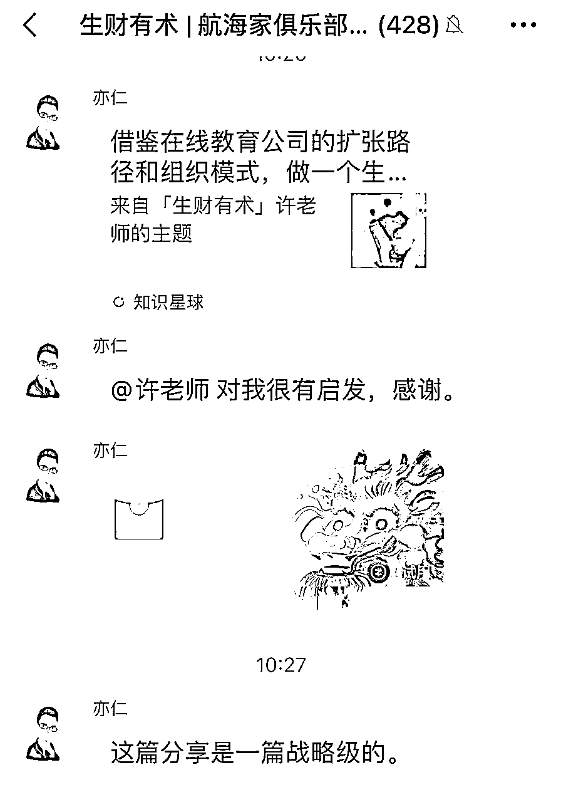

# 从50万到1000万，核桃编程7个月突围，给还在小作坊里打转的创始人3个自检

> 来源：[https://wi1v74w740.feishu.cn/docx/C9u1dBlXzoK4j6xRtmfceGrXnqd](https://wi1v74w740.feishu.cn/docx/C9u1dBlXzoK4j6xRtmfceGrXnqd)

哈喽大家好，我是深耕在线教育七年的许老师。上次写了《借鉴在线教育公司的扩张路径和组织模式，做一个生财商学院，会是个10X战略吗？》，意外拿到精华，还被亦仁老师点赞，也引来不少私聊咨询。

聊下来发现一个很扎心的共性：不少朋友手里其实捏着一座金矿，产品0-1已跑通，月入十万加，口碑在线，账算下来也漂亮。但创始人每天被琐事拽着走，看不到放大的路，或者不敢放大，最后就卡在月入几十万的小作坊里，自我感动。

风投的老话说风口来了猪都能飞，我们也常说没吃过猪肉总见过猪跑。跟我聊的这几个项目，创始人就属于那种没见过猪怎么跑的。我恰好见过两次，跟着两个团队从零做到过亿。

今天就用我当年在核桃编程内部的视角，讲讲它是怎么从月营收50万飙到1000万的。不是复盘八卦，是给同样体量的创始人一些能用的参照。

## 起点和我们几乎一样，都是又小又忙的小作坊

先说个时间题，核桃的月营收从50万拉到1000万，翻了20倍，用了多久？文末揭晓。

2018年初，少儿编程还在早期，西瓜创客已经跑了一年，0-1验证完成，还拿了经纬红杉的钱。核桃晚半年起步，起初明显是借鉴的模式和玩法，录播+微信群运营，0-1也通了，月入十万+，但体量和产品成熟度都落后一代。

2018年3月我加入，是第18号员工，管教研。那时候公司就三四个销售、两个市场、几个产品相关的人、四五个技术外加一个HR兼行政，挤在孵化器里。两个创始人，一个管前端获客销转，一个管后端产品教研。麻雀虽小五脏俱全，但也就是典型的草台班子：创始人冲锋，其他人当助手。没管理、没跨部门，执行力是100%，老板一句话就能落地。

讲这些是想说明，早期谁都一样。决定你能变成正规军还是永远小富即安的，不是起步多光鲜，而是之后的选择。

## 一、先定疯狂目标，再去凑资源，而不是先看看手头有几个人

目标怎么定，直接决定了跑得快不快。

我入职第一个全员会是2018年3月，月营收50万。老板说，5月要做到300万，达成就分100万奖金。当时我心里嘀咕，这饼是不是有点大？结果两个月后如期达标，我也分到了奖池。

庆功会上老板继续放大招，今年10月要做到1000万，达成分500万。当时没人怀疑了。

答案就是，50万到1000万，20倍，核桃只用了不到7个月。

当然有资本加持那会儿的推力，投放可以猛干。但核心启发是反常识的：不要用现有资源去反推一个“安全”的目标，而要用目标倒逼资源。

我们习惯在现有基础上加20%、50%，这在成熟市场可行。可在蓝海，红利窗口很窄，保守的目标等于主动放弃。核桃创始人一开始就定了行业第一，倒推下来：3年后市场100亿，第一名占10%要10亿体量，2年后至少3-5亿，1年后就得过亿。那现在月营收50万时，直接定300万、1000万就顺理成章了。

从50万看1000万，感觉是画饼；从3年10亿倒推回来，就成了必经之路。

当时模型也扛得住：49元体验营转1999元长期课，转化率40%。线索几百块，获客成本约750，销售成本才100多，录播课毛利80%以上。模型一好，正确动作就是放量+扩销售+优化销转。

定下高目标后，全公司都被拉扯：BD要扩几倍，老人要扛更大业绩；流量进来销售招人跟不上，转化波动；人力行政也要跟上节奏，新人没等培训完就上场拿流量；产研要扩容防崩课；教研要加班做课。哪个环节掉链子目标就崩，但正是在高压下组织能力被锤出来了。

手握金矿的创始人，蓝海产品客单五千到一万，交付成本低，周期短，自然流转化5-10%，毛利80%以上，净利也能到70%。问题不是模型不行，是创始人在杂事里出不来。破局就是先定一个看似不可能的目标，再去找人、找流程、找分工把流量、销售、交付拆开。红利期可能只剩几个月，过了就贵十倍。

## 二、把一件事做到极致，别把资源撒胡椒面

目标定了几倍增长，不等于要做几倍的事。

有圈友问我：要不要买量、开社群裂变、转介绍、做体验营活跃社群？我的建议是别碰。先把你现在已经会的那条路打穿。

核桃早期极度聚焦：只做流量-销转的增长飞轮，其它一律不碰。渠道也死磕一个，公众号广告投放。首篇科技号跑通链路后，就猛扩BD团队，全网找号、聊排期、发软文。从垂直编程教育号，到覆盖家长的号，再到泛女性号，把能投的号几乎洗了一遍，做完为止。后期才慢慢加TMK、抖音。

聚焦的好处很实在：公众号红利很大，上限是几十万号，核桃只要吃几万流量就够用；团队手感越来越熟，什么号匹配、什么文案转率高，都变成肌肉记忆，成功率自然上去。

贪多求全，每个渠道放一两个人，最后全是半成品，资源耗散，还错过窗口期。与其每个渠道零敲碎打，不如一招吃透吃满。

现在抖音、视频号、小红书、B站，每个平台天花板都高。有人用抖音直播每月引流一千多人，私聊转化5%，GMV两万五，精力却不到20%。把直播当成有人每场付你两万五来做，把场观从100拉到500，引流放大5倍，转化稍降也能翻三四倍。销转也一样，先把私聊5%的成绩稳定住，等转化掉到3%以下再上体验营这种重模式也不迟。

早期资源有限，找到一个有效渠道单点突破，用一套销转模式持续深耕，专打容易的仗。核桃正是靠集中火力局部压倒竞品，才快速反超。

## 三、产品粗糙时先放大，等体量够了再升级

先优化产品还是先放大流量？这是个经典纠结。

核桃当时的产品只能算60分。孩子在网页上上课，10分钟视频+练习，重复两轮，助教批改。没有客户端，不支持平板，没闭环。更夸张的是课是期货，学生周五上课，我们周四才做完上传。

我是直接开了低年级线，自己写稿做课，每周出一节，市场边卖边做。教研极简但能跑。

如果是传统思路，会先拿投资去打磨产品、招人补教研。但核桃选择了先放大。2018年3到10月，重心全部放在投放和销转扩张上，市场和销售团队扩了好几倍，产品只是保进度。直到月营收到1000万，才启动彻底的产品升级。

新产品一节课6-8分钟动画剧情，知识点切成1-2分钟小块+关卡闯关，游戏化、颗粒度细。一节课研发成本20万，56课时投入超1000万。2019年1月全面推广后，体验碾压对手，市场份额一路冲。

为什么等到1000万才升级？因为重研发需要摊薄。10万学员，摊下来每人100元忽略不计；1万学员，每人1000元，教研成本就占50%，模型直接崩。月营收1000万，每个月新增5000人，一年6万，体量才支撑得起大投入。

所以节奏是：先用粗糙产品验证需求跑通模型，快速放大到能支撑重投入的体量，再用高标准产品卡住竞争对手。没放大时就上重研发，会拖死自己；放大后不升级，会被对手追上。

小作坊的通病是既想放大又怕口碑。核桃的经验是，模型健康的情况下，先放量，再升级。放量过程打磨组织，升级后用体验壁垒收割中期红利。

你有没有想过，一个产品最好状态也许不是100分，而是“刚刚好”？

只要你的产品正在解决真实需求，转化率看得过去，营收也能跑起来，学员反馈没有满屏翻车（零星几条差评其实无伤大雅），那它就值得被市场盖章认可。如果口碑再争气一点，那稳稳站上80分。哪怕你心里觉得它又土又不完美，不重要，市场说行，才是真行。

与其蹲在角落里抠细节，不如把火力转向一件事情：放大规模。

原因很简单——真正驱动产品进化的，不是理想，是现金流。先有销售额，才有余粮反哺产品，才能招更牛的人、做更深的内容，形成“收入提升→研发加码→产品变好→前端转化更强→收入再涨”的增长飞轮。这个飞轮一旦转起来，越滚越大，连带着被带飞。

但偏有人不信邪，非要在营收平平的时候，死磕“完美主义”。看见差评就焦虑，出一点负面就睡不着，把所有精力和预算都砸进产品里，指望口碑发酵、转介绍裂变、学员自动滚雪球。实话讲，这条链路根本不成立，甚至可以说是幻觉。因为即便产品打磨到极致，靠“口口相传”去撑规模，也远比想象中脆弱。

就拿当年和核桃同赛道的某家竞品来说——总共融了2000万，一上来烧掉1000万，几个月时间闭门造车猛磨产品，结果呢？卖不动。窗口期就这样白白错过，弹药也所剩无几，连做投放验证的资本都没有了，最后只能走上被收购的结局，收场黯淡。这故事一点都不魔幻，是曾发生在同一片战场里的真实警钟。

我见过核桃编程从月营收50万跑到1000万的全过程，作为早期成员看清楚了这些选择背后的逻辑。有些赛道看起来冷门，但只要有人在认真做，都是有机会放大的。你手上正在耕耘的蓝海项目，未必比核桃差多少——大环境一般又如何？10倍增长照样可能。从月营收10万到100万，并没有传闻里那么坎坷，不靠资本加持，节奏掌好，创始人为自己腾出手来去做那些高杠杆的事，把小作坊变成正规军，这条路走得通。

当然，每个阶段有每个阶段的坎。从月营收1000万级再往20亿年体量冲，那又是全然不同的挑战——竞争烈度升级、组织复杂度飙升、市场红利期稀缺，这些是后话。但至少第一步，是敢想敢干，先把局面盘活。

亦仁老师在2024年开年寄语里讲得够明白了：“2024年干起来，冲百万，再冲千万。不管外面怎么躺平抱怨觉得没机会，咱们生财人要活成朵朵奇葩，活在他人想象之外——竟然还有这么多人这么赚钱？！”

那就一起，干点能尖叫的事。敢想敢干，活成一朵奇葩，在别人想象之外开得张牙舞爪。

说起我自己，在线教育赛道摸爬滚打了7年，深度参与两家创业公司的从0到1：核桃编程第18号员工，前教研负责人，从月营收50万一路干到年营收8亿；火花编程前学科运营总监&销售团队负责人，从0做到年营收破亿。

眼下，我在生财孵化器和大家一起搞教育培训/IP/知识付费领域的10X赋能计划：[PRE*]https://scys.com/form/z27VzfX3?number=27725&timestamp=1718765135690&signature=11fa91ba14993970298a14a88d0c930c3a97f801

另外我还有两篇沉淀文章，也一并分享出来：《借鉴在线教育公司的扩张路径和组织模式，做一个生财商学院，会是个10X战略吗？（精华）》《怎么从零搭建和管理一个“正规军”的销售团队》。有兴趣的圈友，欢迎一起碰撞。