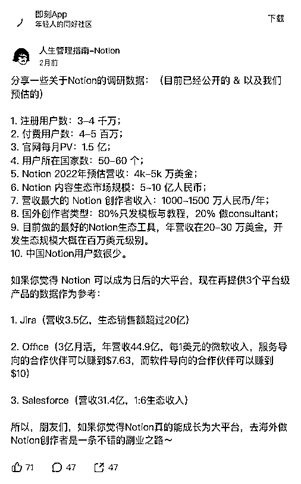
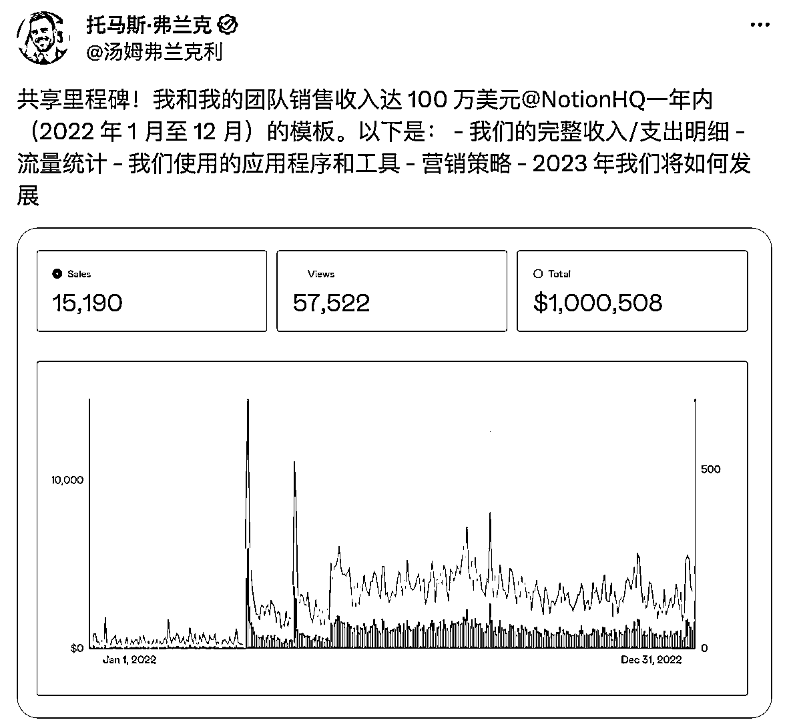
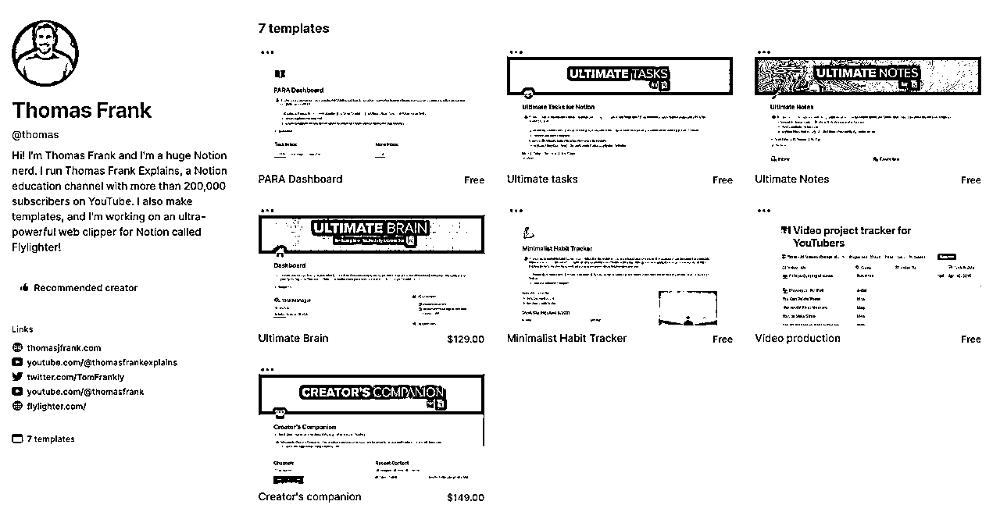
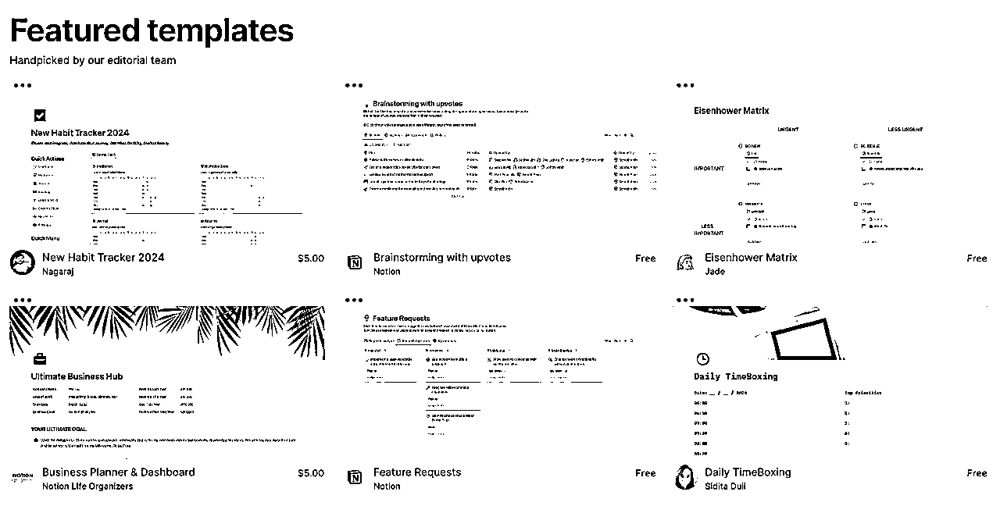
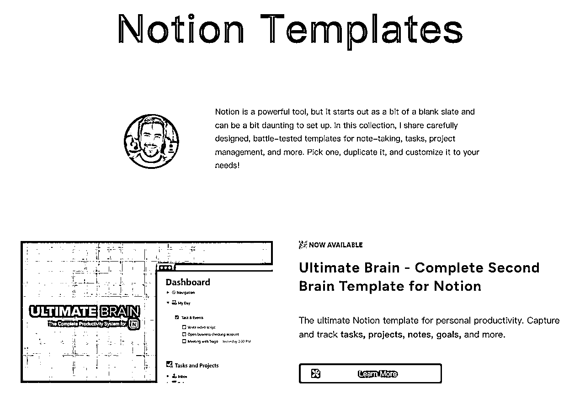
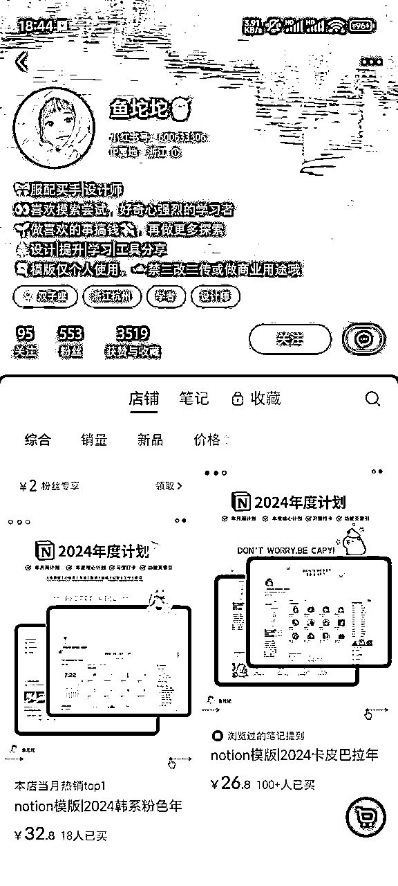
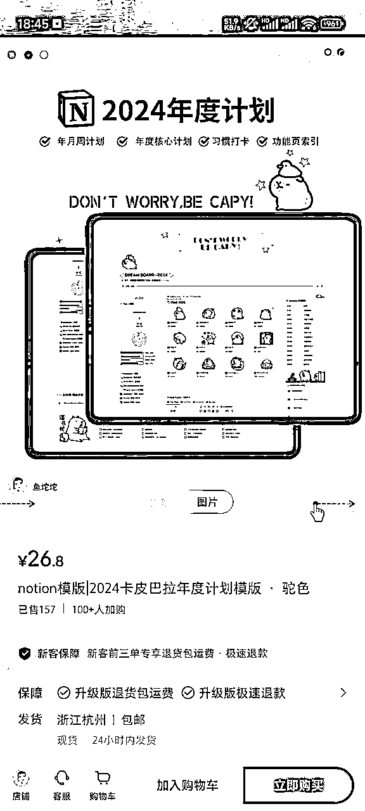

# 风向标拆解第3期 | 一舟：卖 Notion 模板一年做到100万美元，资料整理如何变成可复制的变现生意

生财的伙伴们好，我是一舟。今天给大家拆一个比较硬核的案例：靠卖 Notion 模板，年入 100 万美元是怎么实现的。第一次做这种拆解，难免有不周到的地方，欢迎交流指正。

## 一、先说清楚 Notion 到底是什么

Notion 本质上是一个全能型工作台，把笔记、知识库、数据库、看板、日历这些功能全部揉在一起了。一个人用可以，团队协作也可以。

根据人生管理指南的调研，Notion 现状大概是这样：

1. 注册用户在 3-4 千万左右；
2. 付费用户约 4-5 百万；
3. 官网月度访问量 1.5 亿；
4. 用户分布在 50-60 个国家；
5. 2022 年预计营收 4000-5000 万美金；
6. Notion 内容生态的市场规模约 5-10 亿人民币；
7. 收入最高的 Notion 创作者年入 1000-1500 万人民币；
8. 海外创作者 80% 只做模板和教程，20% 走咨询路线；
9. 目前生态里最成功的工具型项目年营收 20-30 万美金，背后开发规模接近百万美元；
10. 中国用户基数相对偏小。

为什么模板能卖钱？核心就一个字：省事。Notion 功能太全，普通人上手不难，但要玩到精通非常费时间。现成的模板直接套用，既能省掉搭建成本，也能快速体验高级用法，所以愿意付费买时间的用户很多。

至于国内市场为什么没起来，大概也有几个原因。Notion 服务器在海外，国内打开速度不稳定，对速记类场景不友好。国内用户多为个人使用，协作需求弱，付费意愿低。而且 All in One 在国内的痛点不明显，大家更习惯飞书、语雀这类国产工具，和社交生态结合也更顺畅。所以我个人判断，Notion 模板变现，海外比国内更有机会。

## 二、变现的典型案例

最典型的就是 Thomas Frank 了。2022 年整年，他靠卖 Notion 模板就赚到 100 万美元，这不是偶然，是长期深耕的结果。

他从 2010 年起就深耕效率提升赛道，主频道订阅超过 290 万，副频道 Thomas Frank Explains 是全球最大的 Notion 教学频道之一，订阅者超过 17 万。

他的 Notion 模板商店现在只在售两款付费模板，定价 129 美元和 149 美元，其余全部免费引流。

https://www.notion.so/@thomas

## 三、流量从哪来

1）上架 Notion 官方模板市场 https://www.notion.so/templates，官方会根据质量和热度做推荐，是天然的曝光位。

2）做独立站承接。参考 Thomas Frank 的个人网站 https://thomasjfrank.com/，里面既有模板售卖，也有 Notion 培训课程，变现链路更完整。

3）内容平台矩阵分发。比如小红书上我扒到一个账号，共发了 13 条笔记，其中 6 条是早期作品。仅最新 7 条笔记，带来的变现就是 157*26.8=4207 元，效率不低。

## 四、产品怎么做出来

现在小红书上卖得好的 Notion 模板多集中在年度规划、考研规划、手账、财务管理、知识库、旅行规划等方向。卖模板和卖资料的逻辑很像，很多模板里本身就捆绑了资料包。

比如各种长期考试的复习计划，考研、雅思、托福、日语 N1、教师资格证等，用户愿意买现成的规划表，直接照着走。

模板来源也不难。Notion 官方模板库本身就有大量免费素材，覆盖面很广。也可以找同行模板买回来二次加工，再打包售卖。

## 五、利润有多高

模板生意属于典型的做一次反复卖。做好一个模板，后续基本就是净收入，还能做成合集打包提高客单价。至于投流成本，我没法准确判断，因为不清楚小红书账号是否投了广告。

## 六、怎么实操

以小红书为例，玩法相对清晰。

先做垂类账号，只发 Notion 相关内容。封面和选题直接对标头部博主。每天至少更新 2 条图文，可以借助评论引导等动作提升权重。

开通店铺和橱窗后，可以走两条路：一是卖模板合集，质量中等、价格走低、走量，资料包里可以软性植入微信引流私域；二是做定制化模板，视觉更精致、更独一无二，客单价更高。

## 七、结论

综合来看，Notion 模板赛道是可做的。单店月利润大概率在 5K 到 1W 之间，利润率不错，操作门槛低，且模板可以复用。适合想做轻资产、资料整理类变现的同学入手尝试。