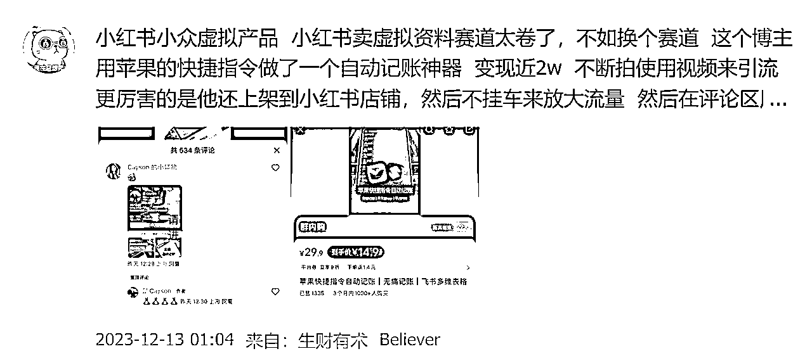
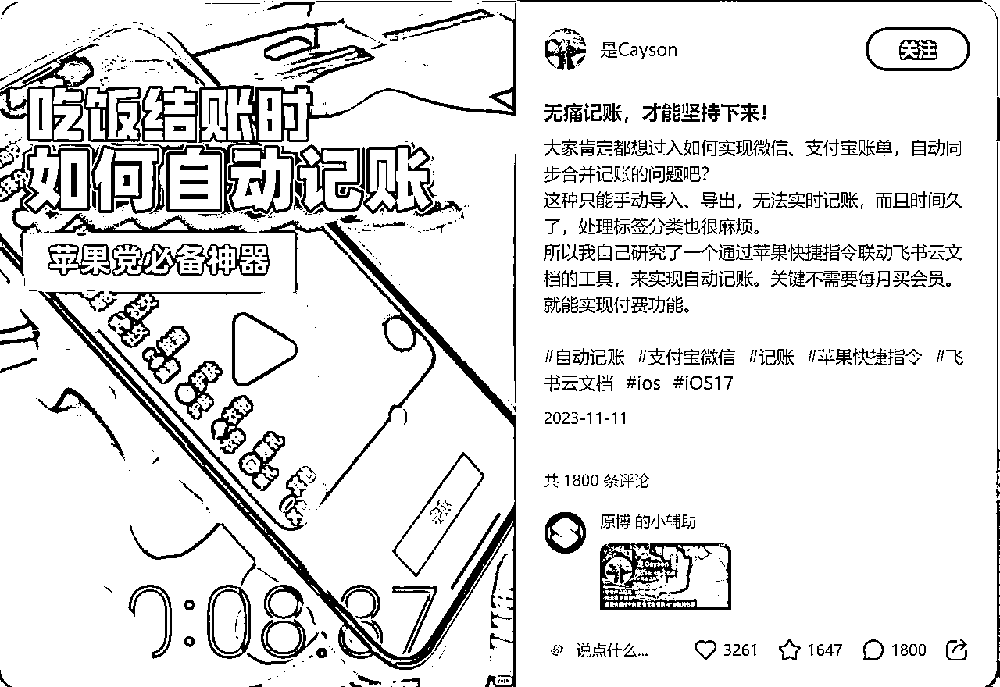
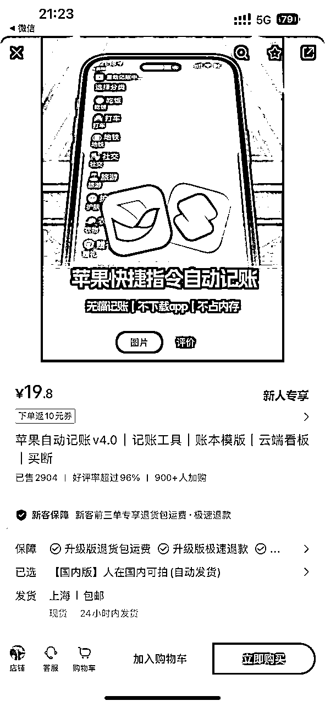
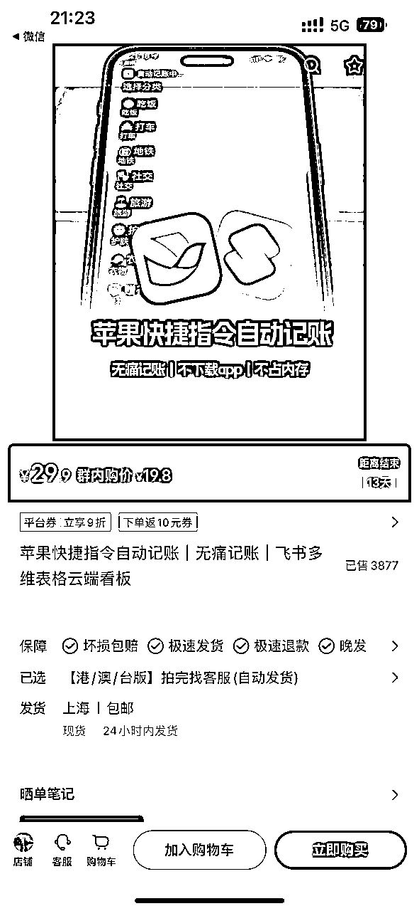
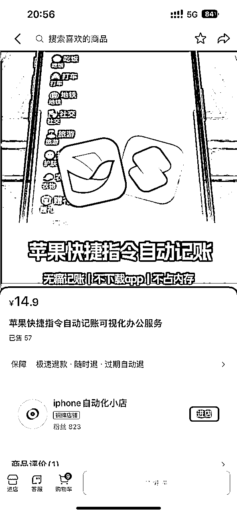
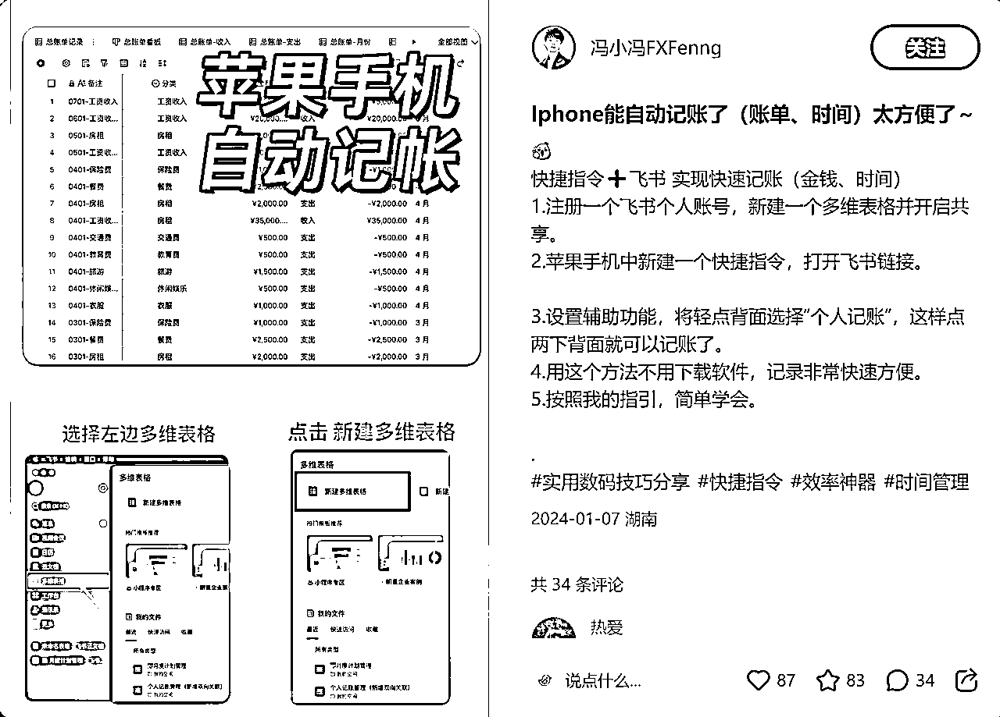
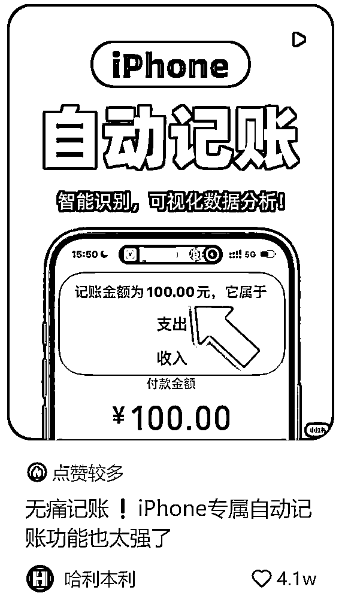

# 风向标拆解第3期：靠“偷懒”变现，一个双击记账快捷指令的赚钱逻辑

# 一、一个靠偷懒卖爆的记账小工具

自动记账快捷指令最早是12月13号出现在星球风向标里，由圈友@believer 提出，反应速度和嗅觉都相当敏锐。这款产品的核心卖点非常简单粗暴：偷懒到极致，只需手机背部双击，就能完成记账，且无需额外下载安装。正是这种极简体验，让它在记账App红海里快速突围。

技术实现上其实门槛很低，核心是苹果自带的快捷指令触发机制，配合轻点背面两下的手势，再搭配飞书多维表格做数据沉淀。具体使用路径是：付款完成后停留在支付页面，双击手机背面，指令自动抓取金额并弹出确认框，核对无误后点完成，再选一个消费类目，整笔记录就存档了。表格还可以做可视化看板，消费频次词云、月度汇总都一目了然，界面也足够干净。

能爆的核心只有一个：双击即记，精准击中了大众既想记账又不想动脑的矛盾心理。这就是产品经理思维的价值，痛点找准了，用户才买单。发布者本身就是大厂产品经理，对用户懒惰心理的拿捏非常到位。

类似的“偷懒型”产品星球里还有，比如圈友之前分享的批量删除微信好友工具。起因也是自己手动删好友删到崩溃，一下午效率极低，调研后发现很多人都有同款烦恼。痛点明确：删到想骂人；付费意愿明确：花小钱买省心。于是产品一上线就有了市场，SOP跑得很通畅。

这两款的共性很明显：开发成本不高，但解决的痛点极清晰，都是把“想偷懒”的需求产品化。

# 二、流量是怎么来的

先看主要阵地📕的数据表现。

作者账号是cayson，19.8元内购价卖出3877份，9.8元档卖出2904份，从11月至今不到4个月流水破10万。

2023-11-05首发视频笔记《终于可以卸载记账app了，这自动云记账很香》点赞1888，后续结合真实吃饭结账场景拍摄的使用演示，点赞直接破3262。爆的原因可以拆解为：

第一，场景化强，代入感足；
第二，流程丝滑，从纸质账单核对、扫码支付、双击弹出、金额确认、完成记账到月度账单展示、可视化界面，全程一镜到底；
第三，评论区留群聊钩子，引导进群；
第四，进群后给内购优惠价；
第五，提供客服一对一指导设置。这一点很关键，抖音上早就有免费教程，但评论区全是“太麻烦了”“不会设置”。用户要的是偷懒，不是学教程。作者把繁琐的设置环节从视频里剥离，由客服兜底，反而转化更高。

目前粗略估算开了至少9个群，每个群400人左右，引流持续增长，每日都有新进群。

总结一下：产品定位是无痛记账，引流载体是📕的图文视频笔记，变现路径是笔记引流进群，群内优惠成交。关键在于用真实使用场景包装“丝滑无痛”的卖点。

抖音这条线则基本没跑通。作品没有爆量，11月之后就停止更新了，应该是平台调性和作者精力分配问题。

# 三、产品到底卖什么

本质上就是苹果快捷指令 + 飞书多维表格的组合方案。📕上这类教程泛滥，核心资产是模板和标准化设置服务。

如果自己不会配置也不用担心，有位作者【哈利本利】已把完整流程公开，并免费提供了快捷指令和 Numbers 表格模板，体验同样流畅。我也已在手机上实操过，区别仅在于他用的是系统自带 Numbers 而非飞书多维表格。该视频传播极快，短短几天点赞就过4万。

# 四、利润测算

按公开销量估算，19.8元档售出4093份，9.8元档售出3150份，合计销售额约111,911.4元。开发成本几乎为零，不需要专业开发团队。人力成本主要是客服，按月薪5000元算，11月至今粗略算下，3个月净利也能稳定在10万左右，月均3万+。基本是零成本启动，高利润率的典型。

📕搜索能看到，1月份新开的账号，几天时间也能卖出几百份，可见模仿门槛极低，红利期还在。

# 五、怎么复刻和放大

这个赛道跑得快胜在手速，模仿成本低，先入为主非常重要。

打法一：做产品销售。提前准备好自己的模板包，矩阵号同时投放，用真实场景拍摄短视频，核心话术围绕“无痛、好用、丝滑”。引流进群后通过优惠价成交，同时用服务差异化做壁垒，标题和形式可以参考已验证的爆款。

打法二：做流量收割。免费送模板做引流，只靠内容快速集圈到私域，后续可做广告或二次变现。目前也有账号在走这个路线，但拍摄质感和丝滑度还有提升空间。

整体来看，这次拆解的核心启示就是：别去卷功能，卷偷懒。把用户不想做的事做成一键完成，就是最直接的商业机会。

### 以上是我个人的复盘视角，第一次拆解难免有遗漏，欢迎交流补足。