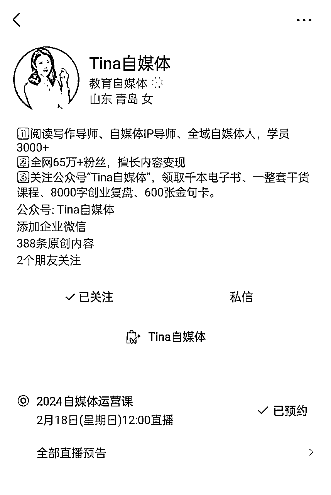
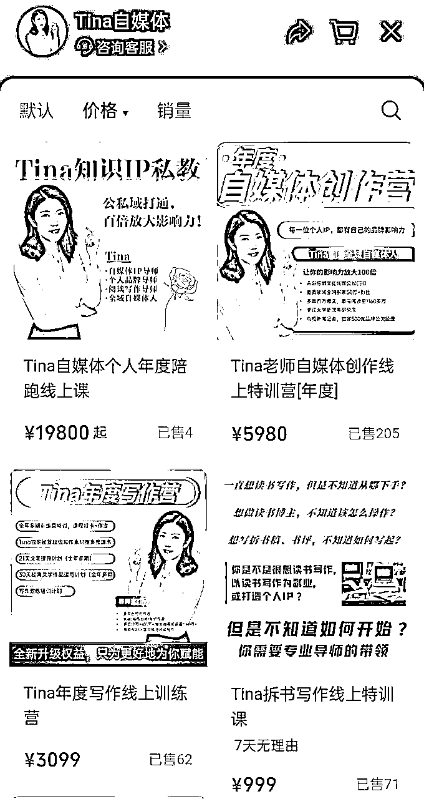
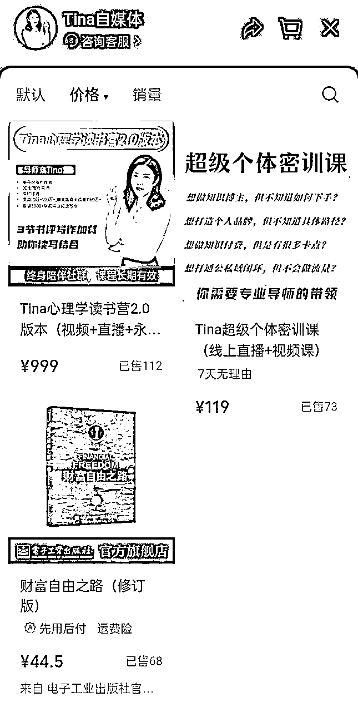
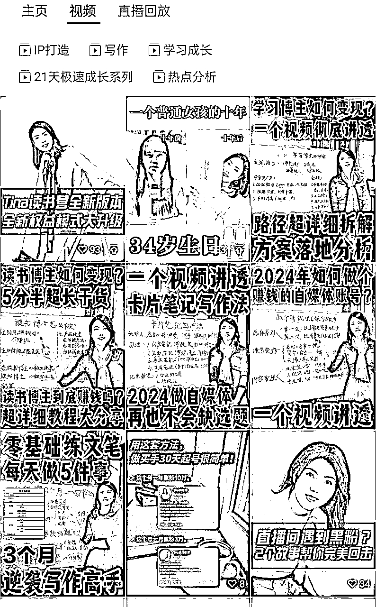
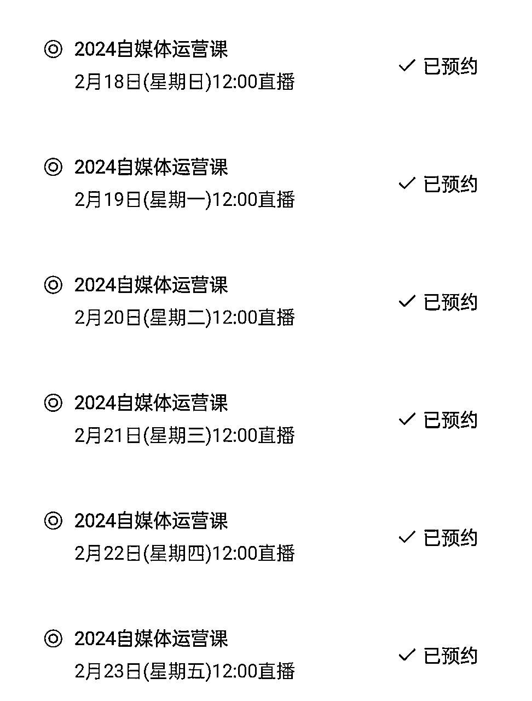
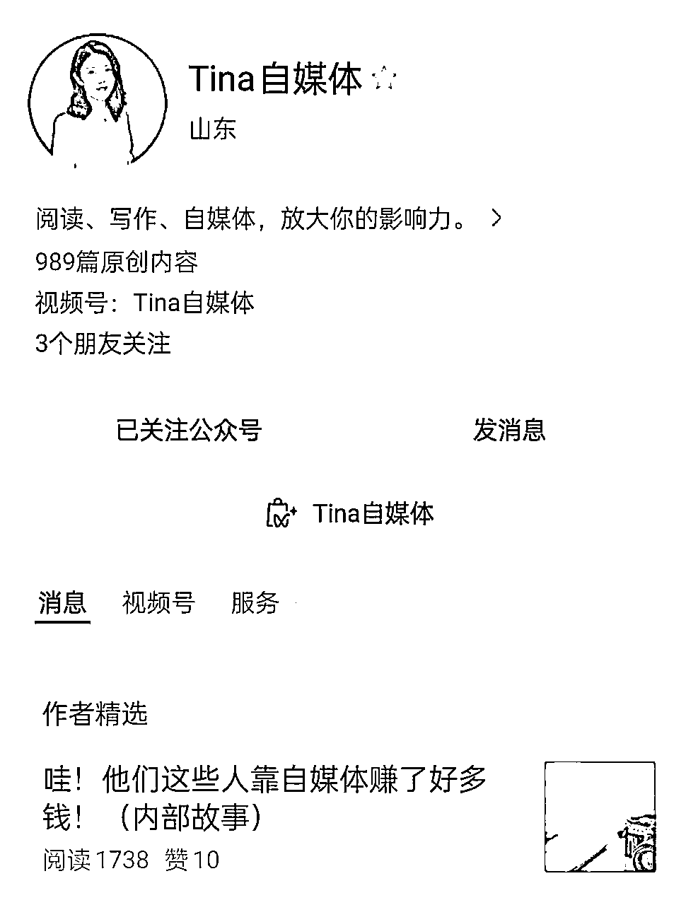
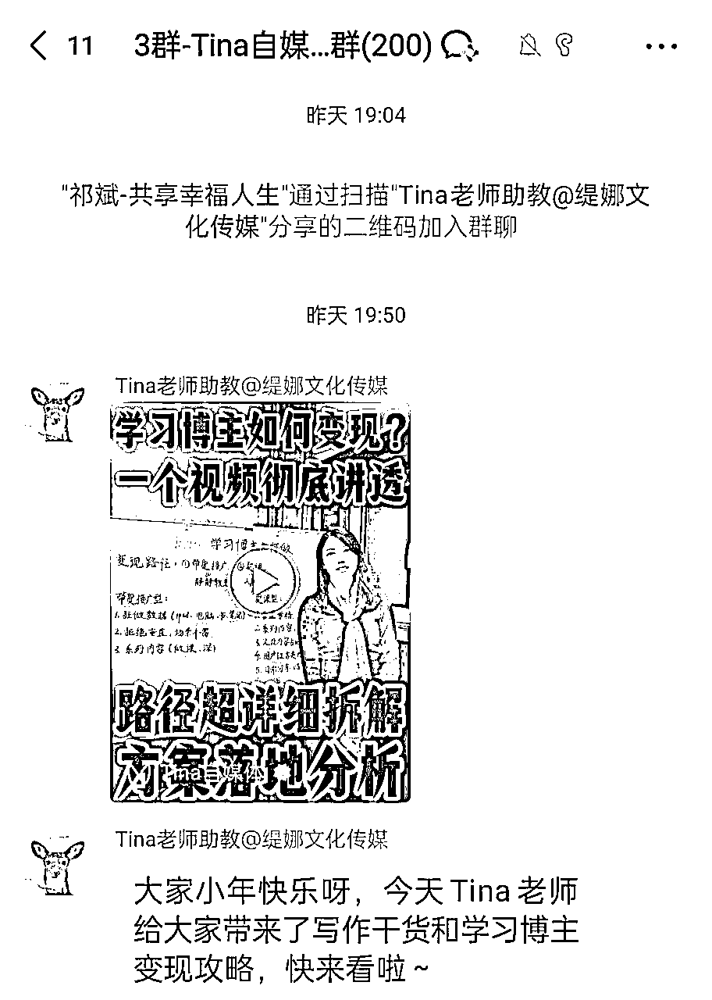
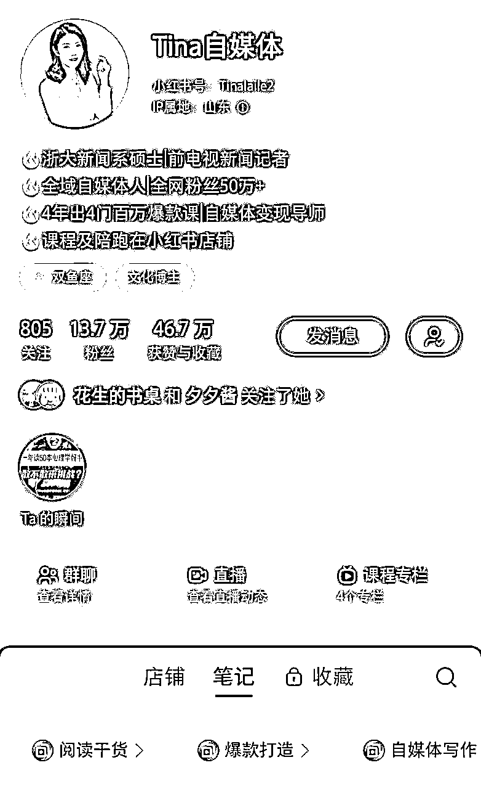
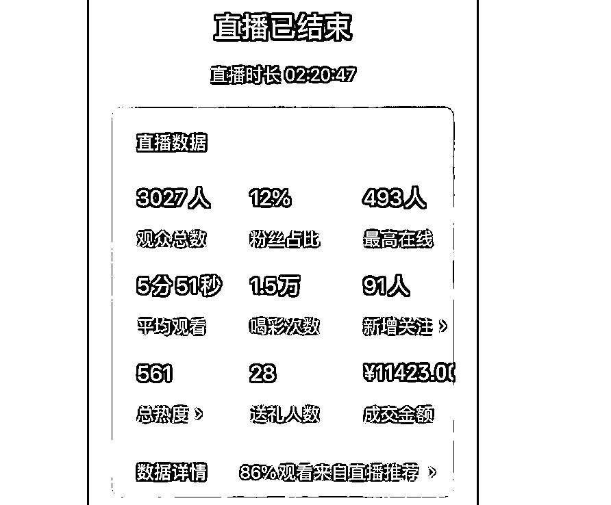

# 视频号卖知识课能爆单的底层打法拆解——以阿翰案例为例

> 来源：[https://opc8tu4qr0.feishu.cn/docx/DPBrdN0QnoxGtUx4U1Xc40wrnqh](https://opc8tu4qr0.feishu.cn/docx/DPBrdN0QnoxGtUx4U1Xc40wrnqh)

# 案例拆解

## 1 账号基本盘

Tina自媒体：主打读书、写作以及自媒体IP孵化方向。

## 2 商品体系是怎么搭建的？

这位博主深耕知识领域已有四五年，自己研发课程。货架上产品不少，定价也都不低。

高客单：自媒体一年期陪跑服务。

中客单：自媒体创作线上课程、写作专项线上课。

低客单：读书营、拆书与写作营、超级个体密训课，以及书籍带货佣金。

## 3 流量该怎么跑？

视频号的免费自然流量：核心是直播带货加短视频种草。

短视频是日更的节奏，并且围绕人设定位做了多个合集沉淀。

直播是硬核坚持，每天中午12点准时开播，历史数据虽未留档。

公众号的免费存量，账号运营已8年，粉丝量级在十万左右。

通过赠送资料的钩子，把用户拉到微信群，后续的文章、视频、直播通知和商品链接都在群里持续触达。

小红书也是重要阵地，主号粉丝十万级，还额外养了一个一万多粉的小号，专注自媒体IP打造内容。

## 4 收益大概什么水平？

这是从她朋友圈扒到的某场直播战报，单场成交过万，原因在于直播间常有限时优惠价。

博主自己说年入七位数，我并无异议。她是多平台在卖课，而且高客单为主。尤其小红书上有十几万粉，客群付费意愿很高。

视频号知识付费店铺累计流水：1688742元

高客单流水：19800x4=79200

中客单流水：5980X205+3099X62=1418038

低客单流水：999X71+999X112+119X73=191504

扣除成本后，剩下的是平台抽成、助理人力以及少量投流费用。

## 5 怎么复制？怎么做大？

### 1）起步该怎么做？
先用读书、写作练出稳定的内容输出能力，把作品公开发在各平台攒人。等粉丝给出明确需求后，再把需求产品化成付费课。

本质是：用内容换信任，用信任在直播间转化自己的课程。

### 2）怎么放大规模？
多平台联动运营，本案例博主就是典型。

矩阵化布局，我在平台上查到她不只运营一个账号。

适度付费推广，她本人也透露直播时会偶尔加投流助推。

## 6 最终判断

赚钱是真的，门槛也不低。最核心是要有过硬的内容创作力，直播间才能留住人。

同时，你得会做课、会带营，懂产品化。没有这两项，转化无从谈起。

这种模式不适合零基础新手上手，建议先把一项核心能力练出来再说。