有些店表面粉丝不多，背地里却闷声卖了几十万单。这期风向标拆解，我随手挑了一个小红书上已经卖了50多万件的光腿神器店铺，想看看它到底是怎么赚钱的。

大家好，我是湉湉（佃佃）。这次参加第三期风向标活动，没有刻意找选题，纯粹想验证一件事：哪怕随机选一个类目，也能把店铺的变现逻辑看明白，帮圈友少踩坑。

先看赛道。穿搭类目的达人数量已经很大，5万粉以下的账号接近9万个，1万粉以下的素人有6.5万个。竞争确实激烈，但做电商依然可行；如果想稳一点，可以从大赛道里切细分单品，比如衬衣、打底裤。总体来说，我还是很看好小红书电商。

从大盘数据来看，女装里的细分赛道潜力很足。小红书女性用户占比高，而裤子赛道里做打底裤的人相对较少，所以上升空间很明显。唯一要提前接受的，就是它受季节影响很大。

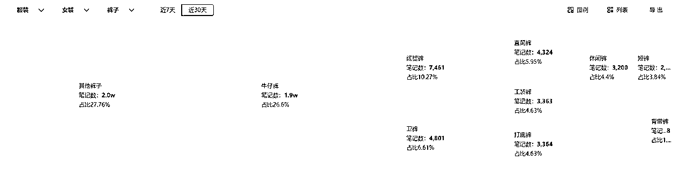
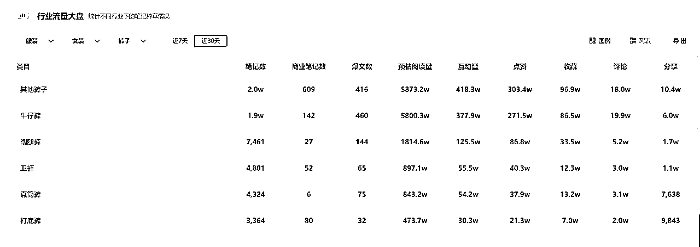

这次拆解的目标店铺叫“钱与书光腿神器”，申请了蓝V认证，同时还通过了服装经销商认证。

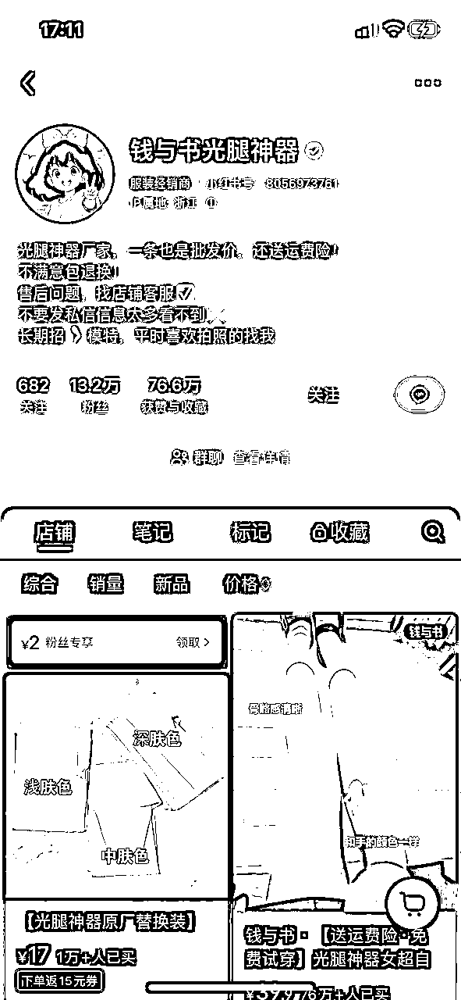
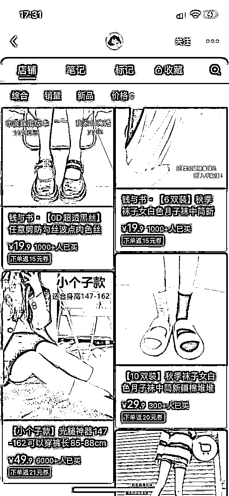

账号ID是“钱与书光腿神器5”，粉丝只有1.5w，笔记176篇，赞藏总数14.8w。赛道属于穿搭-服饰，主卖打底裤/光腿神器，价格在17-49.9元之间。店铺里销量最高的一款单品已经卖了超过76万件。用户画像方面，女性占了97%，主力年龄是18-24岁，活跃时间集中在晚上11点左右；粉丝地域前三名分别是广东（12.90%）、山东（8.30%）、河南（7.30%）。

再看销售数据。近一周店铺卖出3万件，近半个月卖出10万件，15天里平均每天3000多单。截止到目前，店铺累计卖出约80万单，总销售额3000多万，利润少说也有一千万。这份成绩单非常亮眼，明显是吃到了平台红利。

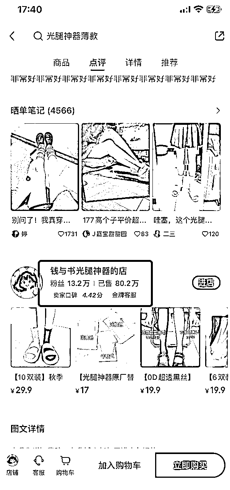

这个号从2023年11月13日开始发笔记，整体策略是视频为主、图文为辅，视频笔记占到75%，爆文率5.5%。秋冬正好是光腿神器的应季节点，笔记也更容易出圈。第一条爆款笔记出现在11月30日，同时店铺关联了4位达人，涨粉速度和转化效率都很高，最高单品出了76.1万单。开店三个多月，整体销量就到了80万单。

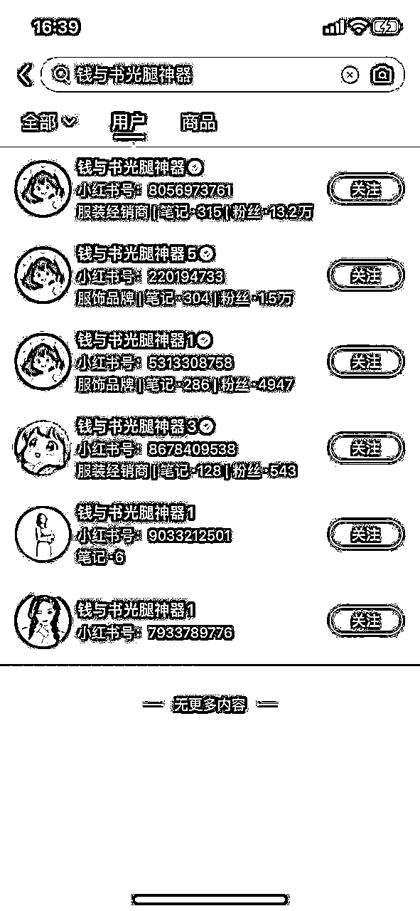
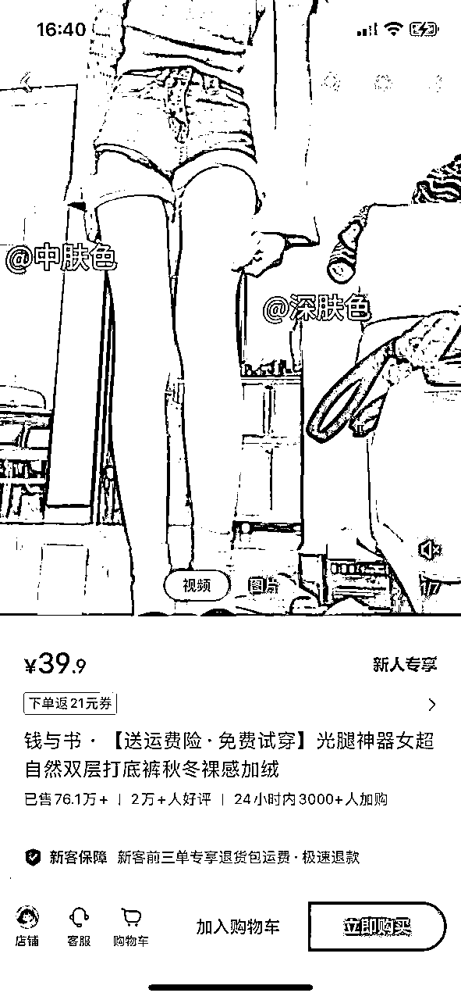

店铺一共上架了7个商品，卖得最好的是39.9元的光腿神器。详情页采用视频+图文的组合，并不需要多精致的页面，也不要求风格跟产品高度契合，核心就三个词：真实、详细、把亮点讲清楚。

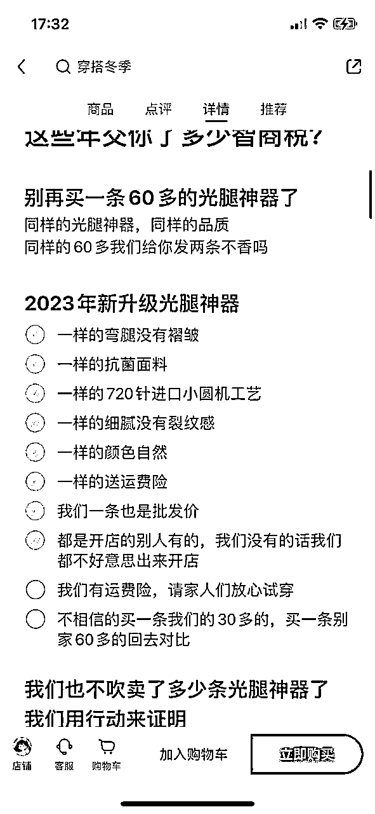
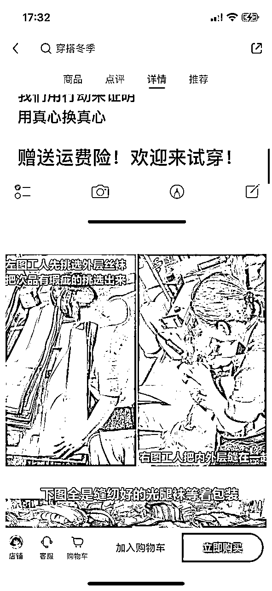
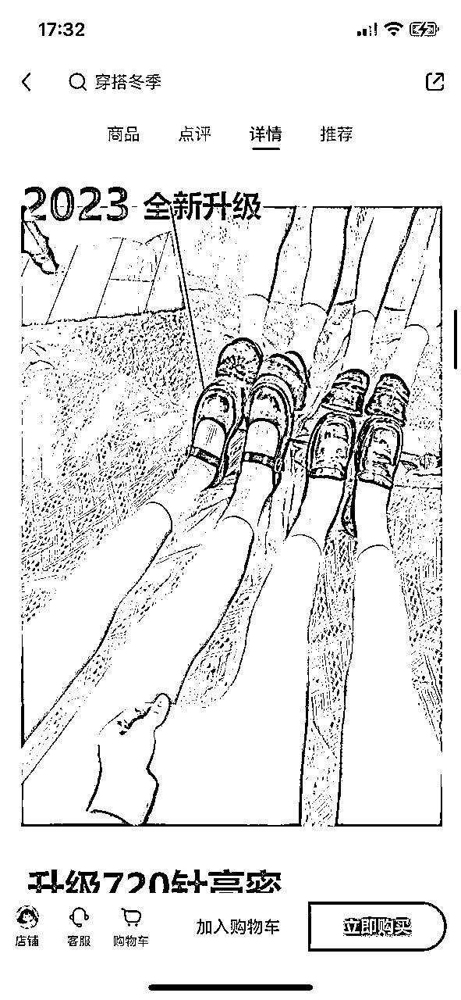

从建号到现在，笔记里的高频词基本集中在穿搭、时尚、光腿神器、平价好物、测评、显腿长这些。

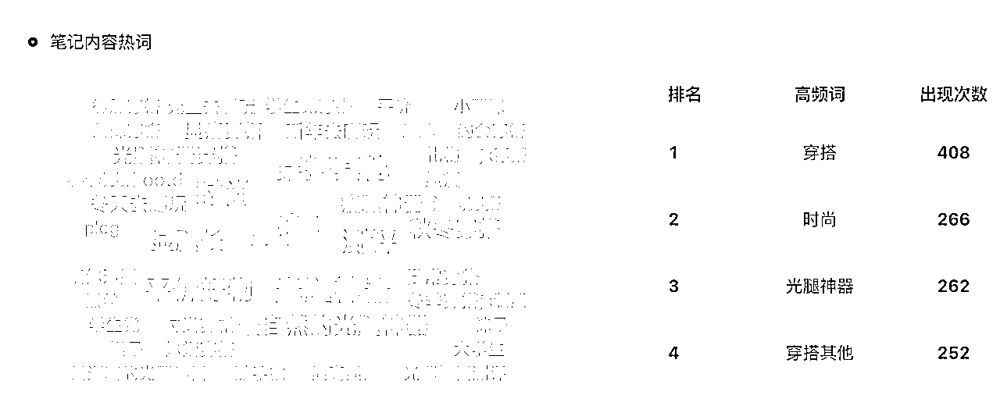

从后台数据来看，店铺矩阵共关联了4个账号，最近3个月有3天出现了爆文。那篇爆款笔记出现在2023年11月的秋冬季，发布后直接把接下来半个月的流量都带旺了；到了12月初和12月末，又各自出了一篇爆文。

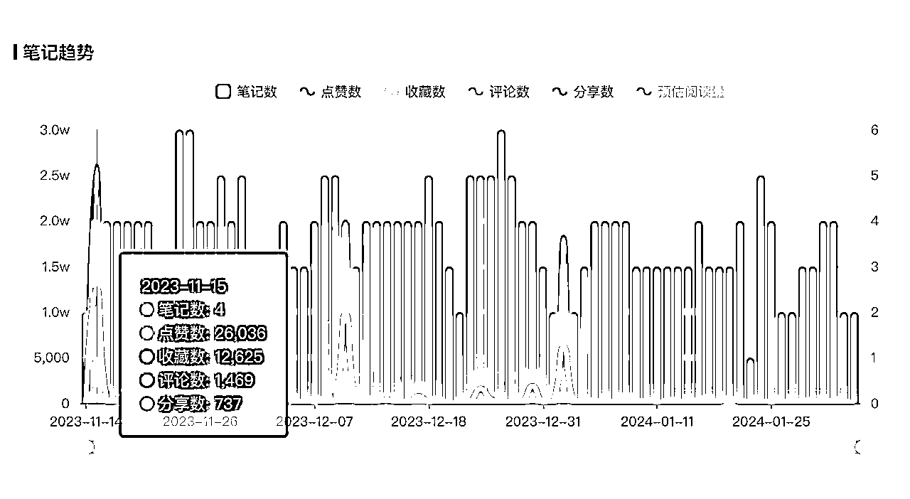

接着拆这家店的流量密码。

先说店铺包装。厂家人设立得很扎实，主打低价、高性价比。因为做的是服装类目，店铺特意设置运费险，也就是告诉用户：不合身、有质量问题，随时退。这个动作很好地打到了痛点，让东西更好卖，但售后成本必须算进账里。

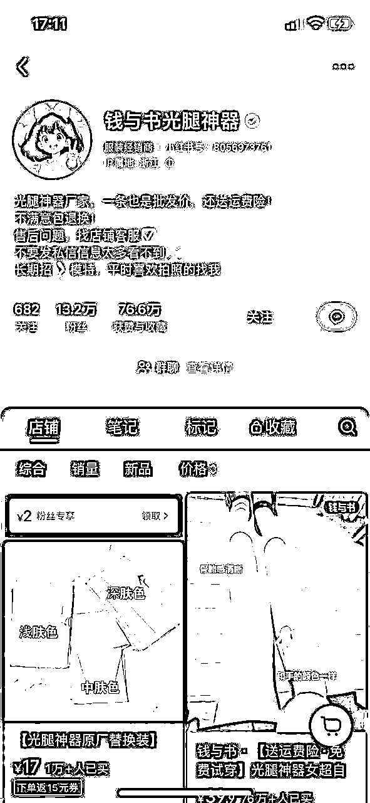

再聊内容选题。每篇爆款笔记都是视频，视频的核心不是“美”而是“真”，重点解决假白、不自然、太贵、质量问题、没有售后这些真实痛点。值得一提的是，视频里的模特并不是店主本人，而是小红书上找来的真实用户。这种做法一举多得：用户免费拿到一条打底裤，店铺获得大量真实素材和免费宣传，还能拿这些内容继续发布。

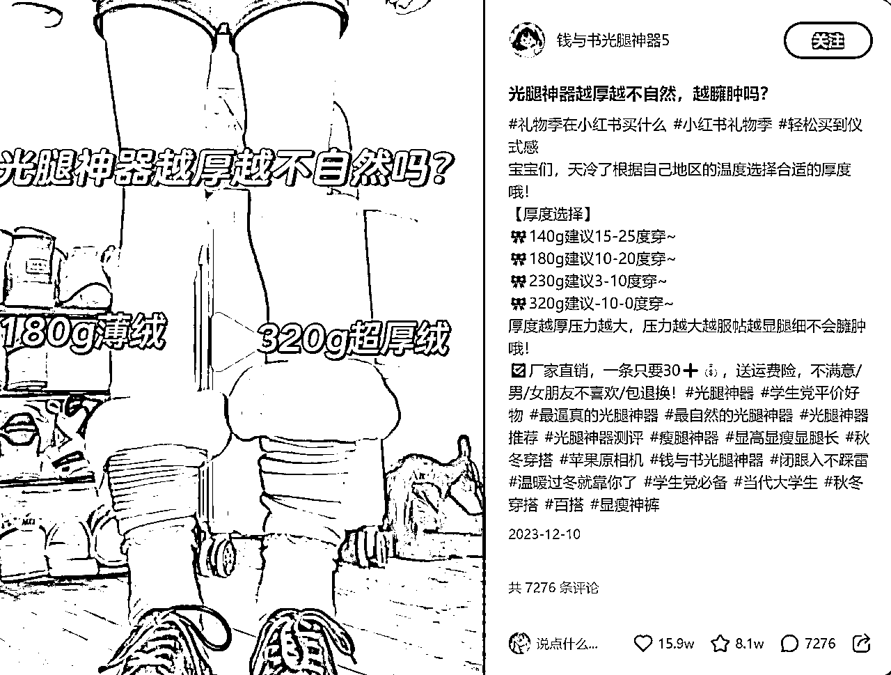
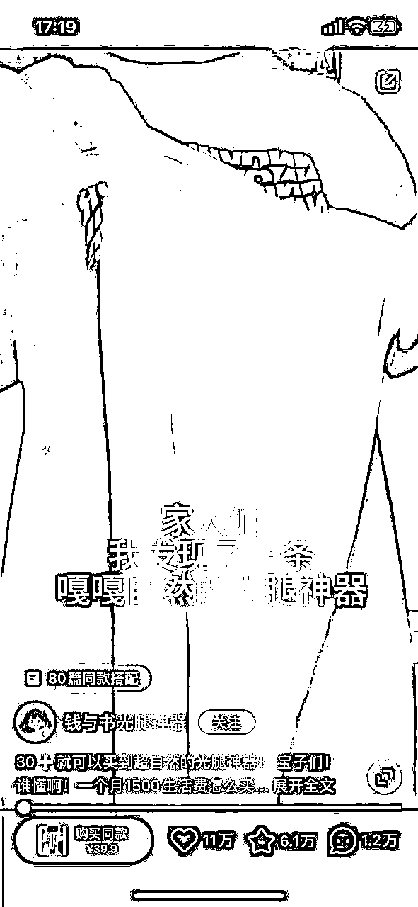
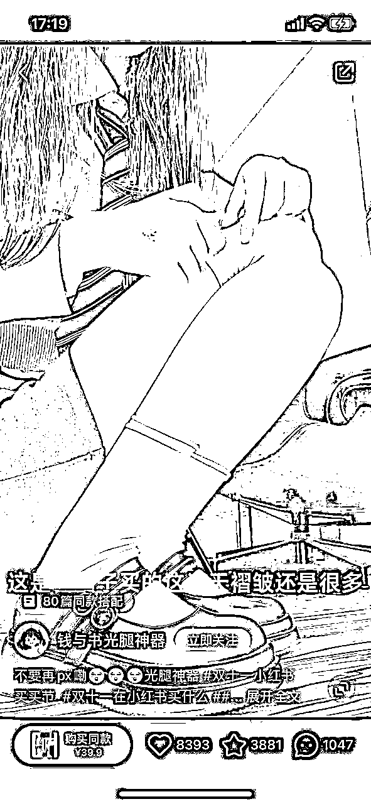
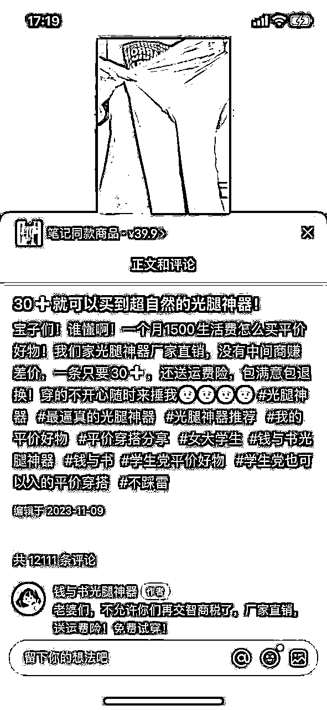

视频笔记也很有讲究。穿搭类产品本来就需要用视频展示，测评+对比是常见姿势。另外店铺设置了优惠券，新用户关注就能领。同时，店铺鼓励用户写晒单笔记，用真实口碑去带动更多销量。

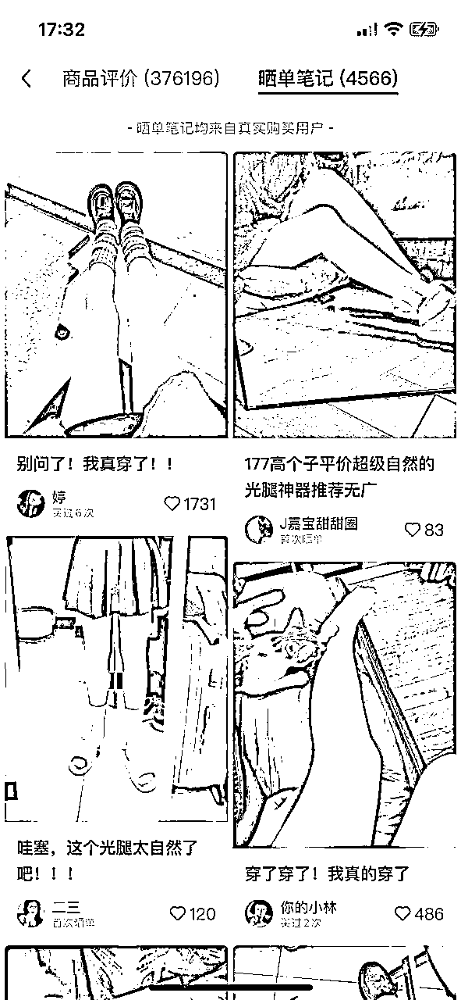

再来看一条最典型的爆款笔记。

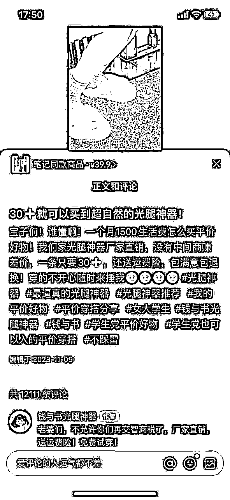
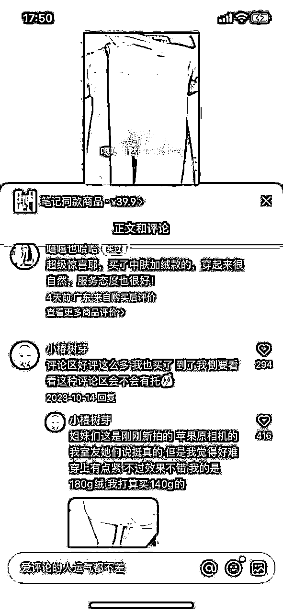
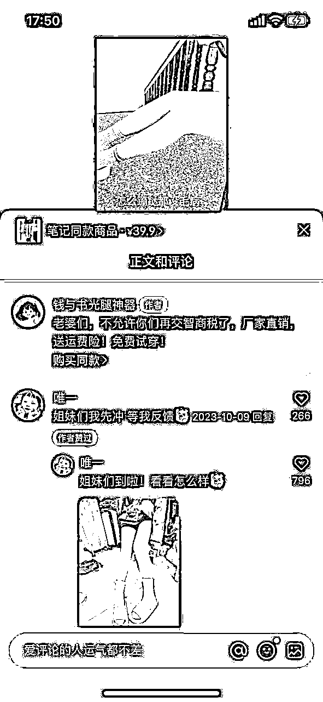

标题大意是“三十多块就能买到超自然的光腿神器”。正文用了女大学生的口吻，说自己一个月1500元生活费也能买到平价好物，强调厂家直销、没有中间商，一条只要30多元，还送运费险，包满意包退换，甚至放话“穿得不开心随时来找我”。笔记形式是28秒的视频，全程试穿，但不是同一个主播，而是把多段素材混剪到一起，从直接展示到蹲下、拉扯、伸腿、蹦跶，多角度来呈现。视频文案大概围绕这几个点：弹性很好、双层设计、怎么动都自然、蹲下也没褶皱，像拉自己的皮一样服帖，关节处骨骼轮廓清晰，随便蹦跶都没问题，对比效果也很水润。

从用户痛点来看，大家在乎的其实就是自然、轻薄、亲肤、不起皱，同时还要平价、性价比高、不踩雷、不掉档，最好有售后保障、足够真实。

最后总结几个能直接复用的经验。

一、服饰穿搭类的内容建议以视频为主，图文很难把产品优势展示出来。细分赛道确实有机会，但季节性是无法回避的短板。比如“钱与书光腿神器”最近流量降温，主因就是季节变了。

二、视频可以做成混剪，但别整段照搬下载，这样很容易被判违规；比较稳妥的做法是加入自己拍摄的素材，既能留住用户，也能降低违规风险。

三、标题和文案要紧扣主打人群的特点，围绕他们的痛点提炼关键词；表达方式也别太生硬，最好用目标人群喜欢的语气。

四、店铺装修要从立人设开始。新店不建议一上来就做高客单价，先用流量款测一测市场反应。

五、做服饰鞋履类目，强烈建议带运费险，确实会更好卖。如果想把售后做到极致，可以单独发一条帖子，把所有常见售后问题都写明，有人问就直接发给她。

六、优惠券可以设置，但一定要先算清利润空间，如果毛利率不到20%，真的没必要做。

以上就是这期拆解的全部内容，希望能给你们一些启发。