# Sora深度解析：OpenAI扔出的这枚“视频核弹”，到底炸出了什么？

大概一周前，OpenAI默默放出了文生视频模型Sora的训练成果，整个科技圈又是一场大地震。

朋友圈先是被卡兹克那篇爆文刷了屏，紧跟着“红衣教主”周鸿祎也出来站台点评，各路报道铺天盖地。说实话，我第一眼看完Sora的样片，脑子里只蹦出三个字：太强了。这绝对又是一个足以写进AI编年史的划时代产品。而且我体感上，这次的热度甚至比当初GPT发布那会儿还要猛。但刷了一圈市面上的解读，说实话大多讲得云里雾里，越看越糊涂。于是我自己翻遍了OpenAI官方技术文档，加上各路大神的拆解，写了这篇尽量说人话的深度解析。

这篇会聊五件事：

1. Sora凭什么比Runway、Pika高出一个时代？
2. 文生视频赛道现在到底什么格局？各家技术路线差在哪？
3. Sora生成视频的底层逻辑是什么？它强在哪，又弱在哪？
4. Sora对视频行业会带来多大的冲击？
5. 里面藏着哪些值得普通人抓住的赚钱机会？

# 一、Sora为什么是“另一个物种”？

别整那些虚头巴脑的技术参数，我们就拿市面上公认最强的几家产品——Sora、Runway、Pika，把他们的示例视频放在一起对比。

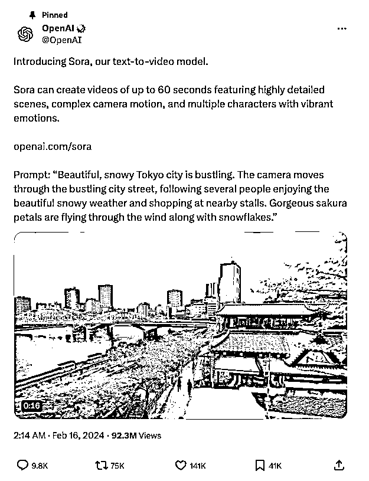

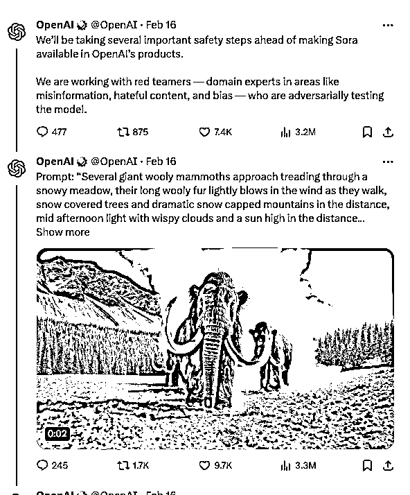

光看“真实感”这一个维度，差距就已经是肉眼可见的降维打击。

Sora给出的样片，如果你不告诉我这是AI生成的，我大概率会觉得是哪部电影的实拍片段。无论是光影、材质还是物体运动，都细腻得可怕。

反过来看Runway和Pika，目前的成片水平还停留在“一眼假”的阶段，跟Sora完全不是一个时代的产物。Runway的官方推文下面，更是直接被吃瓜群众用Sora的样片狠狠“处刑”。

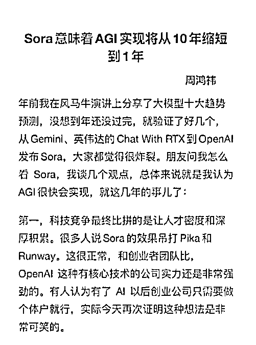

## Sora到底赢在哪三点？

### 第一，它能一口气生成60秒的视频。

现在Runway、Pika的单次生成上限只有3到4秒，而Sora直接拉到60秒。什么概念？别人还在费力凑一个短视频镜头，Sora已经能直接产出一条完整叙事片段了。

Prompt: A stylish woman walks down a Tokyo street filled with warm glowing neon and animated city signage. She wears a black leather jacket, a long red dress, and black boots, and carries a black purse. She wears sunglasses and red lipstick. She walks confidently and casually. The street is damp and reflective, creating a mirror effect of the colorful lights. Many pedestrians walk about.

提示：一位时尚女性走在充满温暖发光霓虹和动态城市标识的东京街道上。她穿着黑色皮夹克、长红色连衣裙和黑色靴子，手持黑色手提包。她戴着墨镜和红色口红。她自信而随意地走着。街道潮湿且反光，创造出彩色灯光的镜面效果。许多行人在周围走动。

### 第二，同一个视频里能实现多角度切换。

你们平时刷抖音口播号，基本都是单机位一镜到底。但Sora生成的视频，可以像影视剧一样在多个机位之间切换。

拿经典喜剧《夏洛特烦恼》里王老师的片段来类比：单角度就是抖音口播，多角度才是真正的影视语言。如果Runway和Pika是单机位口播，那Sora就是多机位电影级制作。这中间的差距，好比一张60分的卷子和一张1000分的卷子，可能还不止。

### 第三，它好像真的“理解”了这个世界。

现实世界充满物理规律。AI要生成足够拟真的视频，就得遵守这些规律：汽车开过会扬起尘土，海边有潮起潮落。

Sora通过海量视频的学习，似乎内化了一套关于世界的“常识”。它见过海边的潮汐，就能生成逼真的潮汐；见过车后的烟尘，就能模拟烟尘。这是一种习得性的逻辑——凡是它见过的真实世界的运行方式，它都有模有样地模仿出来。

说白了，Sora正在尝试用视频数据构建一个“世界模型”，它开始理解这个世界了。

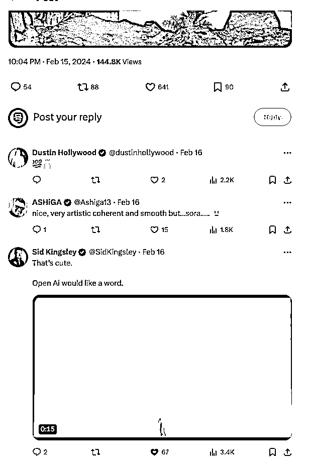

# 二、文生视频赛道，到底卡在哪？

聊Sora之前，先快速盘一下AIGC（人工智能生成内容）这两年最火的方向。跟普通人关系最紧密的，主要有五条赛道：

1. **文生文**：用AI生成新闻、小说、代码，代表产品ChatGPT、Claude、Kimi、智谱。目前已经有不少成熟的商业产品。
2. **文生图**：把文字描述变成图像，代表产品DALL-E、Stable Diffusion、Midjourney。商用产品同样很成熟。
3. **音频生成**：文字转语音或音乐，代表产品Google的Text-to-Music、开源项目Coqui TTS。
4. **数字人**：创造逼真的虚拟角色，代表产品DID、Heygen、硅基智能、风平智能。也有不少商用落地。
5. **文生视频**：用文字直接生成动态画面。这个领域目前还处在非常早期的阶段，市面上只有Runway和Pika勉强能打，而Sora的出现，算是给这个赛道投下了一颗真正的核弹。目前几乎还没有好用的商用产品。

从技术实现难度来看，文生视频可以说是五个方向里最难啃的硬骨头。所以那句结论依然成立：不是Runway和Pika太菜，是Sora太强了。

## 技术路线之争：Diffusion Model vs Diffusion Transformer

Runway和Pika走的是Diffusion Model（扩散模型）路线，而Sora用的是Diffusion Transformer（扩散变换器）路线。

为了把这俩区别讲明白，我专门去召唤了Kimi，让它给我编了个通俗易懂的比喻：

想象有一位艺术家，想创作一幅画。

**Diffusion Model（扩散模型）** 的创作方式是这样的：艺术家面前只有一张白纸，这代表初始状态，也就是高斯噪声。他开始往纸上滴颜料，颜料逐渐晕开，最后变成一幅复杂的画作。当他想再创作一幅新画时，他必须逆向操作：从完成的作品开始，一点一点把颜料移除，回到最初的白纸状态。这要求他记住颜料是怎么扩散的，然后一步步反推。这个反推过程很慢，需要非常仔细地观察和模拟。

**Diffusion Transformer（扩散变换器）** 则像是给艺术家配了一支“智能画笔”。这支画笔能记住颜料在纸上的扩散模式，而且可以快速在不同区域之间传递信息，让艺术家瞬间理解整幅画的结构和细节。再创作新画时，智能画笔可以同时处理画面的多个部分，而不是一个点一个点地磨。所以它既能保持高质量，又能大幅提升效率。

Sora和Runway/Pika最本质的差距，就是Transformer结构赋予了Sora对世界更强的“理解力”。

# 三、Sora的能力到底有多强？

OpenAI官方发布了多篇关于Sora的论文，其中那篇《Video generation models as world simulators》是核心。我基于官方资料，帮大家一条条拆解。

## 3.1 一句话定义Sora

Sora是一个能根据一段文字指令，创造出既逼真又充满想象力的视频场景的AI模型。OpenAI正在尝试教AI理解和模拟动态物理世界，最终目标是训练出能帮助人类解决现实世界交互问题的模型。

### 能力一：一分钟长视频 + 严格遵循提示词

OpenAI原文的第一句话就叫我很震惊：“Sora可以生成长达一分钟的视频，同时保持视觉质量和对用户提示词的遵循。”

看到“遵循用户提示词”这半句时，我一开始有点懵。这不是一个模型应该具备的基本素养吗？后来我去翻了它的提示词和生成视频的逐帧对比，才发现Sora是真的把提示词里的每一个点都还原出来了。

它对文本和视频内容都有极深的理解，并且拥有非常强的跨模态映射能力。这种“指哪打哪”的遵循能力，恰恰是它世界模型强大的直接证明。

Prompt: Several giant wooly mammoths approach treading through a snowy meadow, their long wooly fur lightly blows in the wind as they walk, snow covered trees and dramatic snow capped mountains in the distance, mid afternoon light with wispy clouds and a sun high in the distance creates a warm glow, the low camera view is stunning capturing the large furry mammal with beautiful photography, depth of field.

几只巨大的长毛猛犸象正踏步穿过一片雪地，它们长长的羊毛状皮毛在行走时随风轻轻飘动。远处是被雪覆盖的树木和壮观的雪顶山脉，在午后的阳光下，天空中的薄云和高悬的太阳营造出温暖的光辉。低角度的摄像机视角令人惊叹，捕捉到了这些大型毛茸茸的哺乳动物，呈现出美丽的摄影作品和景深效果。

Prompt: Animated scene features a close-up of a short fluffy monster kneeling beside a melting red candle. The art style is 3D and realistic, with a focus on lighting and texture. The mood of the painting is one of wonder and curiosity, as the monster gazes at the flame with wide eyes and open mouth. Its pose and expression convey a sense of innocence and playfulness, as if it is exploring the world around it for the first time. The use of warm colors and dramatic lighting further enhances the cozy atmosphere of the image.

动画场景特写一个短毛茸茸的怪物跪在一支融化的红色蜡烛旁边。艺术风格是3D且逼真的，重点在于光影和质感。画面的氛围充满了惊奇和好奇，因为怪物用大眼睛和张开的嘴巴凝视着火焰。它的姿势和表情传达出一种天真和俏皮的感觉，就像它第一次探索周围的世界一样。温暖的色彩和戏剧性的照明进一步增强了图像的舒适氛围。

Prompt: A young man at his 20s is sitting on a piece of cloud in the sky, reading a book.

一个20多岁的年轻人正坐在天空中的一片云朵上阅读一本书。

### 能力二：复杂场景 + 多角色 + 物理世界理解

Sora能生成包含多个角色、特定动作类型和精准细节的复杂场景。注意，它不仅能听懂提示词，还能理解这些事物在物理世界中的存在方式。

比如那组著名的“老式电视机”案例：一堆电视同时播放着不同的节目，每台屏幕上的画面都是独立且完整的，这说明Sora具备极强的并行生成能力。

Prompt: The camera rotates around a large stack of vintage televisions all showing different programs — 1950s sci-fi movies, horror movies, news, static, a 1970s sitcom, etc, set inside a large New York museum gallery.

摄像机围绕一堆大型复古电视机旋转，这些电视机上播放着不同的节目——1950年代的科幻电影、恐怖电影、新闻、静态画面、1970年代的情景喜剧等，场景设定在纽约一家大型博物馆的画廊内。

### 能力三：深刻语言理解 + 多镜头一致性

Sora对语言文字有深刻理解，能准确解析提示词，生成有情感、会表演的生动角色。它还能在同一个生成视频里呈现多个镜头，同时非常精准地保持角色形象和视觉风格的一致性。

关于多镜头，文章开头已经展示过了。这里分享一个让我起鸡皮嘎达的案例：

Prompt: A cat waking up its sleeping owner demanding breakfast. The owner tries to ignore the cat, but the cat tries new tactics and finally the owner pulls out a secret stash of treats from under the pillow to hold the cat off a little longer.

一只猫唤醒它的熟睡主人要求吃早餐。主人试图忽略猫，但猫尝试新的策略，最终主人从枕头下拿出一个秘密的零食储藏来暂时安抚猫。

虽然那只猫最后好像没吃到罐头，哈哈。但就这么简简单单一句提示词，Sora居然能生成出“猫叫醒主人、主人装睡、猫换招、主人掏零食”这么完整的剧情闭环。这种复杂度，我只能说：世界模型，恐怖如斯。

### 能力四：它也有明显的短板

OpenAI官方也承认，Sora目前存在明显弱点。它在准确模拟复杂场景的物理规律时可能会翻车，也可能抓不住某些特定因果关系的具体实例。

这就牵扯到Sora世界模型的一个关键特征——它的“世界理解”是不可控的。它能模拟人跑步，但可能让人倒着跑；它能创造眼前的真实感，但并不能保证每一次都符合现实逻辑。具体案例，我放到下面的“不足”部分详细说。

## 3.2 Sora是怎么把文字变成视频的？

看了Sora论文之后，我最大的感受是：这玩意儿本质上就是“视频版的ChatGPT”。

ChatGPT用的是Transformer深度学习架构，本质是文生文的产品。它通过学习海量文本数据，预测下一个词是什么。这个最小单位叫Token。

Sora的逻辑几乎一模一样：它把视频压缩成一个个小块，这些小块被称为“视觉块”（Patch），每个Patch就相当于GPT里的一个Token。

原文的流程是这样的：Sora先从一个看起来像静态噪声的视频开始，然后一步步去除噪声，最终生成清晰视频——这是扩散模型的底层框架。同时，它借助Transformer架构，获得了强大的扩展性能。

所以整体来看：GPT理解的是文本Token，Sora理解的是视频Patch。OpenAI干的最核心的一件事，不是让模型学习某个特定任务，而是让模型真正去理解世界本身。

当模型真的理解了世界，文本、图像、视频这些不同形态的数据，在底层逻辑上其实是统一的。OpenAI把文生文的成功经验复制到文生视频上，再一次验证了这套技术路线的可行性和通用性。

当然，目前的AI本质上还是在“模仿生成”。它对这个世界的理解远谈不上真正的人类式认知，距离完全的自主学习，中间还隔着很长一段路。

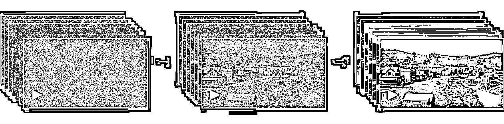

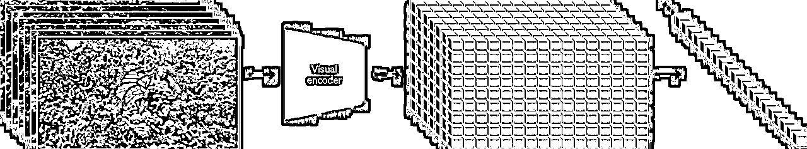

## 3.3 支持各种尺寸的视频

Sora不是只能生成一个固定尺寸的视频。它可以输出宽屏1920x1080p、竖屏1080x1920，以及两者之间的各种比例。这意味着创作者可以直接按不同平台的画幅需求生成原生内容，还能先快速生成小尺寸预览，再用同一个模型生成全分辨率版本。看图就能直观感受到它强大的尺寸适配能力：

竖屏1080x1920

中间各种比例

宽屏1920x1080p

## 3.4 图像也能“动”起来

Sora不仅能文本生成视频，还能对着一张静态图片，结合提示词，把它变成动态视频。

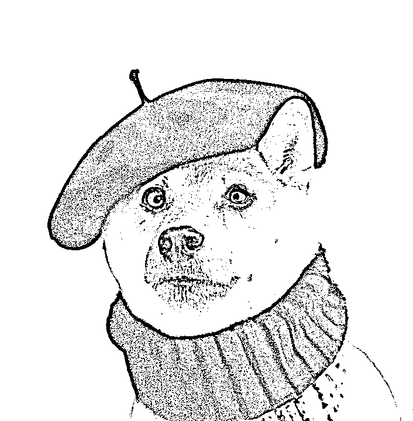

一只戴着贝雷帽和黑色高领毛衣的柴犬。

以扁平设计风格绘制的多样化怪物家族。这个群体包括一只毛茸茸的棕色怪物，一只光滑的黑色怪物带有天线，一只斑点绿色怪物，以及一只微小的圆点怪物，它们都在一个充满趣味的环境中互动。

一个真实的云朵图像，拼写出“SORA”。

## 3.5 视频编辑：往前扩展，往后延伸

Sora还能对已有的视频进行“前后扩展”。比如给你一个视频片段，Sora可以沿着时间线向前或向后生成新的内容。

更有意思的是，两个视频的开头完全可以不同，但Sora可以给它们生成一个相同的结尾。这种前后双向延展的能力，对创作者来说又是一个炸裂级的新工具。

### 3.5.2 视频编辑能力

Sora现在能对已有片段做风格迁移和场景改造，示范出来的效果目前看还算在线，后续案例会不会更猛，就看官方后续放量了。

### 3.5.3 视频拼接

它能读懂两段素材的关联点，自动给出合适的转场衔接，让前后画面连起来更顺滑。

视频1

视频2

视频链接1和2

## 3.6 图像生成

看完前面的视频演示，图片生成的部分就显得没那么炸裂了。知道它同样支持生图就够了。

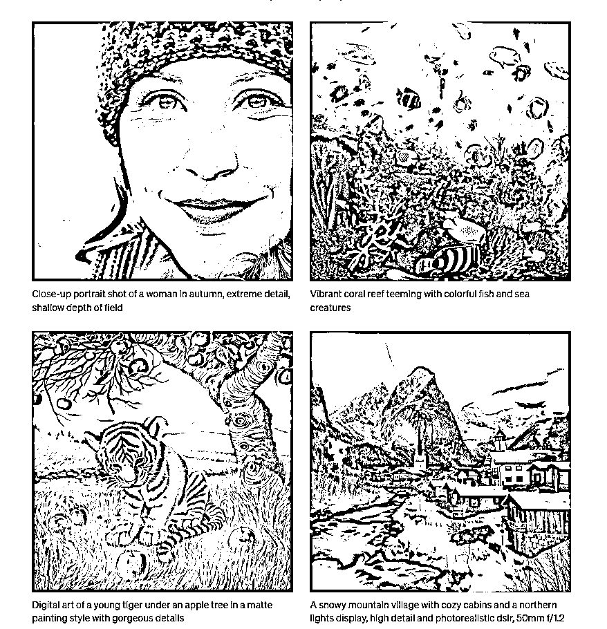

## 3.7 Sora的短板在哪

眼花缭乱的惊艳片段看完后，也该冷静聊聊它会翻车的时刻，下面梳理官方自曝的失败样本。

模型目前的弱点在于是有些场景的物理还原会失真，也对某些因果关系的具体表现理解得不够到位。（OpenAI原文）

Prompt: Step-printing scene of a person running, cinematic film shot in 35mm.
提示：拍摄一个人跑步的场景，使用35毫米胶片拍摄的电影镜头。
弱点：Sora偶尔会产出违背物理常识的动作。
它的世界认知更像是模仿规律，而不是真正的物理理解。

Prompt: Five gray wolf pups frolicking and chasing each other around a remote gravel road, surrounded by grass. The pups run and leap, chasing each other, and nipping at each other, playing.
提示：五只灰色的小狼崽在一条偏远的砾石路上欢快地嬉戏，互相追逐，周围是一片草地。这些小狼崽奔跑、跳跃，互相追逐，轻咬对方，玩耍。
弱点：在实体众多的场景里，人物或动物会出现凭空冒出的问题。
一窝狼一起跑时，对每只狼的动作控制就容易乱，场景复杂度上来它就招架不住。

Prompt: Basketball through hoop then explodes.
提示：篮球穿过篮筐后爆炸。
弱点：物理建模不准、物体形变不自然的典型。
说它没炸吧，它确实炸了，可炸的是💥特效，而不是篮球本身炸开。提示改成篮球穿过篮筐后篮球炸裂或许更对，但这又不符合常人的表达逻辑。
说它做错了吧，它其实严格执行了提示词，每个词都照做了。
说它做得好吧，蜡烛也没熄，人物表情也很怪。
惊艳归惊艳，假也归假。

Prompt: A grandmother with neatly combed grey hair stands behind a colorful birthday cake with numerous candles at a wood dining room table, expression is one of pure joy and happiness, with a happy glow in her eye. She leans forward and blows out the candles with a gentle puff, the cake has pink frosting and sprinkles and the candles cease to flicker, the grandmother wears a light blue blouse adorned with floral patterns, several happy friends and family sitting at the table can be seen celebrating, out of focus. The scene is beautifully captured, cinematic, showing a 3/4 view of the grandmother and the dining room. Warm color tones and soft lighting enhance the mood.
提示：一位头发梳理得整整齐齐的祖母站在一张色彩斑斓的生日蛋糕后面，蛋糕上插满了蜡烛，摆放在木制的餐桌旁。她的脸上洋溢着纯粹的快乐和幸福，眼中闪烁着幸福的光芒。她向前倾身，轻轻地一吹，蜡烛便熄灭了，蛋糕上覆盖着粉红色的糖霜和彩色糖屑，蜡烛也不再闪烁。祖母穿着一件带有花卉图案的浅蓝色衬衫，可以看到几位快乐的朋友和家人坐在桌子旁庆祝，他们的身影略显模糊。这个场景被美丽地捕捉下来，具有电影感，展示了祖母和餐厅的3/4视角。温暖的色调和柔和的灯光增强了氛围。
弱点：多物体、多角色的复杂互动对模型来说仍是难题，有时画面会显得滑稽。
多看看Sora的翻车案例，对人类也是一种定心丸，至少今年不用担心被AI取代。

# 四、Sora带来的影响

## 4.1 迷雾里的灯塔

就像GPT选择技术路线一样，在划时代产品到来前，大家都在雾里探路，不清楚哪条分支最终会胜出。
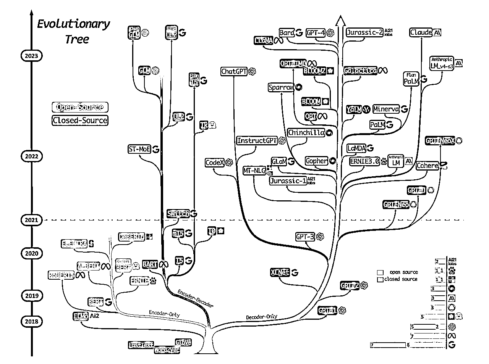
当一条确定性的路线被验证后，其他玩家只需要沿着这条路追赶，就能更快拿到成果。好比造原子弹，第一颗是探索未知，后续都是在已知框架下的工程化，难度骤降。
Sora为Text-to-Video这条赛道点亮了灯塔，再次证明Diffusion Transformer能把高质量的文生视频路跑通。未来很可能像LLM在GPT之后百花齐放一样，文生视频也会在Diffusion Transformer上迎来更多分支和探索。

## 4.2 算力成本：是迈巴赫还是比亚迪秦？

粗略估算下月度成本，来看看Sora的性价比天花板。以下不计入无限生成选项。

先看Runway，35美金/月，5学分≈1秒Gen2视频，约可做450秒。一分钟成本约32人民币。

Pika，35美金/月，10积分≈3秒视频，约可做200秒。一分钟成本约63人民币。
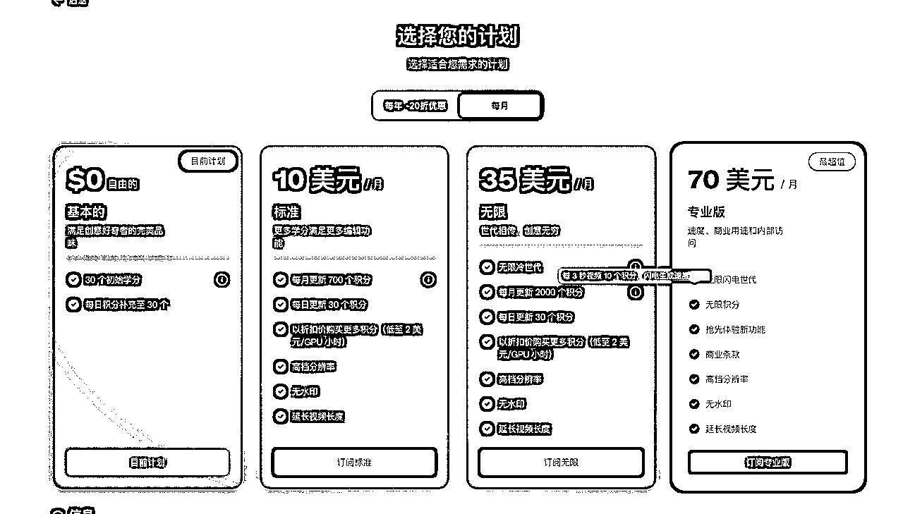
两者目前基本都以3-4秒为最大生成单元。Sora要保证60秒连贯，算力可能要比拼接10段3-4秒的成本高出10倍以上，一分钟可能落在300-600元区间。

由此可见，Sora对行业的即时冲击大小，核心取决于算力定价。
如果一分钟能压到32人民币左右，Runway和Pika基本就被碾压；若能再低到10元级别，那它就和比亚迪秦一样成价格屠夫，没人能扛住。
反之，若一分钟要1000元，那就是奔驰迈巴赫的定位，普通人只能围观，等待成本下降。

以上测算并不严谨，没算成片率等损耗，真实成本只会更高。但即便只看基础套餐，也能感受到算力成本的关键作用。

## 4.3 对视频行业的影响：颠覆还是远水

Sora并不会颠覆视频行业，就像MJ和SD也没颠覆图画行业。现阶段它对视频行业的影响，甚至不如“稿定设计”对作图的冲击大。
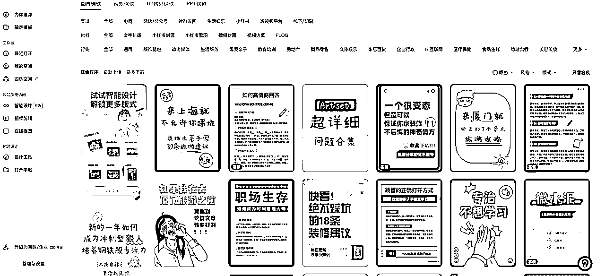
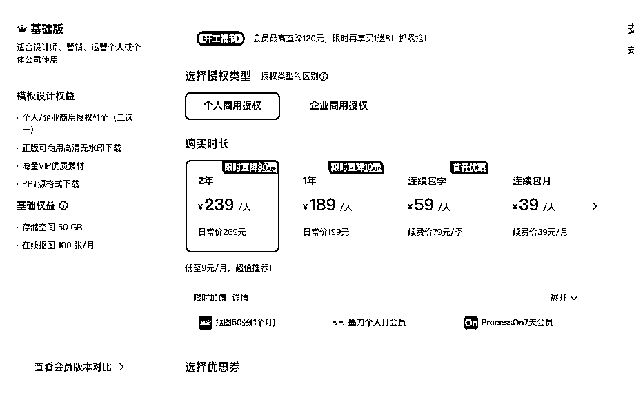
稿定设计花200多块买两年，用起来跟月薪5K的设计师差距不大。SD、MJ、稿定设计，本质都是在设计大盘里切分垂类场景，给特定需求提供解法。AI更多是嵌入到工作流中提效，而非取代整条流程。
Sora同理，算力便宜时人人都能低成本做有趣视频，但这些视频只是视频生态的一小块。行业从业者更可能用它快速出分镜、验证画面想法，提效而非被替代。
GPT问世后自媒体一直喊世界要被颠覆，1年半过去，变化主要在局部提效。智能手机用了十几年才重塑生活方式，AI或许也会，但路还很长。别过度焦虑，多学习跟上节奏就好。
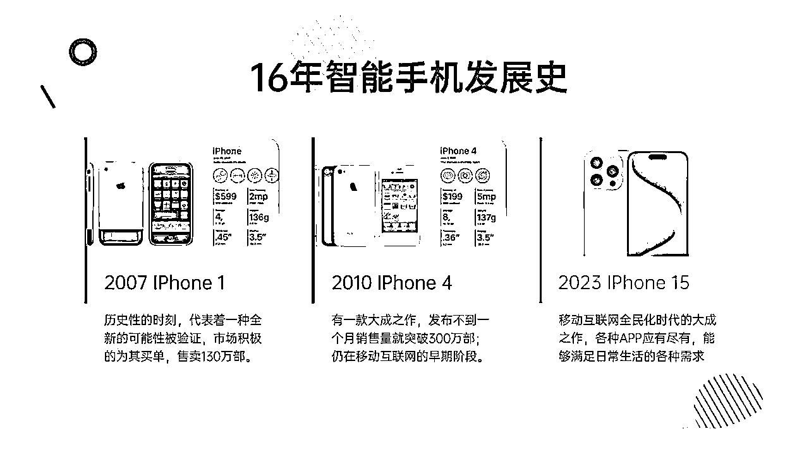
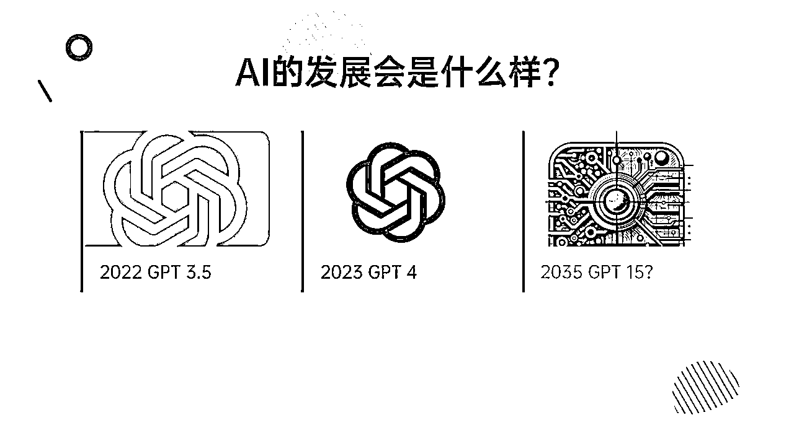

# 五、Sora相关的变现机会

客观来看，如果Sora正式开放，最值钱的还是体验和学习。

## 5.1 体验

### 5.1.1 套壳变现
案例：https://sorawebui.com/zh/playground
思路和GPT刚出来时一样，用API接口做信息差变现。
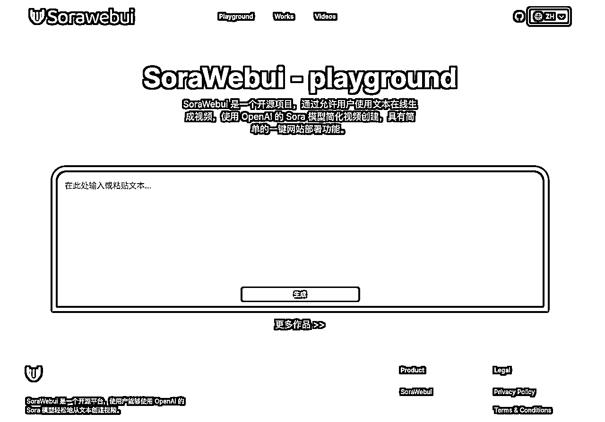
前提是强依赖OpenAI的API权限，如果不开放或限流，这条生意不好做。

### 5.1.2 卖号
逻辑类似套壳，考验渠道能力，也依赖OpenAI授权放开程度。放开后账号溢价会有空间。
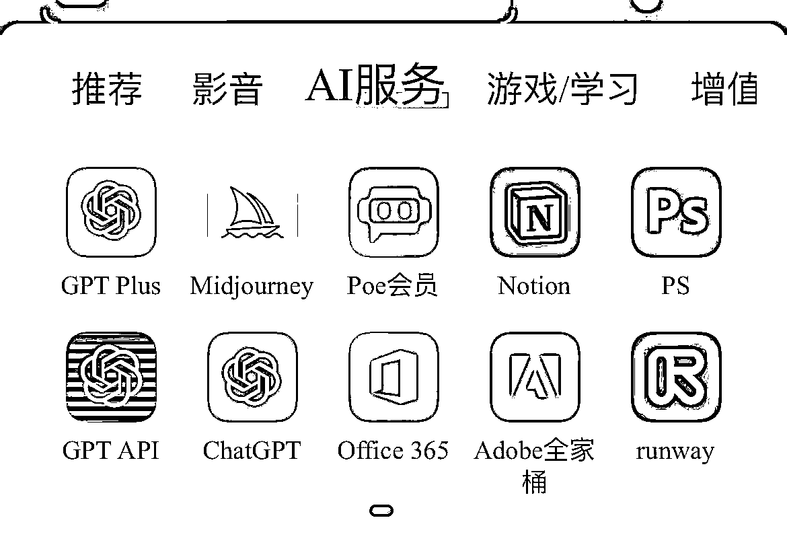

### 5.1.3 卖提示词/代做
要看OpenAI最终的算力定价。若一支视频要35块，门槛就很高，普通体验可能卖不动，反而提示词和代做服务会像早期MJ提示词、SD机车图一样有需求。

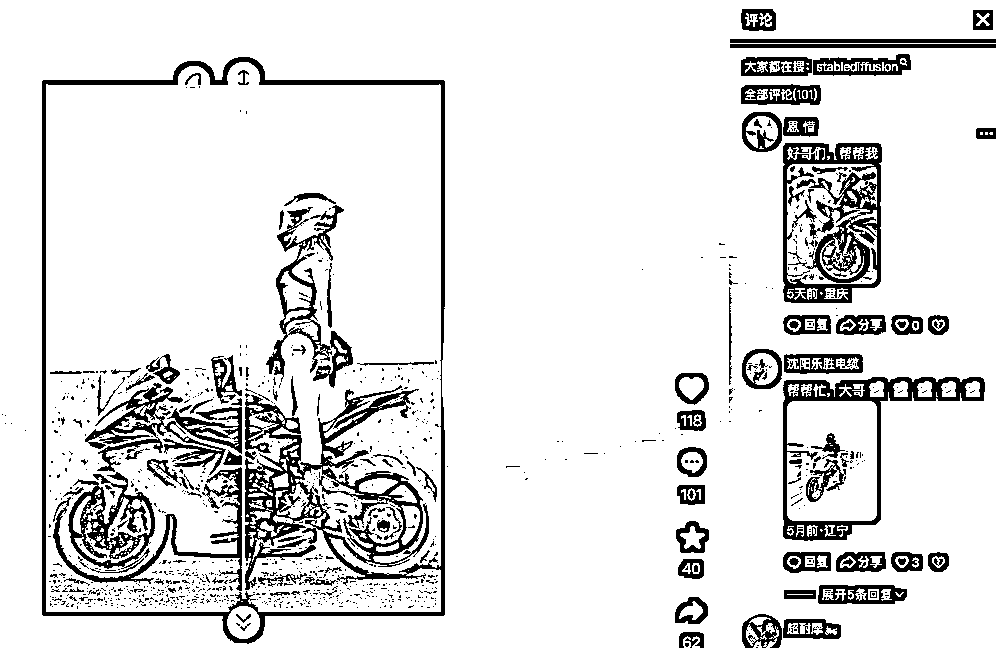

## 5.2 课程学习

### 5.2.1 认真做教育，别割韭菜
Sora爆火后，培训圈有人在认真做内容，比如“通往AGI之路”整理了直译论文和免费案例，“AI风向标”汇总了资讯和48条官方提示词，氛围不错。但也有没权限也不懂的人打着海报割韭菜。互联网有记忆，多靠专业助人，善因得善果。
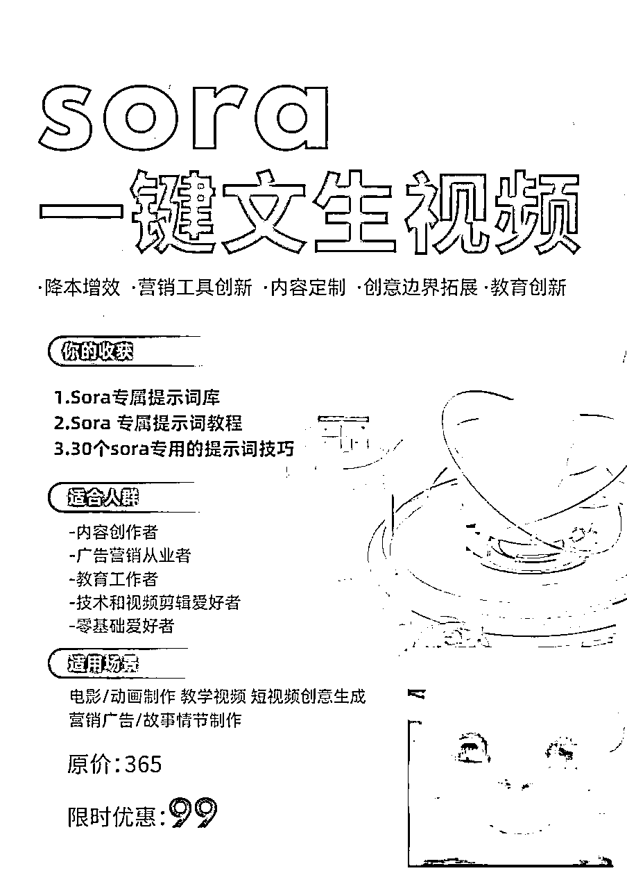

### 5.2.2 认知培训，缓解焦虑
AI通识+商业的串讲仍有空间，用户画像要锚定好。也可做公开课+付费课，或者面向企业中高层的AI发展与商业思维分享。当焦虑泛滥时，帮助人降焦虑本身就是价值。

### 5.2.3 生成视频教学
Runway和Pika的参数都让人头疼，Sora同样会需要prompt写作、风格选择、自定义等培训。先学先会，再去教学，是条清晰路径。
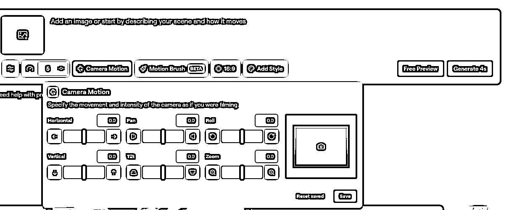
Runway
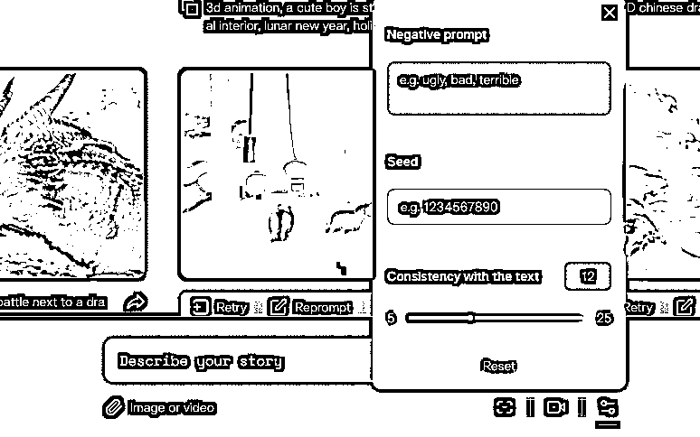
Pika

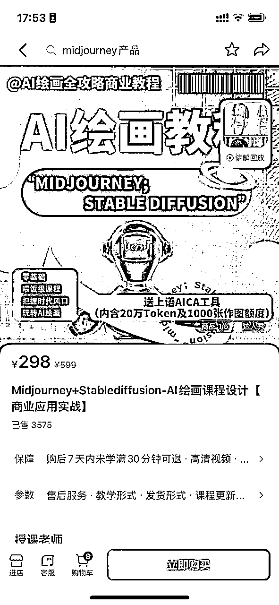

## 5.3 流量获取

跟紧时事做手册，注册域名或👸号再转卖，都是AI从业者的常规打法。
### 5.3.1 飞书云文档手册

### 5.3.2 域名及👸号
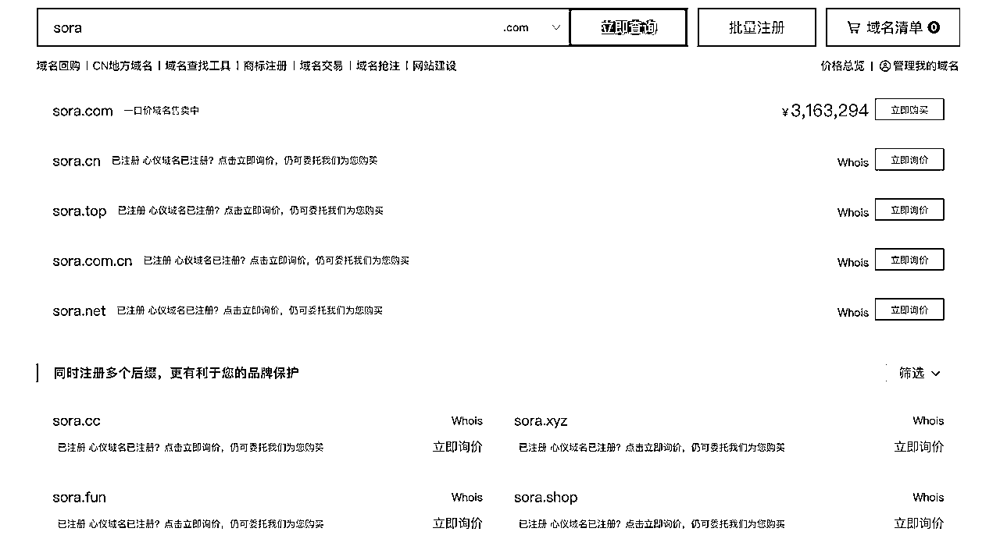
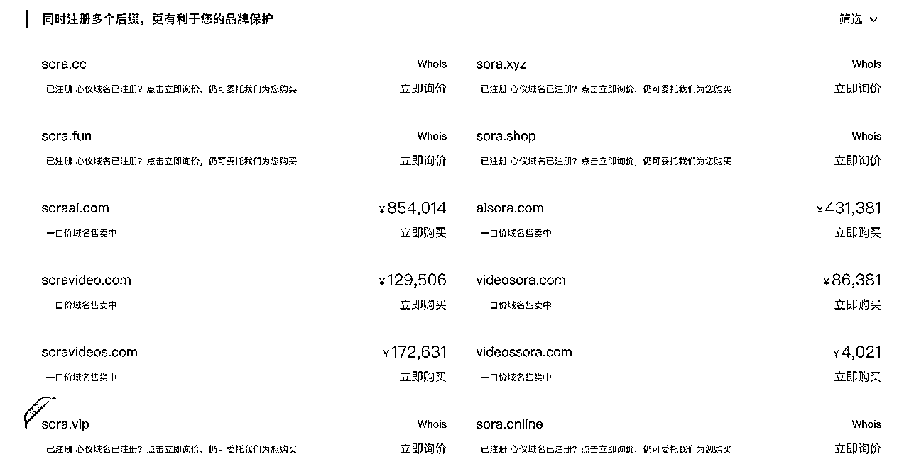

# 结语

我更多是从产品运营角度评判Sora，技术细节理解可能有偏差，欢迎指正。Sora很惊艳，知道它有助于我们在变革期保持节奏，但也不必恐慌焦虑。持续学习，跟上变化就好~
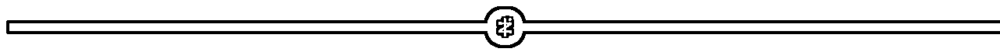

# 🌟 知识库内容汇总