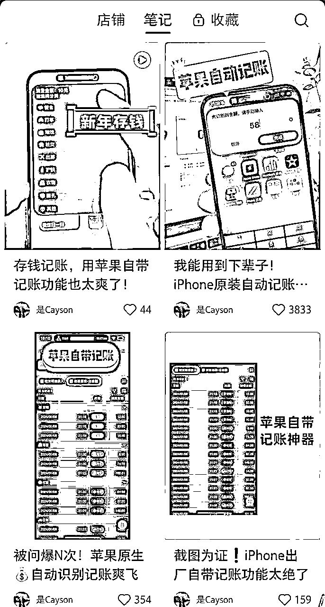
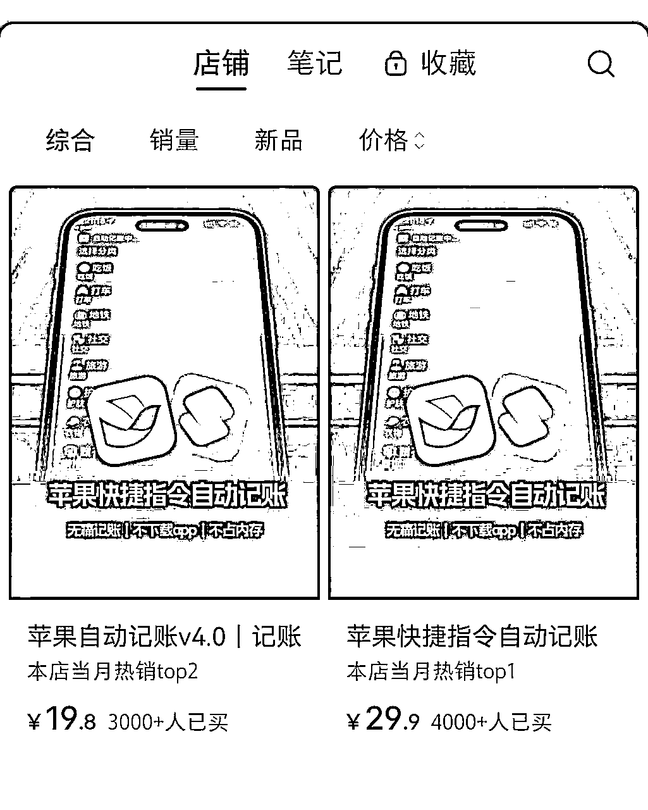
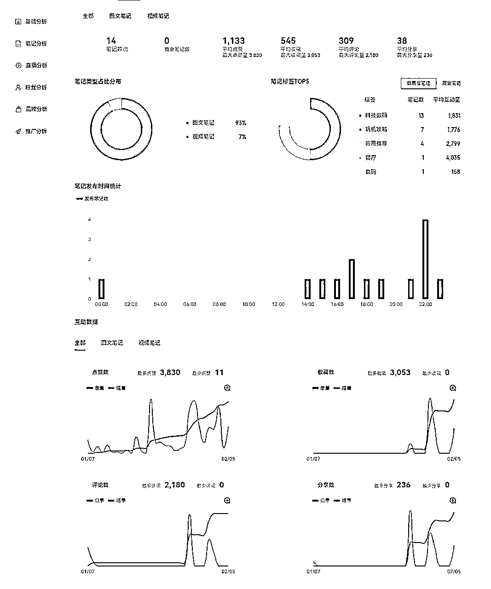
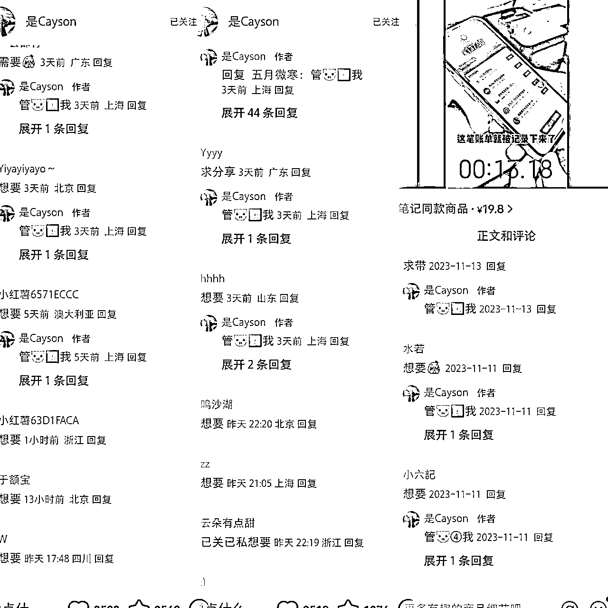
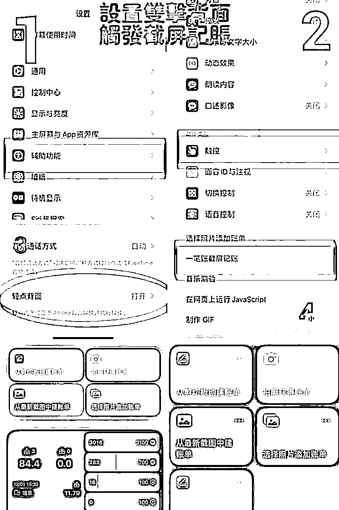

一个自动记账快捷指令，4个月赚了15万+：“偷懒”也能变成生意？

大家好，我是袁圆。这期风向标项目拆解，想聊一个特别会“偷懒”的变现项目——用自动记账快捷指令赚钱。

为什么盯上这条赛道？记账本来算小众需求，但经济下行，越来越多人开始关心个人收支、消费习惯和理财，所以“记账”尤其是“自动记账”的需求慢慢涨了起来。春节的红包、人情往来扎堆，又让自动记账的销量比平时高了一截。说白了，很多人不是不想记账，而是嫌麻烦、坚持不下来；能让人省心的记账方式，自然有人愿意付费。

小红书上的自动记账玩法，大致两类：一类是推广第三方记账APP；另一类是把苹果手机自带的快捷指令和飞书多维表格结合，轻点两下手机背面，钱就记好了。它同时解决了“想简单易上手”和“怕自己坚持不了”两个问题，核心就三个字：省事、稳。

先算笔最实际的账。店内国外版19.8元卖了3211份，国内版21.9元卖了4181份，上线4个月赚了15万+。成本端更轻松，自动记账靠的是系统自带快捷指令+飞书，不需要进货囤货，除了1000元开店押金和售后指导，几乎零成本。难怪说“会偷懒就能赚钱”。

再看账号的基本盘：平台在小红书，店铺叫“是cayson”，粉丝1.7W，赞藏12.3W，笔记46篇，店铺销量18.8W。商品也非常克制，在售一共就两款。

流量是怎么做起来的？店铺创建于2023年11月5日，到2月5日为止，共发布46篇笔记。其中图文笔记占93%，数量不算多，但效果够猛——点赞收藏超过2000的笔记有17篇。

图文笔记的套路是：每篇放4-5张图，把记账界面、轻敲手机背面、自动记账弹窗、同步记账、月账单依次展示，用户一眼就能看出有多方便。

视频笔记呢？背景通常是到店扫码付款，用人声讲解+手动操作，把自动记账过程一步步演示出来，再配上秒数，突出一个“快”字。

评论区也留好了钩子：想要教程，扣“想要”；也可以直接“管猪4我”；想便宜点，就进群用内部价购买。互动和转化一起拿捏。

产品上有什么门道？其实苹果快捷指令+飞书多维表格的组合，在小红书、抖音都有大量免费教程，技术门槛并不高。店主卖的是“模板+完整设置流程服务”，专门帮不熟悉手机功能、又嫌麻烦的小红书用户解决安装过程中遇到的问题。本质上赚的是信息差和服务费。

那这个项目还能怎么放大？

第一，主攻精准人群。账号虽然小红书、抖音都在发，但抖音的数据明显不如小红书。小红书的高质量女性用户天然契合这款产品，内容上再叠一层“精简生活”“大女主”的标签，转化会更漂亮。

第二，做矩阵。目前小红书上做自动记账的账号还不多，需求却一直存在，笔记制作门槛又低，新手完全可以照着上手。想放量就多注册几个账号一起发，毕竟复购率不高，拼的是执行力和铺量速度。

第三，往私域走。我观察到一个现象：几乎每个自动记账群里，每天都有人在咨询、购买。把用户引到私域后，可以根据这批人的特点，顺手卖手机相关产品，让一个用户贡献更多价值。

总的来说，这个项目不复杂，核心就是一句话：把人“懒得记账”的痛点接住，再用信息差和服务把产品卖出去。剩下的，就看谁执行得更快了。