# 风向标拆解第3期-机会9-枫

> 来源：[https://qf8xr66n0a.feishu.cn/docx/Dy9SdXTDaoKYLmxWY4Gcrk0QnEf](https://qf8xr66n0a.feishu.cn/docx/Dy9SdXTDaoKYLmxWY4Gcrk0QnEf)

# 一款 Notion 模板，真的能做到年入17万美金吗？

## Notion 到底是什么东西？

把它理解成一个把网盘、表格、文档、协作工具全塞进同一块在线画布的产品。国内用户可以类比为把百度网盘/夸克网盘、WPS 表格、WPS 文档整合在一起。

圈子里常把它叫做「生产力版乐高」。不需要写代码，只要拖拽就能搭出属于自己的系统、看板、知识库，零技术门槛就能上手。

### 用户体量已经非常可观

全球现在有超过4000万人在用。

这就意味着，你面对的是一片4000万人的待服务市场。

而这些人的共同痛点惊人地一致：没空也没能力自己从零搭建，他们愿意为现成的、可以直接用的模板付费。

你的价值就在于此：用预制模板帮他们省时间省精力，他们则把钱留给你。

于是这门生意变得异常干净：你做一个好用的产品，别人掏钱买单。做的事情光明正大，大方讲给亲友听也毫无压力。

### 做一次，卖无数次

一个 Notion 产品建好之后，可以永久售卖，完全不需要：

线下门店或实体租金

囤货库存与物流

复杂的发货链路

## 卖到10万美金的 Notion 到底长什么样？

#### 他用了哪些工具？成本是多少？

*   Notion - 内容承载主体 - 免费
*   - 设计工具 - 免费
*   - 图标素材站 - 免费
*   Gumroad - 出售渠道 - 只在成交后抽成

#### 背后的人是 Easlo

这个「第二大脑」模板的原作者。

Easlo 在两年时间里累计售出超过60万份 Notion 模板，主打帮助学生、创作者、企业家提升效率，用 Notion 把工作流简化。

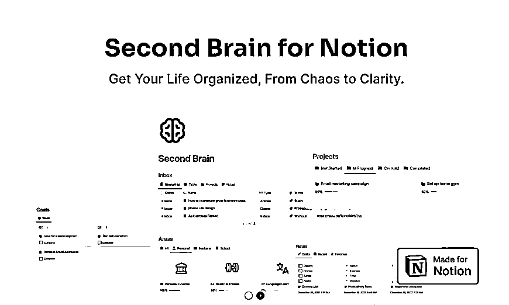

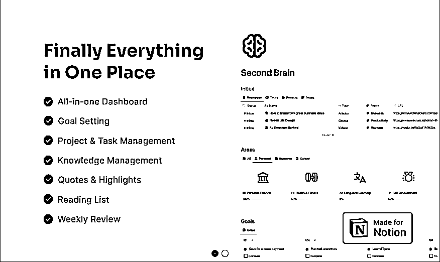

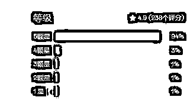

#### 模板里装了什么？

一体化总览面板

目标设定模块

项目与任务管理

个人知识库

引言与高光时刻记录

阅读清单

周复盘

附赠教程与使用示例

买断后永久更新

配套 Circle 专属社群支持

该产品目前累计238条评价，提供79元的基础版和99元的标准版。按评价转化比1:3、两版各半粗略估算，销售额约6万美元。若按1:5的转化比推算，体量则在10万美元上下。数据存在偏差，仅作参考。

### 捆绑包更狠

Easlo 还在售模板合集，分为299美元和499美元两个档位，宣传语是：无限畅用生产力、工作、财务、健康等领域的顶级模板。同样以1:3评价比估算，销售额也逼近7万美元。这份生意，几乎就是复制型增收机器。

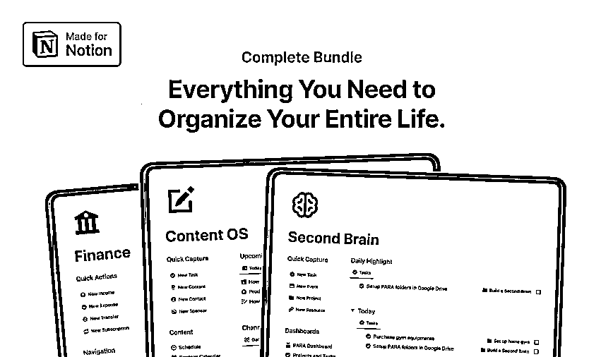

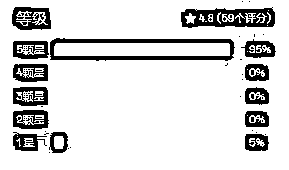

## 其他值得复刻的 Notion 案例

### 偏向个人生活的 Life OS

有人以前也质疑过：卖模板太low，谁会为一份表格付费？真正破局的关键是把个人经验、工作流、最佳实践全部打包进去，并把产品定位从「模板」升级为「操作系统」。客户买的不是冰冷的表格，而是某个领域的最佳使用方法论。

于是围绕个人生活打造的 Life OS 就出现了。

#### 核心模块包括：

财务追踪

OKR 目标追踪

习惯打卡

健身计划

饮食规划

轻量 CRM 与子弹笔记

书架笔记

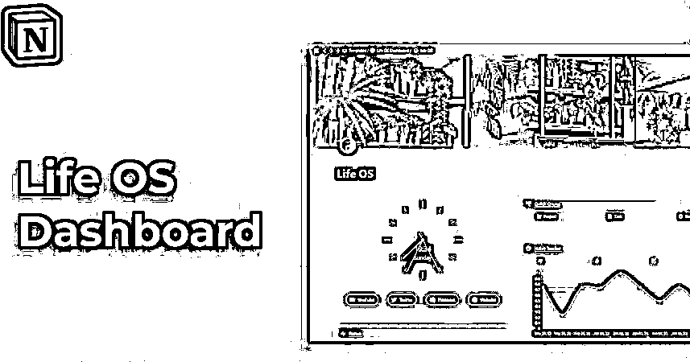

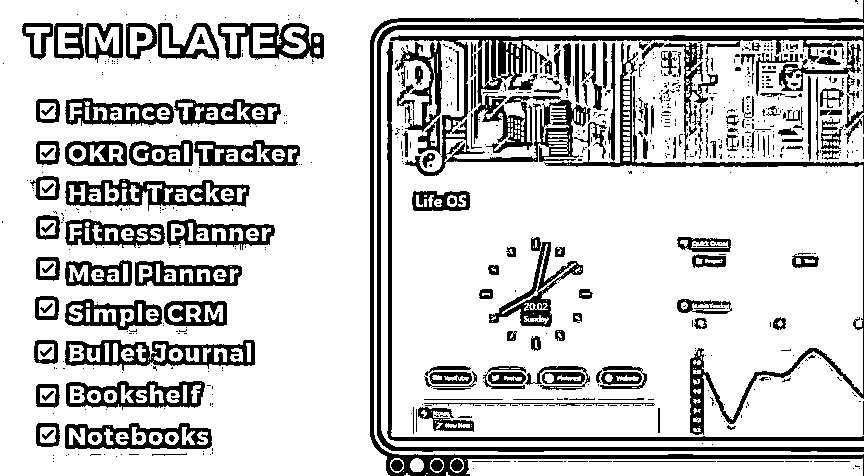

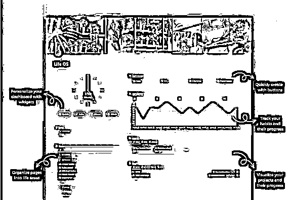

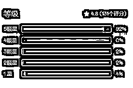

### 偏向职场的 Business OS

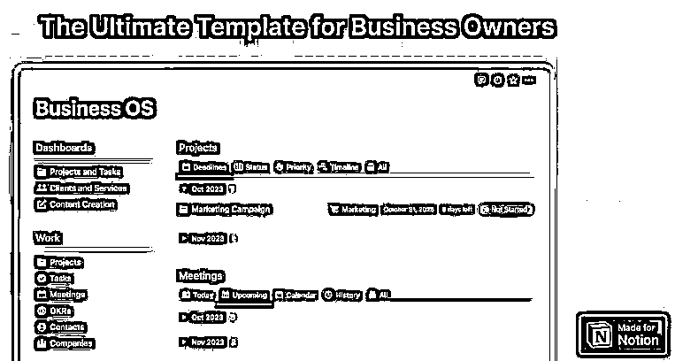

## 国内我们能怎么玩？

国内也有模板交易平台，RPA 定制需求也在线上活跃。找到真实痛点、持续迭代更新，是核心。利用小红书等内容平台放大影响力，Notion 在国内的接受度已经越来越高。

当然不局限于 Notion，其他办公协作平台也能做同类「系统化产品」。关键在于坚持。就像之前拆解的 Janel，一开始提出 OS 概念时几乎无人关注，坚持六个月后才迎来爆发。

挑准一个方向，持续做下去，复利效应会让结果远超预期。

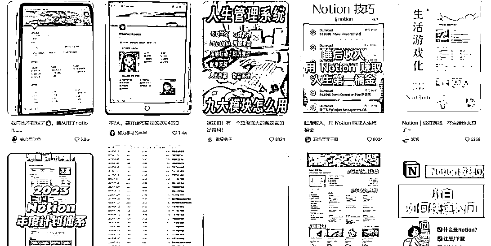