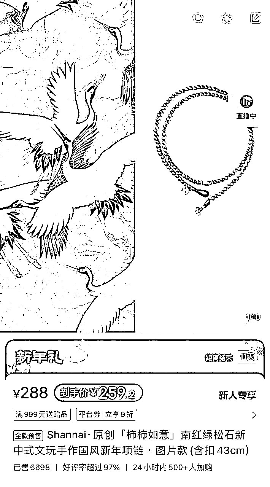
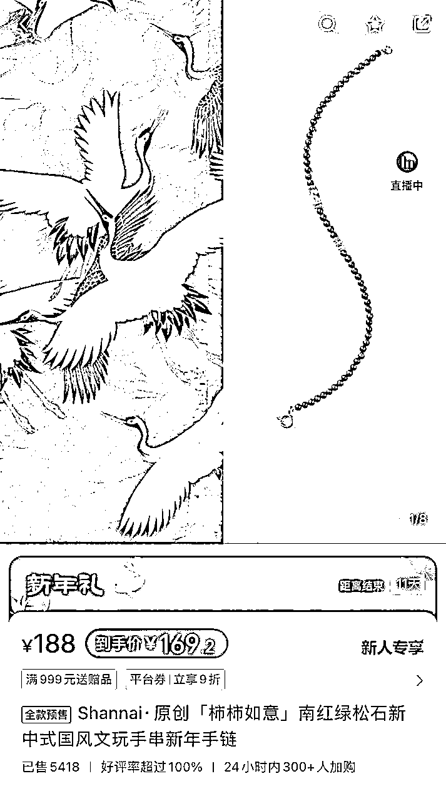
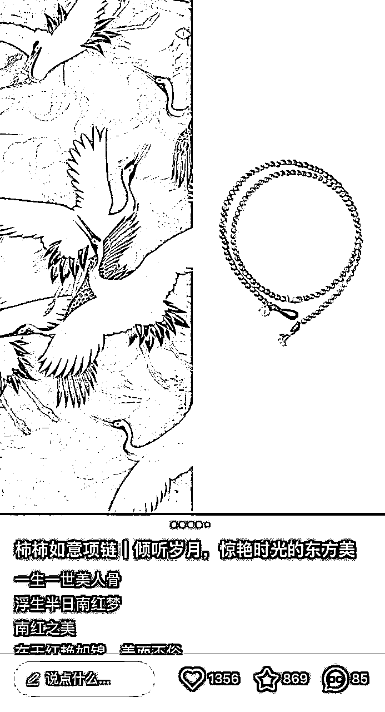
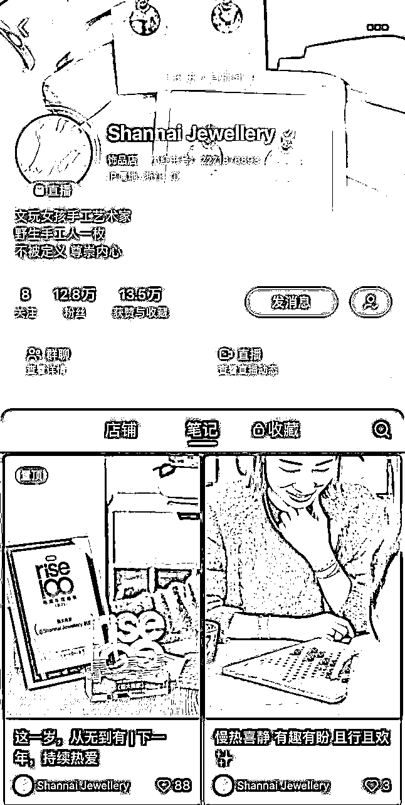
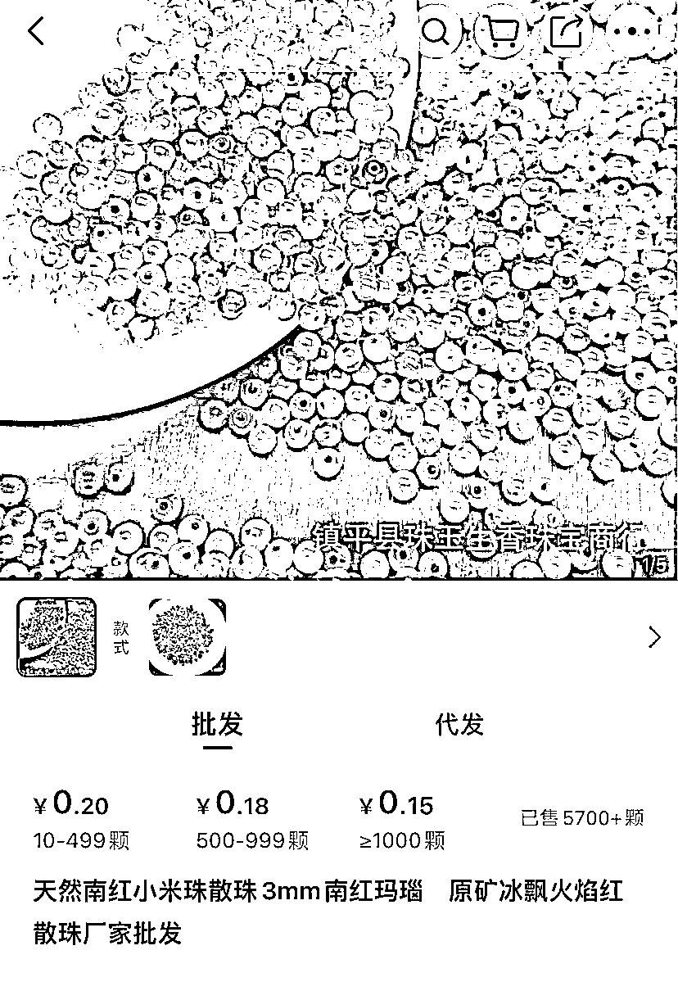
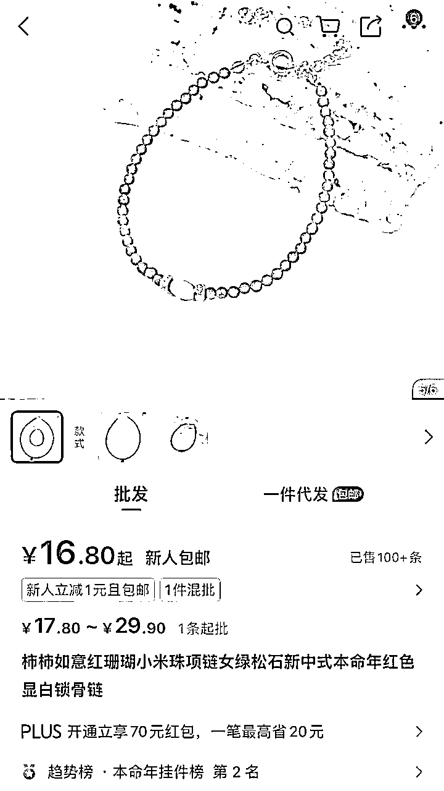

# 风向标拆解第3期｜📕月销百万的手作饰品店，背后玩法竟然这么简单？
作者：龙哥

> 来源：📕高销量手作饰品账号“Shannai Jewellery”深度拆解

你有没有刷到过那种精致又带有美好寓意的手工饰品？看似不起眼的小珠子，串起来却能卖出惊人的销量。今天我们就来拆解一个在📕上靠手作饰品做到爆款的账号，一款单品销售额竟然突破了155万！

## 这个账号凭什么能火？

**账号：Shannai Jewellery**  
**类目：手作饰品（手链、项链、耳环）**  
**带货模式：图文笔记起号 → 跑出爆款后开启直播带货 → 日常更新+图文挂车**

我之所以选中这个账号来拆解，原因有三：

1. **它是📕上的垂直手工饰品店铺**，赛道够细、够专注；
2. **图文+直播的组合打法**，起号门槛低，操作难度小；
3. **单品数据极其亮眼**——一条项链销售额155W+，一条手链销售额84W+，都是妥妥的爆款。

## 爆款是怎么诞生的？

它的爆款笔记标题是：**柿柿如意项链｜倾听岁月，惊艳时光的东方美**

这款手工项链在📕上的售价为288元/件，券后价259.2元/件。而它所用的散珠，在1688上按直径大小不同，单颗价格大多在几毛到几元之间。换句话说，**原材料成本低得惊人，利润空间却大得惊人**。

更值得玩味的是，类似的成品在1688上十几元到几十元就能买到。那为什么📕上能卖出两百多的价格？核心就在于——**赋予寓意，溢价翻倍**。带有美好祝福的饰品，天然自带情绪价值。“柿柿如意”谐音“事事如意”，“苹苹安安”谐音“平平安安”——人人都向往美好的事物，而这份美好的祝愿，让大家心甘情愿地买单。

## 我们怎么复制这个玩法？

**第一步：选品，关键词是“寓意+高性价比”**

去1688上淘一些物美价廉的散珠，品类丰富价格又低。买回来后手工串制，并给它们赋予一份美好的寓意。比如“柿柿如意”“苹苹安安”这种自带谐音梗的祝福方向。现在国风国潮正当道，也可以选中国风图画对应的色系珠子来搭配，甚至直接买成品回来再创作也完全可行——成本依旧保持低位。不过我更推荐手工串，因为通过不同配色和款式组合，**能做出的溢价空间更高**。

**第二步：低成本原创，先模仿再超越**

找到对标账号，以1:1像素级的标准去模仿。这个账号的笔记以图文为主，拍摄难度不大，入手非常简单。先把标杆的玩法吃透，再一步一步做出自己的特色。用最小成本跑通整个模型，再去谈创新和超越，这才是普通人最容易上手的路径。