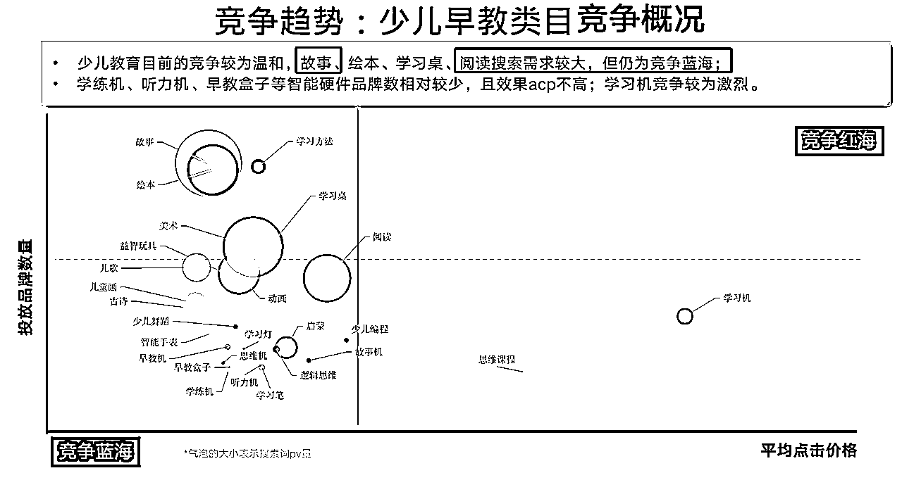
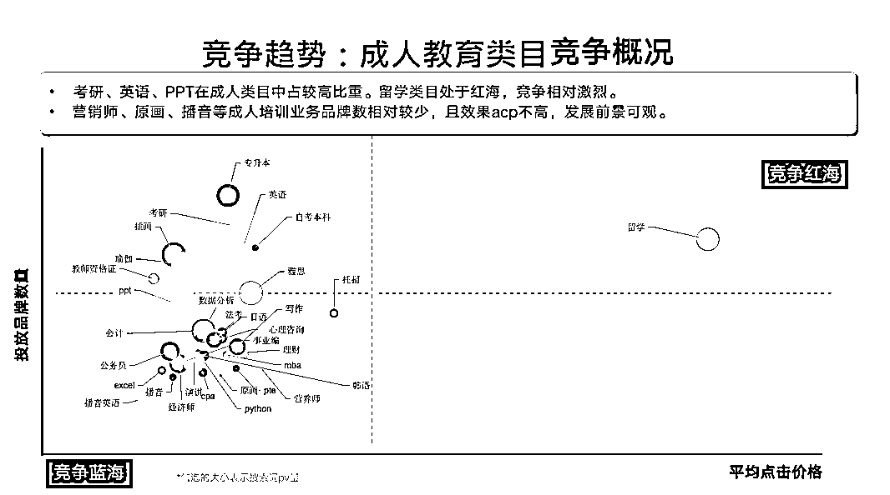
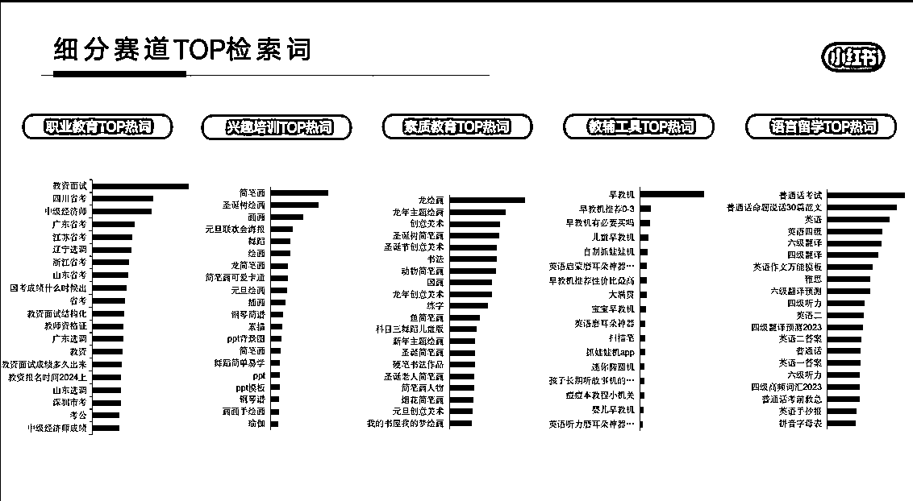
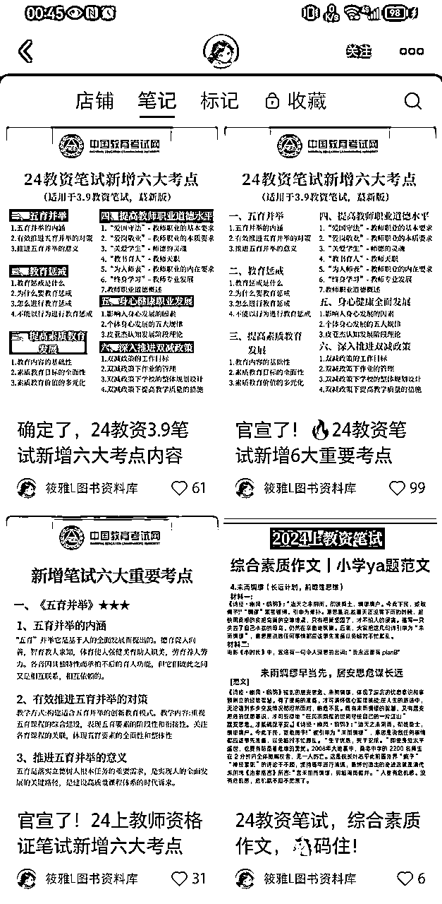
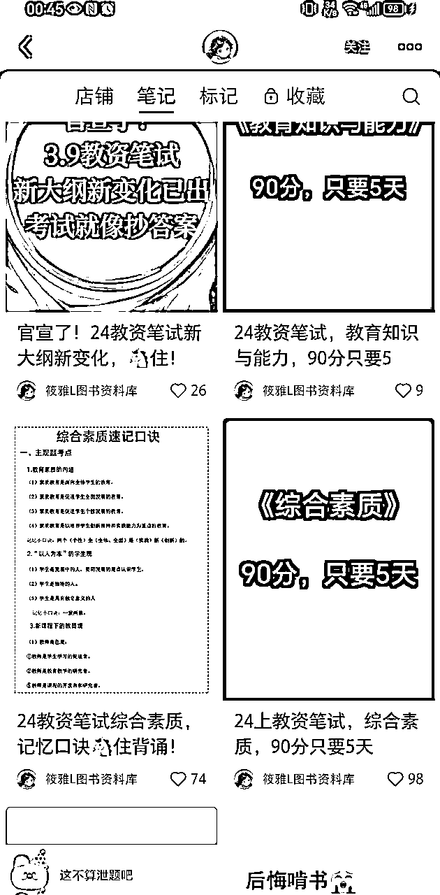
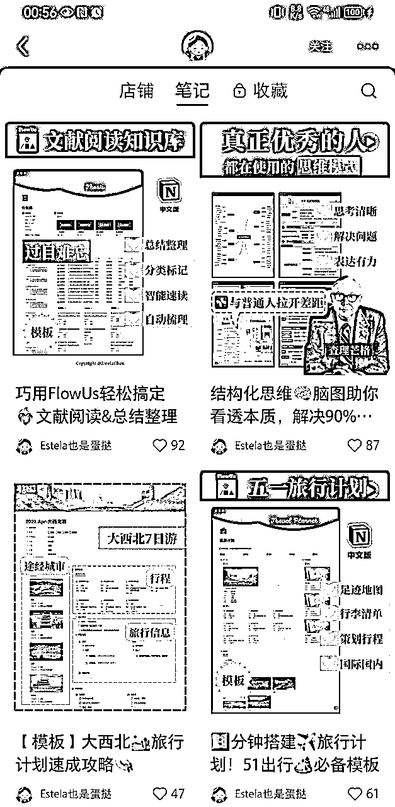
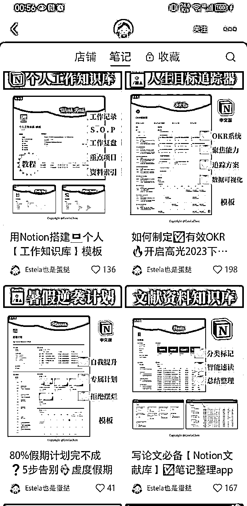

风向标拆解第3期，这次想聊的是一个特别适合新手上手的闷声赛道：资料整理。

**一、它到底是怎么赚钱的？**

逻辑并不复杂：在公开平台上发虚拟资料，把有意向的用户引到私域，再慢慢做成交。以前这类生意大多集中在淘宝、拼多多，闲鱼也出现过，但盗版问题太严重，后来平台官方下了禁令。2023年小红书开始大力推店铺，嗅觉灵敏的人顺势涌入，靠卖资料赚得不少。

为什么教育类资料尤其好卖？教培行业虽然被限制，但家长心里那股“盼着孩子有出息”的劲头没被打压，课程不好报，就去找资料、找辅导内容。与此同时，大环境不乐观，公司一个接一个裁员，打工人为了自保，也会去考公考编、提升学历或技能，尽量让自己更能适应变化。换个角度说，只要人还对未知将来感到不安，教育资料这门生意就不缺买家。

**二、账号怎么从零开始**

不知道做什么细分，可以先去看小红书官方的行业月报，官方数据会告诉你哪些赛道还不卷。以23年12月的月报为例，少儿教育类目里，“故事”和“阅读”的搜索需求明显上升，而且竞争者不算多；成人培训中，营销师、原画、播音等方向ACp不高，竞争热度也没上来，也算蓝海。这套判断逻辑放在抖音上，同样适用。

**三、流量内容怎么运营**

免费流量其实也有章法。小红书官方月报把当月的细分热词整理得很清楚，关键词大致分成五类：职业教育、兴趣培训、素质教育、教辅工具、语言留学。围绕这些词来做选题，等于顺着平台的流量走。

**四、货源和版权问题怎么解决**

虚拟产品的好处在于门槛低，坏处也是因为门槛低，所以大家基本都靠“抄作业”起步。多翻同行，货源总会冒出来：

- 在知乎、小红书搜品类关键词，能找到大量资料号，关注后加好友去挖源头；
- 公众号搜“小学语文”“小学数学”这类精准关键词，先多关注一批，再筛选靠谱的；
- QQ群也一样，搜关键词能找到各种资源群，里面全是一手同行；
- 把持续更新的同行单独整理成表格，按文件质量分好级，后面当作资料更新基本盘；
- 淘宝、拼多多可以用来补货，但拼多多能买到的，淘宝多半也有，所以要多比较，防止买到重复内容；更重要的是，没出单之前不要囤货，真有用户下单了再去同行那买也不迟。

版权问题一定要敏感：机构出的资料直接别碰；个人作品或弱版权的内容，酌情把水印处理掉；如果毫无版权限制，那就可以放心大胆卖。

**五、利润到底怎么算**

这里主要按小红书店铺来算。保证金1000元，不急着提现可以先不交；从同行手里买资料，最高按10元/份算。除此之外几乎零成本。举个例子，一份资料从淘宝拿是5元，小红书卖9.9元，利润率能到98%，卖出1000份，净赚差不多4900元。

但今年小红书明显在收紧站外导流、加强商业化，想做长期账号，付费投流恐怕绕不开。企业号认证要600元，私信通一个月最低1000元，硬把用户引到站外成交，性价比反而不高。

想要放大利润，先记住公式：GMV = 流量 × 点击率 × 转化率 × 客单价 × 复购率。具体有两条路：

1. **站内打法**：做矩阵店铺，每个账号每天多更笔记，提高爆款命中率；同时找低价同行产品，打包成一个大资料合集，抬高客单价；还要持续上新，让用户觉得这家店总有好东西，增加复购。
2. **站外打法**：认证3个企业号，每个号继续多发笔记；站内用小红书店做成交，站外把用户引导到微信领课程；再用私域朋友圈做转化，独立开发课程作为高客单产品，实现低转高，利润会更可观。

**六、两个参考案例**

第一个是“筱雅L图书资料库”，粉丝3599，企业号。她的变现路径很直接：小红书店铺卖幼儿园、小学、中学等不同阶段的教资资料，单价从5.9元到9.9元，单品销量在200到3000之间；此外还上架了一个20元的教资招聘资料包网课，暂时还没出单。笔记内容主要发考点、考纲变化，封面直接放资料缩略图，配上6-9张图，用数量感吸引人；不过封面风格不太统一，隔段时间就换，对主页美观度有些影响。

第二个是“Estela也是蛋挞”，粉丝2.7万，个人号。她卖的是Notion模板，这些模板可能是从外网下载后改的，也可能是自己做了自用再卖；但更重要的是，她店里不止有资料，还有知识付费产品，利润率因此翻了一倍。定价上，论文管理库、英语学习库这类个人知识库卖15到39.9元，销量在90到200之间；128元的多合一知识管理系统销量53；359元的笔记会员销量是0，说不定成交发生在私域。内容层面，她表面卖模板，其实卖的是对生活的掌控感：教你怎么规划工作、打理生活，用一套系统把自己的人生安排得井井有条。这也给想做成长赛道却不知道怎么变现的人，提供了一个很好的参考。

**七、最后结论**

资料整理对于还没有项目、或者刚接触网赚的人来说，算是一个相当友好的入口。上手门槛低，不需要什么天赋，拼的是执行力和持续更新。但反过来，正因为门槛低，竞争也会越来越激烈。想长期走下去，要么把用户攒进私域，卖高客单价的复购产品；要么就走店群路线，用规模去摊薄利润压力。

要是你正在找第一个能跑通的小生意，不妨认真研究这个赛道。