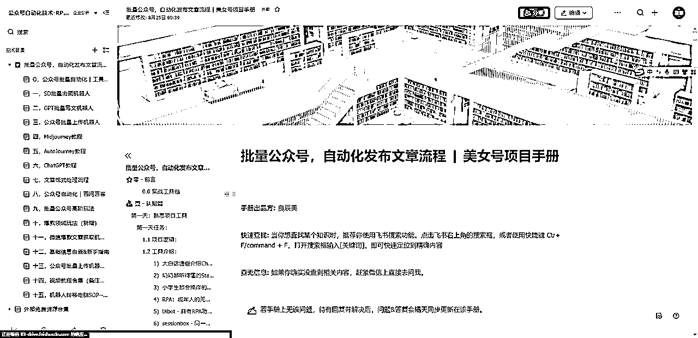
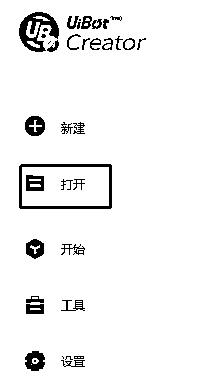

# ('十一，微信爆款文章抓取机器人', (2, 16))

做电商、小红书、公众号的朋友，是不是经常为找爆款选题头疼？今天分享一个微信爆款文章抓取机器人，目前已经在这些领域实际投入使用。如果你想深度交流，可以添加：V：zhuhou-xi。

它怎么运作？

简单说，机器人依靠旧版微信的搜索入口，输入你设定的关键词，就能定位到对应的爆款文章。找到后，它会把文章链接复制下来并写进表格，再进一步抓取链接里的正文内容，全程不需要你手动复制粘贴。

功能方面，基础版能按关键词抓取，高阶版还能做这些：

1. 支持读取多个下拉页面的爆款文章，让抓取数量更多；
2. 支持按“最新”排序，专抓刚发布的新内容；
3. 支持一次配置多个关键词，抓完自动标注每个结果归属于哪个关键词。

下载安装前，先把环境准备好

机器人需要跑在特定版本的微信电脑版上。请去历史版本库下载微信电脑版 3.9.0.28，文件大小165MB，更新于2023-02-13。

为什么要用这个版本？因为这之后微信把“看一看”“搜一搜”拆成了不同板块，机器人读取数据就开始吃力；等更新到8.18版本，页面复制界面变化更大，基本没法用。所以别贪新，认准旧版。

安装运行也简单

拿到机器人压缩包后，先解压，然后打开机器人界面，点击“打开”  导入安装包。接着点击运行按钮即可。

不过有几点要提前确认：

- 微信必须已经登录；
- 桌面最好只保留微信客户端页面，别让其他窗口干扰；
- 机器人的运行按钮目前是在作者本地电脑上验证的，其他电脑还没做过完整测试。

表格怎么用？

模板里已经分好区域：标题栏用 Sheet1，正文内容放 Sheet2。机器人会按照分工自动填入。

特别值得说的是，它采用“用完即删”的策略。已经处理完的标题和正文会被自动删除，这样可以避免内容重复，让每一次抓取的素材都保持新鲜。

常见问题

Q：阅读量能抓吗？
A：暂时抓不了。微信端反爬虫非常强，这个功能还在测试和研究当中。

Q：使用前还要注意什么？
A：先登录好微信，同时保证桌面上只打开微信客户端页面，操作细节可以看视频演示。

最后再划一次重点：机器人运行前，请务必让微信保持登录状态，窗口最大化，并且版本为3.02。