# 家政蓝海：一个被忽视的4倍增长赛道，普通人也能切一杯羹

# 先说结论

1. 家政服务细分品类极多，任何一个细分点都能深耕
2. 人口老龄化加速直接推高养老照护类需求
3. 从业者缺口巨大，供需失衡持续

# 行业正在发生的三件事

* 家政到底包含什么？
打开58同城或天鹅到家，能看到保洁、清洗、家居养护、维修更新、护理服务、管道疏通、搬家等大类，每一大类下面还能拆出无数小单品。 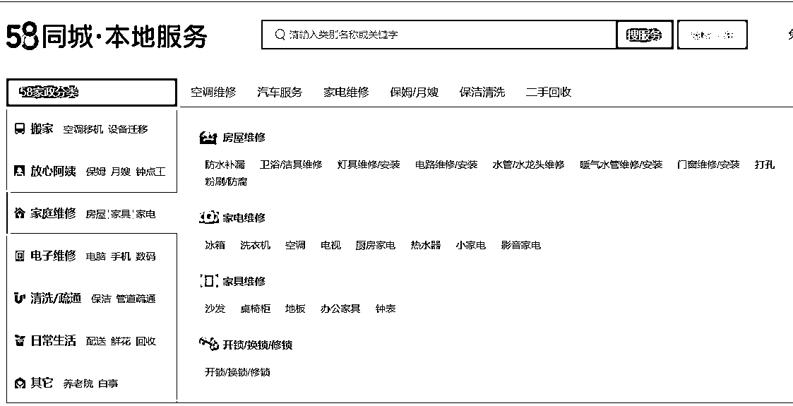

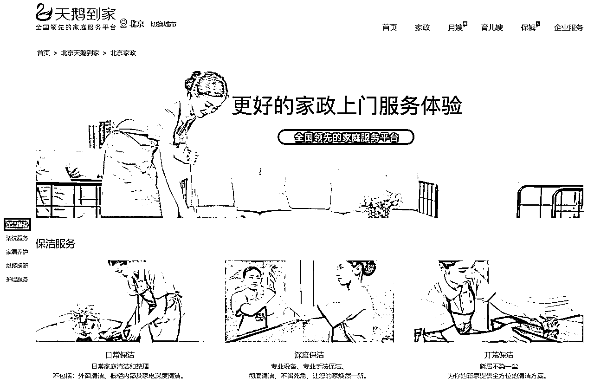
* 老龄化在持续放量，养老护理需求在变多元变刚需
越来越多的家庭需要更专业、更安心的服务。随着“十四五”我国进入中度老龄化，养老赛道只会扩容。根据国家统计局数据，2021年末全国总人口14.13亿。60岁及以上人口2.67亿，占比18.9%；65岁及以上人口2.01亿，占比14.2%。 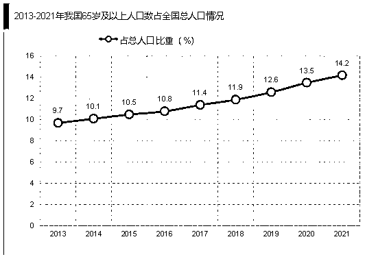

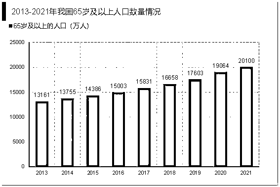
根据锐观网《2023-2028年中国家政服务行业投资规划及前景预测报告（上下卷）》的梳理，2022年消费者使用家政最集中的仍是家居保洁，但随三孩政策落地与老龄化加剧，收纳整理、母婴护理、养老陪护、医疗陪诊等高成长品类使用频次明显上升。 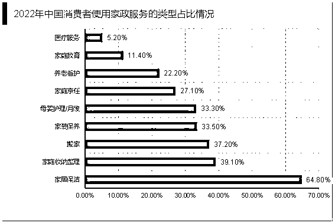
* 人手不够，缺口排在职业榜前列
人社部发布的2022年第四季度全国最缺工的100个职业排行中，家政服务员位列第6，养老护理员位列第14，市场需求远大于供给。 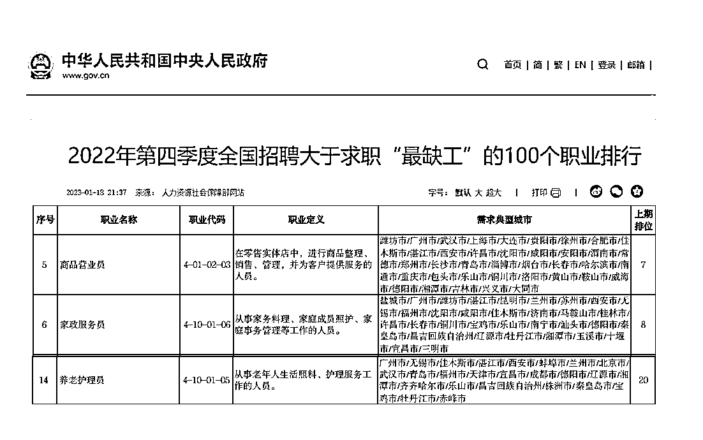
2022年第四季度全国招聘大于求职“最缺工”的100个职业排行
* 市场结构也很清晰
当前家政市场可分为专家管理型、知识技能型、简单劳务型三类。简单劳务型占比最大，如日常清洁、搬家等，2020年规模约5150亿元，占比58.6%；知识技能型如上门维修等，市场规模2776亿元，占比31%；专家管理型如母婴护理、养老看护等规模913亿元，占比10.4%。 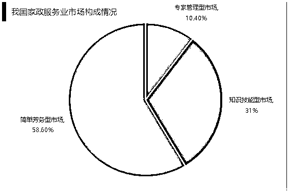

# 案例拆解：普通人怎么玩转三层市场

不论是全国连锁还是本地小店，模式无非两类：B2C直营如轻喜到家、金陵管家，@非大厂叙事 https://t.zsxq.com/16VpiFqRq；或中介撮合如天鹅到家、啄木鸟、传统夫妻店，左手接客户右手找阿姨赚差价。门槛低、品类散，正是普通人可以入场的核心原因。

家政服务品类繁多，下面按简单劳务型、知识技能型、专家管理型拆解。

## 简单劳务型：家庭清洁

**基本情况 A**
小红书账号：金陵管家
内容形式：视频
粉丝：8万
变现：导流微信
人设打法：酒店客房管家出身，把五星级酒店标准搬到家庭保洁，强化专业感

**基本情况 B**
小红书账号：星聚星生活管家
内容形式：视频
粉丝：2908
变现：导流微信
人设打法：退伍兵哥哥，以部队内务标准切入家庭保洁，主打放心细致 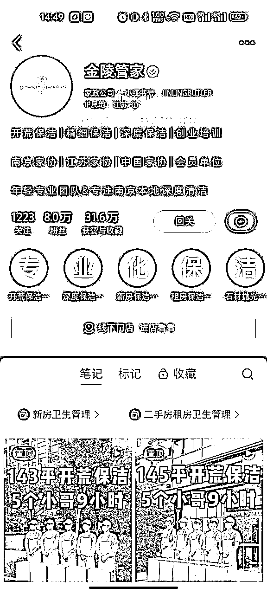

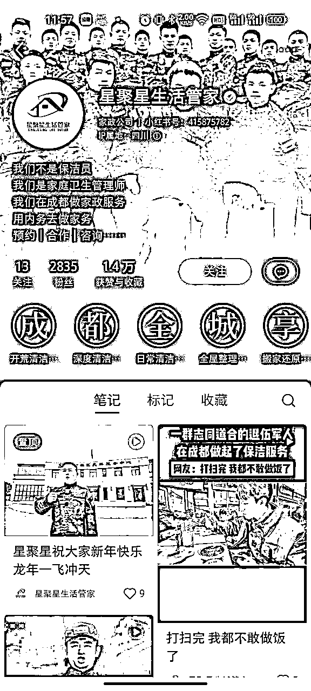

**1 流量怎么来？**
两个账号都走视频路线，塑造专业人设，统一着装与工具，从接单到完工全程记录，重点呈现做前做后对比与细节特写，再用评论区引导私信加微信。金陵管家已发250条笔记获8万粉，星聚星已发274条笔记获2908粉。 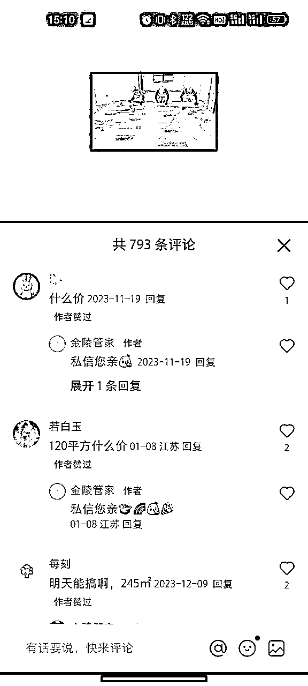

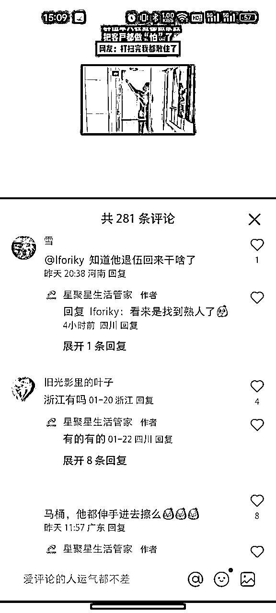

**2 产品怎么搭？**
核心产品是家庭清洁与创业培训。清洁包含新房开荒、深度保洁、全屋整理、搬家还原等。 

**3 变现怎么实现？**
金陵管家：清洁按面积计价，100平米家庭清洁约2500-3500元；另售家庭清洁师培训，价格9800元。 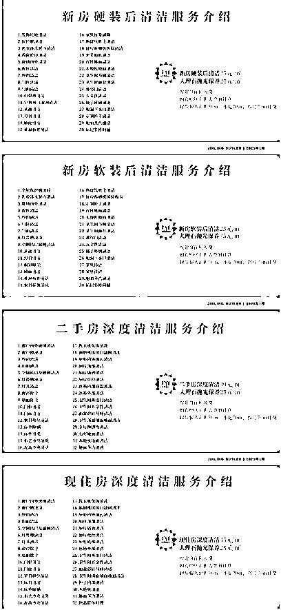
星聚星生活管家：清洁分为新房清洁与日常保洁，100平米收费约2500-4500元。 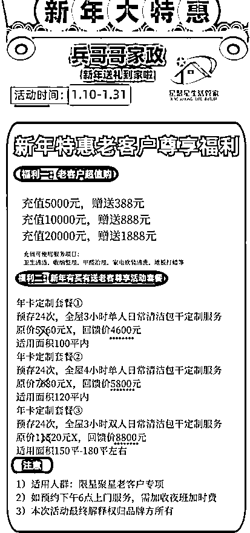

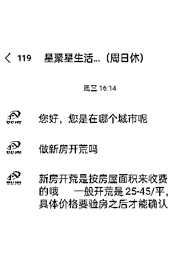

## 知识技能型：上门做菜

**基本情况**
小红书/视频号/抖音账号：李静和亮娃家政美食
内容形式：视频
粉丝：20.1万 + 46.7万
变现：带货
内容打法：真实展示上门做菜全过程 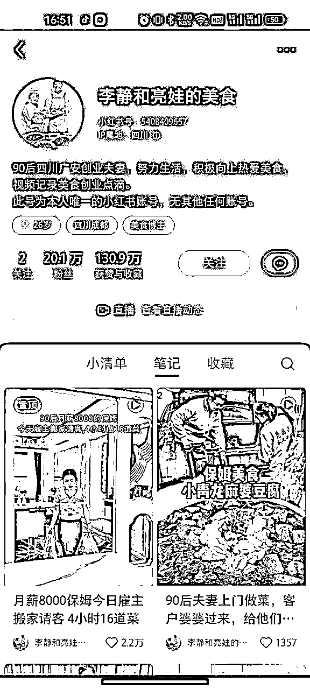

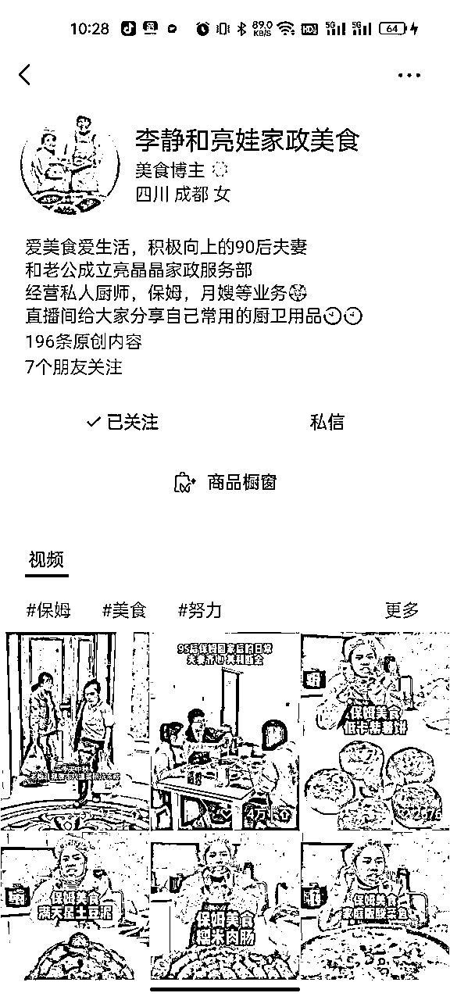

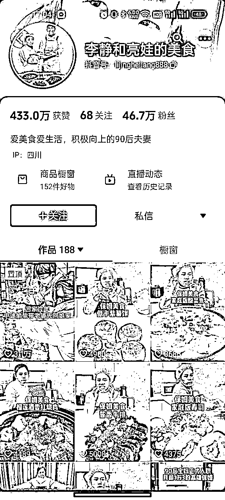

**1 流量怎么来？**
人设锚定上门保姆，每次客户家做菜过程同步分发到抖音、视频号、小红书，并不定期开播。目前视频号发197条，小红书发143条，抖音发188条。 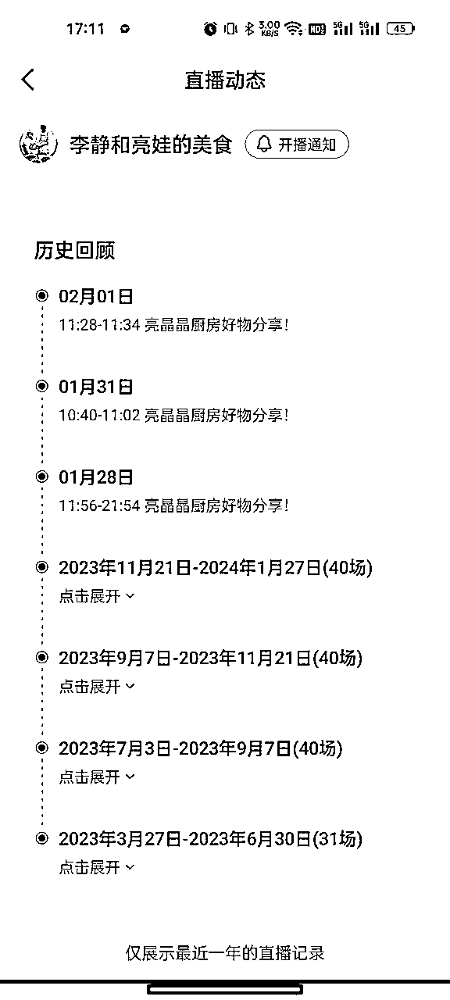

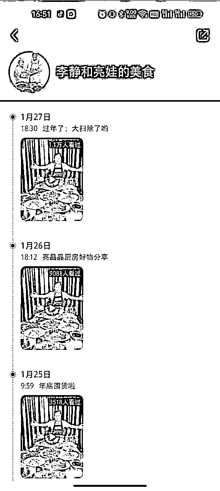

**2 产品怎么搭？**
短视频+直播分销精选联盟商品；同时引流线下上门做菜与定制团餐服务。

**3 变现怎么实现？**
内容带货+直播卖货。抖音橱窗已售29万+，视频号已售53万+。 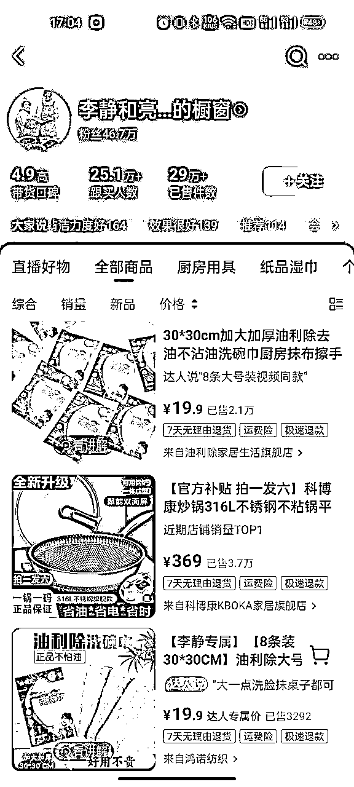

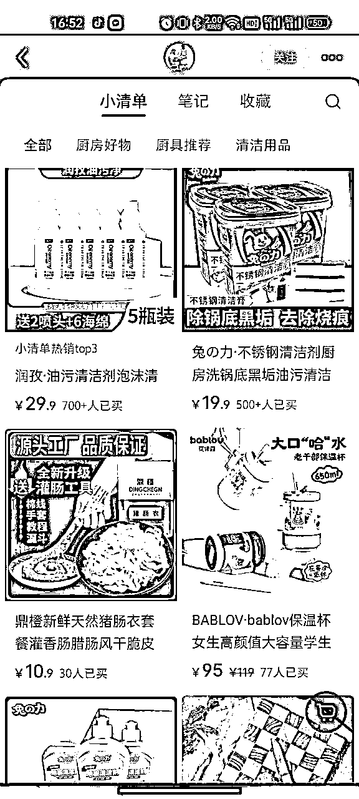

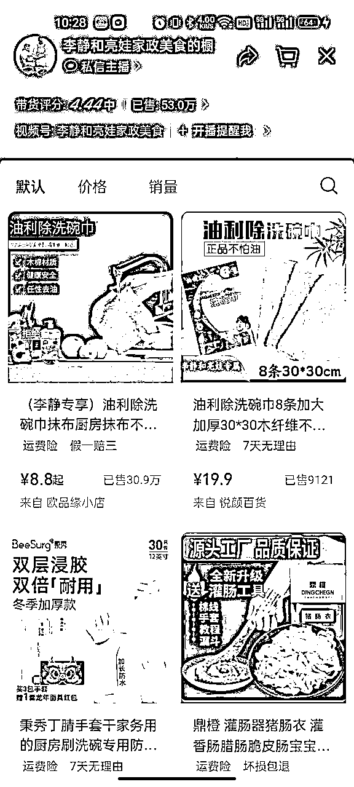

## 专家管理型：养老看护

**基本情况 A**
抖音账号：护工面试官
内容形式：视频
粉丝：10.8万
变现：导流线下
人设打法：护工机构总监，围绕护工、月嫂岗位问题做内容

**基本情况 B**
抖音/小红书账号：福寿康居家养老照护
内容形式：视频
粉丝：3.8万
变现：导流线下
人设打法：护工上门照护老人，突出爱心与温度 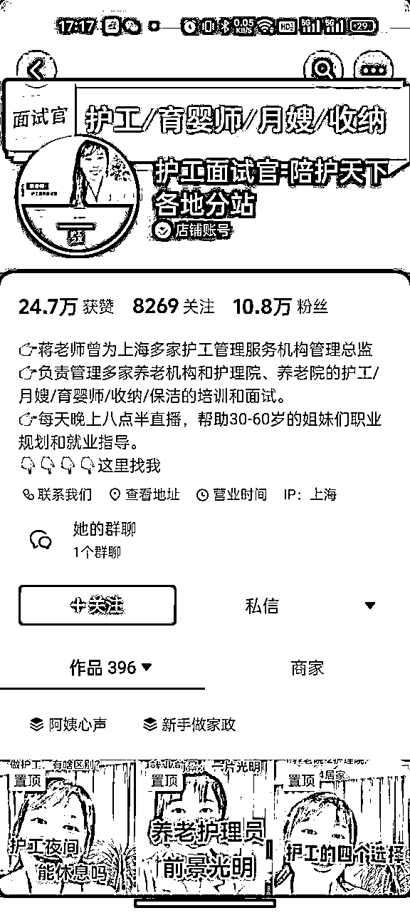

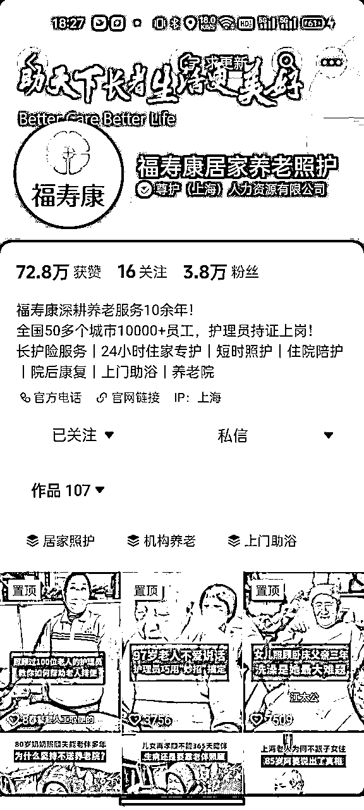

**1 流量怎么来？**
护工面试官采用真人出镜口播+直播引流微信；福寿康通过对老人、家属、护工的访谈式内容输出，评论区做互动沉淀。 

**2 产品怎么搭？**
陪护天下：护工、月嫂、育婴师、保洁家务师招聘培训及加盟。
福寿康居家养老照护：长护险服务、住家照护、短时照护、住院陪护、院后康复、上门助浴、养老院服务。 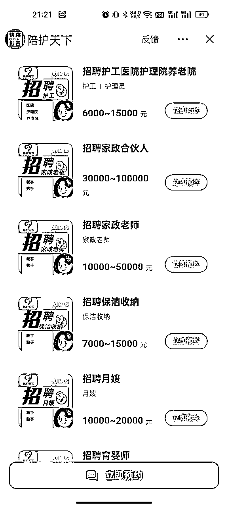

**3 变现怎么实现？**
陪护天下：线上获客，无证人员先培训考证再派单，收取服务费。
福寿康居家养老照护：线下联动社区等资源，线上内容评论区导流线下，按客户需求提供差异化照护方案。 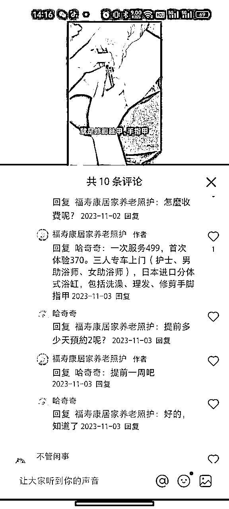

# 项目复盘与放大路径

**1）项目如何做**
一端是多元化的客户需求，一端是专业人员的交付能力。普通人可以做连接。

从需求端切入：获取精准本地流量，找到可交付的同行合作。
从交付端切入：建立标准化交付体系，批量培训人员，与有流量的账号合作。
新手建议先从需求端起步，难度更低：从线上平台截流，再找本地阿姨落地执行。缺点是交付质量难控，容易被客户绕开。

起步SOP：
注册账号
多平台开号：抖音/小红书/快手/视频号
完善人设：家政行业多年的某某师
内容制作
找数据好的对标账号拆解写脚本
本地找阿姨沟通拍摄，或与同城家政公司合作拿客资赚提成
互动引导
发布后用小号在评论区引导互动，加微信
转化交付
加微信后梳理客户需求，问阿姨、同行确认方案
确认意向后安排合作阿姨上门服务

**2）项目如何放大**
矩阵放大
多账号批量分发同类素材
后端建立阿姨服务交付标准流程
加盟培训
输出项目SOP招商加盟，如云家政模式

**3）总结**
国务院办公厅印发的《关于促进家政服务业提质扩容的意见》已从政策层面给行业加持。结合上述判断，家政赛道品类极广、门槛普遍偏低，但要做长久壁垒，核心仍在交付品质的可控与稳定。企业对员工的管理培训、保障制度是否完善，决定了能否建立品牌信任，否则只能靠不断拉新，成本居高不下。 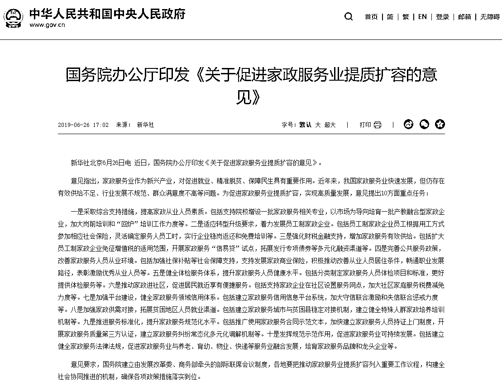