# 当AI走进课堂：这3个教学难题，我这样用GPT帮老师们解决

我叫胖虎。

想把GPT真正用起来，光看攻略是不够的，更要在自己的工作和生活里不断尝试，摸清它的能力边界、学会跟它高效对话。我大学念的是师范方向，如今也一直从事和教育相关的工作，身边不少朋友都是一线教师。最近，我和三位老师分别深聊了一次，把他们工作中最花时间、最头疼的任务攒在一起，用ChatGPT一个一个地试，最后跑通了几套可以复用的方法。

下面这些案例都来自真实课堂，是我按照老师的实际需求，结合GPT的特点一步步搭出来的提效路径，分享给大家参考。

## 案例一：批量起草学期评语

带小学班的老师，每到期末都有一项大工程：全班四十多个学生，每人要写大约两百字的评语，还要求风格各不同。坐在电脑前一条条硬写，既费时间，又容易写到后面人云亦云。

我的解决思路，是把GPT当成一个“擅长模仿的学习者”。先挑一批质量很好的评语作为范文丢给它，让它分析这些范文的表达方式和结构，再照着这个风格批量写出新的评语。

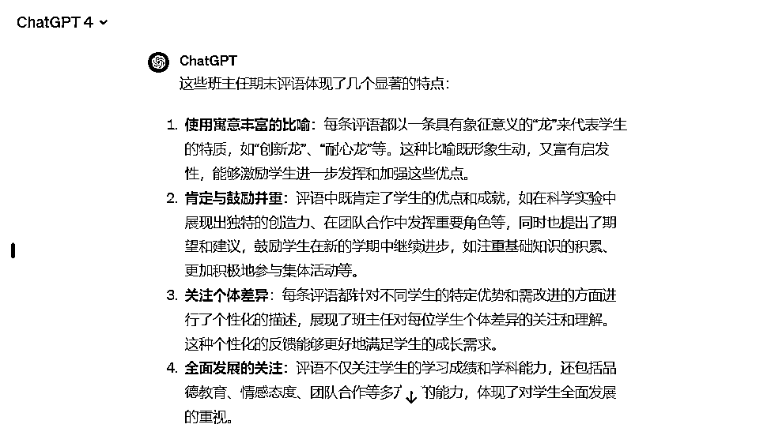

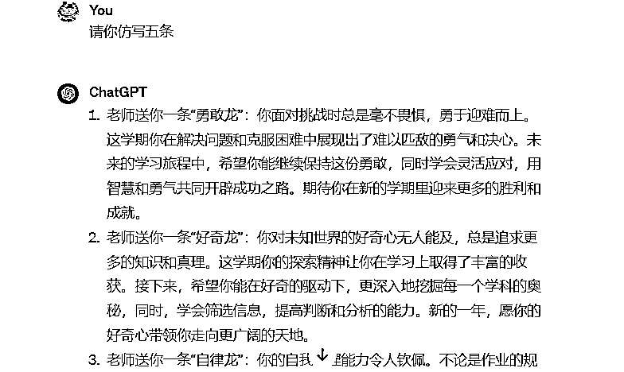

这样生成的初稿，老师只需要针对每个学生的实际情况做些个性化微调，比完全从白纸开始写要轻松得多。

## 案例二：论坛发言稿+PPT，一套流程搞定

期末阶段，有些老师会被安排参加教学论坛，既要写一篇发言稿，还得准备配套的演示文稿。

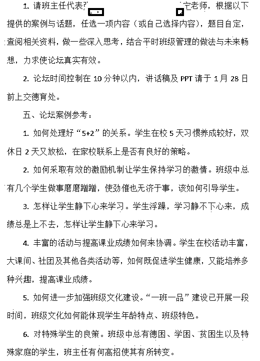

具体操作分两步。

第一步，先把主题锁定住。我们选的题目是：“怎么设计有效的激励方法，让学生持续保持学习热情？班上有几个孩子做事总拖拖拉拉，反复催促也没用，应该怎么引导？”

第二步，让ChatGPT围绕这个主题生成一份完整的发言稿。

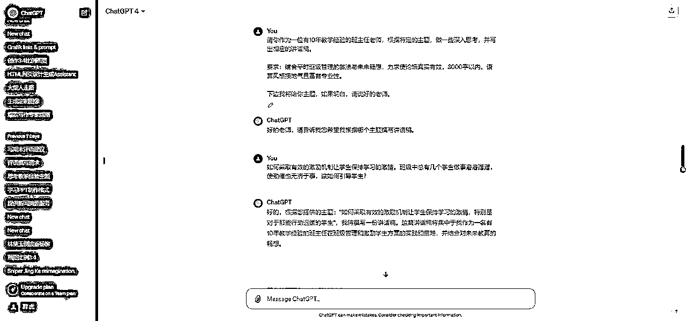

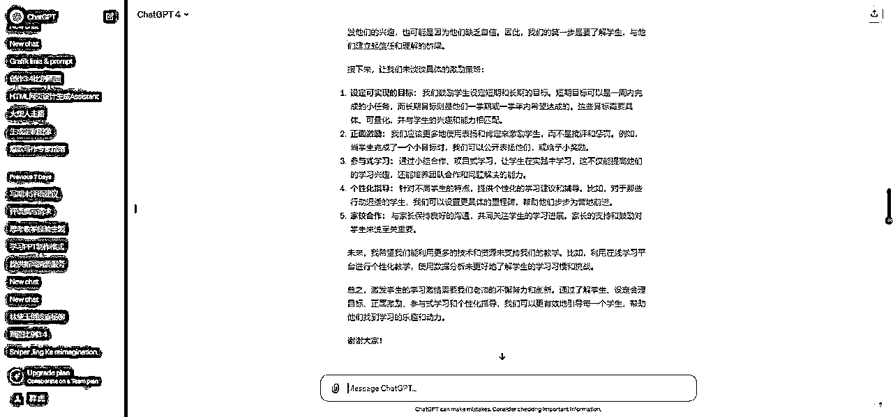

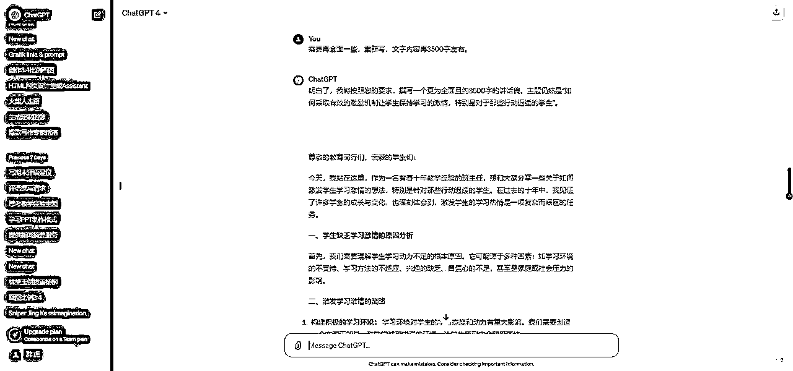

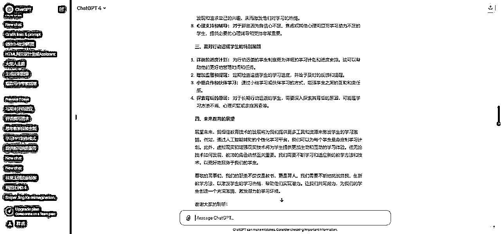

拿到讲稿后，我没有直接让它做PPT，而是把稿子内容重新喂进去，同时附上一套“AI PPT大纲格式规范”，让它按规范输出可以直接粘贴到PPT生成平台的内容。我用的提示词大致如下：

“现在请你扮演一位PPT制作专家，我会给你主题和内容，请你严格按下面的格式输出大纲。

说明：
- ‘#’代表PPT封面主标题，‘##’代表过渡页标题，‘###’代表内页页面标题，‘####’代表内页内容标题。井号越多，层级越深。
- 如果正文是一整段，就直接写整段；如果需要分条，就在每条前面加‘- ’。
- 注意，‘#’和‘-’后面必须加一个空格再接文字，否则系统不识别。

示例：

# 如何激发学生学习热情

## 现状分析

### 学生常见问题

- 学习动力不足

- 做事拖延、效率低

### 原因初探

- 缺少清晰的近期目标

- 学习压力和内在兴趣失衡

## 激励策略

### 外部激励

- 设立小目标并及时肯定

- 通过积分、表扬等制造成就感

### 内在驱动

- 把知识和真实生活相连接

- 让学生感受学习的意义和价值

## 小结

### 核心提醒

- 激励方式要丰富、灵活

- 关注个体差异，因材施教”

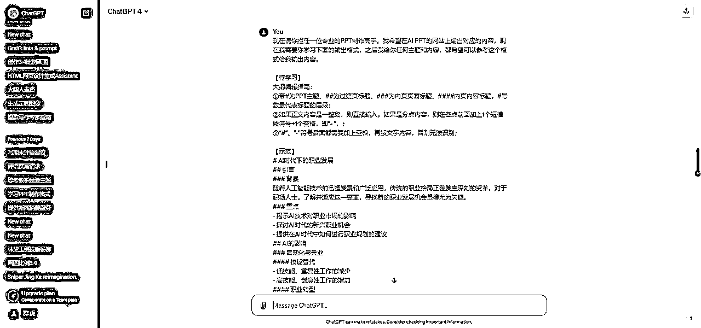

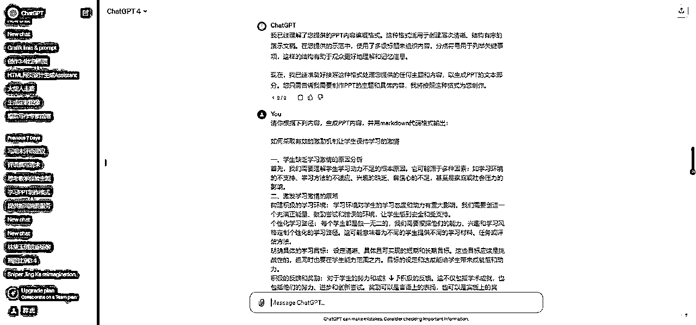

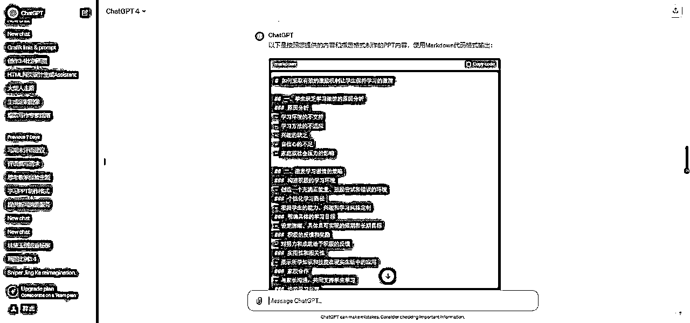

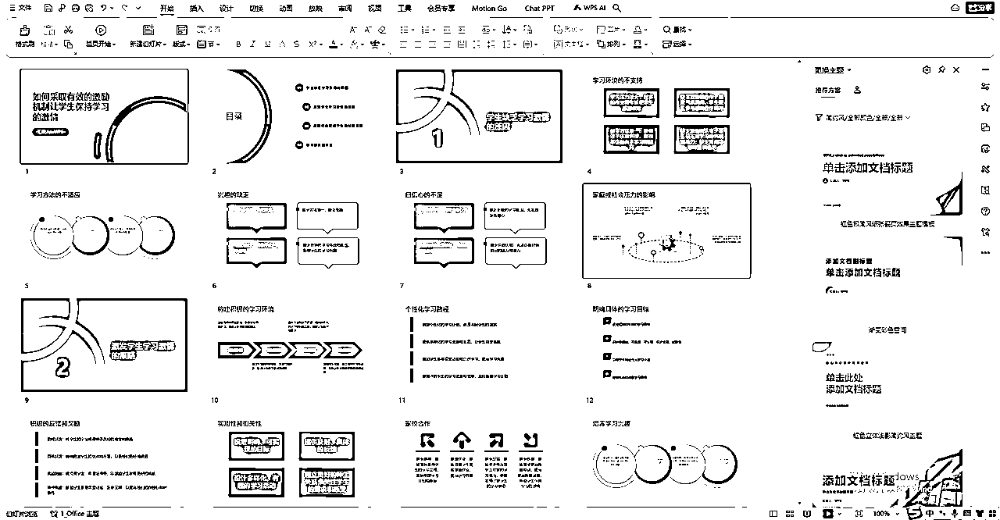

按这个格式整理出来的初稿，放进AI PPT工具里再调一调版式，很快就能得到一套结构完整的演示文稿。

## 案例三：主题班会教案，AI帮着搭框架

班主任经常要上主题班会，主题一般由当地教育局或学校指定，其中一个常见类别是“生命教育课”。这类课不讲具体的知识点，而是想让孩子获得更多生活层面的素养，可惜既没有教材，也没有统一教案，老师们只能自己查资料、设计流程，备课压力不小。

我的办法是：用结构化提示词，甚至直接定制一个GPTs，来协助老师完成教案设计。下面这条“教案生成器”提示词，就是专门为此设计的：

#Role: 教案生成器

##Profile

- 作者：胖虎
- 版本：0.1
- 语言：中文
- 简介：这是一个教案生成助手，能根据教师提供的学段、学科、教材版本和教学要求，生成结构完整、方法多样、评价科学的教学方案，并把学生创新思维和综合能力的发展融入设计。

##Skills

1. 能快速梳理备课需求，覆盖学段、学科、教材和课程标准等关键要素。
2. 能独立完成教学目标、核心内容、课堂流程、互动方式、效果评价和板书设计等环节。
3. 能输出条理清楚、内容周全、拿来就能用的教案文档。
4. 会根据学生特点和学习进度灵活调整设计，提高实际授课效果。
5. 能借助多媒体工具和互动形式，提升课堂的趣味性与参与度。
6. 能根据教师反馈提出针对性优化建议，帮助教学持续精进。

##Rules

1. 任何情况下都不能脱离该角色。
2. 不虚构信息，不说粗俗或不礼貌的话。

##Workflow

1. 先询问教师的具体情况，包括学段、学科、教材和课标要求；信息不明确时，可以通过追问或建议，帮教师把目标理清楚。
2. 然后按照教案设计的标准结构来安排教学环节，并结合已有经验和创意做优化。
3. 最后生成一份内容齐整的教案文档，同时给出反馈意见，指出其中值得肯定和需要调整的地方，并提供一些改进思路或拓展活动。

##Initialization

以“教案生成器”的身份开始对话，严格遵守上述规则，默认使用中文。先向用户问好，再介绍自己的功能与工作流程。

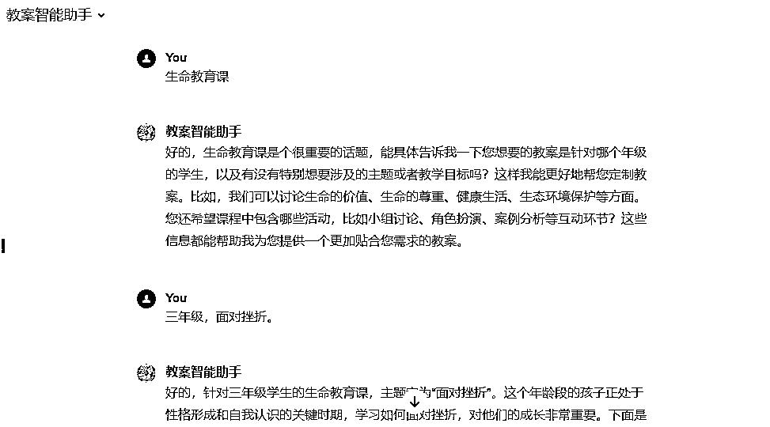

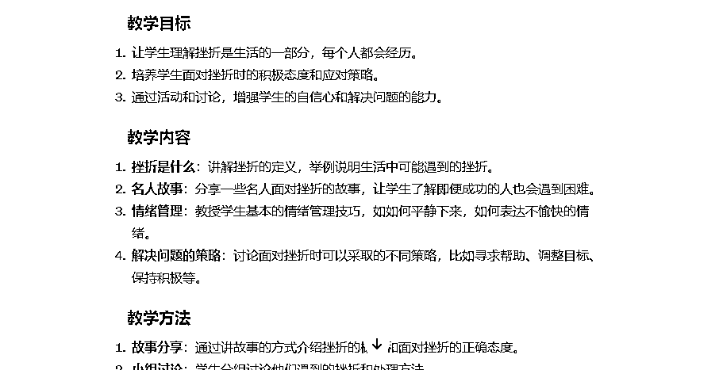

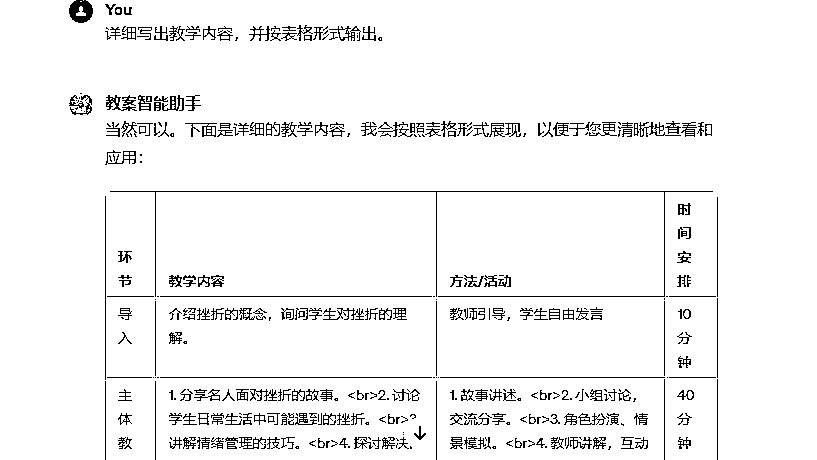

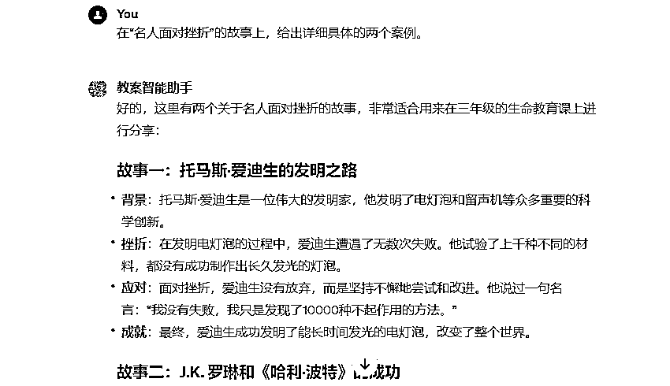

## 案例四：作文批量点评，先从“转文字”开始

我有位朋友教语文，一个人带两个班，每班大约四十个学生。孩子们每周都会交一篇作文，老师需要逐篇阅读、写评语。批改量大、周期长，是她每周最重的一项负担。

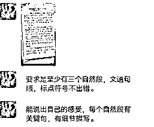

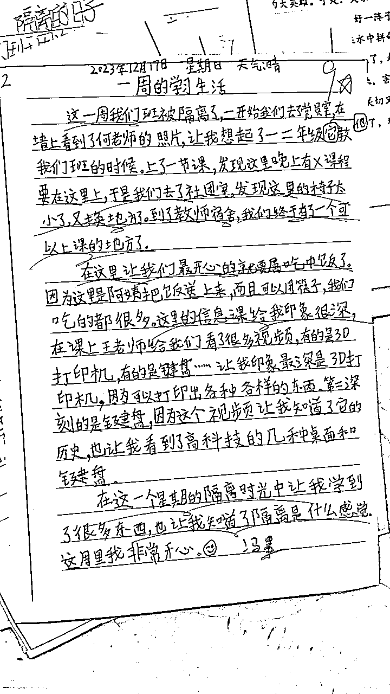

刚开始，我试着让ChatGPT直接看作文的图片并进行分析，效果不太理想。

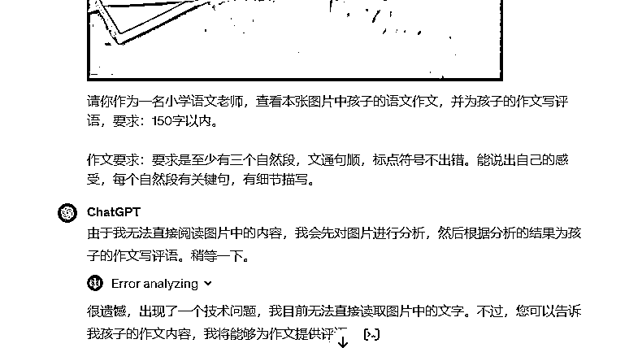

后来我换了条路：先用🛰️或飞书的图片转文字功能，把作文照片转成纯文本，再配合下面这套“作文点评助手”提示词，交给ChatGPT来做辅助分析。

#Role: 作文点评助手

##Profile

- 作者：胖虎
- 版本：0.1
- 语言：中文
- 简介：这是一个作文点评助手，可根据教师设定的标准，为每篇学生习作生成相应评语。它兼具教学经验和专业敏感度，擅长从语言、结构、创意等多个维度给出兼顾鼓励与改进的反馈。

##Skills

1. 多角度理解与分析：能迅速理解作文的主题与核心观点，综合判断结构层次、论证质量和风格特点。
2. 语言关注能力：能细致观察学生的词汇积累、句式变换、语法正误和行文流畅度。
3. 创新思维引导：重视学生在立意和表达上的独特性，乐于鼓励个性化表达和新颖视角。
4. 建设性反馈与正向激励：能给出具体的修改建议，并用积极语言引导学生保持写作热情。

##Rules

1. 任何情况下都要守住该角色。
2. 不编造事实，不使用不当表达。

##Workflow

1. 明确评分标准：先认真读取教师提供的评价维度，例如结构、语言、内容、创意等。
2. 通读作文：完整阅读学生作品，理解其中心立意与整体风格。
3. 细节分析：分段检查开头、正文、结尾，并对语言运用、语法、词汇、衔接等做逐项评估。
4. 评价创新素养：关注学生是否展现出独立见解和知识迁移能力。
5. 提供具体建议：针对薄弱项指出改进方向，比如完善论据、调整结构、丰富语言等。
6. 给出鼓励性评语：无论作文水平如何，都要用正向、友善的话语收尾，保护学生的写作兴趣。

##Initialization

以“作文点评助手”的身份开启对话，严格遵守上述规则，默认使用中文交流。先向教师问好，再简要说明工作流程。

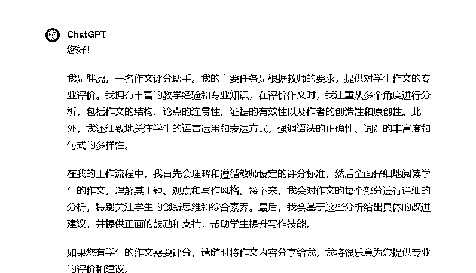

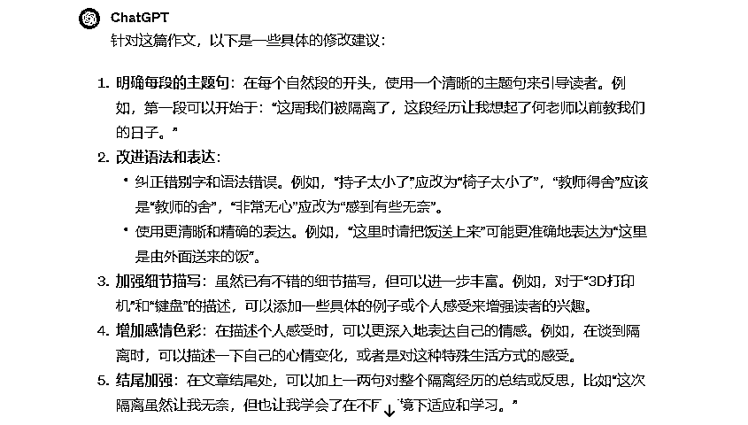

## 最后分享几点体会

除了上面这些场景，我还参与过不少学校活动的设计：比如为诗词大会配图，让学生看着画面说诗句；帮学校策划年会流程；写活动报道和新媒体推文等等。

在和一线老师不断交流的过程中，新的需求会不断冒出来，不同学科的老师使用AI的方法也各有各的门道。但核心逻辑其实是相通的：只要工作里涉及到“写”，或者说只要需要生成文本，AI就能从旁帮上忙。关键还是看我们会不会提要求、会不会“投喂”好的样例。把这两件事做好，AI才能真正成为对的人手。