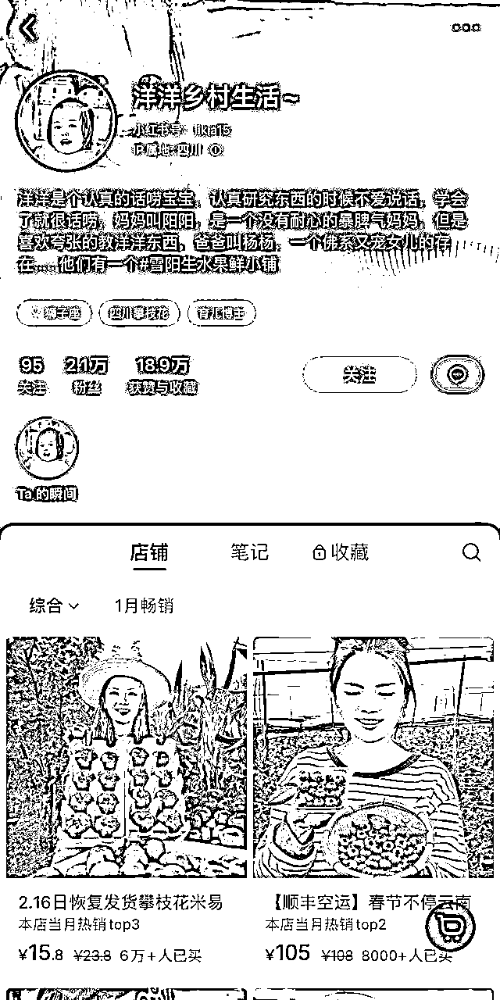
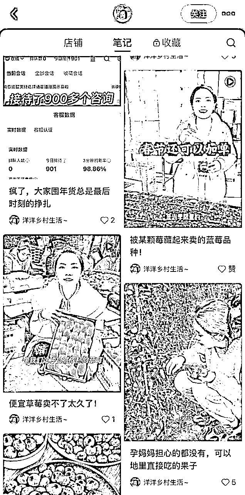
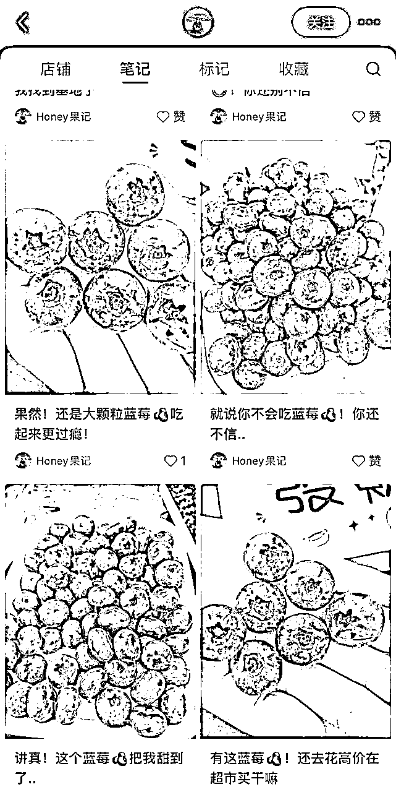
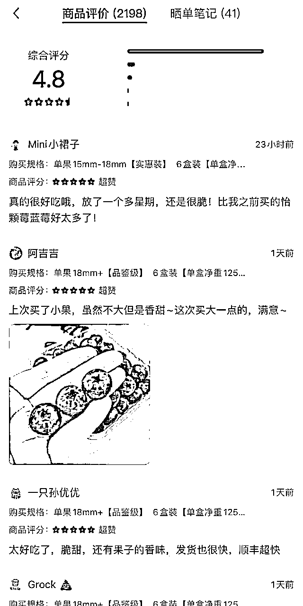
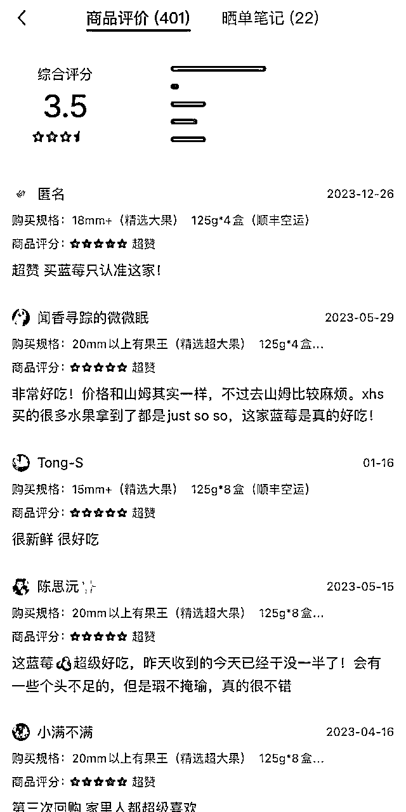

# 📕卖高端水果，不想做低价走量就照这套打法
作者：龙哥

# 案例拆解

📕上做高端水果生意，核心就抓住三件事，订单自然就来了

# 先把货源卡死

我为什么一直看好📕的三农赛道，最近云南朋友就寄来了一盒玉溪蓝莓。

前一天发出，第二天下午就空运到家，顺丰直送。

打开包装时，蓝莓状态完全像刚摘下来一样，颗粒饱满、脆甜多汁。

同款在快团团上是99元4盒，单盒125g，我的佣金是14块。

放到📕上，客单价直接拉到108元起步，还稳定卖出5000多单。

这类高品质的水果，根本不用担心售后问题。

采用一件代发，售后全部由上游源头兜底，退换全不用自己操心。

想在📕玩转高端水果，首要条件就是找到一个能超预期交付的供应链。

# 人设必须和价格匹配

高端果就得配高端的人设。

比如账号【洋洋乡村生活】

主打孕期可以吃的水果、宝宝能安心吃的水果。

内容全部是实拍镜头，偶尔还会带上自己的孩子出镜。

真实感拉满，塑造出一个靠卖水果养家的宝妈形象。

每一次种草都在强调对孩子健康的考量，在天然与安全上做足文章。

哪怕单篇笔记没有爆火，也雷打不动每天更新。

再看账号【Honey果记】

简介里直接立住自己的果园老板身份。

不做真人出镜，全靠高清实物大图硬刚。

账号里常年挂着群聊入口和直播间，每天稳定输出5篇内容。

# 评价才是转化密码

【洋洋乡村生活账号】

店铺里好评几乎清一色五星，评价数量非常可观。

核心是产品本身过硬，再加上主动引导用户晒单。

【Honey果记账号】

价格标得很高，但用户却觉得性价比不匹配。

评价寥寥无几，也没有做引导，信任感直接拉低。

# 收尾一句话

想在📕扎根三农品类，人设的真实感是根本。

人设立住了，利润和复购自然也就上来了。

手里如果已经有靠谱货源和可用的拍摄素材，不妨直接开个📕店铺试试水。

现在平台上同类产品体量还很小，持续发声，爆单的就是下一个你。