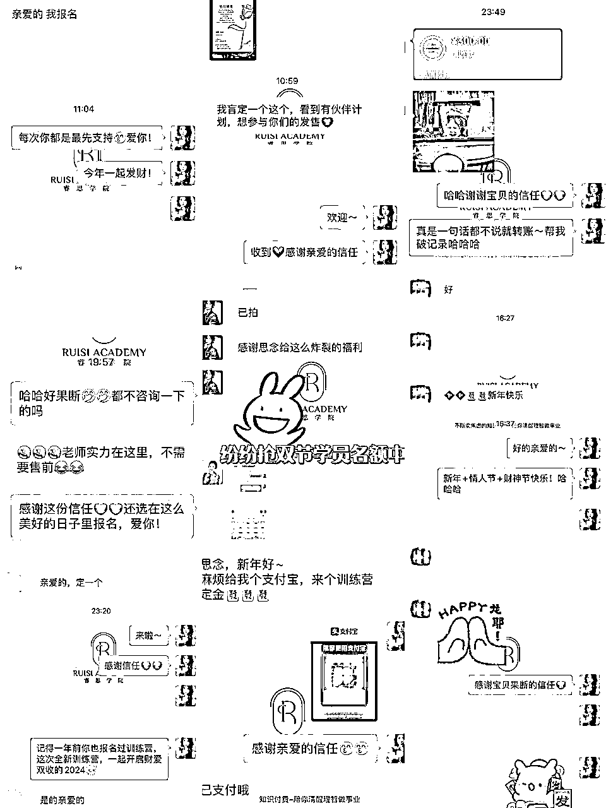
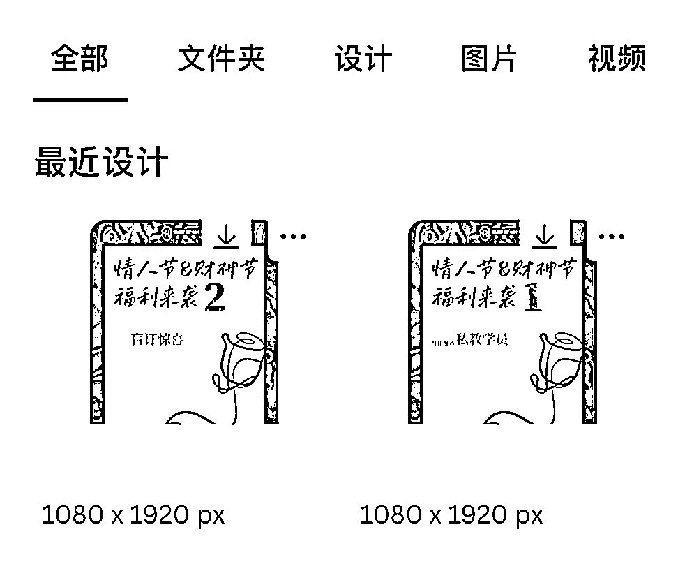
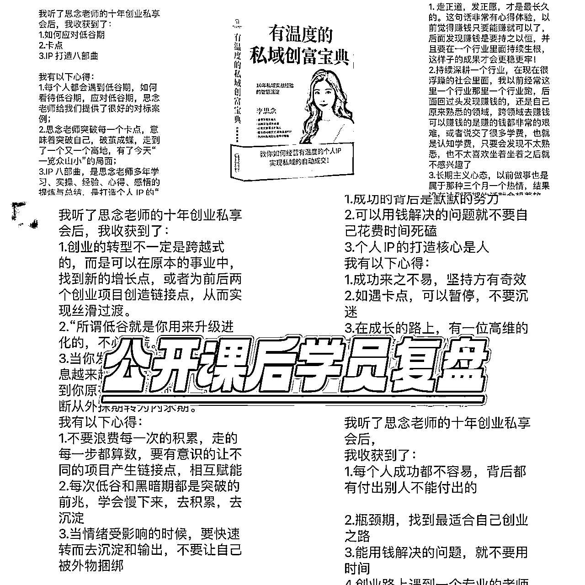
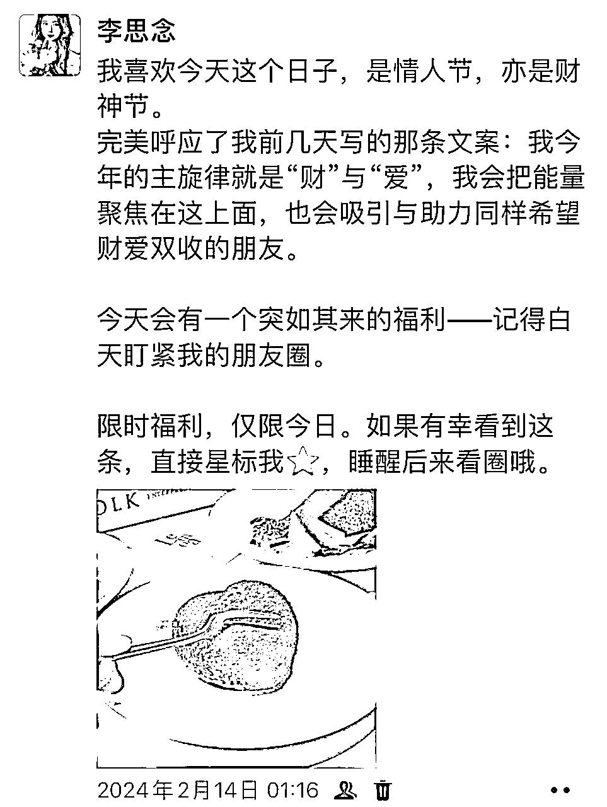
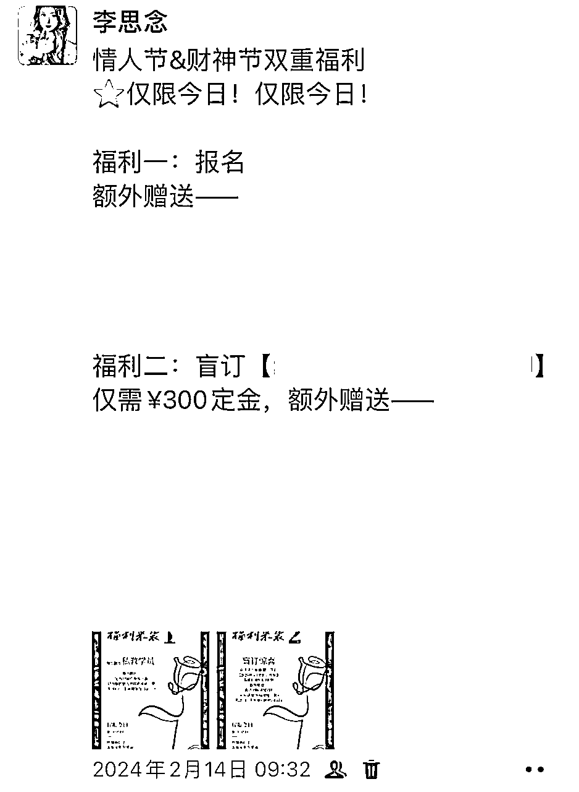
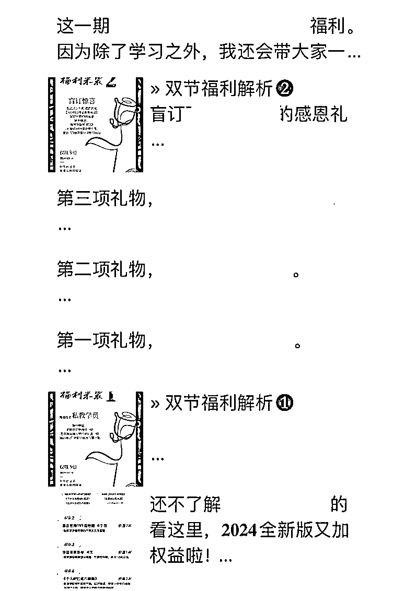
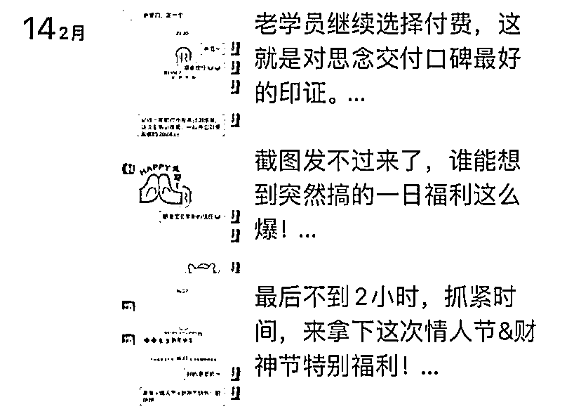
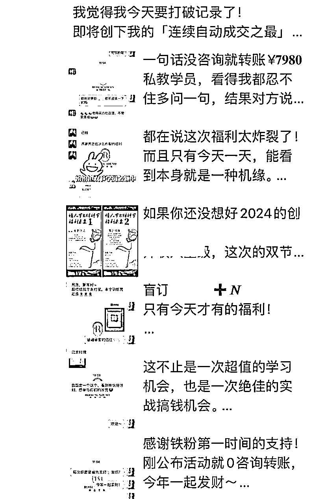

# 一天私域自动到账4万+，不靠推销也能成交的底层逻辑
作者：龙哥

大家好，我是龙哥。

一位深耕「有温度私域」的IP创业导师。

今年2.14撞上了情人节和财神节，我顺着“财爱双收”的寓意，临时起意用一晚上搭了一场小爆发。

结果单日流水4万+，更离谱的是——全程零推销，全部自动成交。当天每一个下单的用户，都在3句对话内完成付款。

这次收的大部分是定金，还是盲订状态，客户在产品没公布前就先付钱。按最终交付价值算，后续体量会超过10万。

我不打算把数字说得夸张，重点是想拆解这套「不销而销」的自动成交机制，这对做私域的朋友会更实用。

[ 全文已脱敏处理，不做广告，安心阅读 ]

先说清楚什么叫「不销而销」：

在我看来，最顶级的生意是用户根本不需要被说服。没有话术、没有逼单，他就是被价值吸引，自愿完成转账。

这种状态不是靠一个点子打出来的，而是一整条链路在支撑：IP的信任感如何建立、私域如何精细化运营、文案如何越读越上头、钩子如何设计让人秒拍。

下面就把这次快闪发售的自动成交链路完整拆开。

# 一、一天发售是怎么设计的

活动本身不是重点，先简单交代背景，方便理解逻辑。

设计思路围绕寓意、节奏、打法、物料四件事。

## 1、活动寓意

做活动前要先回答：为什么这个时候做？

我这次就借了情人节+财神节的情绪场，借势“发财与被爱”的心理预期，做了一波报名福利，天然就有共鸣点。

## 2、活动周期

常规发售我会做3-5天，这次只做1天，算是快闪里的快闪。

周期越短，对IP信任值和触达效率的考验越大。我一直觉得营销不能套路化，用户一眼看穿就会产生防御。适当的反套路，反而更容易破局。

这次我用了很多超出预期的安排，后面会具体说，效果确实出乎意料。

## 3、活动策略

常见打法有折扣、满减、赠品、抽奖、秒杀。

我这次用的是买赠，核心产品本身的价格从不打折，这是我对IP价值的坚持，也建议大家别轻易贬值。

第一层是买私教送权益；
第二层是为下月新品预热做的「盲订惊喜」——产品没公布前先交定金，定金用户再额外拿多重礼包。

盲订对信任是极致的考验，新手不建议玩。只有当你的潜在用户池信任度足够高时，盲盒式玩法才会变成期待感而不是抗拒感。

发布后好几位意向客户直接转款，连基本沟通都没展开。

盲订里我还加了一个「零风险承诺」：如果公布后你觉得不合适，定金价值会以更高配的资源补齐。

这个承诺直接把犹豫值压到最低，是自动成交的关键推手之一。

## 4、物料准备

正常发售海报会提前筹备，这次是春节临时起意，美工休假，只能自己用手机做了两张。

顺便推荐个工具：可画。模板多，一键套用，特别适合临时出图。

# 二、高价值IP的经营打法

## 1、储蓄罐思维

想做到自动成交，必须有储蓄罐意识。

每次输出、每次互动，都是往罐子里存一枚信任金币。发售只是最后那一枚引爆的金币。真正重要的，是前面长期攒下来的存量。

这次就是典型的零存整取，攒够了就取一次，取完继续存。只要持续输出，现金流就能持续。

## 2、信任前置

我的第二个核心理论是：信任要在公域前置，私域才能高效变现。

引流端要把人设做立体，别当工具人。用户是冲着一份资料来的，还是冲着认同你的价值观、想认识你这个人来的，结果完全不同。

我的大部分精准客户来自📕，他们在加我之前就被我的文字和观点吸引，带着好感进入私域，所以成交时几乎没有摩擦。

## 3、十二字用户关系法

加进来的用户怎么留住？怎么让他们持续关注？

我用12个字概括：「一见倾心，再见慕华，三见誓随。」

一见倾心：刚加好友就要惊艳到。核心看两件事：自我介绍和朋友圈五件套。

自我介绍要够有分量、有温度，最好带见面礼，让用户第一时间感受到收益。

朋友圈五件套：昵称、头像、签名、封面、置顶。要有故事感，有设计感，让人想继续往下刷。

再见慕华：持续给价值，让用户觉得你懂他。朋友圈、社群都要长期输出围绕IP定位和用户需求的干货。别想着发两周就够了，真正变现好的IP，内容输出都是以年为单位的。

三见誓随：用人格魅力收尾。用户买的不仅是方案，更是和你在一起的舒服感。通过内容不断呈现你的精神内核、差异化主张，精准共鸣，深度锁粉。

每条文案都是通往成交的桥，要带目的、有原创。

这次一位直接付费7980的私教学员，开口第一句就是问付款方式。我反问她要不要再咨询，她说：老师的实力摆在那里，不需要售前。

那一刻我觉得一切都值了。日常的价值沉淀从不会白费，哪怕用户不点赞不留言，也在默默观察。IP是慢生意，你今天的变现，可能是半年前播下的种子。

# 三、社群蓄能的反套路

虽然这次活动是临时决定，但蓄水很早就开始了。

年初规划时我就建了一个免费创业思考群。为何提前建？今年营销动作多，反复建群容易被风控。

社群+朋友圈配合，能把内容触达率最大化。

1月份我做了两次公益性质的活动来聚粉：《生日答谢》和《十年创业分享会》，都没有做任何转化。

很多人看不懂，我的团队当时也有人质疑：公开课后不追销？这正是我的蓄能逻辑，也是反套路。

不急于转化，先加深信任。生日赠礼、转发送书、跨年红包增加粘性；干货分享和动态同步增强影响力；课后复盘提升参与感和传播力。

社群要养，不能竭泽而渔。取完一次就继续蓄水。

赚钱本质是持续提供价值后自然的回报。

# 四、朋友圈如何做到自动成交

社群蓄能+朋友圈发力，完成了这次营收。

朋友圈日常是信任沉淀，发售期就是自动成交的引擎。

我平时一天发5条，这次发了20条。不是为发而发，是内容太多舍不得删，组合起来才有那种越看越想付费的压强。

当日结构：2条铺垫 + 1条公布 + 7条解析 + 10条成交氛围

第一条铺垫是凌晨发的，提前预告白天有福利，保持关注。

公布圈在上午9:30，直接硬广，不绕弯。方便后期刷到其他内容的客户能快速定位到活动说明。

解析圈是关键，很多人在这一步偷懒，导致用户反复问同样的问题。我提前把大家会想问的都写清楚：每一项权益的意义、设计逻辑，让客户在阅读中自己从理解到认同再到种草。部分用纯文字，避免刷屏感。

成交氛围圈是助燃剂：晒单、倒计时、名额、老客复购等。条与条间隔30分钟以上，不打扰但保持在视线里。

总结角度：铁粉秒付、大量下单、机会稀缺、爽快付款、老客户续费、倒计时催促、消息回不过来。

核心运用从众心理和损失厌恶，但文案要克制。不要浮夸承诺，我对数字很谨慎，我要吸引的是认可价值的人，而不是冲着暴富来的。

同时有筛选机制，对状态不对、过于急躁或经济压力大的用户，我会主动拒收。

# 五、不销而销的成交心法

1、与传统营销的区别
不销而销更依赖IP积累，而非运营技巧。内容>技巧。很多精密的SOP在突发的一天发售面前失效了，只要IP和内容够扎实，技巧可以让步。

2、价值是日常渗透的
内容触达不是发售那一刻的事。朋友圈、社群、👸号、视频号，都是心智占领的渠道。日常每一次输出都在为成交投票。

3、高端用户更容易自动成交
低客单用户更关注价格、反复比价；高端用户更惜时、决策快、懂价值。价格太低反而会被认为没价值。做IP要瞄准认知和付费习惯更高的人。

4、给用户选择权
别频繁打扰、强拉群。让用户主动选择你，比逼单更有效。主动选择的用户，后期交付和口碑更好。

5、前端做得多，后端才轻松
你售前浪费的时间，都是朋友圈文案偷的懒。把痛点和方案提前写清楚，用户自己就会消化疑虑。

6、成交不急躁
理想状态是0咨询成交，但也要接纳用户的犹豫。别摆出高高在上、不耐烦的姿态。换位思考，给确定性和耐心。

7、利他是出发点
产品能先解决用户问题，你的成交意图才会顺畅。这次盲订能成交，因为赠送的权益本身就有用。

8、最终卖的是价值观
你的每一次表达都在体现价值观。我允许学员差异化成长，尊重个体方向。而有人主张无脑复制。没有绝对对错，取决于用户信奉哪种理念。成交的本质是价值观极度认同。

要把自己的价值观大胆、清晰地呈现出来，它是在IP人设上生长出来的纵深。

最后感谢阅读。

我是思念，祝大家2024年持续上扬，拿到不销而销的确定性回报。