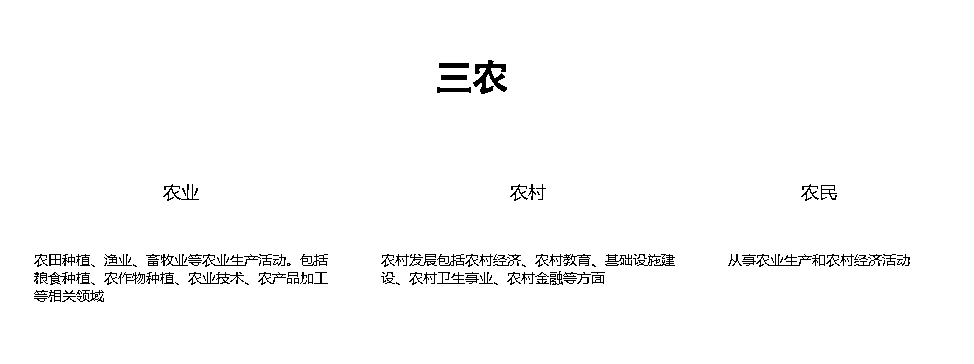
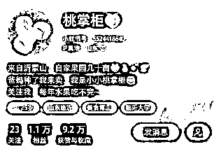
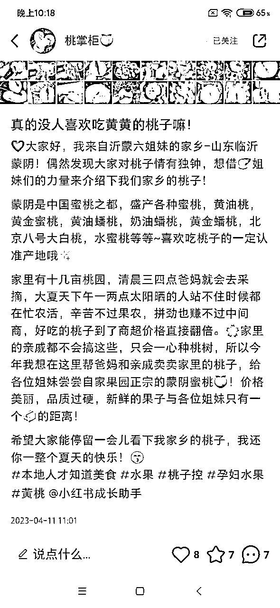
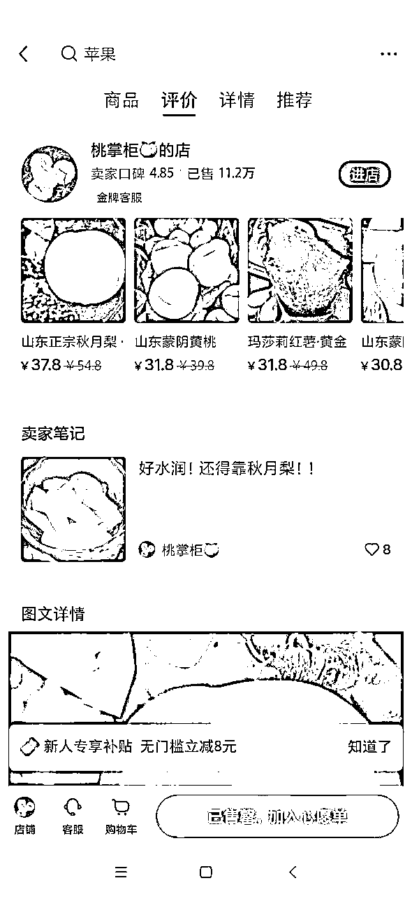
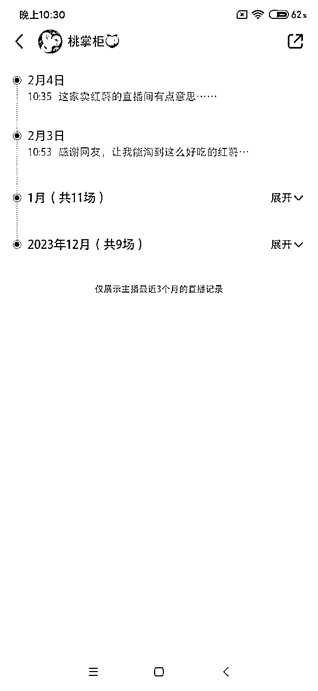
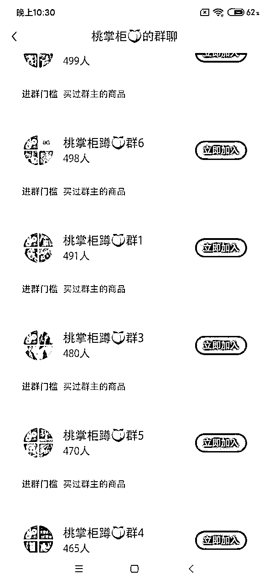
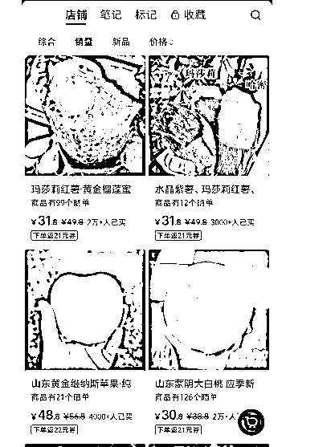
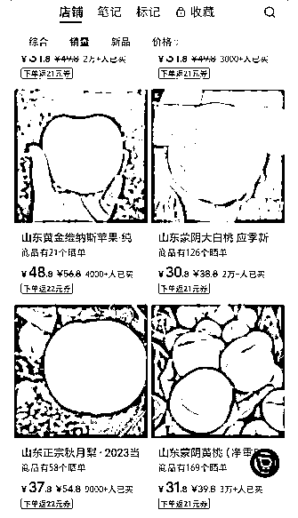

# 三个月卖掉300万苹果？📕三农账号的爆单玩法，全拆给你看

这是「风向标拆解」系列的第三期。今天不聊虚的，直接拿一个真实案例开刀——📕上一个卖苹果的三农账号“秋林”，硬是靠着一套朴实但极其管用的打法，把店铺做成了爆款。而且这套玩法不只限于苹果，蜜柚、荔枝、龙眼、茶叶、番薯……只要你家有地里有货，都能复制。

## 先看成果：这不是玄学，是方法

这个账号的第一条笔记发在2023年4月11日。当时评论区很多人问“怎么买”，因为店铺还没开，也没有商品链接。但现在你再去看，店铺销量已经冲到11.4万件。店铺里一共就6个品：秋月梨、蜜桃、番薯、苹果——没了，就这么精简。

说白了，三农账号卖的就是“你那片土地上长的东西”。北方有苹果，福建有蜜柚、荔枝、龙眼、茶叶，各地都有各自的宝贝。你不需要什么都卖，把一个品类做透就够了。

账号的第一条内容出现在2023年4月11日，当时还没上架商品，评论区全是“怎么买”。而现在，店铺累计销量已达11.4万件。店铺里只放了6个商品：蜜桃、秋月梨、番薯、苹果，轮着来。

## 内容怎么发？怼量，但聪明地怼

这个账号的内容形式是“笔记+视频+直播”三件套。看近三个月的记录，平均一个月开播9到11场，每场主推的产品还不一样。你仔细看就能发现规律：4到8月卖蜜桃，8到10月卖秋月梨和番薯，再往后就切换成苹果。跟着季节走，全年都有应季货可以卖，这也是做农产品的天然优势。

最狠的是发内容的频率——平均一天发2到6条笔记或视频。大约每发10条就会冒出一个爆款，点赞几百甚至上千。爆款出来后怎么办？直接复制，封面和内容都差不多，哪个数据好就照着做，反复做。

这个账号还建了6个群，每个群都快满了。但注意，入群门槛不是随便加的——只有在店里买过东西的人才能进。这6个群就是2000多个忠实客户。等到下一个应季产品上市，在群里喊一声，回购率极高。

## 账号怎么定位？先把自己变成一个“村里人”

核心思路就一条：选好商品，包装好账号，然后讲故事——讲“这是我自己家种的”“这是我自己果园摘的”。别小看这点，信任感就是这么一点一点堆起来的。

选品有两种路径：

1. 如果你家本地就有原产地优势，那就直接整合现有资源。比如你村口就是苹果园，这比什么都强。
2. 如果没有，就上网上找自己本省的特色产品做一件代发。但前提是，你得自己先买回来测品，质量不行就换，别砸自己招牌。

## 流量从哪来？自然流+垂直度+杠精式复盘

账号的昵称、头像、简介，全部围绕三农垂直领域来写。📕本来就是兴趣推荐，你做垂直，系统推给你的客户就越精准。具体的昵称头像怎么写，星球里都有教程，这里不展开。

内容形式上，图文就写商品体验、产品相关知识，多去拆几个做得好的同类账号，找对标很重要。视频就拍实际测试的感受，站在客户角度把卖点讲清楚。直播就更直接了，可以只讲一个品，也可以一次展示好几个品。

至于流量来源，主要还是靠自然推荐，配合“怼量”策略。每天五条，先发20条，然后盯着数据看：有没有爆款？有就复制。没有就继续测。每天复盘小眼睛数据，不断优化笔记细节。

## 利润怎么算？一笔一笔抠出来

如果是自己发货，利润公式就是：

**利润 = 售价 - 商品成本 - 运费 - 包装费 - 人工费**

如果是网上找一件代发，那就简单些：

**利润 = 售价 - 采购成本 - 其他费用**

但注意，水果类产品很容易在运输中出现坏果，一旦坏了就得赔，所以物流选择非常关键，这部分的隐性成本一定要提前算进去。

## 最后的结论：别贪多，先跑通一个品

想做这个赛道，最稳的路径是这样的：

第一步，选一个垂直农产品，优先选有原产地优势的。第二步，找当地的供应商谈合作，有订单就让他们发货，不用自己囤货。第三步，认真核算好利润和定价。第四步，先发几条笔记试试市场反应，没问题再开店上架。

然后把一个垂直品类的内容持续做下去，产品介绍、相关知识科普、客户晒单、售后反馈——这些都要发。发得越专业，系统推荐越精准。

变现也别只盯着📕店铺。把客户引流到私域，在朋友圈再做一轮营销，卖你所在地的特色产品。我之前就看到有圈友靠卖福州鱼丸做私域，还有福建茶叶、蜜柚，都做得不错。为什么在📕上建议卖本省特产？因为📕有IP属性，同样的水果，你说“这是我家后山种的”，比一句“这是批发市场进的”有说服力一百倍。

记住，三农账号的核心不是流量，是信任。信任建立了，苹果一年四季都能卖成爆款。