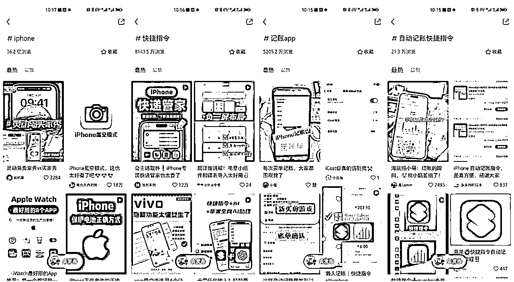
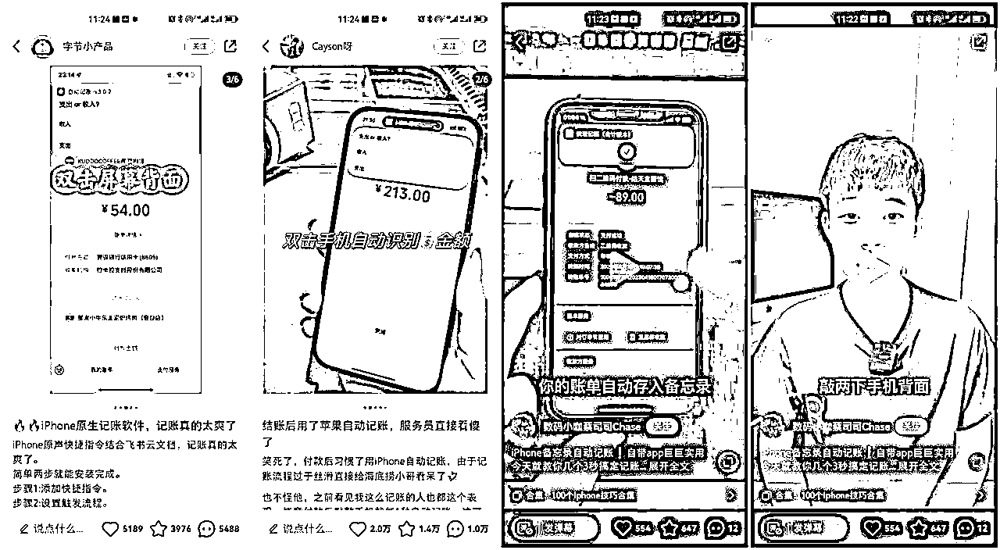
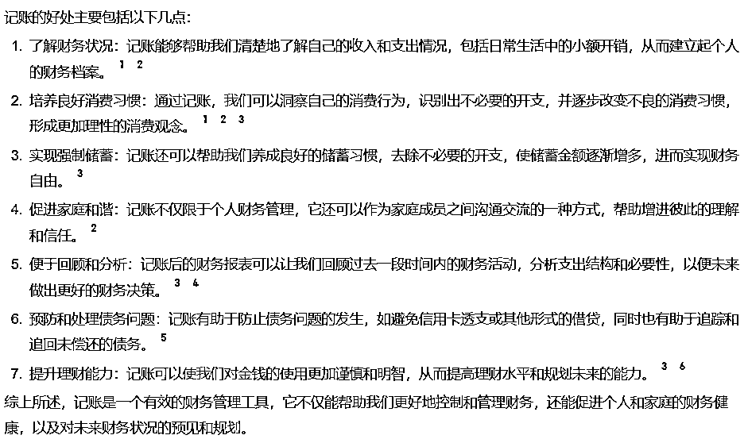
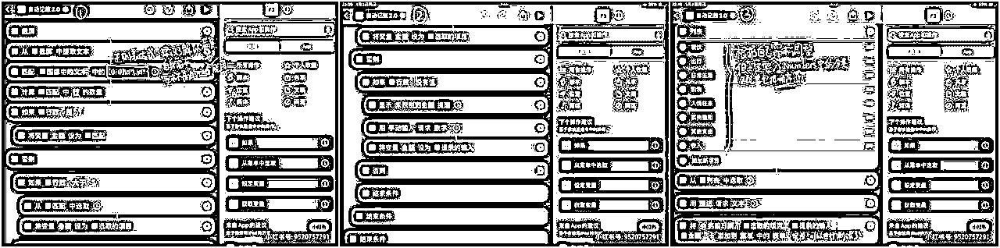
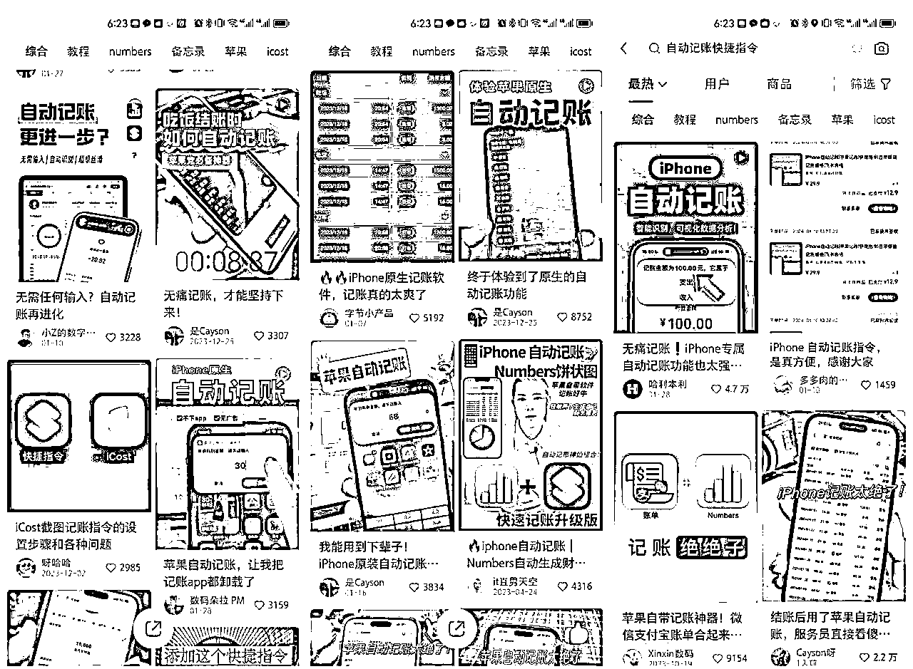

只需在iPhone里配置一套自动管账的规则，就能在种草社区卖出近两万块的销售额——这是本期拆解的主角，一套毫不起眼却让不少人掏钱的效率捷径。

刚听说时，很多人会嘀咕：苹果白送的功能，做起来几乎零成本，真的有人愿意买单？答案是肯定的，因为它恰好戳中了一小撮用户日复一日的困扰。这件事最奇妙的地方在于：不用贪多求大，只要能捕获一些垂直又刁钻的痛点，你照样能复刻出一条属于你的变现路径。如今做一款小工具的难度已经大幅下降，无论是iOS里的自动化捷径，还是当红的RPA，又或者借助AI生成代码，投入一点时间学习，都能顺利上手。

因此，这个案例真正值得研究的环节，不是如何把工具造出来，而是去哪儿寻找那群愿意掏钱的人。手段并不复杂：到内容社区发个帖子，看看评论区的真实声音；混进各类软件用户群，捕捉大家愿意掏钱解决的问题；或者低头瞧瞧自身日常，那些让你皱眉的小事，很可能就是机会。读完这篇拆解，你或许会发现许多藏在眼皮底下、却从未被你正视的真实需要。

先来看看这个工具到底是什么。它的名字拆成两半：一半是“自动账目管理”，这是使用者向往的功能，即需求原点；另一半是iOS系统内置的效率工具——这项工具最初叫Workflow，出自Ari Weinstein团队之手，2015年6月9日摘下一项苹果设计类大奖；2017年3月23日，苹果把它收至麾下；2018年9月18日，它更名为“捷径”并随系统预装；2019年2月，又经历了一轮改名，最终定格为如今大家熟知的名字。

它凭什么吸引这么多人？答案相当直白：国内iPhone用户群体足够庞大；iOS这套内置功能的发挥空间相当大；种草社区里讨论理财和日常开支的人向来不少。 更别说它自带趣味属性——轻碰两下机身后盖，记录功能就会自动弹出。 当然，养成记录开支习惯的益处也不需要赘述，总有人想知道每一分钱都流向了哪里。

产品是怎么做出来的？有两条路子。第一条是全程手工打造：先建一个Excel表格，把参数校准到位（如Feishu、Numbers这类工具），随后创建自动化流程， 再去手机系统的无障碍菜单中，把“双击背面”的触发手势指向这套流程。接着录制演示视频，再配上图文素材，标题往“iPhone专属”“管账神器”“闭眼入”的方向靠，最后引导访客下单并提供完善的售后支持。第二条路子是采购现成模板，拿回来后自己优化升级，挂到店铺里做引流，慢慢促成转化。

那么，怎么让流量主动找上门？目前这套产品主要活跃在种草社区，图文笔记是主力载体。 笔记里的高频话术基本离不开“系统自带”“免安装”“自动管账”这几个卖点，可以参考一个叫“是Cayson”的账号。用户愿意下单的动机大致有三点：省事，正对懒人胃口；好玩，轻碰两下就能完成记录；刚需，恰好回应了打理收支的长期愿望。

谁在为此掏钱？有稳定消费能力的人、有记录开支习惯的人、热衷新鲜事物的人；性别方面女性明显多于男性；财务从业者，比如账务专员和出纳岗，同样是购买主力。利润账怎么算？开发端不用花一分钱，手头有一台iPhone就行；生产端同样零投入，顶多贴上些时间；运营维护几乎是零成本。综合来看，只要把客流稳住，这门生意基本是纯利。

那该去哪儿找“有需要的人”？最简单的入口是审视自己——比如最初选中这个题目的人，就是因为他本人始终在寻觅一套好用的管账手段。另一个方法是借助优质圈子：像生财这样的社群里，各种市场信号、中标案例、精华内容、实战拆解每天都在刷屏，背后全是实打实的用户痛点和赚钱机会。

未来还有什么玩法？私域绝对值得一试。把用户沉淀到微信上，然后鼓励老用户在个人动态里晒单、分享返利链接，依靠人际传播放大销量；同时可以持续创作搭建这套自动管账系统的教学内容，用它们把新流量引导进私域，再做一波周边产品变现。

这期拆解就聊到这里，希望它能带给你一些不一样的启发。谢谢你的耐心阅读！