# 一个人把婚礼从零搭到竣工，省下3万块的完整复盘

大家好，我是艺荷，90后自由职业者，也是签约平台的写作者。

毕业五年半，靠着死工资加理财攒下人生第一套房。现在主要做自媒体写作和账号运营，全网粉丝合计2万出头。

2023年我把自己的婚礼从策划到执行全包了，累是真的累，但最终效果超预期，省下来的钱直接进了口袋，算下来有3万多，所以我觉得这笔买卖很值。

下面是我对整场婚礼的拆解复盘，供有类似想法的人参考。文中会多次提到小红书，先说明一下，不是推广，纯粹是备婚期间离不开它，攻略全靠它。

# 1、为什么选择自办

这个决定来源于两个原因。

①我的摄影习惯。每年生日我都会去拍一套艺术照，拍两三组下来人也废了。两年前刚和阳光认识时带他去拍情侣照，结果成品惨不忍睹。后来我自己用相机试拍了一组，效果反而好很多，于是萌生了自己拍婚纱的念头。再加上朋友拍婚纱时各种翻车，让我更坚定要自己来。

把婚纱照搞定后，我觉得难度并没有想象中大，于是开始琢磨婚礼是不是也能自己操盘。

②现实条件。阳光妈妈希望婚礼在老家村里办，亲邻居近，去市区酒店不合适。而且爸妈基本没法出钱出力，得靠我们自己。找婚庆公司在小地方可选的少，价格也降不下来。为了把钱花在刀刃上，我开始在小红书搜农村婚礼DIY的案例，发现可行性很高。和阳光商量后，我们就定下了自己操办的路线。

# 2、整个筹备脉络

备婚的重头戏其实都在婚礼前，工作量占比接近九成。

从婚纱照、婚期、请柬、风格方案、四大金刚安排到各种小物件采购，每一块都要投入精力。

因为我是全程主理人，流程心里很清楚，所以把我觉得需要重点盯的环节拎出来说说，也带点小坑提醒。

婚礼当天走的是：接亲 → 外景拍照 → 男方家敬茶 → 仪式流程【朋友开场-新郎入场-父亲送新娘-宣誓交换戒指-父母致辞-伴郎伴娘发言-封酒-集体合影】→ 午宴敬酒。

下面重点讲备婚阶段，按时间顺序梳理。

# 3、婚纱照自拍全记录

婚纱照我没交给影楼，自己拍的。

试拍过后我发现，自己拍更真实、有情绪，不像流水线产品。摄影小白出身，之前只借过公司实验室的相机玩过，现在才认真上手。

拍照技术是可以练出来的，自己拍时间灵活，想拍到满意为止完全没问题。

关注点主要在五方面：

①风格定位
和选影楼套餐一样，要先定风格。我对自己想要的感觉不清晰，就去小红书找灵感。平台上既有自拍笔记也有工作室客照，喜欢的都先存着备选。

最后我拍了5组：赫本草坪风、国风俏皮风、韩式简约风、户外森系风、清新街拍风，室内室外都有。

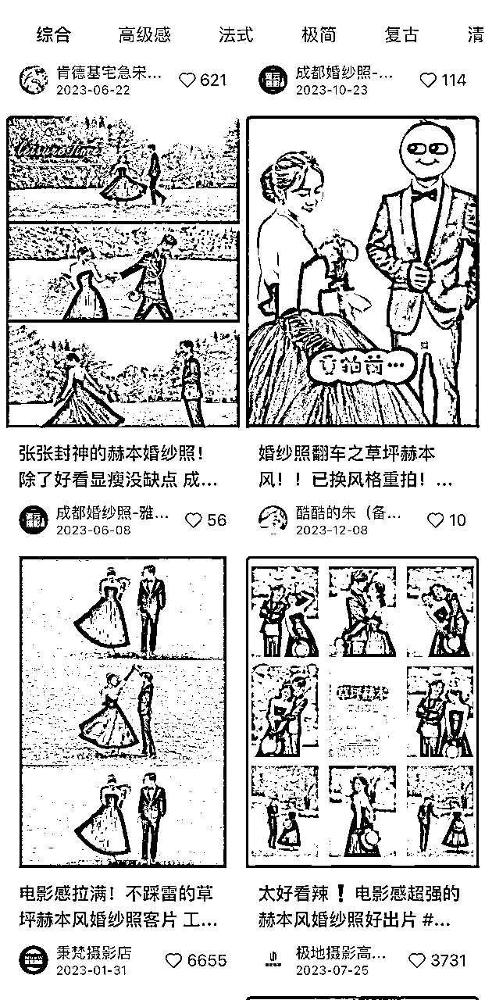

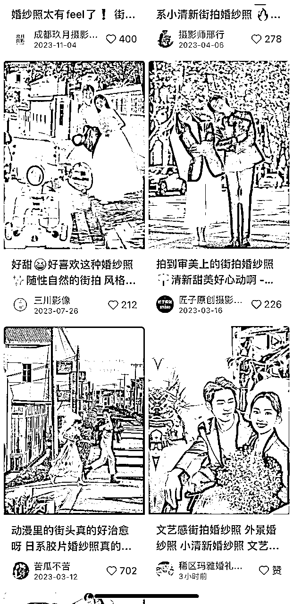

②取景地
风格定了再选地，提前在脑子里过一遍现场会更省时间。每个城市都有可替代的相似场景。

赫本草坪风我提前去朋友婚礼外景的公园踩点；森系风本想去青岛，后来成都全城风控只好改在成都大湿地公园；街拍风就找了条小巷子，复古慵懒感正好；室内场景直接在家搭，红布做背景，白墙当墙面即可。

③造型搭配
自拍最大的挑战是妆造。我平时只做基础护肤加淡妆，妆面从零学起。靠小红书教程练手，觉得后期修图比现场妆容更关键，所以前期大胆学。

发型选简单的易复刻款，妆面重点是双眼皮贴、假睫毛和遮瑕打底，拍照显眼更吃妆。所有思路都从小红书找。

服装尽量同风格不求同款。主纱淘宝现成品，结婚当天还能穿。国潮情侣装拼多多买，赫本黑裙子直接用平时的。

配饰道具同样拼多多下单，还办了会员卡领优惠券，省下的钱花在刀刃上。

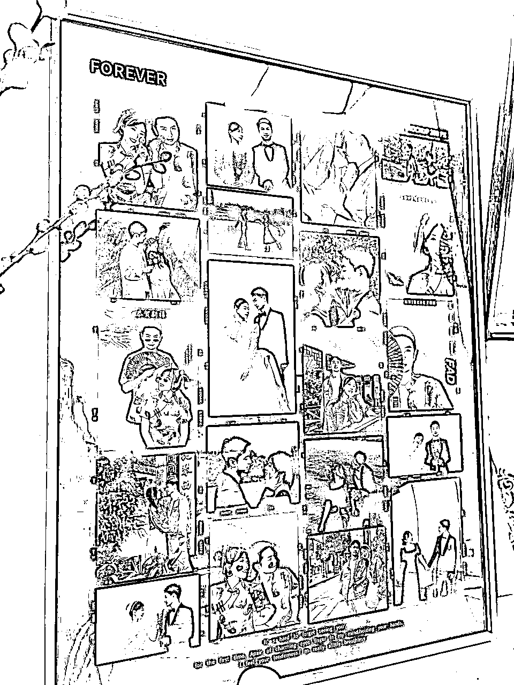

④拍摄周期
自己拍最大的自由就是时间。以往艺术照拍两三组要从中午耗到天黑，朋友拍婚纱更是早出晚归到凌晨。我不想那么赶，和阳光约好每周末拍一组。

从2022年6月第一组，到国庆节最后一组，共花了四个月。轻松玩着拍，成片质量反而好。

最佳拍摄季节是初夏初秋，避开极端天气。时间一定要前置，越近婚期越容易手忙脚乱。我们提前一年拍，时间充裕很从容。

⑤设备选择
姿势也不熟，所以提前在小红书找同风格样图照抄模仿。

设备我借了前公司实验室的入门佳能D601，操作简单，人像模式表现不错。相机拍出来细腻度和氛围感远超手机，强烈建议必须用相机，买二手或租都行。

还入手了带蓝牙遥控的三脚架，自己在机位摆pose，阳光在远处按遥控，可一次性多角度连拍。

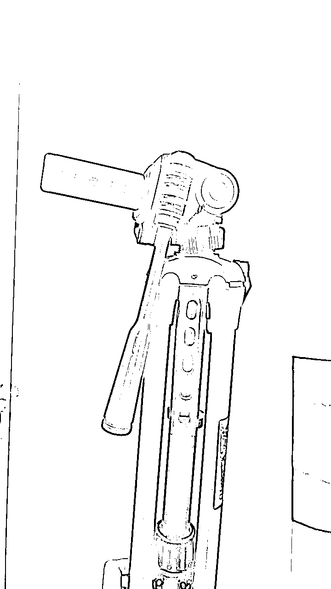

5组里第一组是妹妹帮忙拍，后面4组全是我自己拍。天气不好时也备了反光板补光，效果明显。照片精修没自己学，直接淘宝找修图师精修20张，性价比高，效果不输影楼。

# 4、婚礼方案与四大金刚

婚期大约在2023年3月敲定，我就开始研究可落地在家的风格。大半年准备期很充裕。

阳光家在山上农村，宾客都是街坊邻居，殿堂风、西式派对、游园会都不合适。自然风和新中式更贴合现场，所以我重点在这两类里筛选。

选风格花了很长时间，女生总想完美。直到6月前都没最终确定。我收藏了大量农村婚礼案例，包括婚庆公司和个人DIY的。

最终结合现场环境，定下以自然风为主的新中式。

ps：风格案例可在小红书、马蜂窝、公众号找，多看就有感觉了。

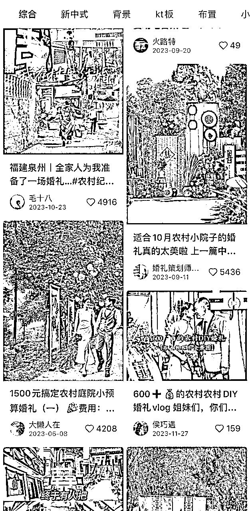

风格确定后，我梳理了四大金刚的需求。现场化妆和摄影自己解决不了，这两笔钱我决定不省。主持我们夫妻自上，摄像非刚需就舍弃。

最终只请化妆师和摄影师，7月开始联系。先找小红书上的独立从业者，后来发现异地请人要安排食宿太麻烦。最后在本地大众点评找了一家婚庆公司只买单项服务，价格略高但更稳妥省心。

# 5、进度表与现场分工

7月初，我和阳光开始做细化排期。这种大事件必须提前规划，我做过项目筹备深知时间线清晰才能不乱。

提前两个月做了进度表，列出每个节点任务、完成时间和负责人，方便随时核对。

人员分工针对婚礼当天。我们是主角没法兼顾，需要亲友配合。男方要准备的事更多，分工也更多，阳光提前和兄弟姐妹沟通好，婚前一天晚上家里开短会再确认一次。

任务明确到人后，混乱和推诿明显减少。工作方法搬到生活中也很管用。

# 6、现场小物采购

其他环节集中时间就能搞定，最磨人的就是婚品采购。像双十一的琐碎感，婚礼物料更多。

为此我做了购物清单，按场景和场地划分：通用、我家、阳光家。再细分到婚房、伴郎伴娘、接亲、签到台、仪式台等区域，确保不漏项。

分享几个高性价比氛围道具：

接亲：粘粘球射枪、喷钞枪、鞋盒套圈，既整蛊又好拍照。

仪式：泡泡机/泡泡管，入场时小朋友喷泡泡，氛围感拉满；风铃和红灯笼挂在旁边的树上，拍照好看；中式点心摆台搭配平安喜乐摆件和定制可乐，喜庆感十足；渔网照片墙挂情侣照，出片超出预期。

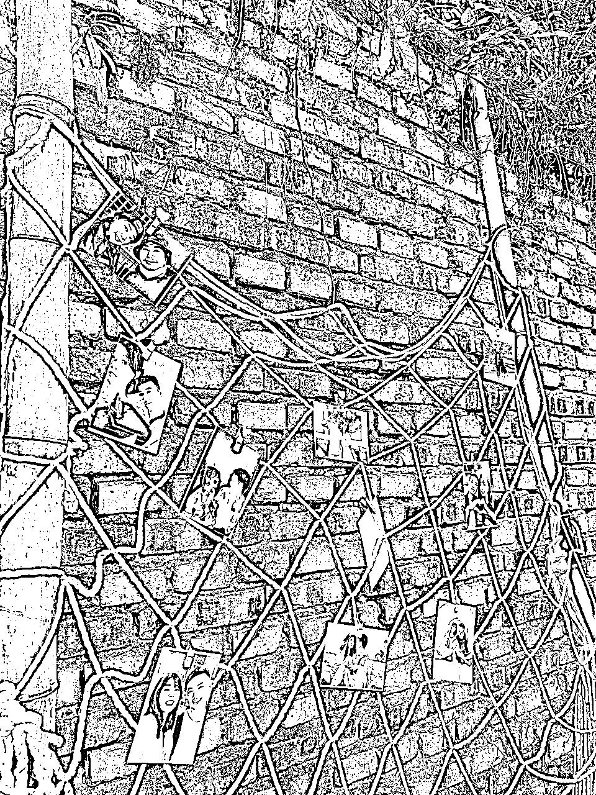

因地制宜也很重要。阳光家附近多竹子，我们砍来做背景和迎宾牌，特别有乡村质感。花艺部分采当地绿植搭配仿真花，以假乱真还省钱。

# 7、喜糖盒自主设计

DIY婚礼想体现个性，所以我决定自己设计喜糖盒。刷到笔记后觉得门槛不高，便动手试了。

规格选8*8*8的正方体天地盖，尺寸常见好装。

流程如下：

1、定色系与主图
挑了一张俏皮国风合影当主视觉，主色用浅粉+暗红。婚纱插画元素流行，我想自己画。醒图APP里用“玩法-漫画脸”功能试了两种风格后定版。

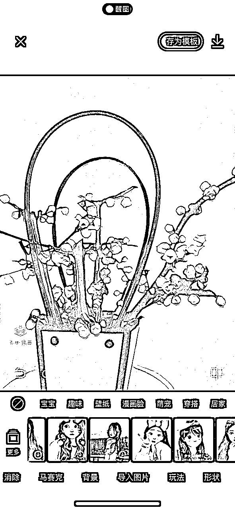

2、选盒型
先了解了喜糖盒常见盒型，最后选基础的天地盖，便于装盒。

3、排版设计
结合博主案例和流行元素，用Canva 8*8*8画布设计。正面放婚礼头像，顶部写“请你吃糖”，底部留白用色块点缀，其余版面按顺序排放。

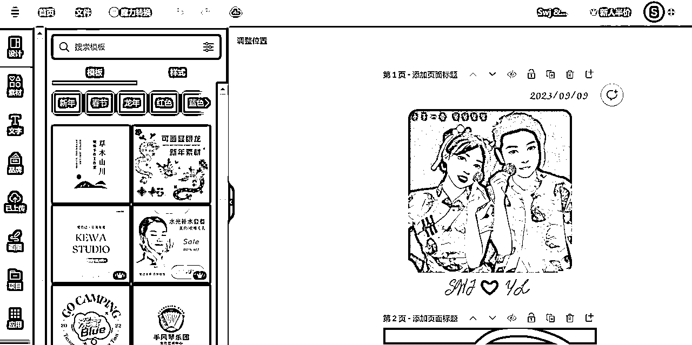

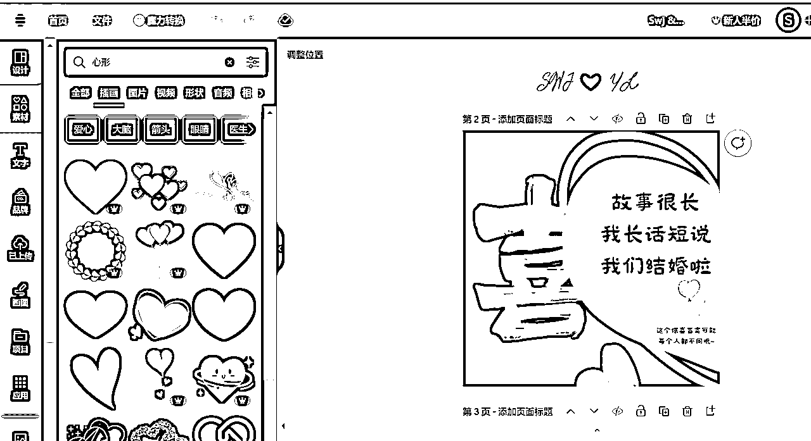

4、生产对接
在1688和拼多多比价，对接生产厂。数量太小开模成本高，所以我把400个加到500个，单价更划算，总价300元。把刀版图标注好位置给厂家，减少沟通成本。

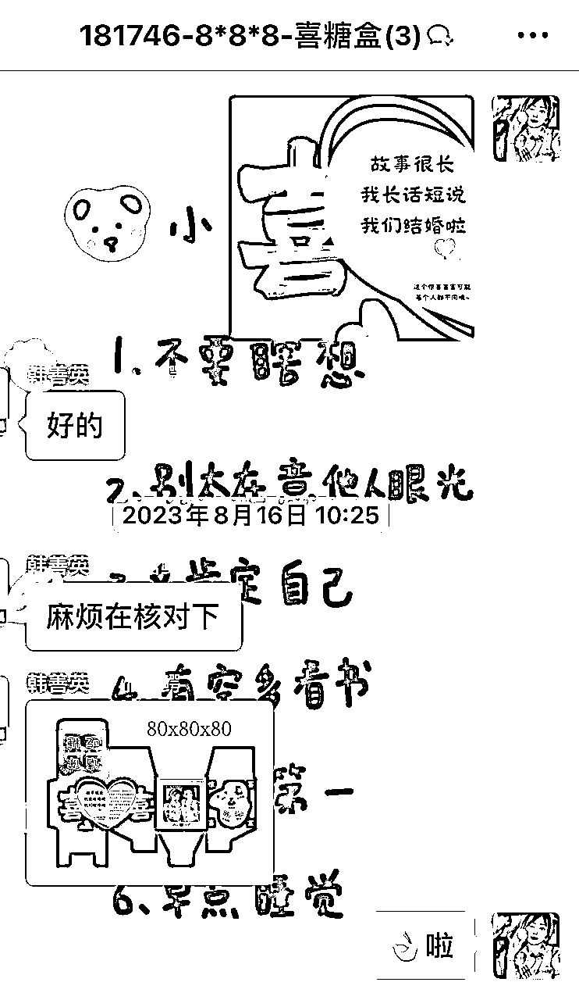

一般生产周期7天，配送3-4天，时间必须预留。糖盒到货后自己装糖，还贴了镭射喜字贴，颜色发错将就用了。我做了喜糖盲盒，里面放不同口味糖果和国风贴纸、钥匙扣等小礼物，宾客拆开很有趣味，现场小孩抢着拆，成就感十足。

# 8、电子请柬与氛围视频

婚纱照精修后，我没花钱做电子请柬，自己研究工具。婚礼前20天开始搜攻略，多人推荐婚贝APP，我直接用模板。

模板数量足够应付个性化需求，操作简单省钱。

我一口气做了好几版请柬，最后敲定的是那版我最喜欢的——照片塞得满满当当，特别是领证那天的抓拍放进去后，整张请柬情绪感直接拉满。

发出去之后，身边关系比较近的朋友都在夸照片好看。当聊到这张请柬其实是我自己操刀做的时，她们的反应都大同小异，满脸惊讶。

更逗的是一个好多年没联系的高中同学，她后来说，如果我不主动提一句，她脑子里会一直默认这是“大城市婚庆公司出品，连请柬质感都这么在线”。直到去年国庆我回老家见到她，她还在念叨这件事。

至于婚礼现场用来营造氛围的视频，我一开始压根没把它放进备婚清单里。

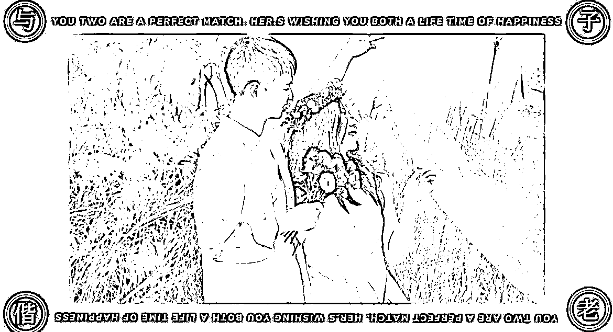

是后来刷备婚攻略才被种草的，看到不少人会在大屏上循环播放婚礼纪实，也有人把静态照片做成幻灯片放在家里电视上播放。氛围感太强了，我就想自己也试试看。

于是我也用婚贝做了一个图库视频，这个操作挺省心，基本就是在原有模板里把图片换成自己的素材就行。

视频弄完之后，我又额外做了一组热闹的动态氛围图，和视频一起在电视上轮播。

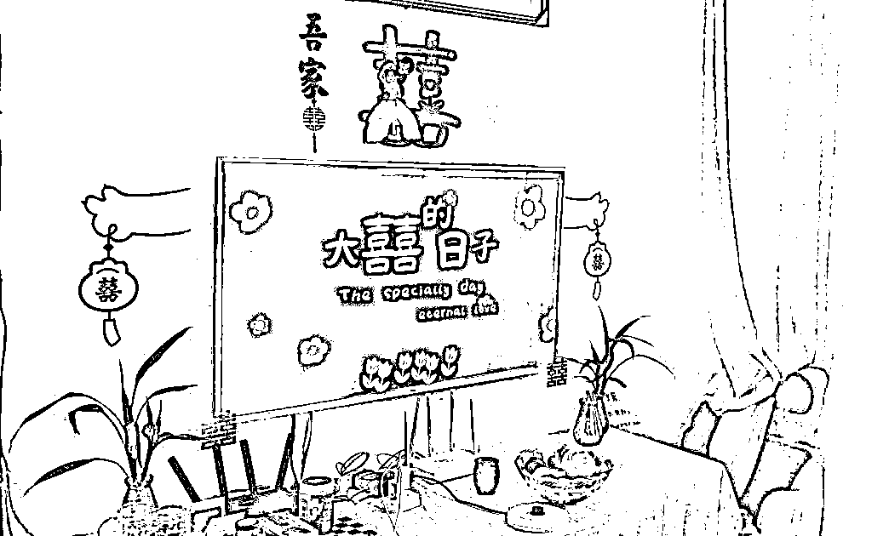

动态图我是去可画做的，平台上现成的动效素材很丰富，烟花、喜糖、花瓣这些喜庆元素应有尽有，排版逻辑就照搬小红书上好看的案例来做。最后攒了6张动态图，导出合成了一个视频文件。里面没有任何个人信息，纯氛围用，有需要的朋友可以来找我拿。

# 9、婚礼现场布置

场地布置我们提前一周就回去了动手。

阳光家：

①主舞台

砍了几根竹子搭起背景墙，用来挂布幔营造氛围；舞台边那棵梅树把多余枝桠修剪干净，方便挂灯笼和风铃；我采了一些延展性好的绿植，和仿真花混搭做花艺；又剪了仿真花、锯了几节竹筒当花卉路引，整体更显森系；再把立体喜字拼好，蜂窝气球柱也装上，让舞台看起来更厚重立体。

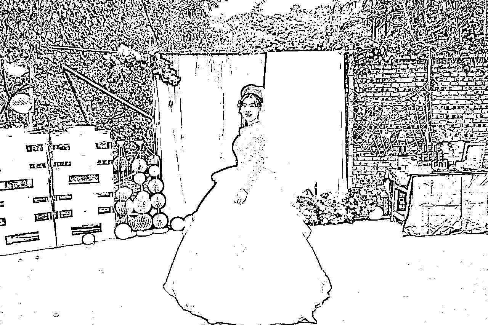

②中式点心台

桌子提前摆好，竹竿做的照片墙网也绑好了，婚礼当天直接挂照片就行；

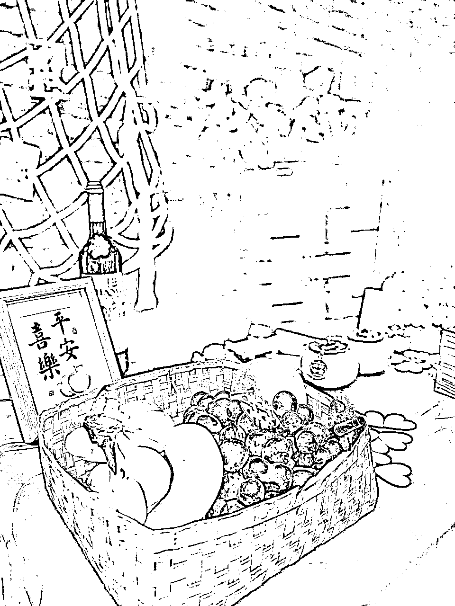

③迎宾牌

这次大量就地取材，迎宾牌的骨架就是竹子，搭好后配上插花、麻绳和一个大号无纺布喜字。防风防雨，和整体场景很融洽。

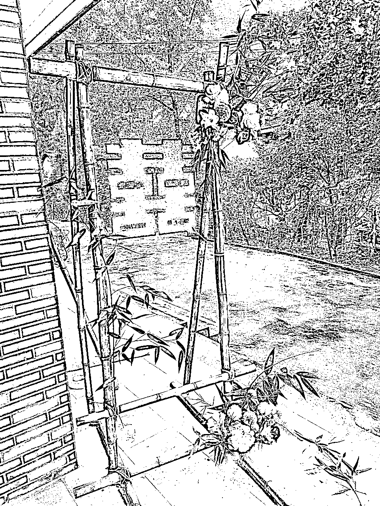

④婚房布置

我个人不太接受房间到处都是气球，感觉太浮夸。所以婚房以不同造型的喜字为主，在卧室做了个喜庆的拍照背景墙，床头柜放了立体喜字配插花，提升层次感。楼梯贴满喜字，露台栏杆挂上喜庆拉花和挂件，整体既喜气又大气。

阳光家的准备我负责到这些，剩下的路引、迎宾气球、餐桌摆台等琐碎活就交给他在现场收尾了。

我家：

①婚房布置

采购婚品时我早早就区分了两家各自的物品，所以我回来就能直接用。布置上比较简洁，核心还是背景墙和各式喜字的点缀。

②迎宾牌

我家婚礼前一天要在农家乐设宴答谢亲友，也需要一点装饰。迎宾牌是我手工做的，市场价要一百多，我自己做成本控制在三十块左右，第二天还能搬到阳光家继续用。

用到的材料有写生画架、亚克力板、丙烯颜料、马克笔、仿真花。做法并不复杂，把提前打印好的文案描摹好，贴上仿真花点缀，背面用丙烯颜料随意涂鸦，自然晾干即可。

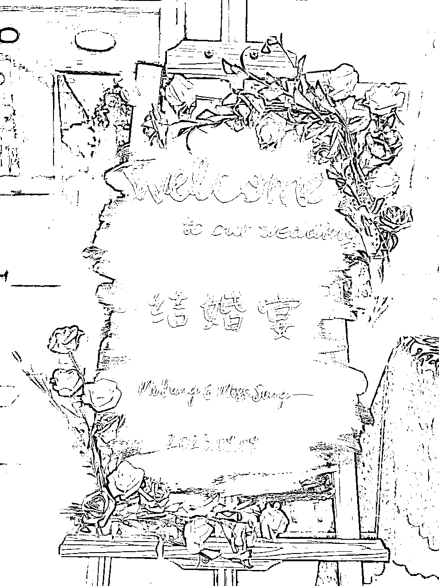

小红书上这类手作笔记很多，不确定的话多看看教程就好。

很多事情在脑子里盘算时总觉得不多，但真正落地布置会冒出大量琐事。我们俩一直到结婚前一天还在视频里对进度。但等全部布置完，那种完成感和满足感真的很强烈。

# 10、主持+音乐

前面所有环节收尾后，就只剩下主持和音乐了。

我们选择自己上台主持，但毕竟不专业，所以提前把主持稿写好、过词、背熟，心里才有底。

主持稿是我来写的，我们一起誊到手卡上。写稿前我参考了不少别人的案例，但婚礼主持不能直接套用别人的话，因为每个人的人生节点不一样。于是我只借鉴了别人的调性，锁定轻松俏皮的风格后重新创作。

最终效果超出预期，阳光平时不是擅长表达的人，当天主持下来，台下朋友都惊呼专业，挺有成就感。稿子我也整理好了，需要的可以参考。

音乐部分我们花了一个晚上一起敲定。实际呈现效果很不错，现场控场的小哥卡点很准，完全超乎预期。

总体来说，这场婚礼的体验非常好。当时过程虽累，如今回忆起来全是幸福感，每次想起都依旧很鲜活。

希望这份经历能给正在准备的你一点思路和参考，前文提到的素材有需要的随时来找我领取，也欢迎大家加我聊~