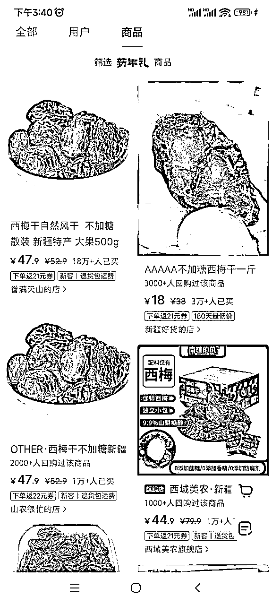
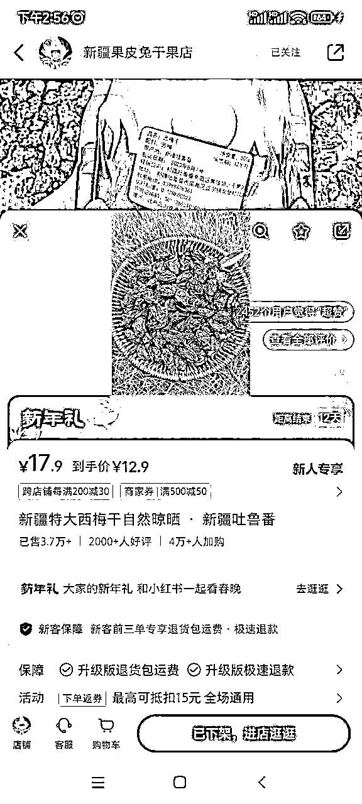
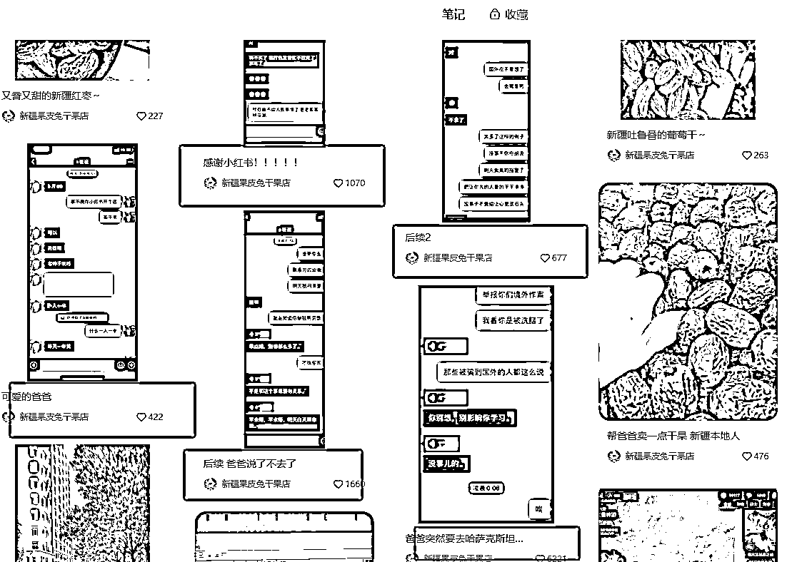
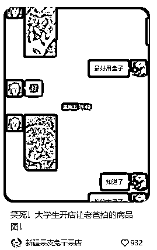
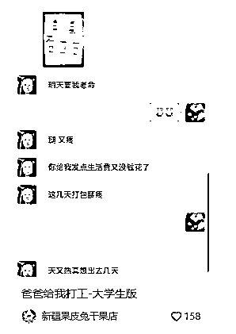
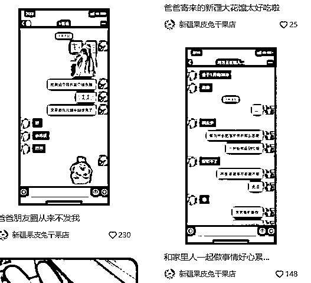
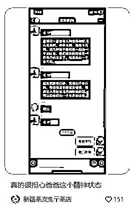
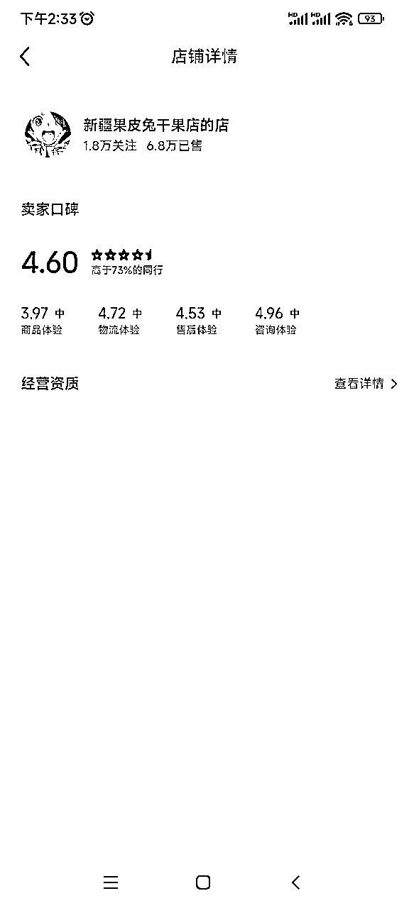
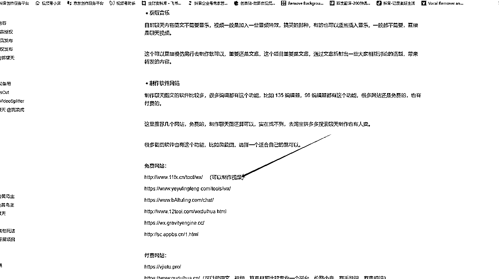

# 小红书三农账号拆解

最近刷到一个超有意思的小红书三农账号，忍不住想拆给大家看看：一个素人大学生，怎么把家乡特产卖爆？不直播、不露脸、文案也不花哨，就靠聊天记录截图，一年不到冲到单品类目第二，你说牛不牛？

这账号叫“新疆果皮兔干果店”，主打西梅干。这玩意儿在女生圈子里可是传说中的“噗噗神器”，便秘、减脂人群基本都知道。关键是它天然无添加、没经过深加工，属于原生态农产品，这一点直接戳中健康需求的痛点。

人设更妙：大学生帮家里卖货，自产自销，家乡直发，人在外地读书。这组合一出来，天然就带着“真实”和“可信”的滤镜。谁看了不觉得靠谱？

来看具体数据：账号从23年3月开始运营，不到一年涨粉1.8万，发笔记157条，获赞收藏7.4万，平均每条笔记的赞藏数达到471。什么水平？放到同行里比一比，简直碾压。

单品类目TOP3的对比就很直观了：
- “溢满天上”：粉丝6.1万，最高单品销量18万，发笔记1343条，平均赞藏138
- “新疆好货”：粉丝10.9万，最高单品销量3.1万，发笔记649条，平均赞藏104
- “山农很忙”：粉丝3.4万，最高单品销量1.1万，发笔记1351条，平均赞藏26

而这个账号呢？粉丝1.8万，最高单品销量3.7万，发笔记只有157条，平均赞藏471。也就是说，它发的笔记数量不到同行的零头，但平均互动量是别人的好几倍。号龄不到一年就做到类目第二——这个内容质量，太值得琢磨了。

那流量爆点到底在哪？

核心就是和爸爸的聊天记录截图。真实到不行，又带点猎奇感，让人忍不住点进来。博主显然也发现了这个流量密码，后面大部分笔记都是“聊天截图+产品展示”的组合，效果不是小爆就是大爆。而且她不直播，不做复杂的埋词，纯笔记带货。

文案本身没什么华丽词藻，重点就一招：调动情绪、营造真实感。让你觉得“这就是源头好货，又好吃又健康”。

其实赚钱圈友之前也分享过更细的同类帖子：

本来想算算这个爆品的利润，可惜博主把商品下架了，具体数字拿不到。但整店总销量6.8万+，运营不到一年——如果她真是大学生，这水平已经超越身边80%的人了。

这个模式能不能复制？当然能。

不一定非做西梅干，你家里有什么特产，就可以1:1按她的框架来套。做过小红书图文的人都知道，文案是门槛，可这博主偏偏没啥文案，就是聊天截图。所以门槛比你想象的低多了。

而且还可以延伸出两种玩法：

一种是纯图文模式；
另一种是聊天视频模式。像赚钱航海里的“视频号分成计划”就有类似的聊天视频内容，容易引发共鸣，尤其女生爱看八卦，用工具就能做。两种模式完全可以一起跑，避免同质化，还能矩阵放大。

同类型笔记，一个做图文，一个做聊天视频——有做过的圈友欢迎来指正。

总结一下：

23年正好是小红书的变现元年。我刚开始做小红书时也发现，凡是粘性高的商品、复购型品类，小红书用户的转化远好于视频号。之前我主要在视频号发力，但那边加过来的好友朋友圈互动很一般。小红书这边才加了不到30人，就有10几个回购的——小姐姐们的复购力是真的强。

这次也是我第一次参加赚钱项目拆解，小白交作业，勇敢迈出0到1。

