来星球不到一个月，我就靠一篇帖子把入场费赚了回来。这话说出来，我自己都有点意外。这里的帖子质量高到我挪不开眼，简直是我理想中的圈子。平时我就爱折腾：拍拍视频、写写公众号，也会经营星球和社群，什么都愿意试。结果刚来不久，一篇分享帖就帮我完成了第一次变现——24小时不到，赚了近3000元（不完全统计），门票顺利回本。

要说最让我开心的，倒不是这笔钱，而是这次分享带来了很多意想不到的合作机会。先放两张收入截图，大家感受一下。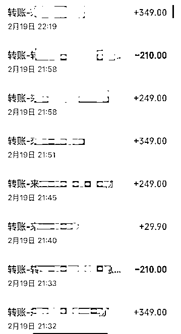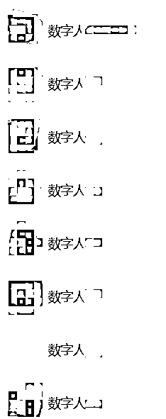

再说说帖子本身。我写的时候，市面上已经有一些精华帖，只是很多已过了时效。于是我想着，干脆自己整理一份新的。最早一版写了四千多字，可总觉得不够满意，就反反复复改。发出去24小时，阅读量到了2400+，内容也放在下面了，圈友可以翻看。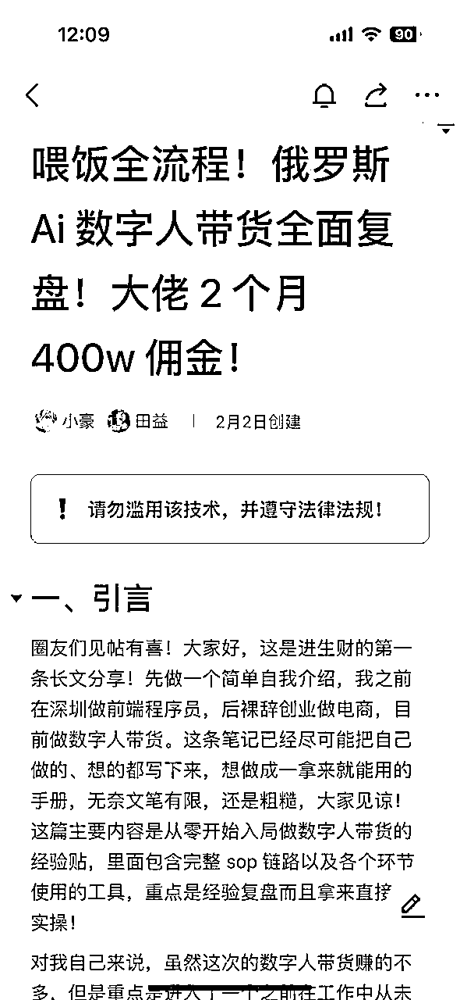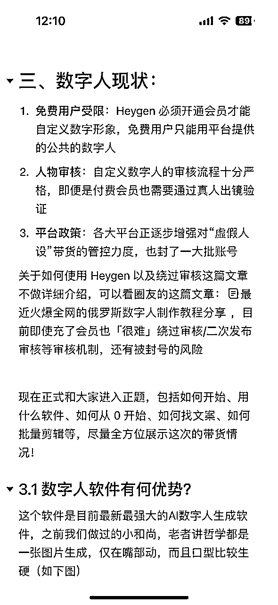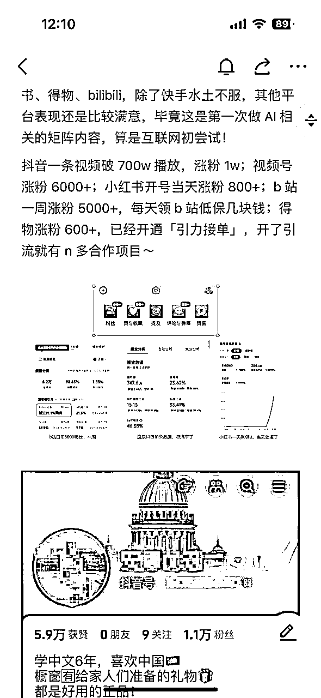

这篇帖子一共投给4个星球，其中两个被加精，前前后后大概涨了一百多位新朋友。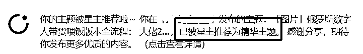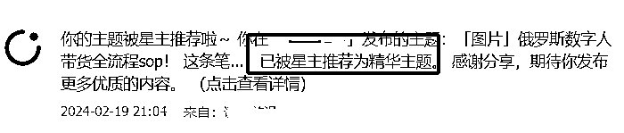

除了门票回本，我还收获了一些意想不到的东西：
- 有其他星球的运营看到内容后，主动邀我免费进群，省下了一笔星球费。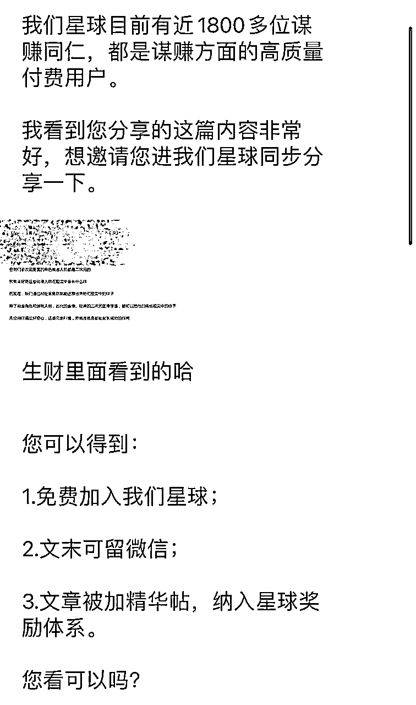
- 因为内容是AI相关，官方邀请我参加了一场关于数字人带货项目的直播交流。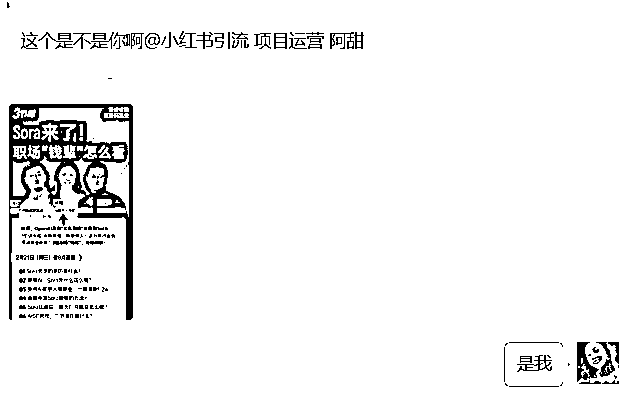
- 学员那边也陆续给出了不错的反馈，让我觉得这篇帖子没白发。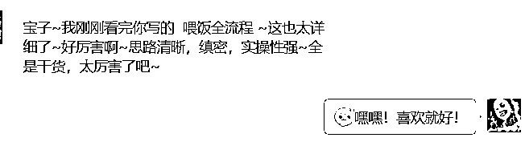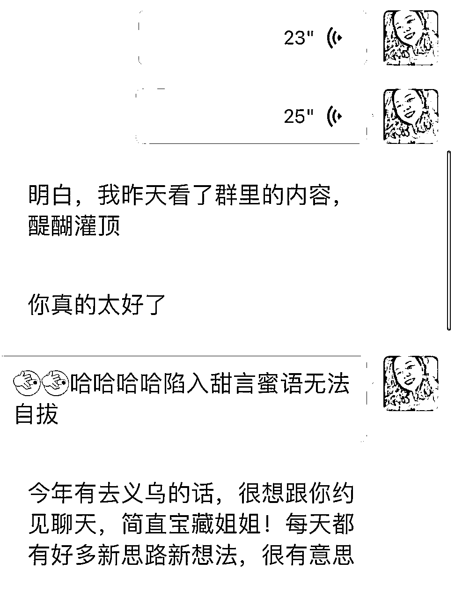

那我是怎么做到的呢？说到底，就是分享真正有用的东西，做到“利他”，出发点永远是能让别人得到什么。结果是自然而然来的。除了把帖子链接分享给圈友，我还做了几件事：

第一，开一个小报童。怎么让更多看到这篇内容？单纯靠自己发，看到的大多是星球圈友，很难形成裂变，所以最好配上分销，让兼职的人有动力帮忙转发。于是我把内容放进小报童，佣金直接设到60%。但小报童的排版效果一般，于是第一步先让买过的人加我微信，好为后续裂变做准备。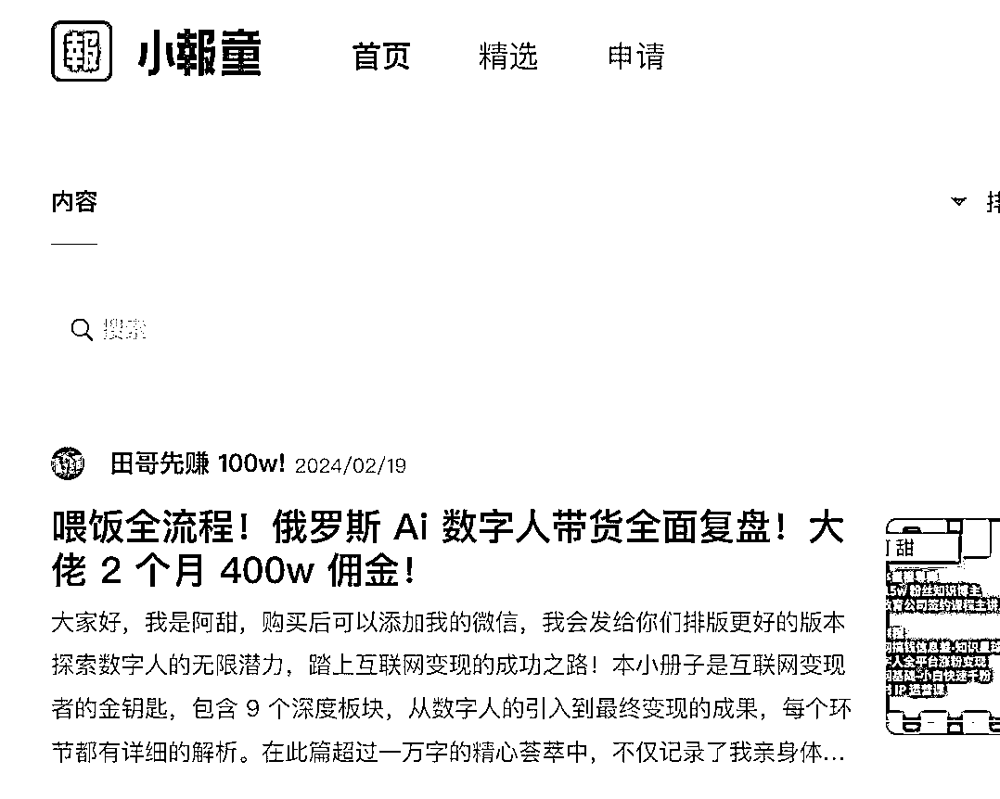

第二，利用分享群。我本来就有个小群，平时会在里面发干货，成员大多是想找副业兼职的学员。正好这次机会，他们赚佣金，我做裂变，双方都受益。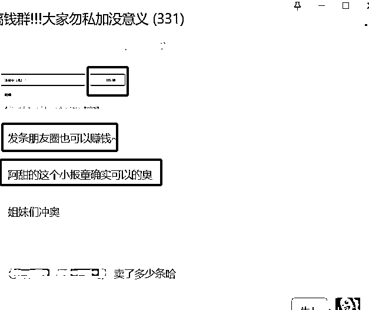

第三，给出一套可复制的分销方法。不少人是互联网小白，不知道朋友圈海报该怎么发。于是我专门做了一个数字人分销朋友圈的方法和参考，他们不用懂逻辑，照着发就能看到结果。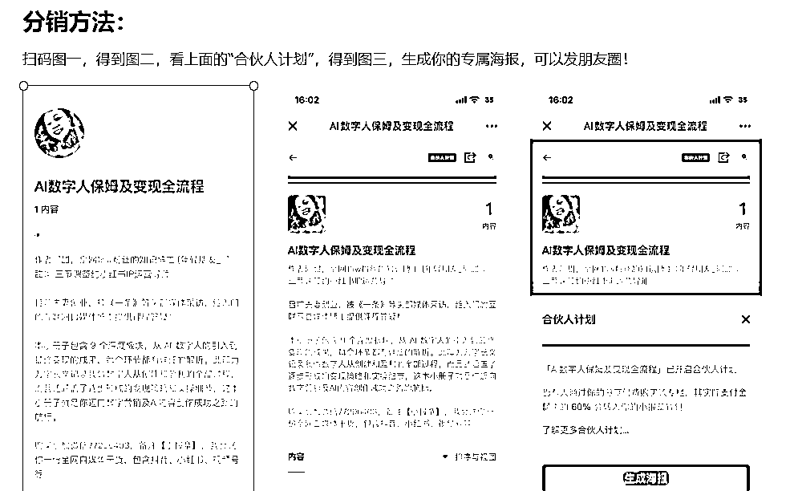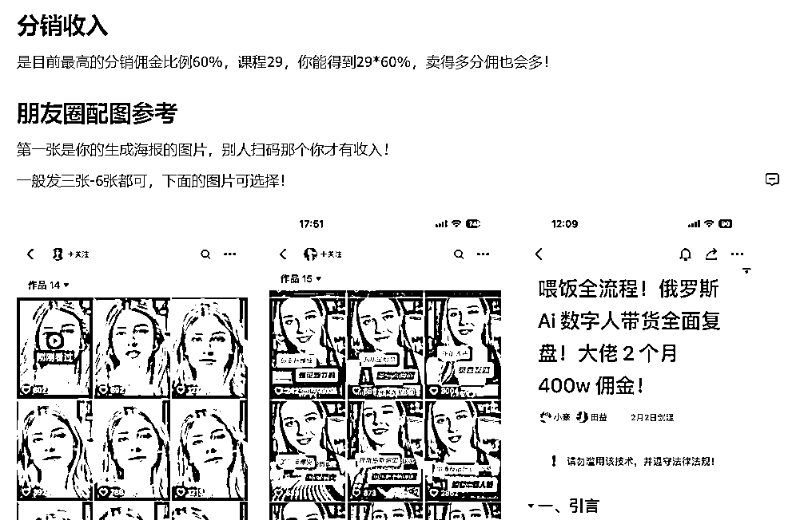

回头看看，这套流程的核心就是“卖资讯+分享裂变”。如果对屏幕前的你有一点点启发，那就再好不过了。也谢谢所有看过帖子的圈友，是你们的关注给了我继续分享的动力。