# 美区 TikTok Shop 实操与变现全景手册

# 先说个总体情况

大家好，我是众里，先做个自我介绍。我们团队主营的服务板块是 TikTok 服务商，核心是把美国本土小店的资源对接到有需求的卖家手上。

在运营上，我们是通过抖音、小红书等自媒体渠道做内容分发和引流，锁定对 TikTok 美国市场感兴趣的潜在卖家 PS：目前属于蓝海赛道。

为什么这个赛道现在好做？

我花了差不多一个月去调研这个市场，总结下来就是：做过跨境电商的玩家，错过了亚马逊、eBay、Shopee、Etsy、Wish、TikTok 东南亚/英国、Shopify 等等这些平台红利期，或者在这些平台没有拿到预期结果的，目光基本都集中到了美区 TikTok 小店。

简单梳理一下：美区 TikTok 全球用户体量排第二，2023年5月开始开放本土小店注册，Q3起关闭半闭环交易，全面转向站内成交，平台给了很强的自然流量扶持，现在基本是开店上架后靠自然流就能出单。Q4 正好撞上感恩节、黑色星期五、圣诞节、跨年等消费高峰，按照电商规律 GMV 必定迎来爆发，平台也预期今年美区 GMV 可达 50 亿美元。因此现在是抢占店铺、快速铺货的黄金窗口，需求非常旺盛。而美国本土小店的注册门槛较高，需要真实的美国 SSN、驾照等资料，有门槛的生意一旦你掌握了资源，反而更容易做。

我方能提供的资源有哪些：

一手渠道的 TikTok 美国本土小店，资料真实稳定，抗封性强

美国本地一件代发货盘、源头低价货盘

延伸服务：物流、虚拟仓、本土仓、刷粉刷单刷播放、自有货盘、工作机、IP 节点、MCN 代入驻、白号、千粉号、五千粉号、美区铺货 ERP、店群矩阵工具

## 资料参考

最新版 TikTok 美国小店全方位解析

# 获客方法论

## 公域获客

我把国内主流公域平台都查了一遍，目前搜索美国本土小店有流量且能带来询盘的，主要就是小红书和抖音两个。

这两个平台的关键词搜索目前还没有被头部账号占据，不管做图文笔记还是短视频抢词，或者在评论区截流，都还有很大操作空间。

小红书关键词：

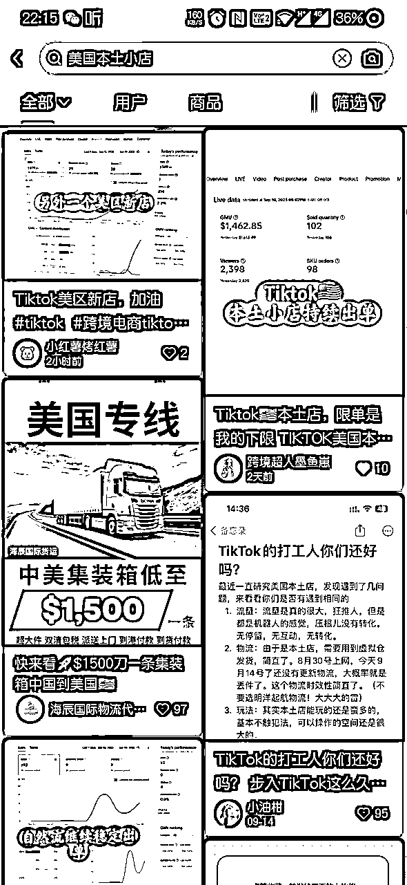

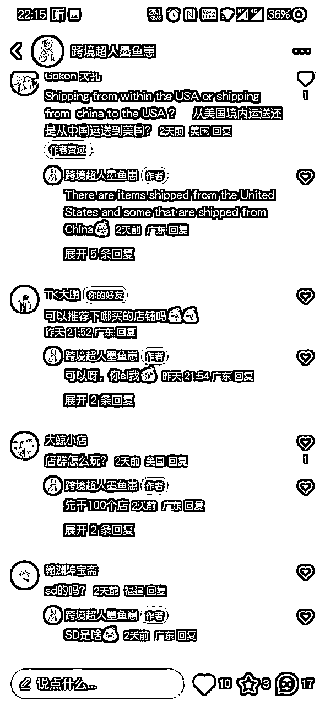

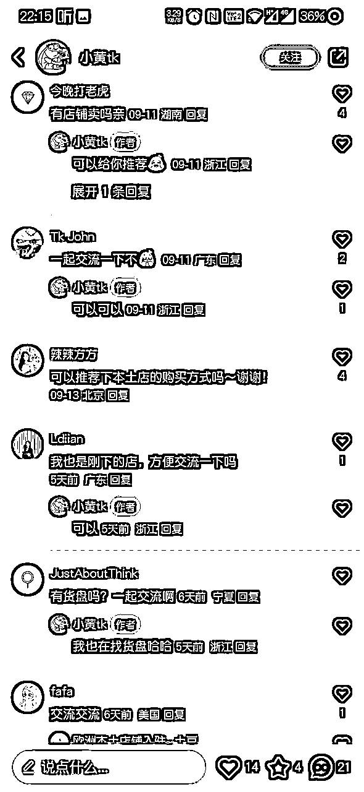

抖音关键词：

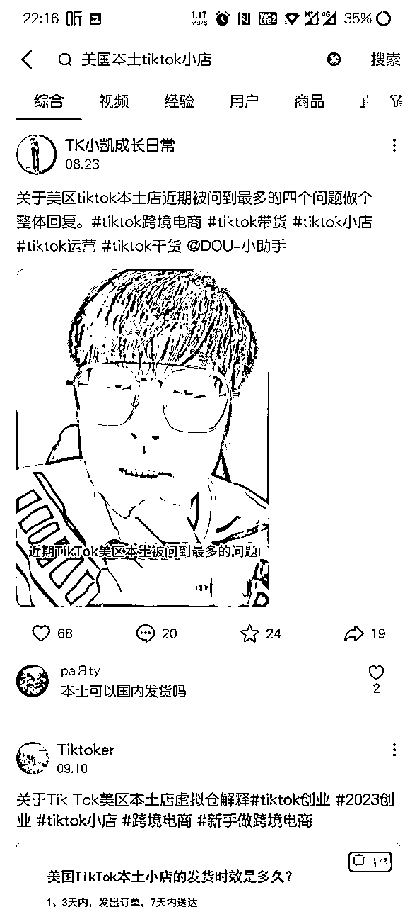

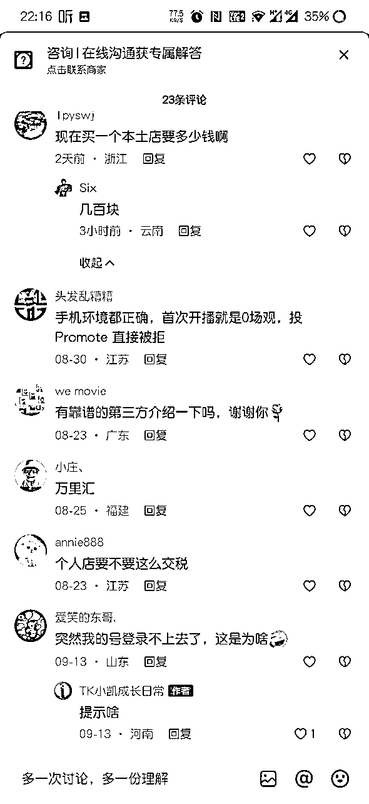

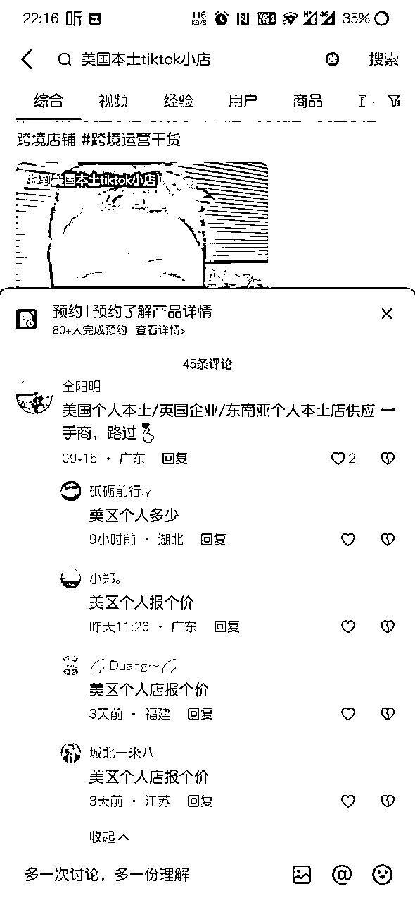

公域引流的核心逻辑我就不展开了，做过项目的同学自然懂。没做过的也一样能上手，做图文也好做视频也好，都能切进去。

## 私域获客

私域这块对 TikTok 知识的储备要求会高一些，但问题不大，集中补几天课，多跟业内同行交流就能上手。

私域获客的转化价值更高，我目前大部分的询单和情报来源都来自私域。打法很直接：加群换群，在群里发需求或主动私信。

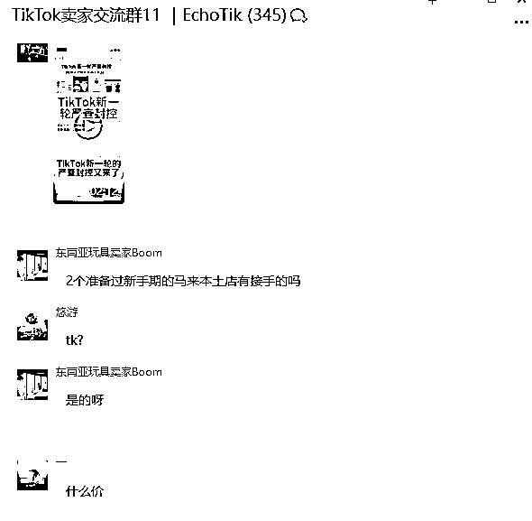

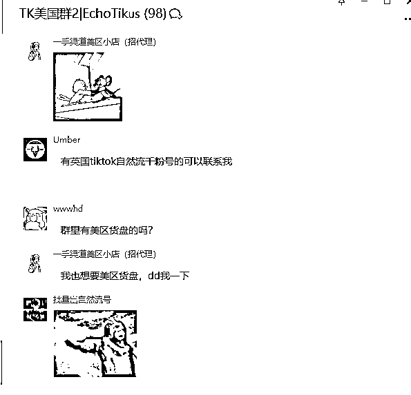

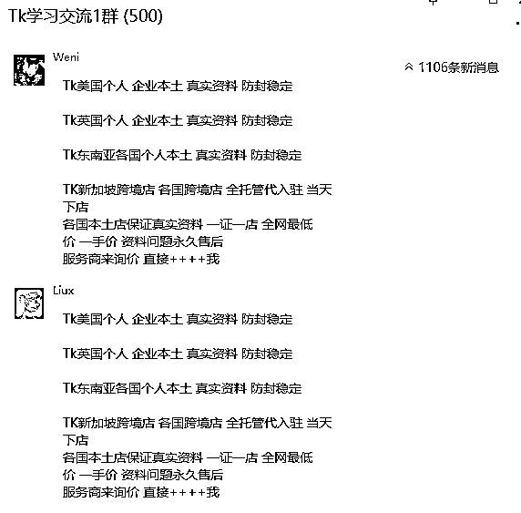

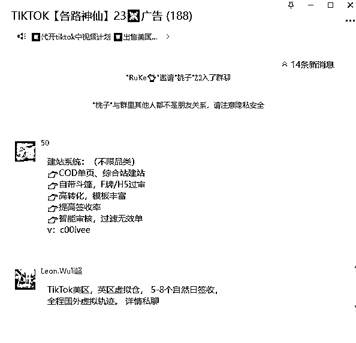

群聊从哪里找？在公域里搜就行，公众号、抖音、小红书、今日头条、豆瓣，只要能想到的平台都去搜相关关键词，比如跨境电商。凡是做这个赛道的博主或 IP，基本都会把人往私域引，大胆加就行，有三点好处：

第一，群里一定会有高价值潜在客户，可以在群里树立专业形象，借势成交。

第二，能拿到超出你认知的信息差。

第三，便于资源对接，很多项目都能谈，关于 TikTok 的各类资源我这边都能提供。

## 相关搜索群聊

https://www.cifnews.com/zhibo/3698?origin=zhibo_3727

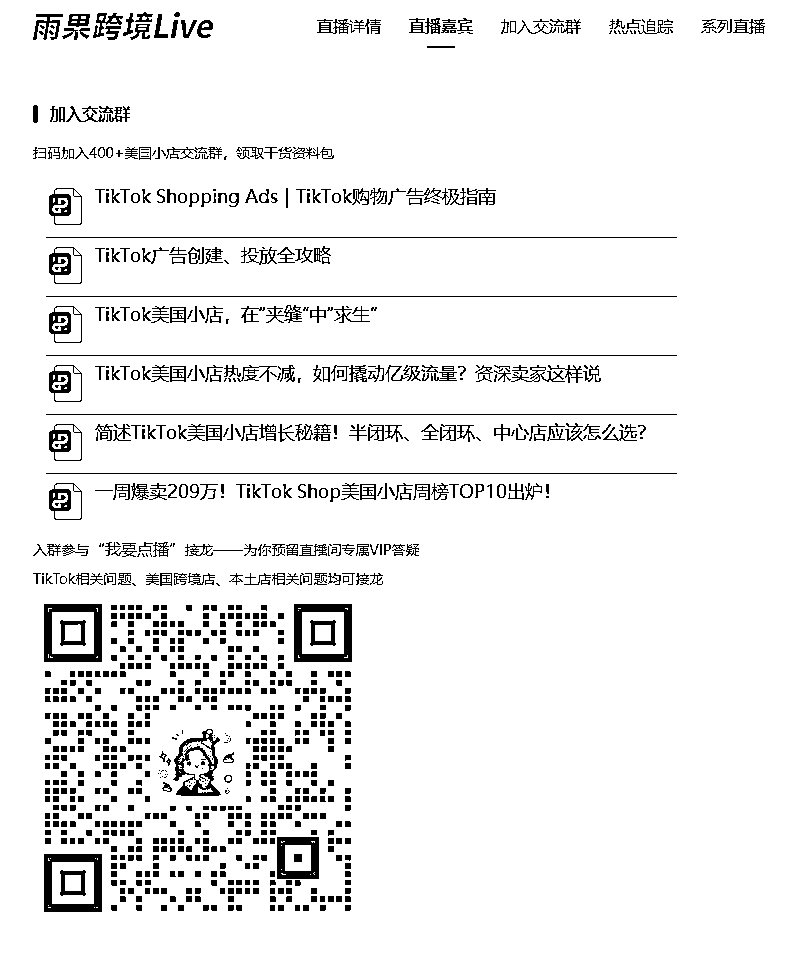

# 售前核心问题

### Q：售后与交付标准

交付后 24 小时内出现问题可无条件更换；可配合二审。若后续因资料问题导致封店，我们协助二审解封或直接换店。

封店时邮箱会收到 TikTok 官方邮件，里面会说明具体封禁原因。

交付内容包含：

1：可使用买方自有邮箱和 IP 登录；
2：身份信息；
3: AdsPower 指纹浏览器软件
4: cookie

### Q：本土店不是要纳税码吗

美国税号主要有三种：SSN 社会安全号、ITIN 个人税号、EIN 联邦雇主号码。注册小店时用到 SSN，我们代注册的资料包已包含这些信息。

#### 美国本土店注册所需材料清单

① 国外邮箱如 Outlook/Gmail
② 美国银行卡用于收款
③ 双币信用卡用于缴纳刊登费，0.2 美元/ Listing
④ 1-3 款用于开店上架的产品图片
⑤ 美国住宅 IP，用于防关联和 IP 检测
⑥ 美国身份 SSN，用于跳转审核
⑦ 美国真实地址，用于开店填写验证
⑧ 真实美国手机号
⑨ 店铺跳出的 1099K 表格，用于后期报税
⑩ 虚拟仓/真实海外仓，用于设定发货物流模板

### Q：美区本土店价格如何？

美区个人店 1200 元，企业店 1800 元，资料问题包补。

下店后可对接回款、虚拟仓、货盘等，后续问题可随时沟通。

交付店铺后请第一时间修改店铺密码并更换邮箱！未更换导致封店不补。

### Q：封店率大概什么水平？

A：100 家店大概封 1 到 5 家，主要是客户操作不当导致。

### Q：店铺能稳定多久？二审能不能过？

* 24 小时后店铺若正常运行，基本就不会再出问题，除非扣分或物流体系被盯上。若被查到虚拟仓和虚假发货，则与资料无关。
* 二审通过与否具有很大的偶然性，我们部分店铺已通过，部分未通过，最关键的因素是 SSN 的实际情况。
* 店铺只要合规运营，首单发出后基本就进入稳定期。

### Q：资料是否提供？如何保证真实？

我们与市面上其他公司不同，资料是真实的一手资源，由美国地推获取，我方股东在美国运营网吧。无法像刷库公司那样直接把资料给到你，公司规定不提供原始资料以免渠道风险。若在过程中因资料出现问题，随时沟通我们都会处理。

资料不提供，渠道安全优先。若一家店出问题导致整条渠道崩盘，我们宁愿不卖。

### Q：下店后不会运营怎么办？

1：下店后如何出单取决于你的运营打法，选择适合自身优势的路径；
2：店铺必须配备指纹浏览器、IP、cookie，交付时会一并提供，IP 使用期一个月；
3：未绑定 TikTok 账号，可另行购买或自行注册。

### Q：什么情况下会触发二审？

风控触发二审，原因复杂，TikTok 政策一直在变，核心风控因素是店铺操作异常。

所以大部分需要二审的店铺本身就存在问题。花五六千买一个“保证过二审”的店，本质上是花钱当冤大头。

### Q：二审用真实资料能过吗？可否配合？

我们店群目前超百家店，触发二审的有十多家，我们已用流水单、手持资料、人脸识别提交过申诉，通过率大概五五开，样本量有限，但个人感觉二审更多是运气问题。

### Q：二审通过后就稳了吗？

二审通过后还有三审，会涉及税务、流水等更深层问题。除非能去美国找到资料本人并配合，大概率最后仍会封店。

## 售后承诺

1: 交付 24 小时内因资料问题导致店铺异常，我们负责售后
2: 交付 24 小时后店铺未被封，基本后续不会再出问题
3: 若字节未对政策倾斜，我们手上百余家店目前运行正常，整体死亡率约 20%。100 家里约有 20 家因 SSN 税号等资料问题导致封店。

## 其他常见问答

### 美国本土店税务问题

入驻后我们与本土客服沟通过税务问题。官方回复是平台会代扣代缴交易产生的税款，最终承担方是卖家。回款账单上会体现代缴税款。

卖家需要自行解决的是公司层面的收入税务，这与国内一致，可找代理记账公司处理，只要公司有 EIN 即可。

### 物流问题

平台物流主要使用当地的 USPS、UPS，也支持卖家自发货。自发货的物流选择更多，国内的货代公司资源非常成熟。

### 回款问题

美区本土店回款走美国银行账户，和其他区域类似。美国收款服务商众多且便捷，万里汇、派安盈、空中云汇等均可开具美国银行账户。

### 可经营类目

与其它地区本土店一致，美国本土店类目限制较少。客服反馈除黄金、食品、儿童用品暂未开放外，其余类目均可正常经营，无需像跨境店那样报白。

## 术语说明

### 美国 TikTok 站点

本土店：美国本土店分个人/企业，需美国本地人驾照+税号注册；新店限流 100 单/日
企业店：需在美国有本地公司并完成企业认证；新店限流 200 单/日
跨境店：内测开放，需有年收入约 200 万的亚马逊运营基础做背书

### TikTok 小店用途

1：自营产品上架销售
2：邀约达人带货
3：直播带货
4：短视频带货，最主流的运营形式

# 相关小店数据

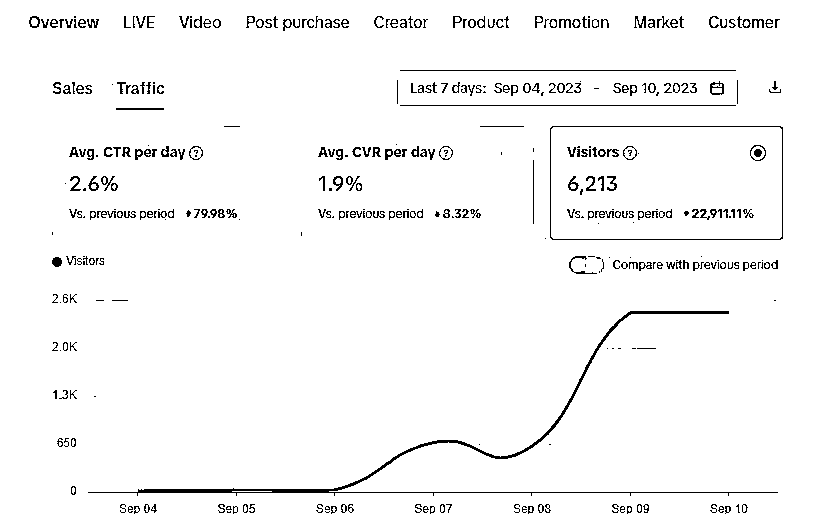

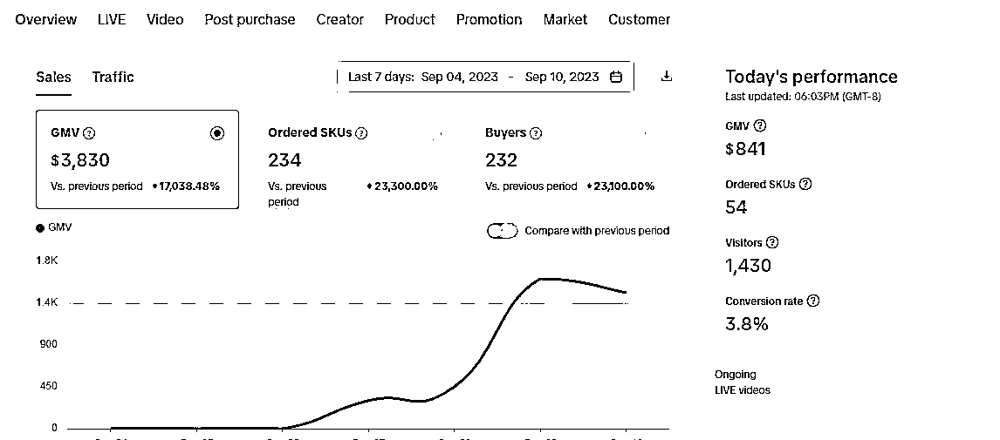

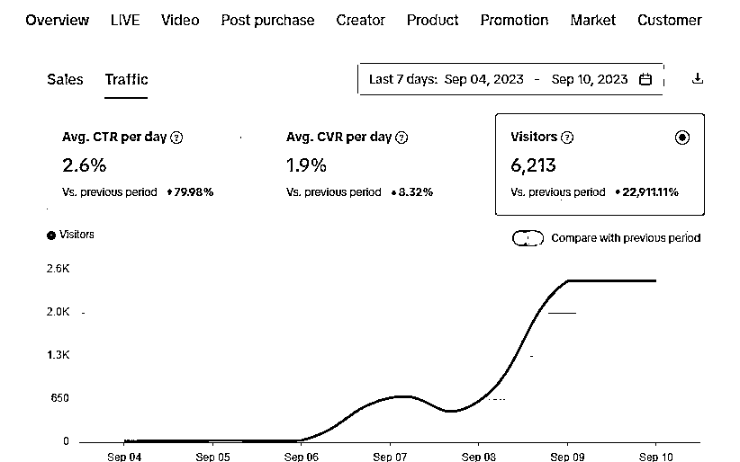

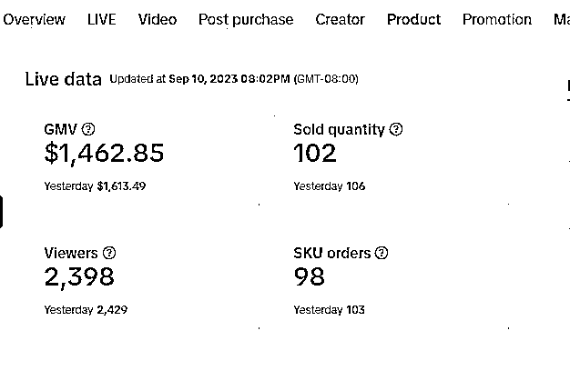