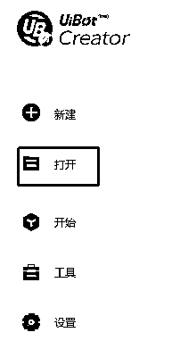
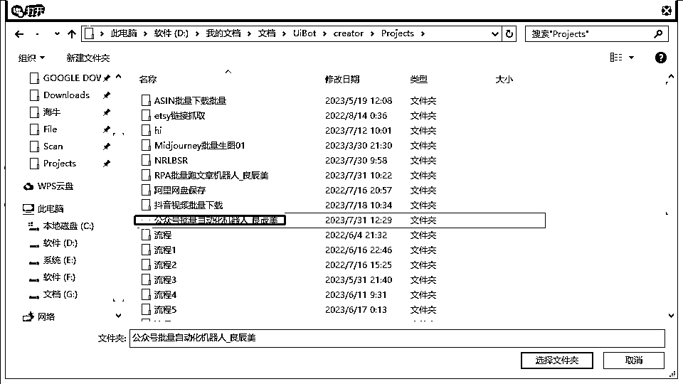
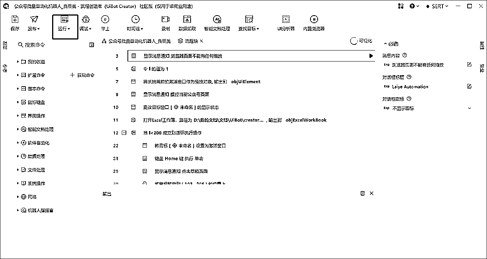
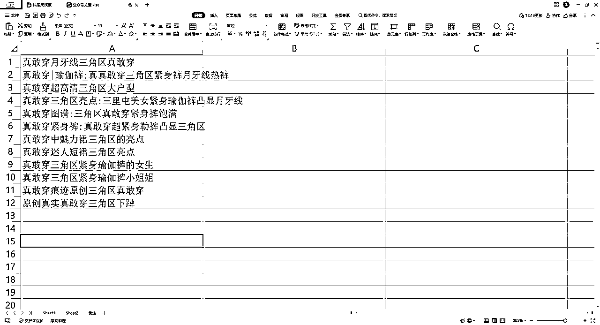
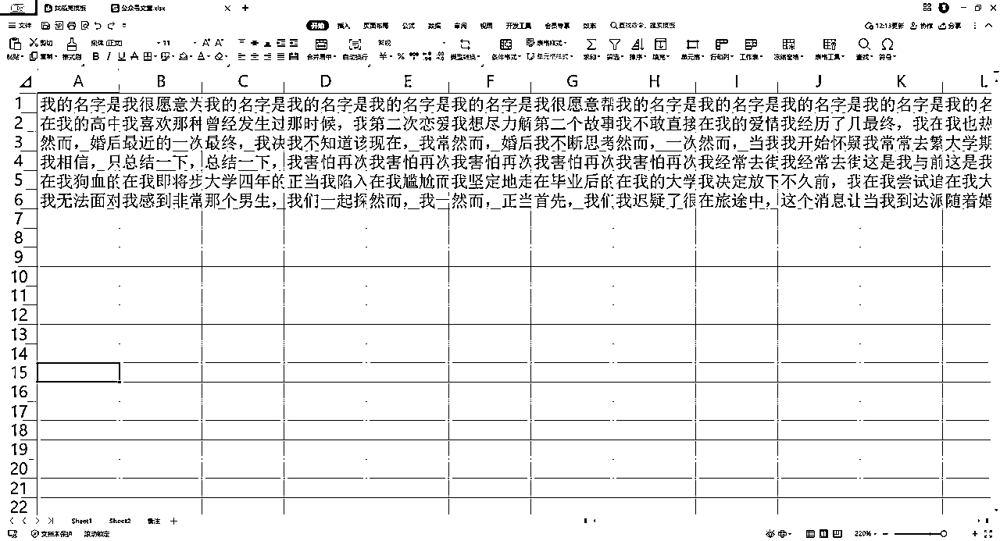
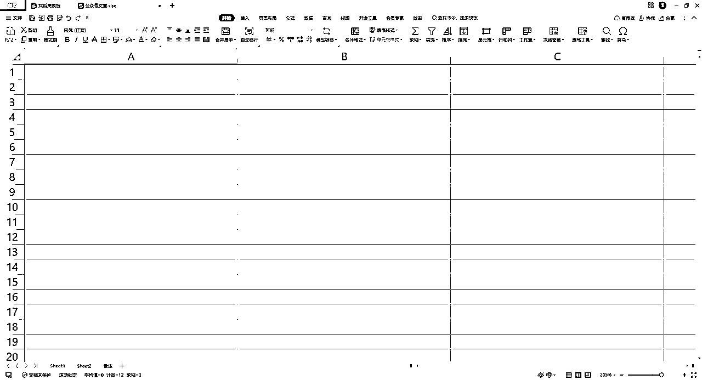
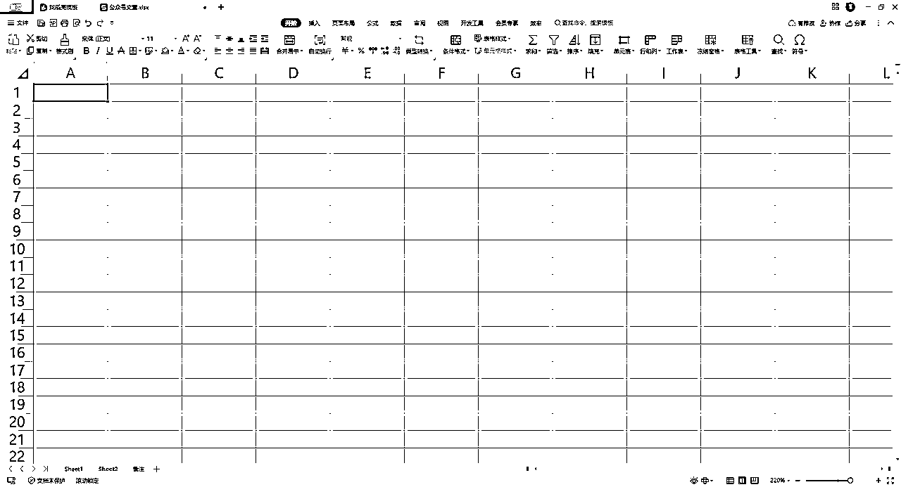
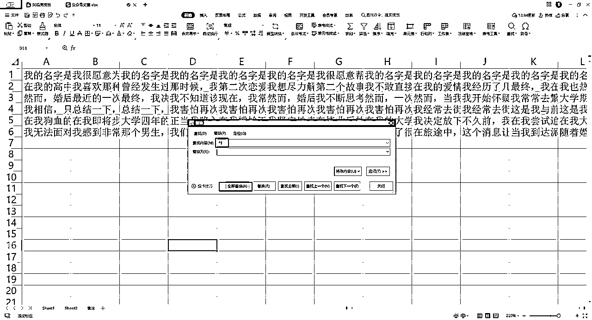

# 三、👸号批量上传机器人

### 一、 总览

##### A. 工作原理：

##### B. 前置需求：

### 二、核心能力

##### A. 基础定位

👸号批量上传机器人属于内容分发类自动化助手，核心目标是帮运营者摆脱重复性的手动发布负担，让整体运营节奏更顺畅、效率更高。

通过把成批图文自动推送到👸号后台，人工干预的时间被大幅压缩，运营者得以把宝贵精力集中在选题策划、内容打磨和粉丝互动等更有价值的环节。

##### B. 进阶扩展

当前版本实现的是单篇自动上架，实际上🛰️👸号单次群发支持最多八篇合集。因此，后续完全可以拓展为 1 到 8 篇的批量群发自动化方案。

### 三、获取与部署

##### A. 运行环境：

##### B. 安装包说明：（关键点，压缩包请放在桌面，解压后文件夹也保留在桌面）

##### C. 初始化配置：

打开主程序

载入机器人安装包

##### D. 启动操作：

按下运行键

### 四、表格模板规范

##### A. 初始表格

标题信息填入 sheet1 工作表

正文内容填入 sheet2 工作表

##### B. 处理完毕

本机器人采用上传即清理的机制，避免重复推送，因此已完成发布的标题与正文会被自动清空

### 五、实操指南

##### A. 常见疑问

<h8>Q1 标题从哪里获取？</h8>

可以借鉴同类账号的标题写法，也能直接用 GPT 一次生成几十条，手动复制到表格即可。由于操作门槛低，并未做成自动化流程。

<h8>Q2 文章格式如何转换？</h8>

具体操作可参考教程内的截图演示与视频讲解。

<h8>Q3 正文段落换行太多怎么处理？</h8>

在表格中通过查找替换的方式，把换行标识符统一删除。

##### B. 使用提醒

启动前请确保已完成👸号登录。

浏览器窗口建议保持 100% 显示比例，避免缩放导致元素错位。

素材池在用完之前要及时补充新的标题、正文、配图等内容。