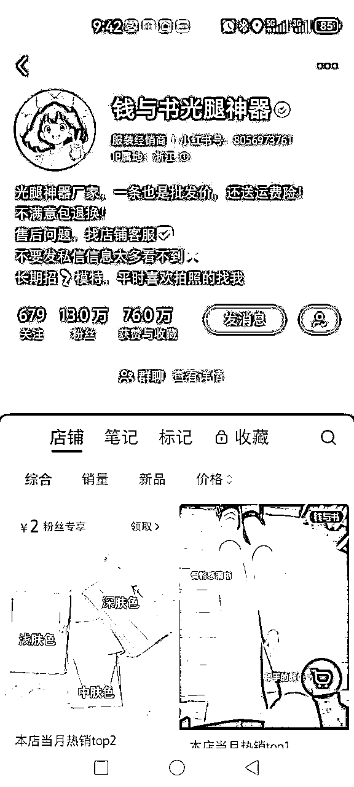
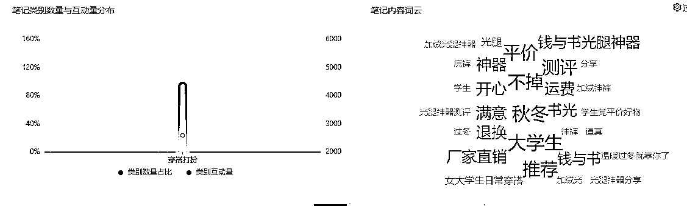
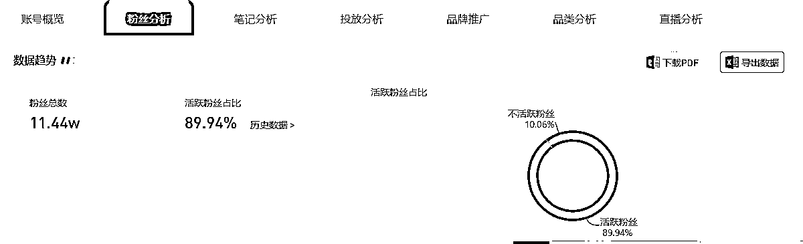
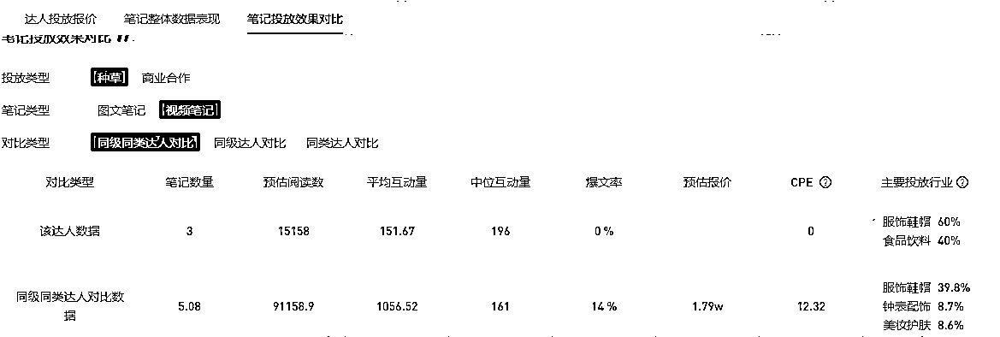
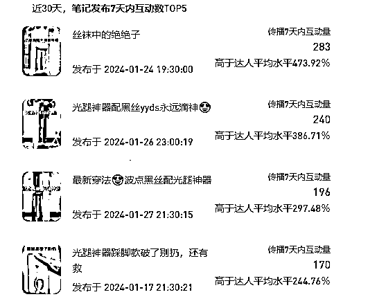
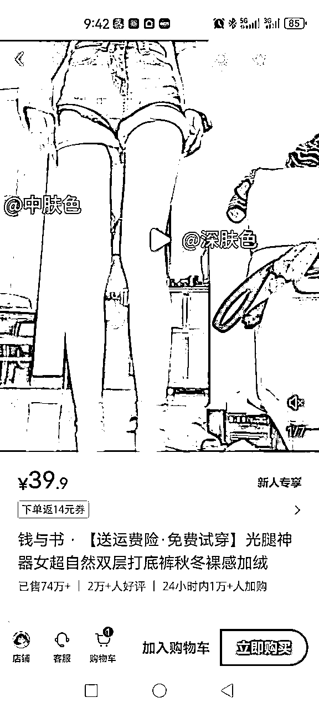
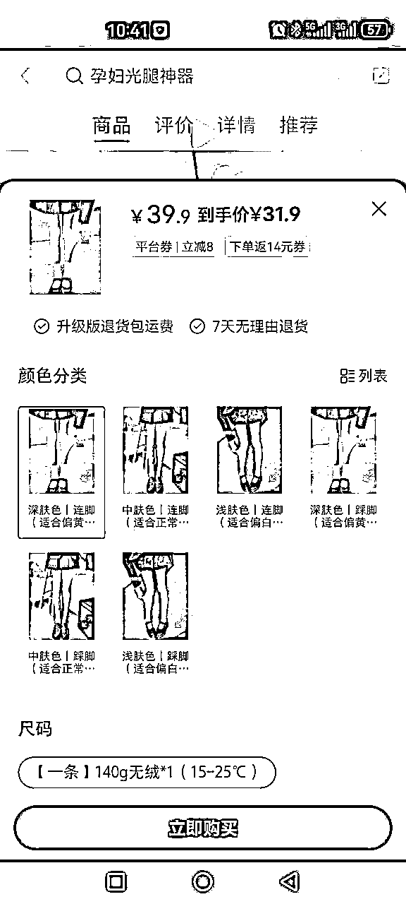
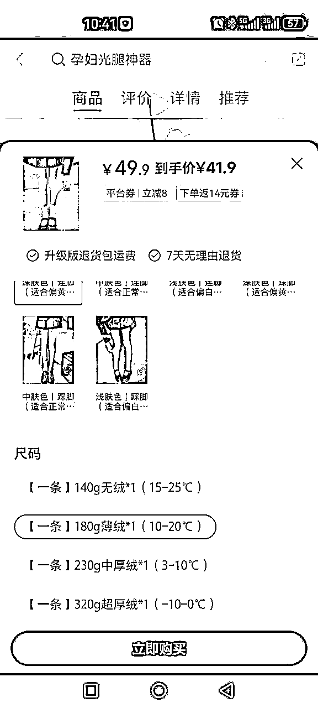
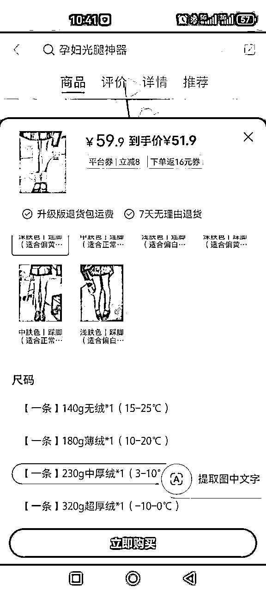

# 风向标拆解第3期—小红书单品50w+爆卖，卖光腿神器的店铺利润真相—安静

> 来源：[https://m8d4z9nx0g.feishu.cn/docx/GQ7cd2h5KoOMK7xRi6Pchw7WnEf](https://m8d4z9nx0g.feishu.cn/docx/GQ7cd2h5KoOMK7xRi6Pchw7WnEf)

✅ 流量到底靠什么来？
✅ 产品端是怎么打的？
✅ 一单到底能赚多少？
✅ 这个模式怎么复刻放大？

# 本期拆解案例：

本次拿小红书账号「钱与书光腿神器」做实操拆解。

#### 店铺画像

账号：钱与书光腿神器
品类：打底裤 / 光腿神器
成交方式：小红书短视频带货

选择它的原因很简单：

*   小红书一家只做光腿神器的垂直女装号👉垂类极致
*   全靠视频笔记起号，直播情况未知👉上手门槛低
*   单条光腿神器累计销量74w+👉爆款实锤

1 账号拆解：

01 一个主号关联了2个分号

02 核心数据

账号名：钱与书光腿神器
粉丝体量：13.2w
内容标签：穿搭打扮 / 穿搭 / 女装
核心关键词：光腿神器、平价、厂家直销、大学生等

简评：内容全以视频笔记为主，直观呈现产品卖点。整体人设像一家专业做打底裤的老店，支持不满意退换，叠加粉丝互动和晒图极多，对新客信任感拉满。

# 1 流量怎么运营

01 该号目前走的是纯自然流，零投放，靠视频带货转化。

02 评论互动数据非常夸张

远超同类垂类达人均值

# 2 产品怎么解决

以74万销量爆款拆开看：

配色：共6款
尺码：多达14种，基本做到一人一尺码的覆盖感

福利层叠也很狠：新人券2元 + 平台券8元 + 下单返券，算下来性价比感极强。

# 3 利润怎么核算

早前未使用券时，售价低至39.9元

拿1688和拼多多的同款来倒推成本：

1688高销量款参考价：
140g：25元 + 3元运费 ≈ 28元，差价约11.9元
180g：27元 + 3元运费 ≈ 30元，差价约19.9元
230g：33元 + 3元运费浮动 ≈ 36元，差价约23.9元
310g：40元 + 3元运费 ≈ 43元，差价约26.9元

拼多多同款数据后续再补充对比。

# 4 项目如何做&如何放大

量大取胜。先找对标账号研究内容，再多拍多发冲量。爆了之后继续用视频和笔记持续喂养。

# 5 项目结论

按中间差价估算，单笔净利至少在15-20元之间。15*760000=1140万。就算保守计算，也稳在1000万以上。小红书的变现空间，确实被低估了。