# 小红书爆款手作饰品的底层打法：从雍和宫手串到灵隐十八子，再到原创溢价

## 01 风向标案例

拆解源于1.12圈友半阙酒的一条中标风向：小红书野生长大的手作博主，走原创手工路线，主打小南红、绿松石的年节国风配饰，品类覆盖项链、手链、戒指等。

数据很能说明问题。热销项链定价288元，已卖出4884条，笔记播放累计超140万+；手链定价188元，卖出3057条，播放57万+。放眼多多同类店铺，类似手链裸卖15.8元，少一颗绿松石，差价就是188与15.8的差距。1688上珠子的批发价更不必多说。

临近新年，求好兆头的需求被放大，“柿柿如意”成为年年不衰的主题。小南红手链质感好，柿子红正好呼应如意寓意，火得理所当然。

博主另一条爆款项链“一梦入敦煌”，借势近年大火的敦煌美学，定价189元，已售8042条，播放151万+。

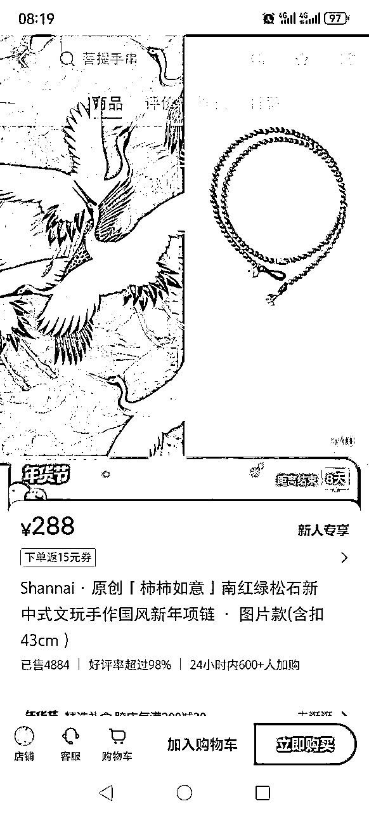

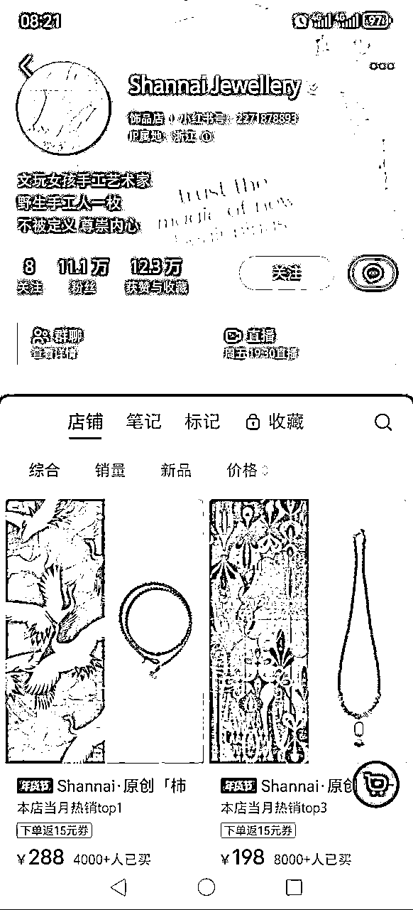

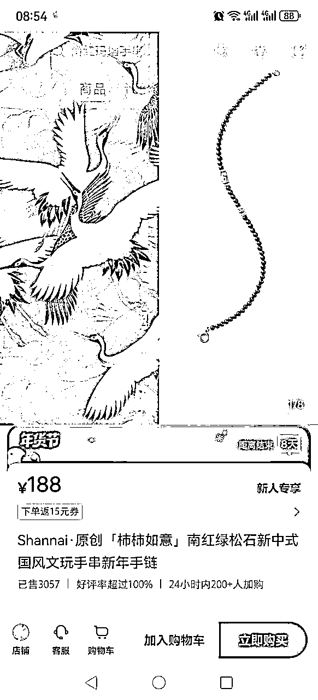

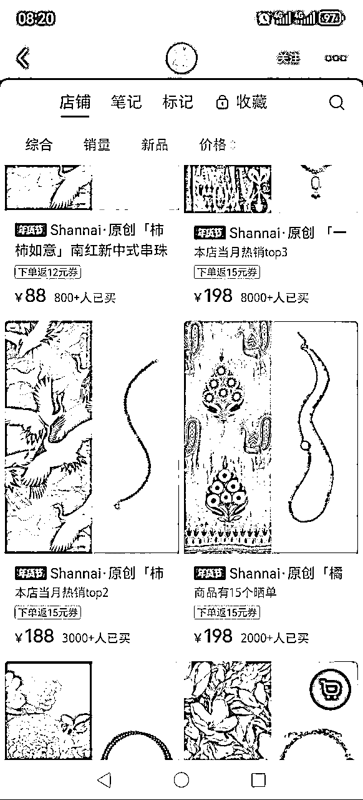

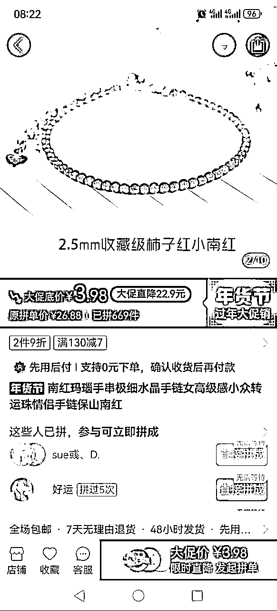

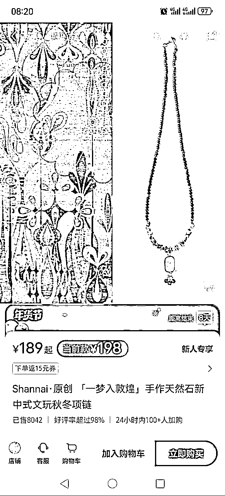

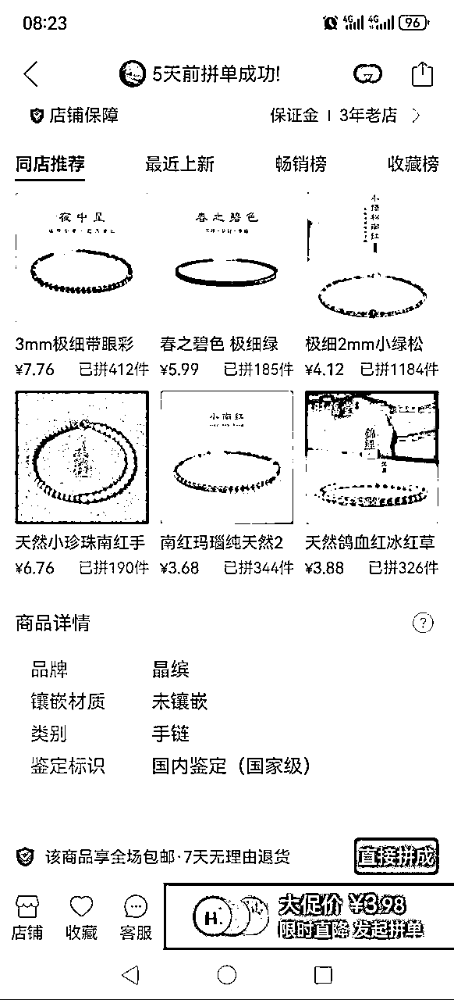

本质上，同样的串珠换上“原创手作”标签，就能实现十倍甚至更高的溢价，且销量依然惊人，利润空间被拉得很开。

“摆烂”“躺平”成为近年的社会情绪，职场压力与快节奏生活让一部分人寻求心灵安宁。迷信、祈福类内容因此在小红书上持续走热。

1. 心灵抚慰与情绪出口：制作或购买祈福类手作，被很多人当成一种情绪宣泄与自我安慰。在高强度竞争下，这类饰品成了传递心安的载体。
2. 追求内心平静：“躺平”文化体现了对过度内卷的抵触。手作饰品被赋予宗教、灵性或吉祥寓意，成为平衡心灵的工具。
3. 个性化减压：祈福手作多可定制，用户按信仰与偏好挑选，定制过程本身就是一种解压与满足感来源。
4. 传统文化回溯：社会加速发展时，部分人开始回望传统。手作里融入传统符号、图案与工艺，能带来文化传承的温暖感，缓解焦虑。
5. 社交共鸣：小红书是社交场，用户晒手作过程与成片，容易形成共鸣，找到同频的减压人群，构建支持圈。

小红书手作饰品走红，本质上是社会情绪与文化趋势的叠加。它们早已不只是装饰，更是情绪寄托与抗压方式。

本文以雍和宫手串、灵隐十八子与原创手作为样本，梳理高销量手作饰品的运转逻辑。

## 02 雍和宫手串

过去一年，小红书上关于雍和宫手串的笔记已超1W条，从北京游记到代请攻略再到代卖内容，话题度与浏览量都很高。手串在寺内售价从200+到1000+不等。围绕它在小红书的变现主要分两类打法：

一、代请
从雍和宫法物流通处代请：https://www.yonghegong.cn/2017-01/05/content_40045052.htm
本质是代购赚跑腿费与快递费，打“小票+防伪码+可开光”的真实感做信任背书，增强“开光加持”的感知。

内容端大量投放手串实拍，带上雍和宫手串标签，通过评论区与私域入口导流至微信成交。单笔净利在50-200元。

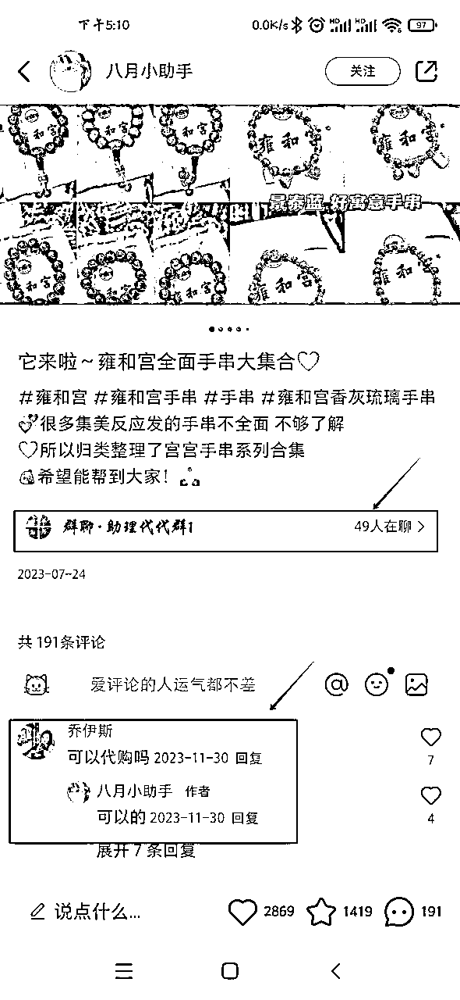

二、同款售卖
卖雍和宫爆款的仿款，部分甚至附赠手提袋与防伪卡，主打性价比，真假难辨、品相参差。

这类创作者多直接在小红书开店上架，或开播带货。虽然品类齐全，但销量普遍偏低，大多停留在个位数。

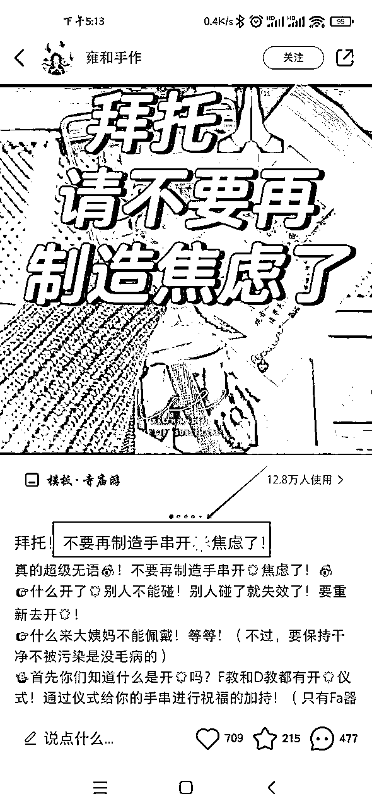

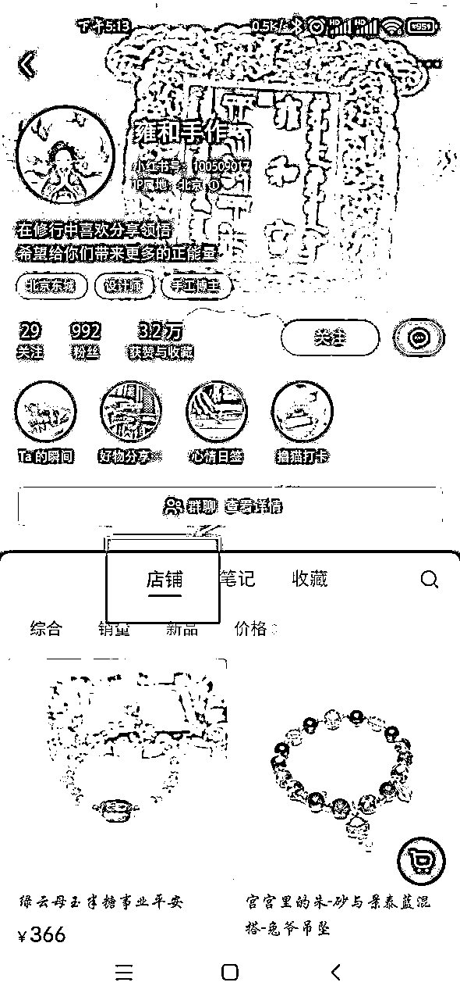

## 03 灵隐十八籽

灵隐十八籽过去一年笔记约6000+，热度不及雍和宫手串。它同样是十八种珠石混串并赋予寓意，但缺乏防伪与独家渠道，灵隐寺及周边文创店均有售。寺内零售价46元，价格门槛低，话题价值也相对弱。

在小红书的玩法同样是两条线：

一、代请
以代购名义，强调帮忙开香与正品保障，有时会搭配当日门票票根或现场视频，增强可信度，多在本地发货后导私域成交。单笔利润约30-100元。

二、同款与周边
货源来自景区文创店或义乌小商品市场，款式多、价格亲民。部分账号挂着代请名头实则无代请承诺，直接在小红书店铺售卖。单笔利润在几十到上百元。

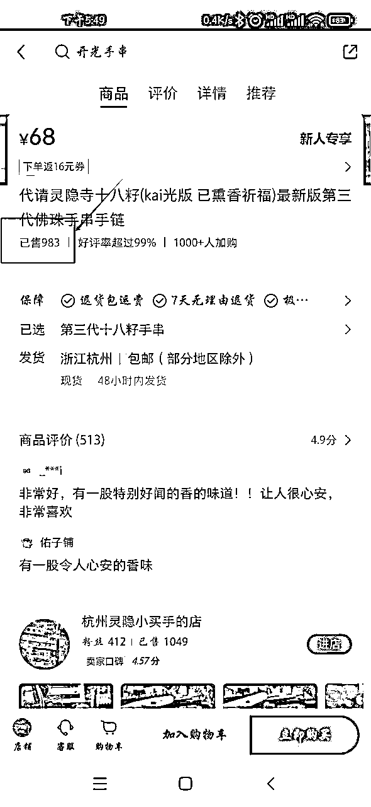

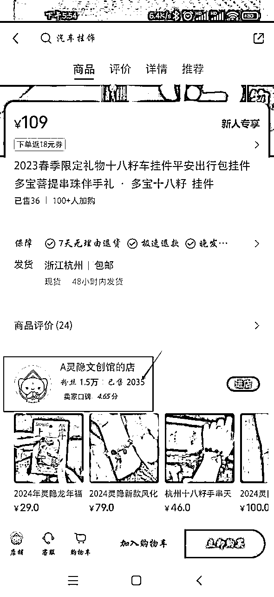

## 04 原创手作

没有大IP加持时，原创手作靠“寓意+辨识度”抬价。如“柿柿如意”“一梦入敦煌”这类主题，借助节日与文化情绪，能把客单价有效拉高，溢价可达十倍甚至数十倍。

可复制的运营链路大致如下：

1. 精准账号定位：无论是分享搭配、展示制作过程，还是做批发业务，都需要清晰定位。定位明确才能抓住目标人群，提升账号辨识度。
2. 主页视觉统一：简洁、有调性的主页更容易让人停留。布局清晰、分类明确，便于用户快速找到内容。
3. 持续内容迭代：用户口味会变，笔记要跟着调整。多做数据反馈好的内容类型，保持更新节奏。
4. 日常信息沉淀：从同行经验到生活灵感，都要系统收集，保持对饰品流行趋势与市场动态的敏感。
5. 遵守平台规则：熟悉小红书的内容与营销规范，避免限流、删稿或封号风险。
6. 用数据做决策：通过笔记互动、转化数据判断哪些内容受欢迎、哪类人群在下单，据此优化投放与话术。
7. 直播放大成交：直播是拉高销量的关键。可直播展示手串、可直播制作过程，把材质、寓意、故事讲完整，附加价值感会大幅提升转化。

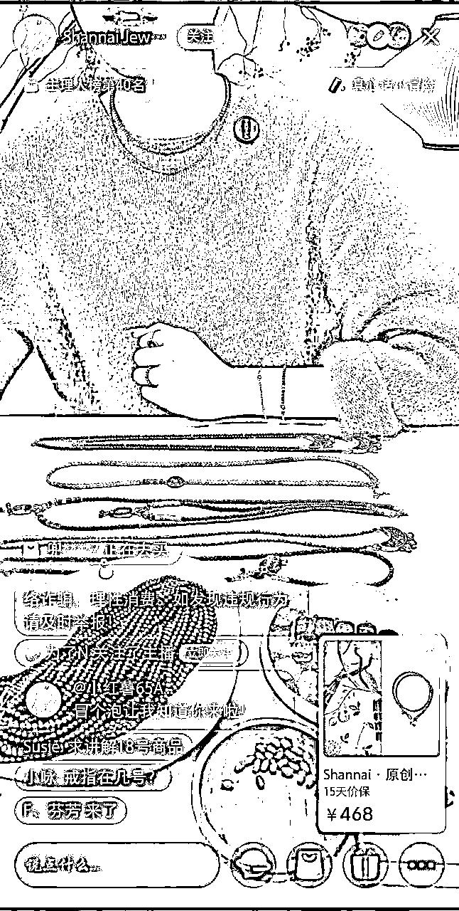

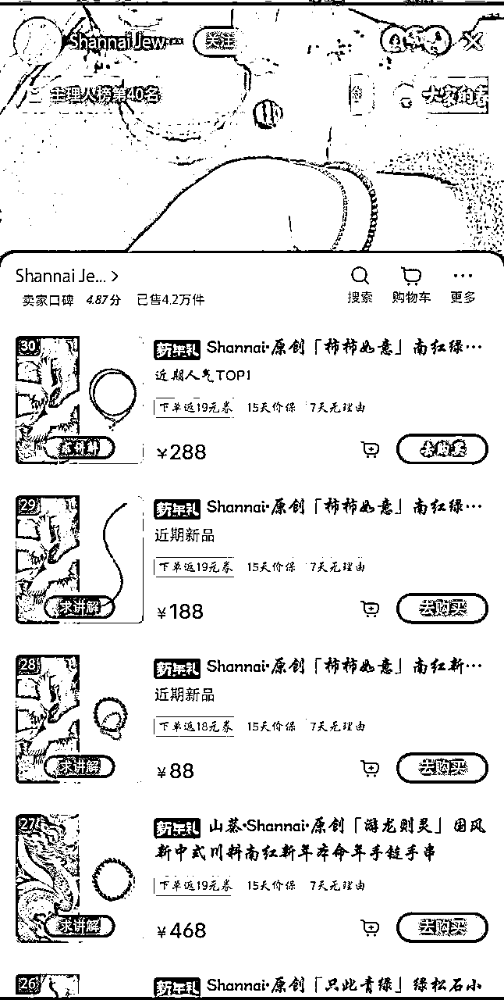

总体来看，小红书上的手作饰品要想持续热销，产品力与设计感只是起点，后续必须有一套完整的运转体系支撑。从定位、内容到私域转化与直播放量，每一个环节都需要精细设计，才能在竞争中脱颖而出，实现高销量的稳定复现。