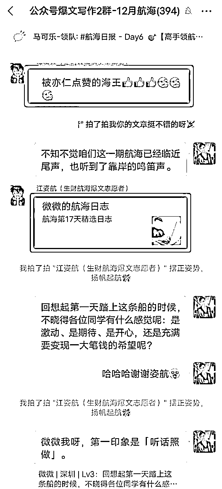
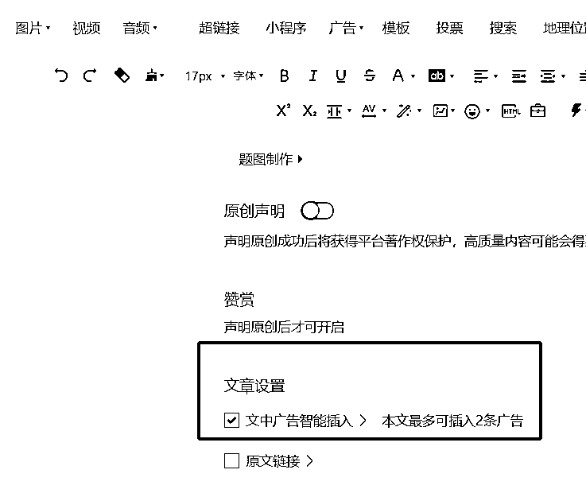
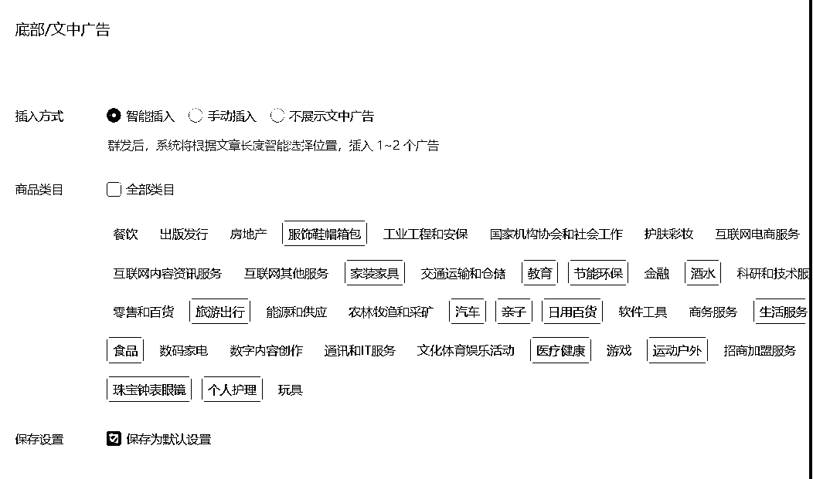
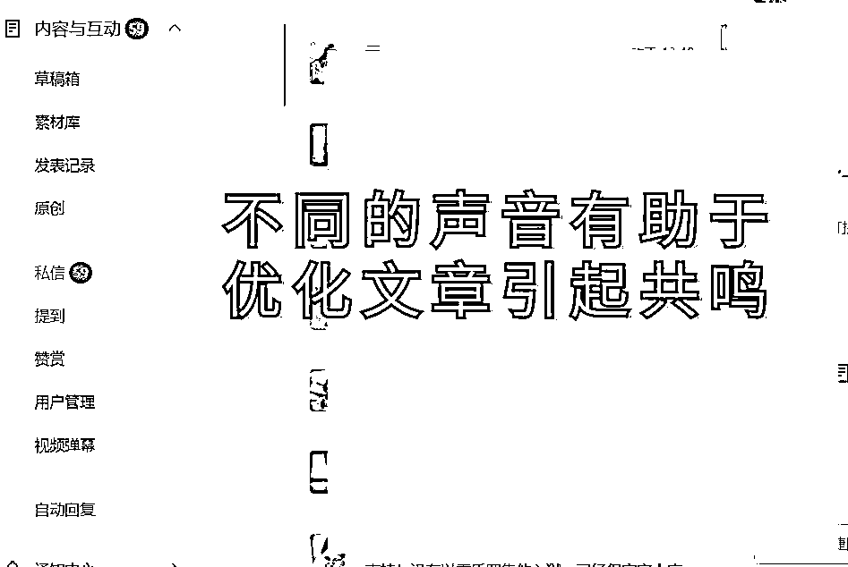
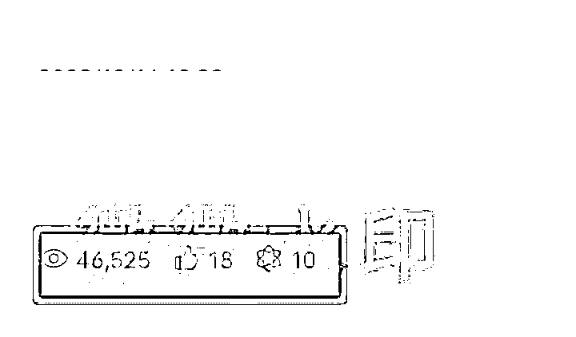
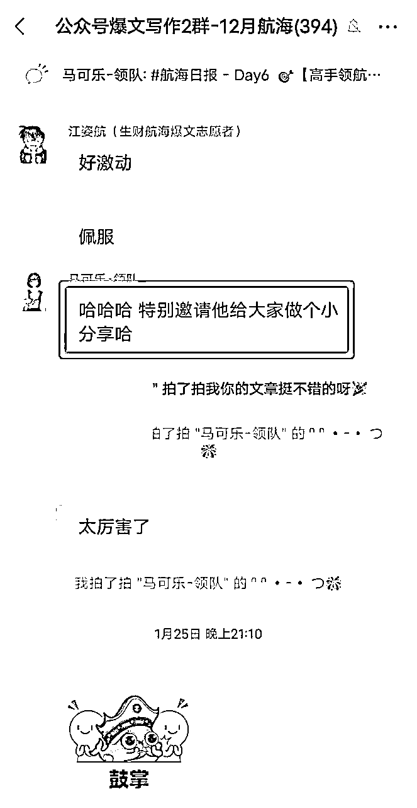
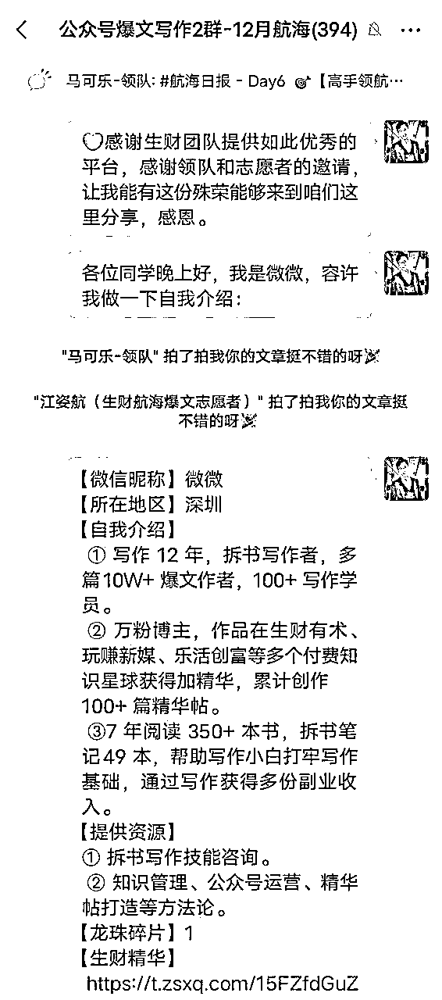
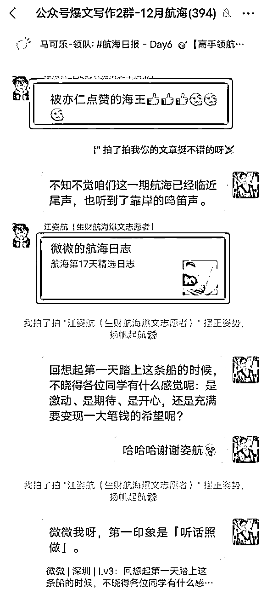
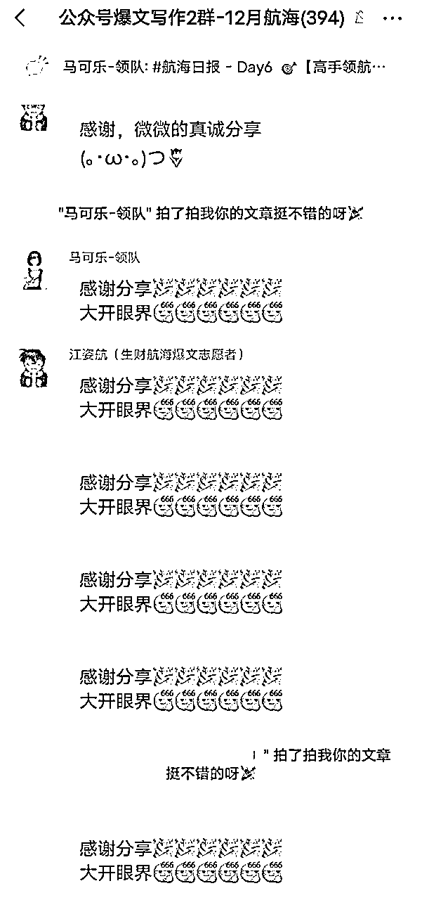

# 《从0到100W阅读，21天流量主变现7000+，我把👸号爆文的所有心得都告诉你》

你好，我是龙哥，一个靠拆书写作为生的普通人。做自媒体这一年多，我从没有背景、没有资源、没有成绩、没有基础的零起点，硬是靠着👸号一步一步走出来：后来做了知识星球、开了写作课、带社群、做资料变现……前前后后写了110W字，出了不少10W+爆款，累计阅读量超过100W，在多个付费星球里贡献了上百篇精华，还帮100多个写作小白实现变现。

去年12月，我参加了“👸号爆文写作（原创）”航海项目，21天里靠流量主赚了7000多，写出了多篇原创10W+，每天阅读量稳稳地3W+，单单一个号累计就有100W+阅读。不仅如此，还给私域导流了100多人，后面还能继续转化。幸运的是，我写的日志还得到了龙哥老师的点赞。

这一年说长不长，说短不短，却足以让一个人脱胎换骨。哪怕你出身普通、能力平平，只要肯执行、能坚持，走过的弯路都是养分，所有尝试都不会白费。正是那些跌倒和爬起，才撑起了今天的爆发。

为什么我特别推荐👸号爆文写作（原创）这个方向？因为它对新人太友好了：不需要高超的技巧，也不需要惊人的天赋。我把跑通的路子原原本本分享出来，只要你动手去做，心态积极，遇到问题就解决，三个月后你也可能拿到同样的结果。

## 一、爆款背后的底层逻辑

能在21天里每天稳定3W+阅读，说实话，靠的不是文笔多好，也不是素材多牛，而是我搞懂了爆文的三件核心事。

### 1. 先搞清楚你写给谁看

做过销售的人都懂：想卖出去产品，得先知道哪里欢迎这种产品，谁对它有刚需。写文章也一样——你擅长什么、能提供什么、打算在哪个领域深耕，决定了你的读者群是什么样的人。

这里有两个关键词：舒适输出、最相衬。

为什么这么说？因为爆文写作特别考验长期输出能力。如果你整天追热点、蹭爆款，会越写越累，灵感会枯竭。而且，如果读者对你这个人不感兴趣，不点关注，那你每一篇都像在赌运气，又累又被动。

举个例子：你擅长写母婴和婚姻，但读者全是大学生和职场小白，那内容能引发共鸣吗？能获得推荐吗？要知道，文章发出去后的第一波反馈，往往决定了系统推不推。

所以，你要做两件事：
- 找到自己最擅长的文章赛道，比如故事、历史、教育、职场、热点等。
- 分析这个赛道读者的画像：年龄、性别、地域、职业、兴趣、购物习惯……摸清他们日常在想什么、做什么。

一个小参考：最擅长写的内容，一定是你花最少力气就能写出来，而且反复写也不烦的。拿故事文举例，可以分成社会故事、家庭故事、两性故事、观点故事等，但总体来看，中老年群体占了七成。只要站在他们的视角去找话题、定选题，互动数据就会上去，被推荐的几率也会变大。

我曾在🛰️问一问上零成本给视频号涨粉2000+，用的就是类似的思路，详见龙哥盟帖子《涨粉2000+！关于「🛰️问一问」的几点实操心得分享》。

### 2. 文中广告怎么选

爆文最直接的变现方式，就是靠文章里的广告点击。除了要写读者爱看的内容，选什么样的广告也很关键。以故事文为例，读者主要是中老年人，那广告类型就要贴合他们的喜好。你可以点进去筛选，选那些适合他们的广告位即可。

### 3. 标题决定生死

大家都说标题决定一篇文章能不能爆，我说不止50%，70%都算少，80%也不夸张。内容再好，标题没人点开，一切白搭。标题不仅影响打开率，还会影响完读率。具体拟法航海手册讲得很细，我就不重复了。

我只说一个我特别受用的方法：读者思维。

也就是把你的视角和读者的视角重叠，找到交集，再从这个交集出发去想标题。说白了，就是找痛点。读者都不喜欢被说教，所以标题要避免“老师”口吻，而要有“医生”的意味——告诉他这样做有危害，或者提醒他避开错误方法。

几个例子：
- 春节前花10000块买年货，回家被老婆全扔了：为什么没买够20000？
- 为什么你30岁还赚不到钱？因为你不懂这个富人规则
- 还没到40岁，这3点不注意……反而会越来越好！
- 我减肥减到抽筋，躺床上告诉你这4点千万别碰

看到没？反差、异常、金钱、数字、畏惧、好奇、疑问，这些因素特别好用。只要搭配两个以上，那篇文章大概率能破万阅读。

### 4. 用“反常规”思维打破瓶颈

很多时候你写不好，不是能力不行，而是太想完美、太没耐心。写爆文的第一步，是丢掉“内容至上”的包袱。不要总想着写得深刻、有文采，好像这样才能证明自己。

事实上，👸号读者中有80%是初中水平。你写得太高深，大家看不懂，反而不愿意点开。所以，在账号还没进池之前，用大白话把事说清楚就够了。等进池了，再慢慢把文章写得更充实、更有条理。

记住三个原则：
- 先完成，再完美。
- 一篇爆文只是踩中一个推荐点，持续出爆文才说明号进池了，这时才该优化内容。
- 新号第一个月阅读量只有个位数很正常，跟质量无关，只跟关键词、选题、标题有关。

具体怎么做？
- 先完成：不追求逻辑严密、知识点密集，就用口语化的“口水文”形式，想到什么写什么。把对话记下来，稍微改改，初稿就出来了。
- 再完美：初稿读一遍，你会发现全是自己的真实经历和想法，有点自嗨。这时候让两个声音打架：一个挑剔毛病，一个肯定价值。就像把文章当朋友，面对面聊，让他给你提建议。
- 改稿：没改过的文章不算好文章，更成不了爆文。技巧有很多：用5W2H理逻辑、删减口水话、适当分段、加入故事和案例、制造画面感、加比喻、改错别字等等。

## 二、三个必修技能

懂了底层逻辑还不够，上战场前得练好这三门基本功。不然光有热血，日更100天也可能白干。

### 1. 写作：从“简单描述法”开始

很多人把写作当成随笔和碎碎念，想到哪写到哪，结果写了一大堆，阅读量还是25。

小白的困境是：基础差、思维弱、没体系。但有一个“速成”方法叫简单描述法，适合从零开始。简单说，就是先写“流水账”：不管语法、结构、顺序，脑子里飘过什么就记下来，比如选题、灵感、吐槽。有了内容，就能去优化。很多时候，一篇流水账里就藏着爆款因子——我那篇10W+就是这么来的。

举个例子：
- 选题：过年回娘家，和亲妈聊婆媳关系，用儿媳妇视角来写。
- 标题：年前和80岁婆婆吵架，老公生气推开我，我连夜回娘家过年，老公反而笑了。
- 内容：因为年夜饭吃什么吵起来，婆婆要喝粥，我觉得要有鱼有肉；老公推了我一下，我气不过跑回娘家；结果到初三他都不来接，打电话才知道他觉得我回家过年更开心，打算年后再说，自己也出去喝酒放松了几天。
- 关键词：婆婆、过年、老公、娘家。

同样的方法，可以套到任何场景里。

### 2. 思维：练你的“首发系统”

思维能力决定了你能把信息整合成多高质量的内容，是输出爆款的“首发系统”。很多人觉得自己思维不活跃，就怪天赋、怪资源，却忘了一个常识：大部分人都是普通人，没有谁天生会写。怎么训练？我之前在龙哥盟发过一篇文章，叫《学历高≠写作强，这5点才是学会写作的关键》，里面讲得很清楚。

### 3. 素材：用“代入角色”制造共鸣

找素材最怕什么？怕找到好素材却不会用。大家都会去今日头条、🛰️看一看、抖音找对标，拆解爆文，但如果你一直用旁观者视角，写出来还是没共鸣。

我试过一个少见的方法：代入角色。就是把自己当成故事里的人，用共情、感性、想象力去经历一遍。再直白点说：中二一点。

正面代入：比如我写《富爸爸穷爸爸》时，把自己想象成书里的清琦，思考：一个初学者怎么理解“房子是负债而不是收入”？因为自己住没收益、会贬值，还要装修、还贷款。那怎么获得“资产负债表”里的收入？面对股票、债券，既期待又害怕。然后想象自己向富爸爸提问，一问一答，素材就出来了。

再比如《流浪地球》，如果我变成刘启，最后一刻看到所有人掉头回来帮忙，会有什么感觉？感动、热血、自信、团结……这些关键词又能延伸出很多选题和素材。

反面代入：更进阶一点，把自己代入正面角色，然后用反派的心理去改编剧情。比如刘启在关键时刻说的是“事情变得有趣起来了”，想象反派会怎么做，故事马上有了新走向。用这个方法，我写出过一篇20W+。完整思路在龙哥盟的《写作秘诀，学会自制源源不断的素材》。

## 三、巧用“微式拆书写作法”

如果你觉得自己一时半会儿练不出上面这些技能，又急着要正反馈，那我分享一个“人工工具”——微式拆书写作法，润色文章特别高效。

简化版就三步：

1. 开篇：从一本书的封面、简介、引言里提炼核心关键词，写成100字的概括。要求两点：一是简洁，一眼看懂；二是能调动情绪，像爆款标题一样“开幕雷击”。比如写干货书拆解，开头先戳痛点，再抓痒点。举个例子，标题《为什么你30岁还赚不到钱，因为你不会“拆”》，开篇就说要分享一个价值五位数的写作方法，让你几小时提升写作水平，让人忍不住想看下去。

2. 正文：用总分总结构，省去书里啰嗦的过渡，只挑关键观点，用自己的话复述。所谓总分总，就是先抛中心思想，再分几个小点讲，最后总结。其实你记住一句话：围绕一个主题，分几个小点说明，就够了。书里很多知识就藏在一两句话里，其余都是解释。每个小节找出一句关键句，用自己的话演绎一下，写个两三百字，正文就有了。

3. 总结：把全文最重要的三五个点拎出来，用“侧面角度”升华——也就是从读者的视角去表达读后感受，再带一点自己的观点。这样既不显得知识点太生硬，又不会变成纯粹的个人感想。

用这个方法拆书，再把素材融进之前的流水账里，润色半小时就能写完。如果你觉得思维还是不够，也可以借助AI工具发散，比如文心一言、火山写作、通义千问、GPT。但注意，别依赖AI，能力上来后它只是偶尔的灵感助手。

## 四、创造需求：从真实反馈中找爆文

这个玩法很有意思，很多做爆文的人都在用。👸号原创爆文，不只靠对标账号和爆款文章，更要借助“真实反馈”来创作。

两个途径：
- 每天看后台读者的私信，不管是骂声还是建议，都用心研究，结合底层逻辑去构思。
- 看对标账号评论区里点赞最高、互动最多的留言，用必修技能里的思维去延伸。

我就是靠后台的骂声和建议，写出了好几篇破万、破5W阅读的爆文。至于具体怎么改写，航海手册里有详细的指引。

## 五、温馨提示

最后提醒大家一句：方法再多，不动手都是零。别怕犯错，别等完美，先写起来，坚持这个动作，爆文才有机会找到你。相信你自己，三个月后，你也可以成为下一个让我羡慕的人。

以上，共勉。

总有人会在深夜里对自己发出这样的疑问：

写满几十天，数据依旧平平，该怎么办？

GPT用起来总是不得要领，文章质量上不去要怎么破局？

群里一片欢呼庆祝，唯独我还在原地打转，坚持还有意义吗？

花上两三个小时忙活，最后到账却只有几块钱，这路还能走下去吗？...

微微想跟你说，记住这句话就行：成功从来不是一步到位，而是靠一次次踩坑、填坑的积累。当你踩过的坑够多，解决问题的经验够厚，你离转机就只差一点点。

写了许久没起色，那就换个赛道再试试；
工具玩不转，先花两小时跟着演示把手感练出来；
别人此刻在庆祝，那下一个被点名的一定是我。

或许挫折会接踵而至，或许回报不会立竿见影，或许你需要比大多数人投入更多的时间和耐心。

可只要你按照正确的方法论去执行，航海手册在手，且始终和赚钱航海群同行，你根本不用怕走偏，你的高光时刻迟早会抵达。

# 六、结语

人活着，就得有点盼头。

微微一路走来的每一次跌倒和爬起，都在悄悄把我升级成更好的自己。我坚信未来的我会越来越亮，写出10W+、100W+、1000W+的爆款。

【相信自己，是开启成功的第一步】。把想要放弃的念头，换成一句“我来改一下”，你会发现从此每一天都充满期待和希望。

彩蛋：细心的朋友可能在微微的分享里发现了几个错别字，还有用错的成语。其实这也是写爆文的一种小技巧，文章里刻意留点瑕疵，互动数据自然就上来了。

最后，再次感谢赚钱团队带来的航海项目，感谢领队和志愿者的认可。祝愿每一位同学在新的一年里，靠👸号爆文写作原创，赚到六位数、七位数、八位数，拿到属于自己的第一桶金！

2024新春，微微祝各位圈友身体健康，家庭幸福，新春快乐！