# 赚到五十万的实战笔记：📕无人直播的红利与坑位全拆解

先说前提，只聊项目怎么落地，怎么踩坑。账号注册这些基础操作，自己去搜就行。看之前必须认清一点，任何项目想浅尝辄止最后都白干。接下来的内容我会按这六块展开：

1. 核心数据 2 . 选品 3. 起号 4\. 工具 5. 放大打法 6. 实战经验和避坑

## 1. 核心数据

如果你对数字敏感，这几张截图里藏的信息量很大：直播时长、起量节点、退货率、封面点击率、人均停留时长、5秒留存占比、流量构成、进房量与转化比。这些都是判断一条线能不能走的关键，后面拆给你们看。

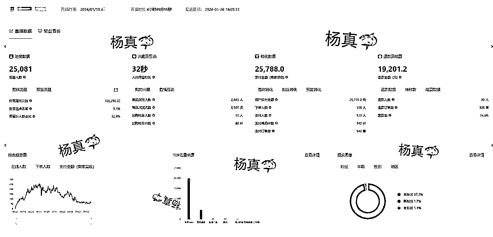

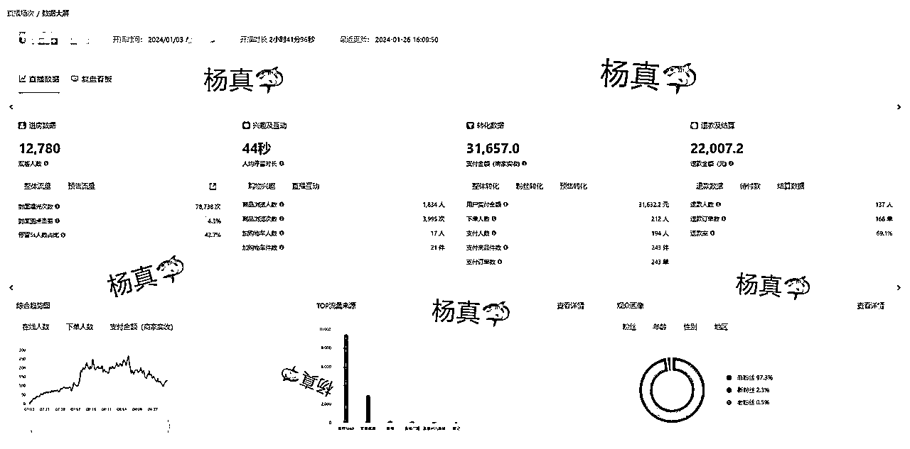

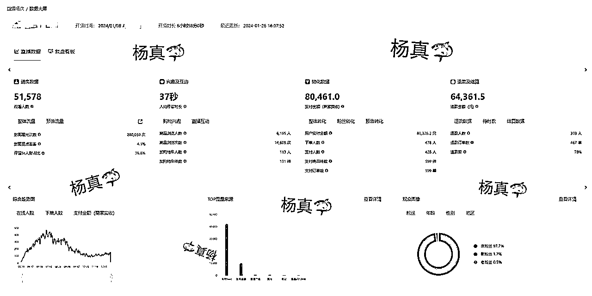

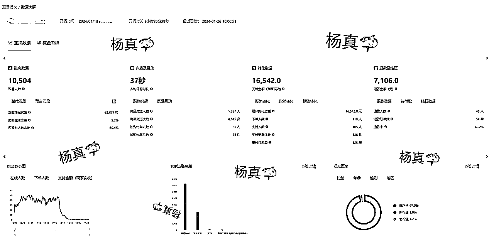

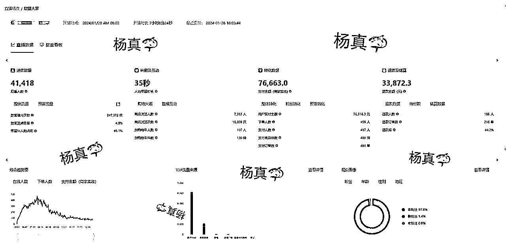

记住一个核心认知，📕无人直播没有高深技术，做的好的玩家无非是把时间用在了正确的地方：找品、测品、找封面、测封面、复盘同行、迭代再迭代。下面就按选品、选封面、选直播间、起号这条线展开。

## 2. 选品，决定成败的70%

我们是做带货，不是做IP，卖的就是商品本身。先想清楚📕用户的决策路径，货不行，主播说的再好也白搭。

### 站内找品

直接硬刷电商类直播间，重点盯无人直播账号，截图留存。判断标准：

1. 场观5000以上
2. 粉丝越少越好，优先新号
3. 24小时加购量和成交量，百单起步
4. 主页获赞收藏高，但笔记很少出单的，基本就是无人直播

符合条件的把账号和产品记下来。用📕综合排序或销量排序搜这个品，看竞争激烈度。

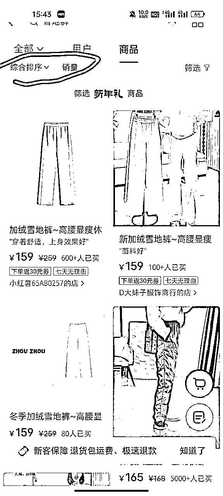

按销量或综合排序，看100单以上的账号有多少，24小时内刚爆没销量的品就蹲直播间看。单量破百的账号只有1-3个，且都是近1-3天起来的，竞争度通常很低。

品锁定后，就去看对标账号的开播时间、封面用的是谁的主播素材。

#### 看开播时间与封面

点进直播动态就能看。

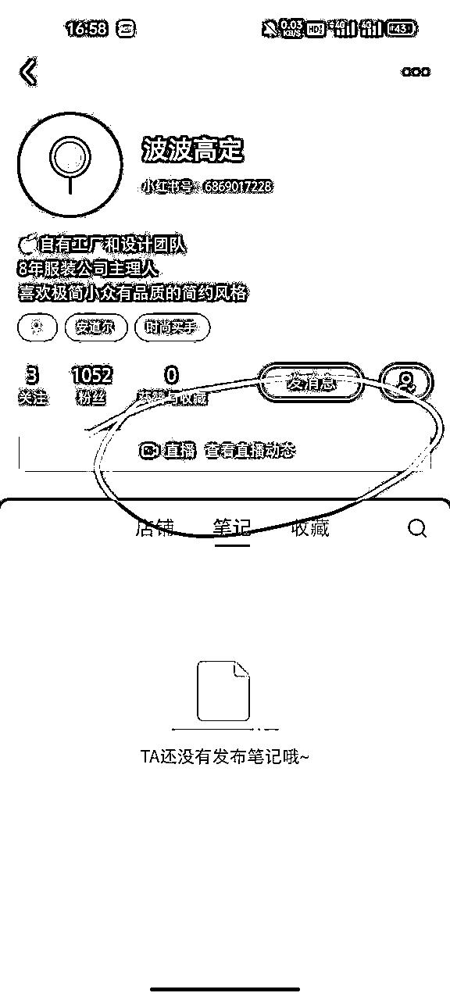

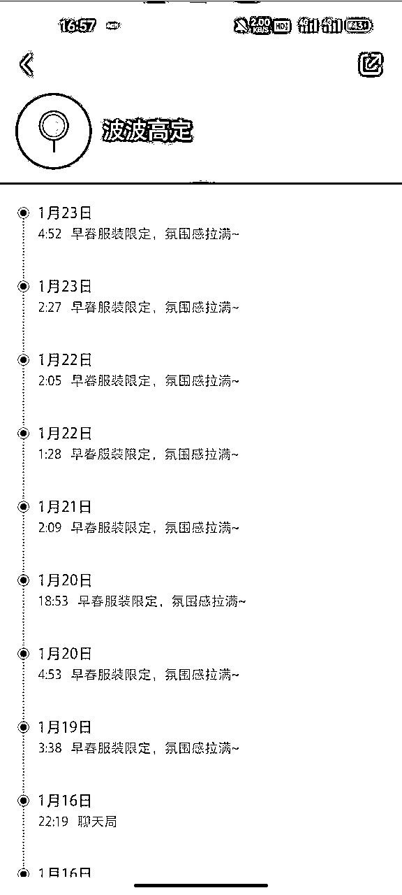

#### 找封面

知道了标题，用灰豚数据搜标题，进入直播分析。筛品时可以先过滤粉丝量。

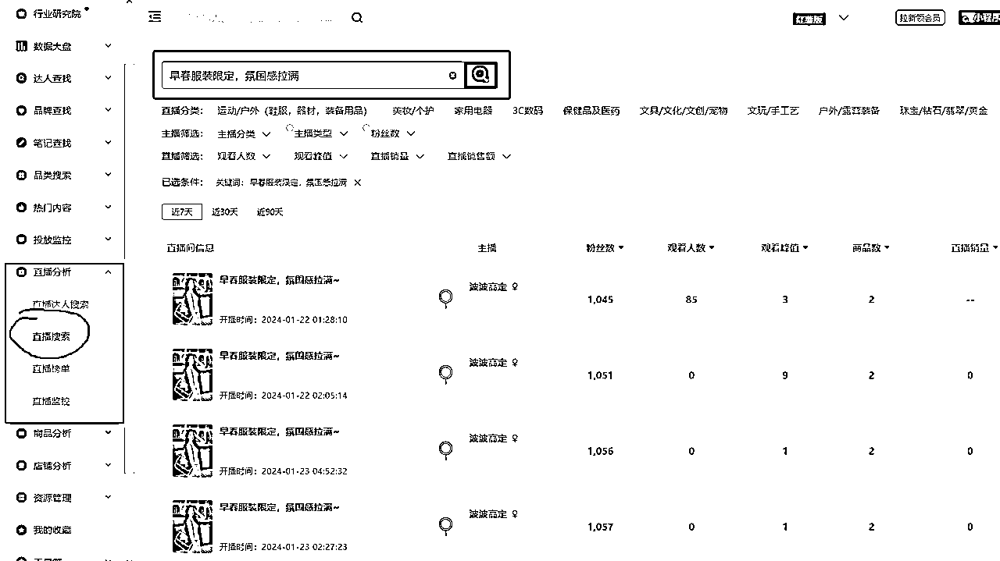

封面获取两种方式：

1. 直接右键另存，画质差用美图秀秀修复
2. 用抖音或📕的拍照识图

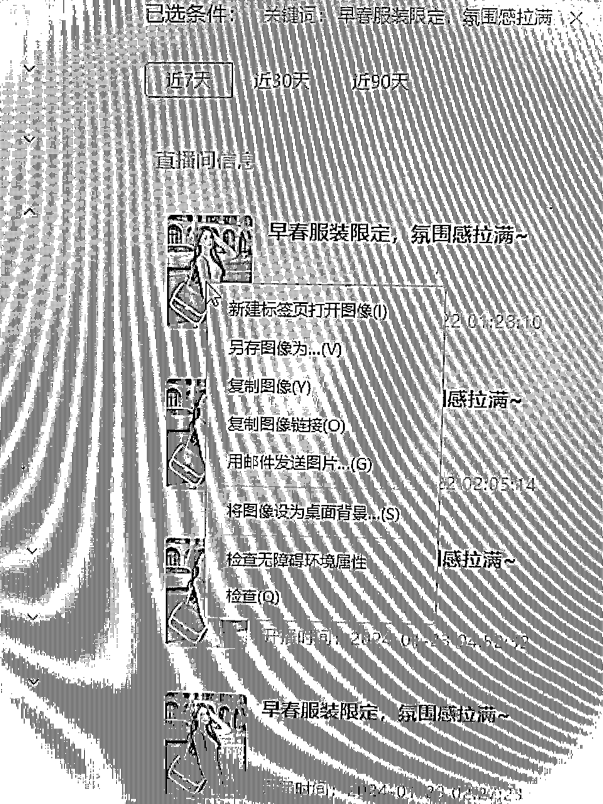

#### 对标主播是谁

1. 直播间拍照识图
2. 复制商品去抖音搜，筛直播带货的，一般爆品主播就那么几家
3. 抖音拍📕商品主图

小结：站内选品就是刷低粉爆款快速跟单，在别人大爆前卡位。注意错峰开播，同一时间扎堆开，平台流量会倾向利用率高的账号。

### 站外找品

#### 1. 天赋选品

适合有女性直觉的人。我见过女生靠感觉选品就爆了。她的做法是搜感兴趣的品，在抖音看主播直播，停留10分钟左右，能被话术打动到想下单就记录主播。筛一轮后，选最感兴趣的主播和品去📕播。

#### 2. 数据化选品之抖音

1. 早中晚不同时段刷抖音各大榜单

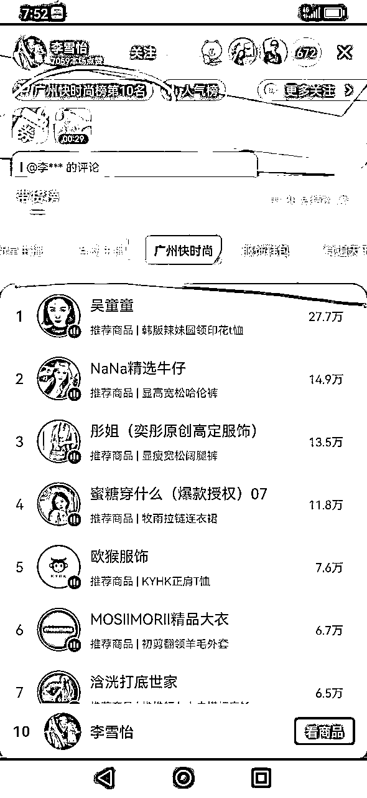

2. 筛选标准：单品或少量品直播间、粉丝低于15万越低越好、单场转化高、考古家的人群画像与📕重叠度高，女性25-45岁为主。符合条件的去考古家看是否是自然流，单场数据如何。

#### 3. 数据化选品之考古家

结合📕、天猫等平台近期热榜。之前我操的雪地靴就是先在📕看到几个人在做转化不错，竞争不大才上的。

1. 考古家直播搜索雪地靴，流量结构选推荐feed流，时间7天，然后刷

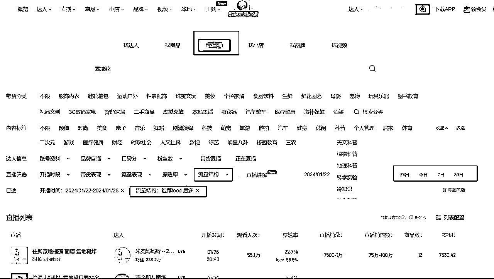

2. 关注粉丝低、观看人数低、自然流高但销售额高的账号，转化比高

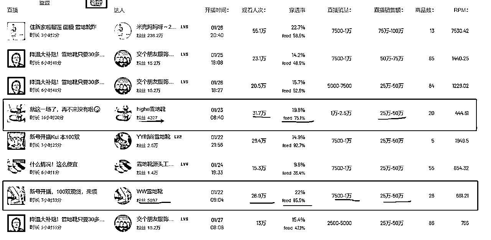

3. 点进账号看销售额、人群画像、自然流占比

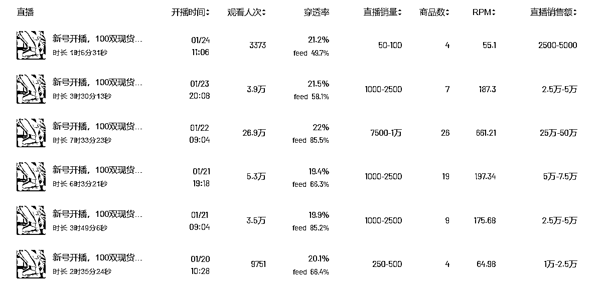

4. 自然流占比高，单场能卖10万+，人群符合📕，就拿。注意再回📕搜一遍确认没人提前铺量。

### 选封面，起量的发动机

一个好封面点击率最好能做到4%以上。

1. 通过笔记找封面

品选定后，拆关键词去搜相关笔记。好笔记封面的标准：时间越近越好、粉丝越低越好、封面与商品相关度越高越好。

2. 找封面共性

把要打的品的爆款对标封面全部扒出来放一起看规律。📕很多爆款封面其实就是直播间一帧截图，找到共同点后去录屏里截相似度高的。

### 选直播间，承接的油箱

品和封面确定后，直播间决定转化和起量。参考考古家选品逻辑：

* 粉丝越低越好
* 自然流越高越好
* 转化比越高越好，看UV价值
* 观众画像与📕用户一致

## 3. 起号

品 > 封面 > 直播间

品是测出来的，封面是测出来的，直播间也是测出来的。

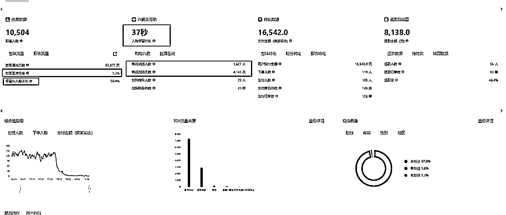

一般3场就能测出品能不能跑通。

第一场播满3小时拿到激励，第二天继续拉时长，账号没起来前每天20小时起步。下播复盘：

1. 封面点击率低于4%就换
2. 人均停留低于20秒就考虑换素材或主播
3. 商品浏览次数少说明品不行，浏览多不转化可能是价格问题

封面不行换封面，素材不行换素材，三场品不行就换品。每次只改一个变量，控制变量。

## 4. 工具

录播：江湖工具箱 http://www.jianghudata.com/

OBS https://www.onlinedown.net/soft/637537.htm

📕直播助手 https://www.xiaohongshu.com/zhibo/robs

数据：灰豚数据、考古家

### 灰豚主要看点

直播搜索看对标直播间

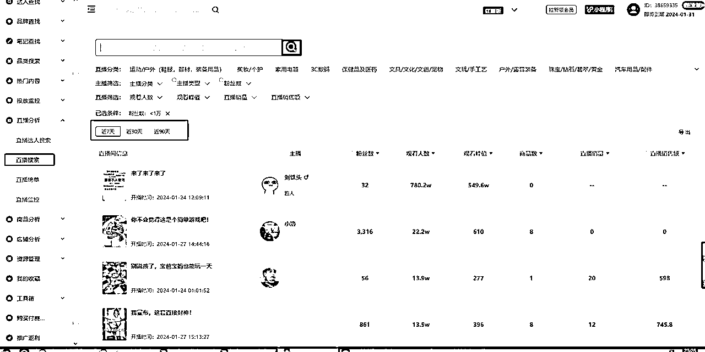

商品搜索看卖品的直播间，点击关联直播可看对标封面等

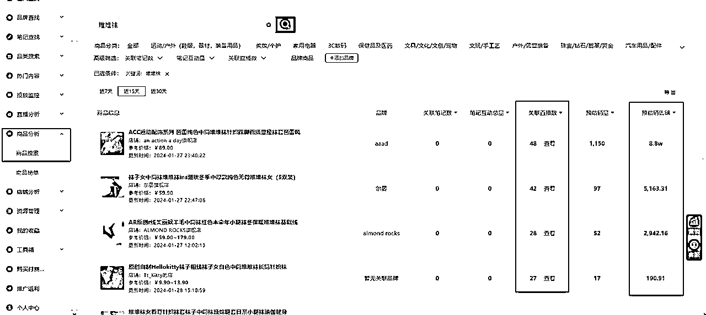

### 考古家主要看点

主播直播记录，方便记录开播时间去录屏

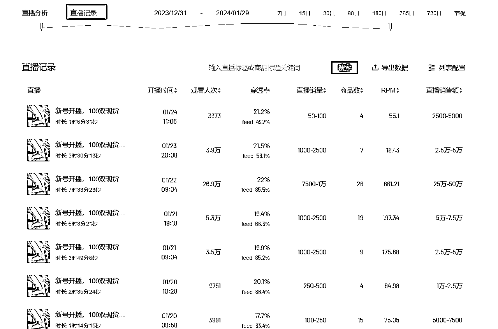

点进场次看人群和年龄

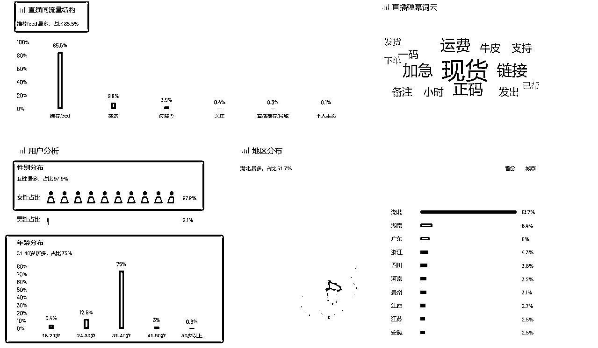

## 5. 放大打法

账号起来立刻复制，一鱼两吃。A号白天播，B号晚上播。封面有流量就保留，没流量就换，素材不用换。

## 6. 经验与踩坑

1. 封面别用暴露、不清晰、大网红、明星、同质化严重的、低俗的
2. 选品大于一切，封面是引爆点，好素材提升转化
3. 选品时全平台搜，供应链至少备2家
4. 做好亏号准备，用小号快速试错
5. 拉时长必须拉
6. 出单后立刻谈好售后，服装退货率50%不包的别碰，优先全包厂家。建议1688、淘宝交易，微信交易压货款
7. 爆单用店管家绑定厂家 https://tfxportal.dgjapp.com/ffaccount 绑定📕面单联系客服
8. 服装退货60%是常态，必须对版对尺码
9. 跟低粉爆款是最快出单的，前提是竞争小
10. 服装在📕依然最好做，女性天然属性
11. 价格可以先高点，把素材里价格相关的话术剪掉，先出单再降

重要提醒：

* 素材处理要剪掉违规词，抖音平台词、福袋、极限词、最后一波等逼单话术都要去
* 竞争小的品，单场素材循环5-8次没问题，我2小时素材循环20次也正常
* 起来后固定时间开播，及时换素材能延长账号寿命
* 剪辑建议用台式机，电脑卡会疯。没电脑用支付宝人人租
* 被封号的常见原因：同质化严重，品泛滥、主播泛滥就容易被判定录播；同一素材使用次数过多，出单素材加镜像用2-3次可以，没出单别反复用；频繁开播一天开3-4场不正常，测试一天一场够了
* 建议准备2个账号做废号测试，哪些操作会违规自己去试，比任何教程都快

最后说一句，📕无人直播本质是信息差项目，我们是在给平台做数据。拼到最后比的就是谁在选品上投入的时间多，测的封面多，筛的直播间多。多备号，封号快是项目特性，与其研究反封号，不如多准备号。