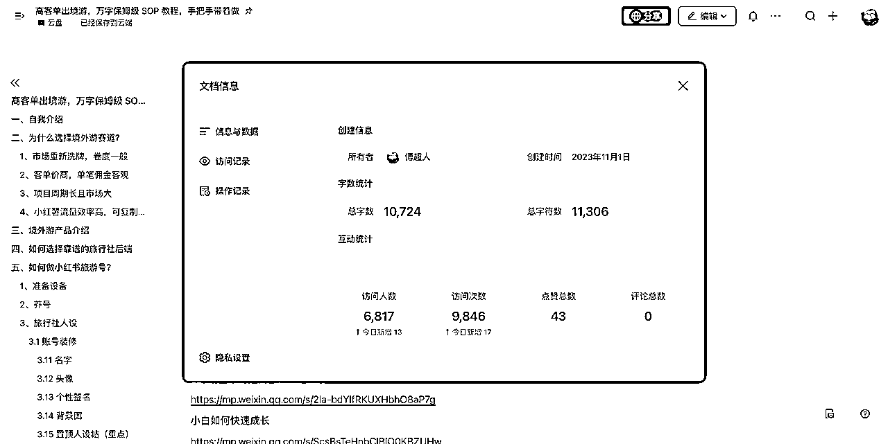
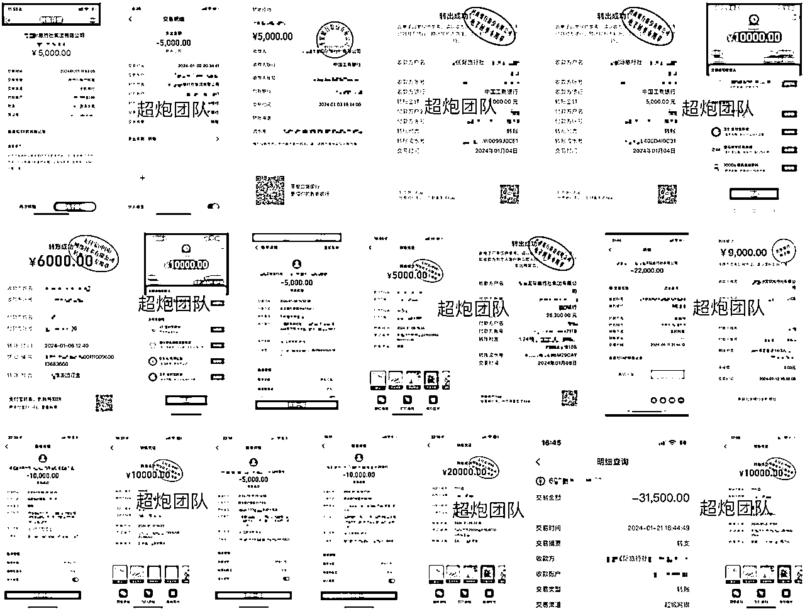
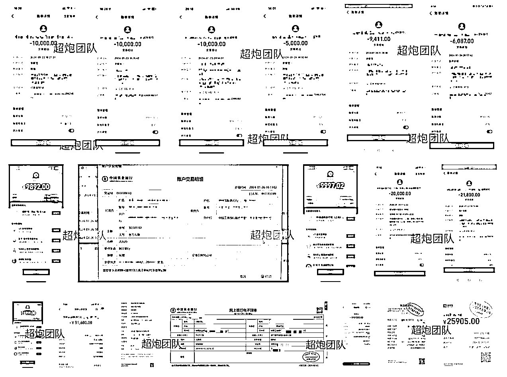
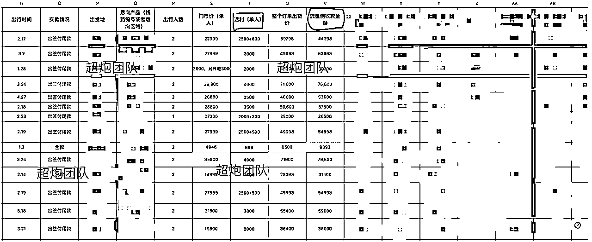
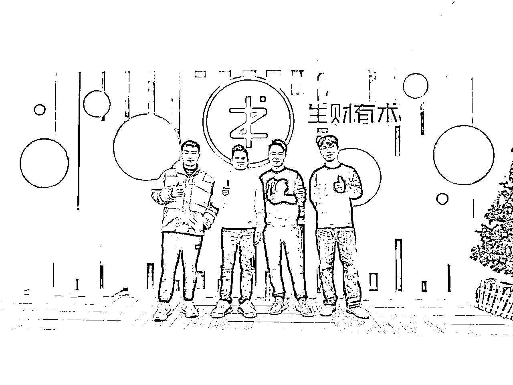
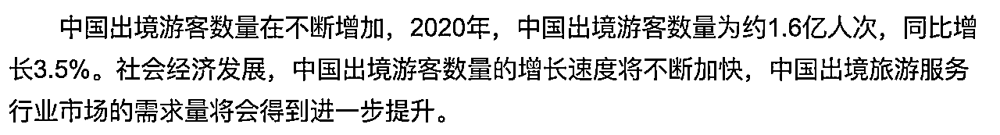
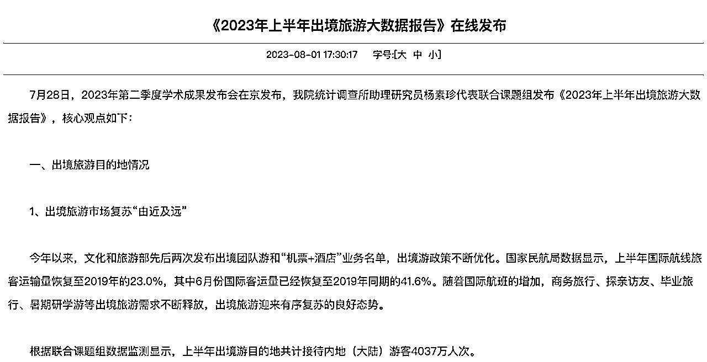
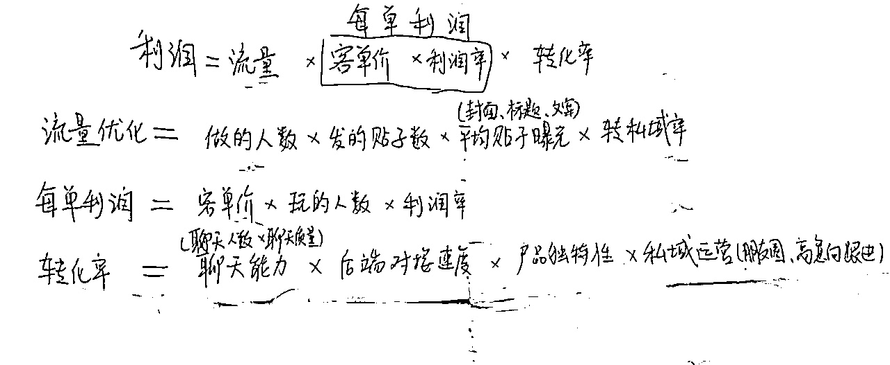
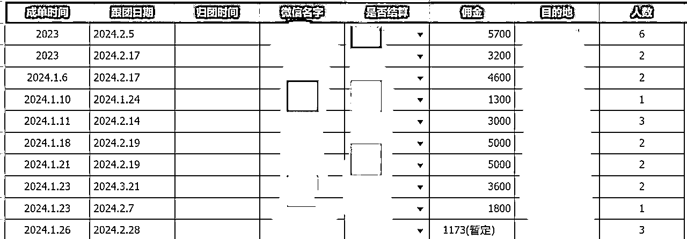
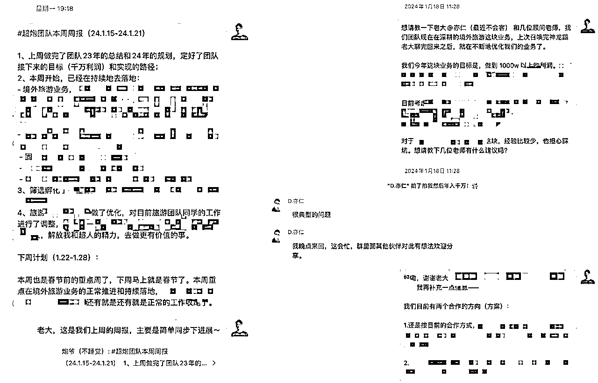

# 📕高客单境外游，我们如何规划年入千万利润的打法？

大家好，我是龙哥。今年我们的核心方向非常明确：死磕境外游赛道，目标年利润做到一千万。今天就把我们的完整规划思路公开聊一聊。

几个月前，也就是去年十一月初，我在龙哥盟发了一篇精华帖：

那篇帖子目前已经有六千多人看过，人均阅读接近两次。这至少说明内容确实有干货，而且不少朋友照着做也拿到了结果。

光说没用，直接晒一月份的部分真实数据：

（这些都是定金截图。毕竟境外游基本要提前一两个月出发，签证也得提前办，尾款一般是在出发前十五天左右收。）

我们目前的平均客单价在三万上下，大多数订单是两人出行，这个结构还在优化中。目前单均GMV大约五万，单均利润大概六千。

去年年底，我们去杭州见龙哥哥，两个多小时高密度交流，他站在更高维度给了我们不少优化方向和建议。回来之后，我们一直在持续推进业务，不断打磨细节。

关于旅游流量获取和转化细节，这篇文章不展开讲，没看过的朋友可以翻我之前的分享。

至于高客单境外游怎么跟客户聊，可以看看我们实战营一位同学的复盘文。

月初我们团队闭门开了几天会，专门梳理了今年的业务规划，以及高客单境外游的打法路径。

好，回到正题：📕高客单境外游，我们打算如何做到月利润一百万？

直接说我的思考。

## 一、先判断市场：这个赛道值不值得做？

要看一个生意能不能做，首先要判断它未来几年是往上走还是往下走。

想赚得轻松一点，一定要顺势而为。就好比站在上升的电梯里，哪怕只是原地踏步，也会被带着往前。

境外游这个赛道足够大，而且刚经历完三年特殊时期，整个行业正在重新洗牌——很多老玩家已经转行，留下来的和进来的都有机会。

我们做线上流量，跟传统旅行社抢市场，某种程度上算是降维竞争。另外这个赛道门槛不低，靠谱又专业的后端资源非常稀缺，一般旅行社对境外线路并不专业，根本接不住。

而且项目生命周期长、市场盘子大。欧洲、美洲、大洋洲、非洲、南北极，日本、伊朗、尼泊尔、巴厘岛、马尔代夫……全球都可以做，每个目的地都算一个细分赛道。我有个朋友只做一个国家，去年在红薯上一个账号就卖了五百万。

用户一旦加到私域，后边还能持续运营，复购机会很大。

## 二、月利润100万怎么拆解？

既然市场没问题，那我这点体量根本不算什么。关键是：具体怎么落地？

先把利润公式列出来。这也叫公式化思维，我们之前出过的专栏《百万千万级项目操盘指南》里详细讲过，非常实用。

利润 = 流量 × 每单利润 × 转化率 × 复购率

继续往下拆：

流量 = 干活人数 × 发帖数量 × 产品数量 × 平均帖子曝光 × 转私域率

每单利润 = 客单价 × 利润率 × 人数

转化率 = 聊天能力 × 后端对接能力 × 产品独特性 × 私域运营

复购率 = 产品体验 × 服务体验

你会发现，每一个环节都能优化。优化一点，整体利润就涨一截。

### 1、转化率怎么优化？

拿转化率举例。

高客单境外游的完整路径是：公域曝光 → 私域运营 → 私域成交。

跑通这个全流程，意味着你做任何产品、任何项目都能触类旁通，而且这还是高客单产品，更有说服力。

但前两个月我们发现一个问题：有些人只擅长流量，不擅长聊天和私域；有些人聊天非常有天赋，但没时间做流量，导致出单量也上不去。

那为什么不让他们组合起来？专注搞流量的人跟专注做转化的人搭伙，按比例分钱，一起把盘子做大。

测试了半个月，效果立竿见影——转化率直接翻了一倍。

这是优化后某位同学出的单，小几十万GMV。

### 2、平均帖子曝光怎么优化？

从📕的角度想，平台最需要什么？当然是让用户停留更久。

用户评论要花时间，用户收藏说明内容有价值、以后还想回看，对吧？

封面和标题呢？一百条帖子同时摆在用户面前，肯定是谁最吸睛谁就能赢。

如果大家都不愿意点进帖子，平台就没人看了。所以我们要顺着平台的逻辑来做内容，平台自然愿意给你更多推荐。

说白了就一句话：找爆款、抄爆款。同学不会找？我们带着找，直接给爆款模板；同学不会抄？我们带着抄。

### 3、后端对接能力怎么优化？

核心是资源倾斜、先富带动后富。

我们对出单多、表现好的同学，单独拉专属对接群，有任何问题随时沟通。

### 4、产品数量怎么优化？

把产品做宽，铺更多国家和相关产品，比如签证服务、欧洲杯门票、奥运会门票（包括开幕式、跳水、游泳等）。

每个产品有多少人在做、数据怎么样，实时统计。这样宏观上就能看清楚哪些产品还没铺到位，再分配人手去补。

我的想法是，先把出单量、GMV和利润做稳，稳定到一个月一千万GMV，再考虑要不要聚焦某个目的地做深做透。

比如湖南有家叫懒猫旅游的公司，只做仙本那一个目的地，地接和产品资源都很深，整个公司围绕一个目的地打，成绩非常亮眼。

在一个万亿级市场里，只要你足够专注、认真深耕，月入百万的团队根本不缺位置。

怕的是你不专注，三天打鱼两天晒网，永远在0到1之间循环，那确实大钱赚不到，也赚不长久。

## 三、几点个人思考

### 1、人和人最大的区别在哪？

我经常想，同一个项目放在面前，有的人文档都没认真看完，有的人一月份GMV就已经跑了小几十万，佣金好几万。

人和人的差距真有那么大吗？其实就像上学的时候，同一个老师、同一套教材、同样的教法，有人考前十，有人考后十，有人上清华北大，有人只能上专科。

同样的投入，老师慢慢会把更多心思放在尖子生身上，重点培养他们冲刺更好的学校，同时让尖子生带一带中等生，一起进步。

这就像总设计师说的，先富带动后富，让一部分人先富起来。

这也是我们今年团队的核心策略：把会做流量的人和会做转化的人匹配在一起，门当户对，一起出更多单。

算一笔账就明白了——创业者第一个要会的本事就是算账，算不清，就干不明。

十个优等生每人月利润十万，团队月利润就过一百万，GMV过千万。

十个优等生每人月利润十万，再带三十个中等生每人月利润三万，团队月利润将近两百万，GMV过两千万。

我们要做的，就是做好匹配、做好流量分配、保持前沿玩法、持续迭代后端能力，以及优化产品的深度、广度和利润率，仅此而已。

### 2、执行力、学习能力、反馈能力

想做出成绩，核心就是跟对项目，然后拼执行、学习、反馈这三件事。

#### 执行力是什么？

上学时为什么有人学得好、有人学得差？进社会后为什么有人赚大钱、有人赚不到？我认真想过，背后的逻辑其实一样。

想学习好，首先得想学习好；想赚大钱，首先得想赚大钱。

第一层是欲望。我想要好成绩、好大学，我想要买车买房、自由选择——这叫开眼。

见过好大学生活，全是积极向上的人，我也想去；见过有钱后的生活，想干嘛干嘛，我也想有。

有了欲望和需求，一切都好说。

#### 学习能力是什么？

对小白来说就四个字：听话照做。

换种说法叫：一比一抄优秀同行。同行做啥你做啥，先把从0到1跑通，赚钱稳定了再谈优化。

从生物学角度看，模仿是高效的学习方式。别的生物的优点，都是经过无数次试错才保留下来的，这是适者生存。自然界里试错一次，轻则断手断脚，重则命都没了。

做项目也一样。有人帮你整理好了最优路径，你为什么不一比一照做？你自以为的“优化”，很可能就是我们踩过的坑。

非要自己硬冲，断胳膊断腿，然后长期没有正反馈，全是负反馈。于是觉得自己不行、项目不行，再换下一个，继续断胳膊断腿，继续负反馈。

次数多了，心理素质差的人就会认定自己不是创业的料，老老实实回去上班。

殊不知，可能只是没做到“听话照做”这四个字。

#### 反馈能力是什么？

很多人第一次听这个词。其实很简单：写小作文。不用每天，至少每三天或每周，把最近的数据、思考、总结、问题整理成文字，发给带你的大哥。

千万别闷头干活。你可能想三天、一周都过不去的坎，大哥一句话就点醒了。

所以要定期给大哥反馈。虽然大哥不一定每次都有时间回你，但大哥一定喜欢积极反馈的人。

拿我们自己举例，我们也会定期给龙哥哥发业务反馈。

而且大哥非常喜欢这种小作文。业务到了一定体量，大哥身边最不缺的就是项目和机会，缺的是踏实干事、能冲锋陷阵、事事有回应的人。

懂了吗？

### 3、抬头看天，低头赶路

做出点小成绩，觉得自己牛逼，没有执行力的时候，记得抬头看看更厉害的人、更厉害的成绩、更厉害的执行力。

抬头看天，才会发现自己现在这点成绩根本不算什么，戒骄戒躁，继续狠狠干。

共勉。

这次分享差不多就到这里了。希望还没跑通0到1的朋友，以及想放大业务的朋友，能从中得到一点启发。我是尽量把能写的干货都写出来了，如果你有收获，点个赞支持一下。

「看见好的内容点个赞，也是一种利他行为。」

也欢迎正在做旅游、或者想做旅游的朋友来链接交流。我是傅超人。

链接我：abcfjj123，备注「赚钱圈友」。

新朋友也可以先看看这两个帖子，认识一下我：

22岁，毕业半年，我赚了50W

https://mp.weixin.qq.com/s/2Ia-bdYlfRKUXHbhO8aP7g

小白如何快速成长

https://mp.weixin.qq.com/s/ScsBsTeHnbCIBlO0KBZUHw