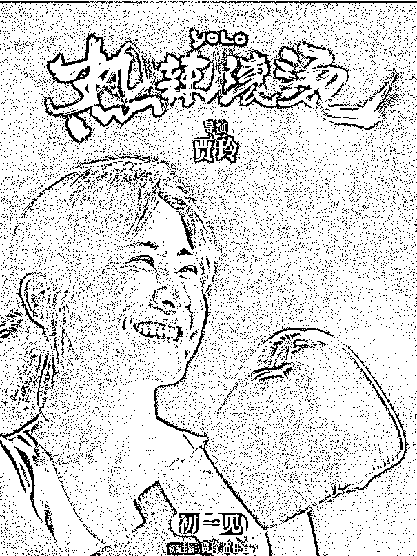

你是不是也常听见这样的声音：AI这么强，Sora又来了，工作会不会随时没？先别急着慌，听我讲讲自己的故事——一个38岁的普通女人，在2023年4月之前还平平无奇，后来却靠AI找到了一条靠自身优势赚钱的路。这篇分享，你能带走两样东西：一是3分钟发现自己优势的办法，二是把焦虑扔掉的底气。

我们太爱追热点了，天天盯着最新消息，却把自己身上最值钱的东西忘了。讲两个真实例子。

有位学员来找我，愁的是账号流量怎么都做不起来。他做了一个成长读书号，每天晚上啃书、总结观点、剪成视频发抖音，结果数据惨淡。我问他为什么做这个？他说市面上流行，想靠这个变优秀。可现实是他快做不下去了——没有任何正反馈。再一聊才惊讶发现，他从零开始做了一年的医疗机构带货直播，GMV做到一千多万，身边还有机构老板想挖他，他却不敢接，怕丢了那个月薪7000但很安稳的工作。他完全没意识到，自己能帮多少三四线城市的医疗机构从0到1做直播，那一片几乎还是一片空白。

另一位学员，做小红书搞笑热门短视频，出过爆款，但也撑不下去——因为没法变现。他不知道的是，自己身上有写作和采访的本事，还懂精酿啤酒。他完全可以采访那些喜爱精酿的精英人士，聊聊他们的口味和文化。这不就是一条路吗？

所以你看，普通人往往“优秀而不自知”。那优势到底是什么？一句话：你能解决部分人解决不了的问题。优势一般有四种。

第一种，行业优势。我有个学员在丰田待了15年做门店管理，4S店线下营销、销售流程了如指掌，结果他天天捣鼓日本文化号、种菜号、能量场号，全都没水花。他把自己最硬的底牌给忘了。

第二种，技能优势，这个不用多说，写作、画画、看病，都算。

第三种，资源优势。我一位49岁的学员，靠场地资源赚了两百多万——她能搞定社区和园区的空置场地，再对接企业活动，做活动承办加场地租赁，钱就来了。还有一个你们想不到的例子：我爸妈家楼下有对退休夫妇，初中文化，但他们有一坛祖传的臭豆腐水，40年了，泡出来的臭豆腐特别好吃。我当时迷茫到差点花5000块跟他们买一点水，自己出摊卖臭豆腐。后来ChatGPT出现了，我就没去摆摊。

第四种，经验优势。拿我自己来说，我生完孩子后，宝宝肠胀气特别严重。我翻遍资料，试遍国内外药物和物理办法，终于找到一个绝招。我在宝宝树发帖分享，那篇帖子阅读量两万多，无数宝妈说太有效了。还有一位学员，52岁离婚，但两个孩子培养得非常优秀，一个国外名校，一个考上985，她的优势不就是“单身妈妈怎么把儿女培养出色”吗？更极端的，一个学员投资失败背了几百万债，家也没了。他靠运动把自己从离婚阴影里捞出来，又通过债务重组减轻了压力。那他能不能帮同样处境的离婚欠债男人，既提供情绪价值又给点实在建议？当然能。

所以每个普通人都有优势，只是自己没发现。你说我没有发现优势的天赋？那给你一个超简单的方法：想一想，有没有至少两个人对你说过“哇你在这方面好厉害，能请教你吗？”哪怕对方最后只是说了句谢谢，连饭都没请——他请教的领域，就是你的优势。我办公室一个男同事，月薪也就六千多，但每次我们开会前必听他的经验。他之前做了六年会务，走南闯北办过大大小小的峰会，手上一堆资源。最近有个女生特意请他吃饭，不是为了追他，而是请教怎么筹办大型峰会。你看，这就是信号。

可能你还纠结：我这点本事，跟那些专业大牛比起来不是班门弄斧吗？这里有个概念叫“知识的诅咒”。实验里，A组戴着耳机听歌，根据节奏敲桌子，B组猜他敲的是什么曲子。结果是根本猜不到，A组的人还特别震惊：这么明显你们听不出来？因为我们一旦知道了一个知识，就忘了不知道它时是什么感觉，也理解不了那些没听过的人。所以你可能觉得自己那点东西太小儿科，但在没这些知识的人眼里，你就是专业的。就像年轻人觉得教爸妈用手机是再简单不过的事，可对爸妈来说就是绕不过去的难题。现在已经有创业团队把“教爸妈用手机”做成了产品，照样变现。我弟觉得机械键盘的知识都是常识，我却觉得他专业到发光，甚至想劝他去做自媒体。

更别怕大V太强。中国的市场太大了，几个头部IP根本覆盖不了那么深、那么大的需求。他们的客单价和吸引的人群，跟你吸引的人群本来就不一样。每个人背后都站着一群人，每群人都有至少一个没被满足的需求。太高精尖的内容吸引的是同行，而行业里的通用知识吸引的才是愿意付费的小白。60分可以教50分，40分可以教30分，你有什么好慌的？

要是还自信不起来？那就刻意练习。贾玲从拳击小白练成还不错的拳击手，你也行。任何人在一个领域专注练习1000小时，都能积累出真正的底气。

我自己也是这么走过来的。原本在营销领域我是个外行，之前做自媒体，用了4年时间才搭起知识体系。买大量营销专业书，每天下班后啃；看完理论，白天就用进产品文案里。有了流量和正反馈，再把方法论和写文案的流程发到垂直平台，慢慢有了关注。所以啊，有了优势、帮别人解决了问题，还得持续输出，不断放大自己的价值。

你又说：我学理科的，从小文笔差，写不出来？没关系，AI就是来帮你这个的。

AI第一件事，是把写作门槛狠狠降低了。它能让没有文案基础的人也能产出像样的内容，你只要掌握一点技巧，就能写出还不错的字。举个例子，你不会写，但你会不会回答问题？我做了一个帮个人IP写故事的方案。我之前是记者，多年采访经历让我练出了挖故事的能力，就让ChatGPT扮演记者，去和用户对话，不断提问，慢慢把用户的个人经历构建成一个完整故事，他们拿这个故事去做营销、做变现。我自己光靠这篇个人故事，一个月就加了300多人，变现五位数。

AI可不止能降低门槛。它更大的本事，是赋能你现有的业务，相当于给你配了个助手。比如我做1V1定位咨询，就是和AI一起为学员服务——人机合作。我负责挖学员的天赋、优势和独特定位，AI帮我把这些信息创新组合成很多参考答案。有个学员是大龄技术员，怕被职场淘汰，但他特别会带孩子，能把内向的孩子引导得开朗；他自己又喜欢AI绘画。我们人机结合一琢磨，定了个特别有意思的方向：给家长定制动画视频，用童话故事帮孩子改掉拖拉、乱发脾气、爱玩手机这些毛病。我当时看完这个方案，都想马上跟他预定一个视频，因为我娃也有类似问题。AI的想象力加上我对自媒体的见解，一下子就擦出火花了。另一个学员52岁刚退休，以前做人力资源，现在做小白职场辅导，教写周报、定计划，还搭了个职场案例库，做得有声有色。

说到底，AI时代让IP变得更去中心化，普通人的出头机会反而多了。只要你能找到自己的优势，在某个领域里刻意练习，再用AI放大你的势能，持续输出、分享，你的职业周期就能一直延长。2024年，愿我们都能找到心之所爱，找到努力的方向，做自己的英雄。