最近我把小红书上一批销量能打的手作饰品店铺挨个研究了一遍，从粉丝、笔记到产品定价，全看了个遍。结果发现，那些卖出高销量的店铺，背后其实有一套共同的“运转逻辑”。

先说第一个，【川川手作】Fairy house。

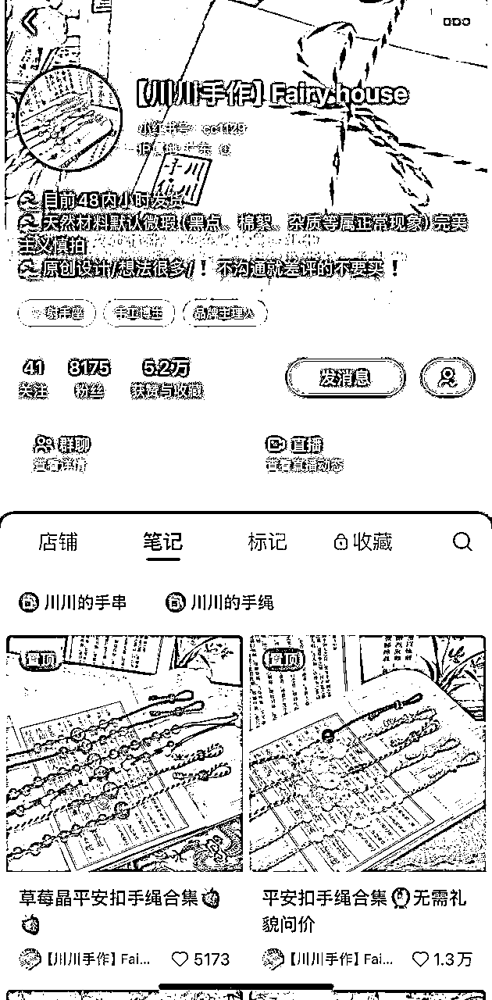

这家店粉丝量不算高，只有8174，卖的是原创设计的玛瑙手串和项链，价格集中在9.9到60元之间，绝大多数在50元以内。按市场行情粗略估算，产品本身加上包装快递的成本大概6到8元，也就是说每一单的利润在4到50元左右。笔记最早发在2022年5月20日，当时只是随便配图，发了两条就停了。直到2023年3月13日又重新开始更新，发的是产品图文，标题就写产品名，图片感觉是店主自己拍的，走的是带点仙气、唯美的调子。

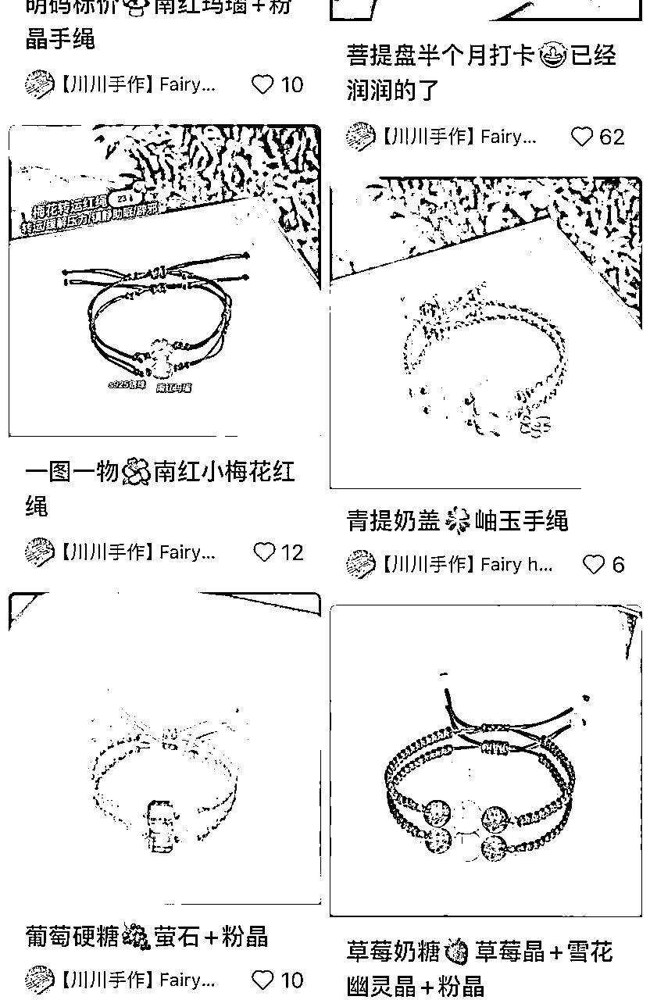

从4月4日那篇笔记开始，商品链接挂上了，之后发的图文基本都带了购买链接，更新频率接近日更。最开始点赞很少，直到4月底才出了一篇讲摆摊经验的爆文。到了8月底，真正的爆款产品笔记才出现，也是从这篇开始，她换了拍摄风格，并且一直保持到现在。

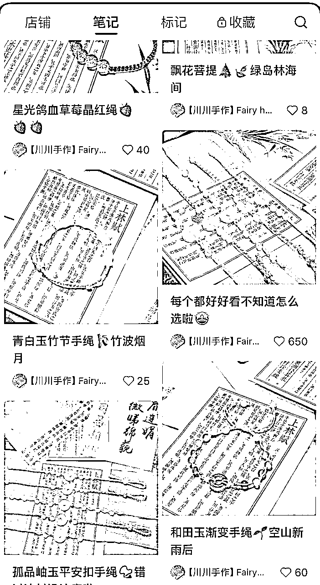

店里卖得最好的单品销量超过一千，其他大多数在100到200之间。没有开直播，但建了个群聊，只不过群里基本没人说话，店主只是偶尔发发上新通知。淘宝虽然也有店，但没在运营，基本等于没有。

这家店从2023年3月做到现在，还不到一年，没靠直播，硬是靠着日更图文做出了不错的销量。关键在哪？首先是店主能坚持日更，其次产品调性和笔记画风非常一致，主打原创手工，价格又不贵，尤其产品图和实拍确实漂亮，很容易让人记住。再看她笔记的吸引力，主要功劳在图片上。所有标题都特别简单，只是写个产品名，所以标题起的作用很小，真正把人吸引进来的还是视觉。从数据也能看出来，换了拍摄风格之后，流量明显上了一个台阶，新的风格跟产品气质特别搭，给产品加了不少分。总结下来，这家店能卖得好，就是靠风格统一、记忆点强、笔记内容垂直、自带品牌感，再加上雷打不动地日更。

第二个是楠璞手作饰品。

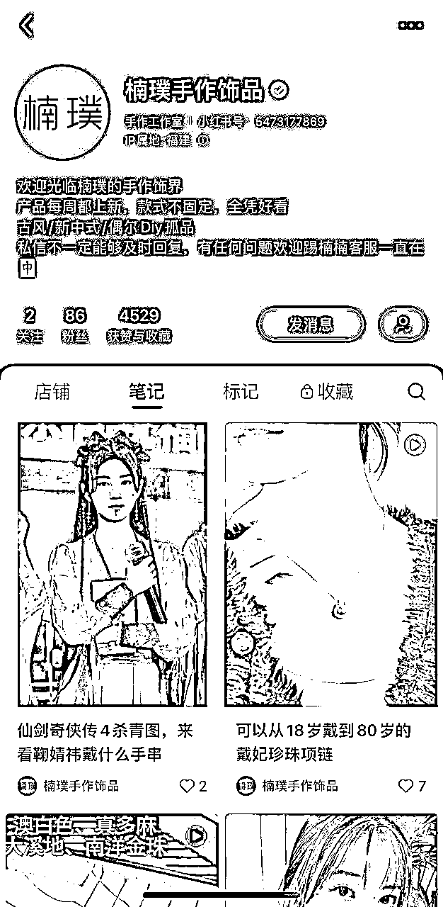

这家粉丝量只有86，卖的是古风、新中式和田玉、珍珠类的手串和项链，价格从19.9到350元都有，大部分在100元以内。利润不太好估，因为玉的价格水太深，没法统一算。笔记图文和视频都有，从2023年11月中旬开始发，第一条就挂了商品，内容基本是展示产品。但风格很杂，有时候只展示，有时候蹭明星事件的热度，点赞数大多在10以内。

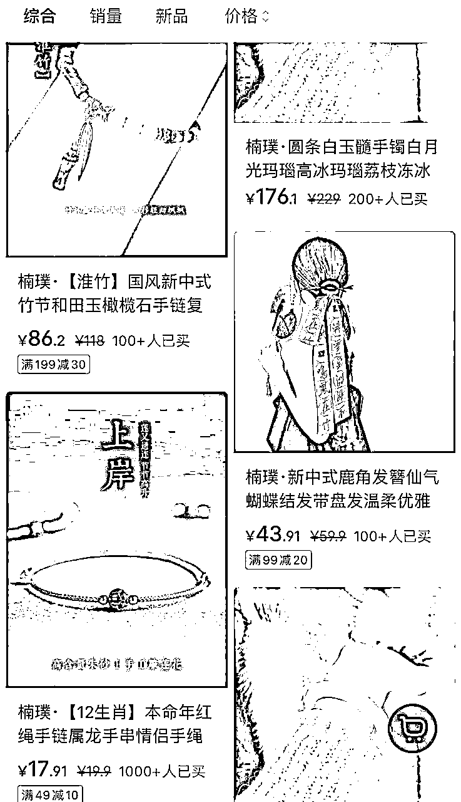

店里最高销量也有一千多，其余多数在100到200之间。没有直播，没有群聊，其他平台也没有布局。整体销量一般，但产品价格跨度比较大，既有50元以内的低价，也有更高的单品，所以单量不多，但每单利润可能不错。主页翻进去感觉乱乱的，产品也没什么明显的风格特点，用户第一眼看不出她主打什么。即使这样，她也出了一个过千的小爆款，推测是赶上了小红书开店的红利，同时靠坚持发笔记慢慢攒出来的。

第三个是认真的橙子。

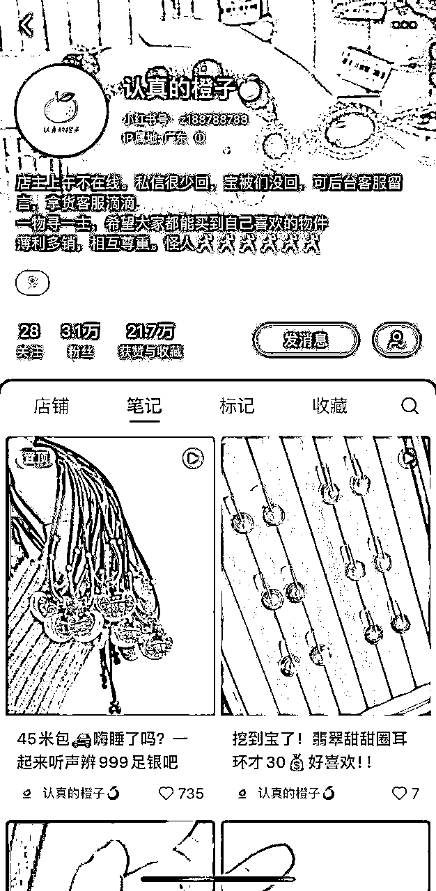

这家粉丝量有3.1万，卖的是翡翠、玉类饰品和项链，价格在9.9到60元之间，小部分在200元以内，利润没法估算。笔记以视频为主，从2022年4月18日开始发，7月6日才挂商品。更新频率不稳定，不是日更。视频都是短款，没有配音解说，只展示产品，产品信息放在标题和文字区。不过所有笔记风格调性很统一，辨识度还是有的。

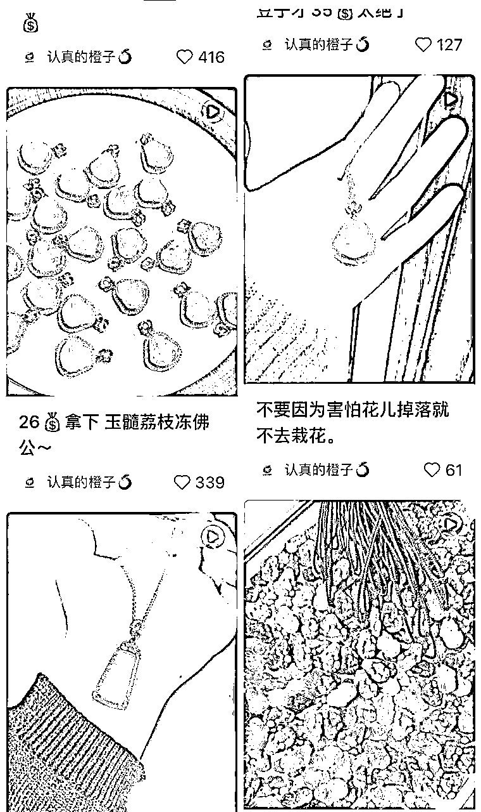

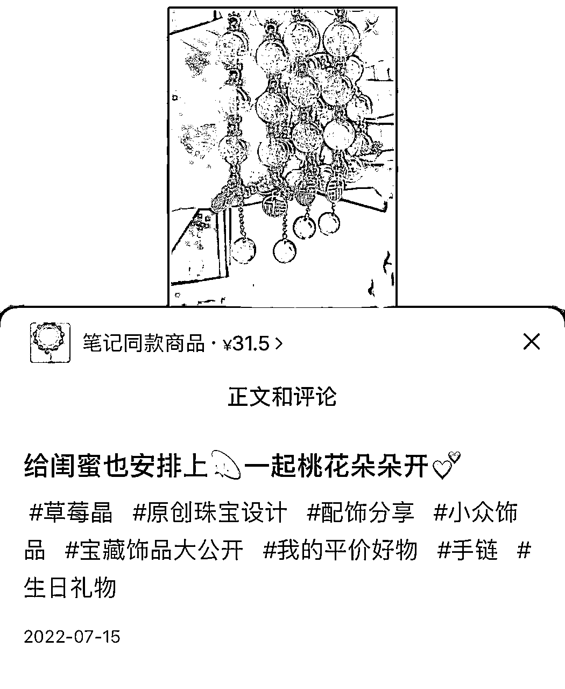

店里最高销量一千多，其他多为100到200。淘宝也有店铺，但看起来没怎么打理。这家做了快两年了，价格也不贵，对比其他几个号，销量真不算亮眼。更新频率不高，估计是副业在做。这种情况下，更新可以慢一点，但笔记内容如果优化一下，说不定能带动销量。

第四个是山野少女。

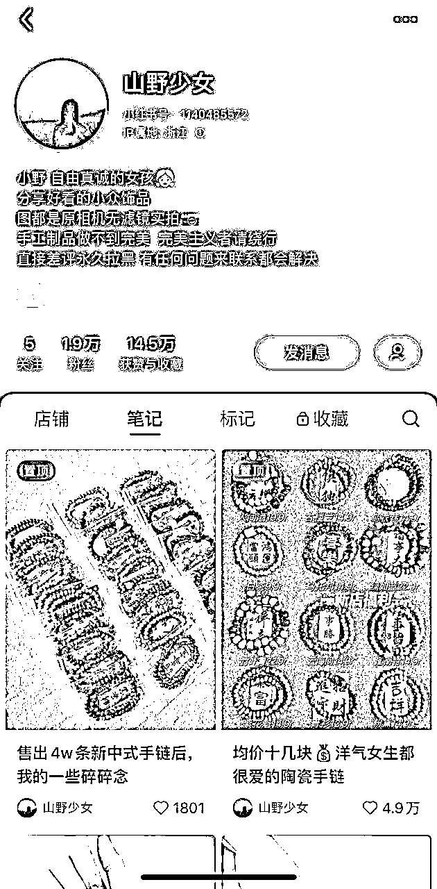

粉丝量1.9万，主打新中式、文玩类手串，价格在9.9到30元之间，在售单品很少，不超过20个。按市场行情估算，成本加包装运费大概6到8元，每单利润在4到22元之间。从2023年5月3日开始发笔记，第一条就挂了商品，明显就是冲着开店去的。前期更新没有规律，近期基本日更。笔记图文和视频各占一半，内容都是单纯展示产品，没有解说。只要发的是产品合集那种笔记，点赞数据就不错。由于产品风格都差不多，整个主页看起来还算统一，但辨识度不太高。

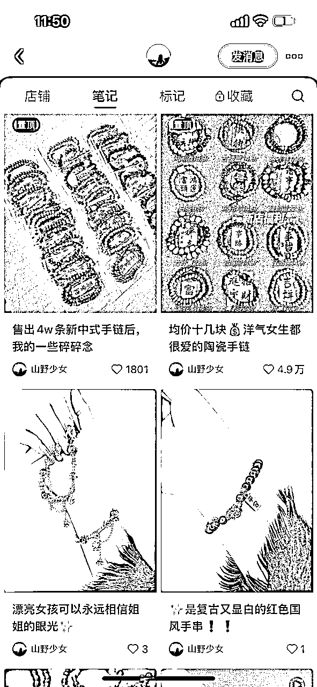

店里最高销量4万多，其他多为100到200。没有直播，没有群聊，也没有其他平台店。2023年5月才起步，现在已经有上万销量的产品，算是很厉害了。跟同期开店的其他账号比，她涨粉速度不错，说明产品本身受欢迎。产品和笔记风格都比较一致，如果前期更新频率再高一些，成绩可能更好。总结下来就是：产品调性统一、价格实惠、笔记垂直、坚持更新。

最后是简菩文创。

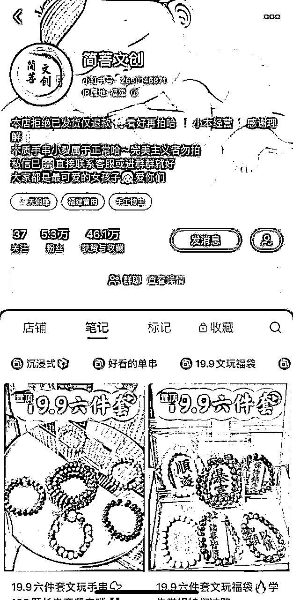

这家粉丝量5.3万，卖文玩手串，大部分价格在8.8到30元，小部分在30到60元。按市场行情估算，单品成本加包装快递大概6到8元，但她卖套餐居多，如果有更便宜的渠道，套餐总成本可能也就七八块，那19.9的套餐利润大概在11块左右。其余更高价的产品，利润自然更高。笔记以视频为主，内容展示产品，用方言配音，标题直接用价格写上去。从2023年3月1日开始发，一开始只是单调展示产品，没有任何配音解说，更新频率是日更。3月21日开始转变内容，加了配音来详细介绍和展示产品，并说明价格，后面基本延续这个风格。

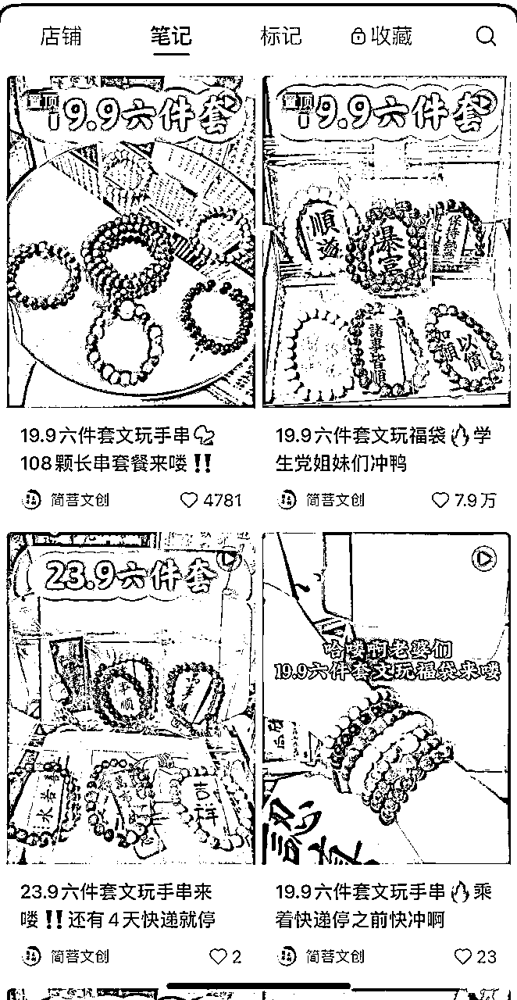

店里有两款产品过万销量，最高4.3万，其他多数是几千或几百几十。没有直播，有5个群聊。抖音也有店铺并且同步了笔记，但销量最多几百件，远不如小红书。这家店产品风格非常统一，走文玩路线，记忆点很强。价格也特别便宜，不到20块能买6串，放在同行里非常划算，便宜这个点应该贡献了大部分销量。笔记也尽量保持统一风格，有利于平台推给精准用户。总结：从店铺名到产品，再到整体调性，全部高度一致，物美价廉、内容垂直、坚持日更。

把这几家放在一起看，首先能发现一个共同点：产品基本都属于文玩领域。文玩手串号称“养成系爱好”，一方面能做装饰增加美感，另一方面也是精神层面的追求。这几家店大致分两类，一类是玛瑙、玉饰品，一类是木质饰品。我在小红书上对比了一圈，木质类的销量明显比玛瑙玉类更好。为什么会这样？因为文玩手串是有级别划分的，玛瑙玉属于入门级，木质类属于资深玩家的选择；再加上传统观念里，木质可能更符合大家对文玩的理解和认知，所以玩木质的人更多，销量自然更高。

再提炼这几个店的共性，无非三点：

1. 笔记坚持日更，并且风格统一；
2. 产品风格鲜明统一，有记忆点；
3. 价格压在9.9到30元以内。

这三点，再加上文玩本身能满足用户爱美和精神爱好的双重需求，就是高销量的真正答案。