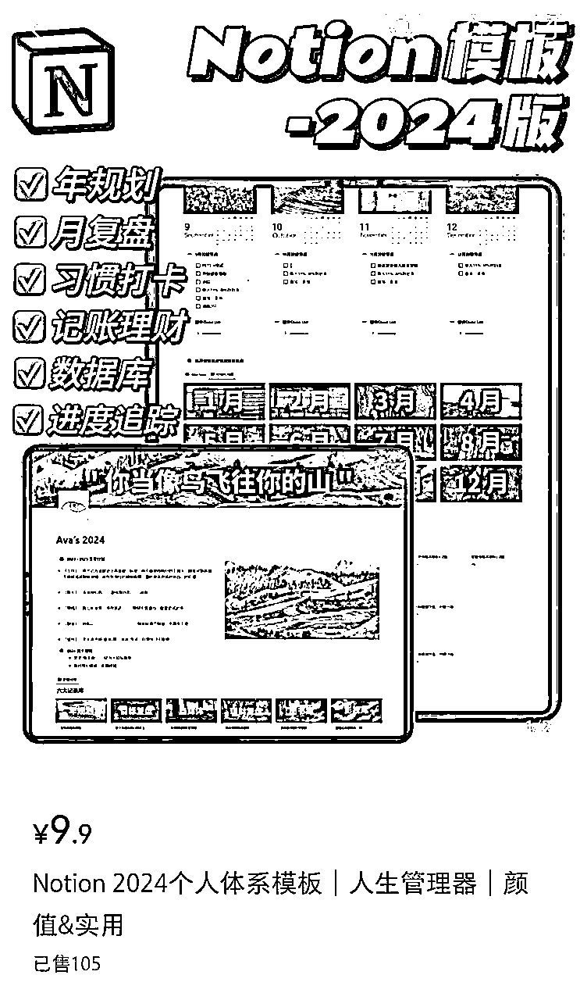
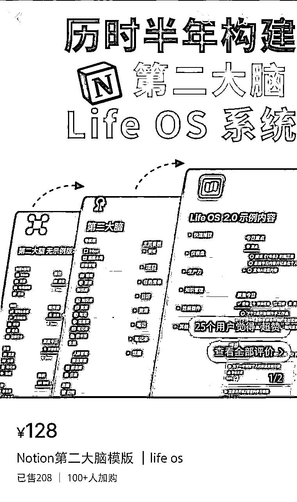
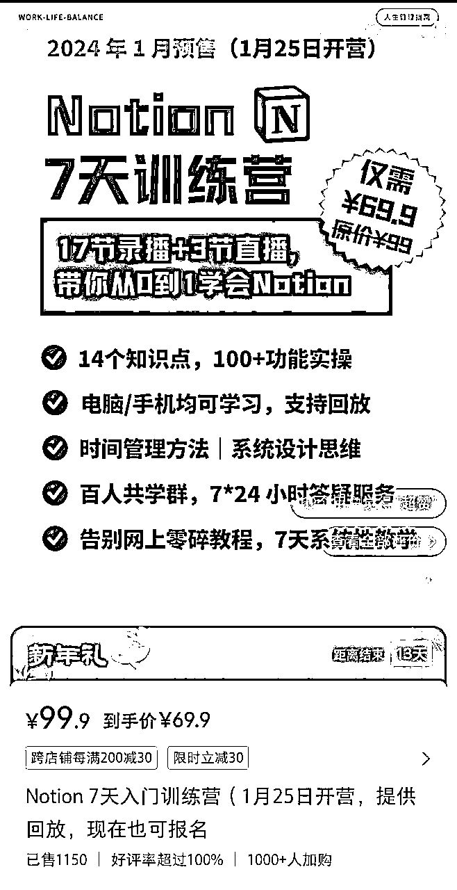
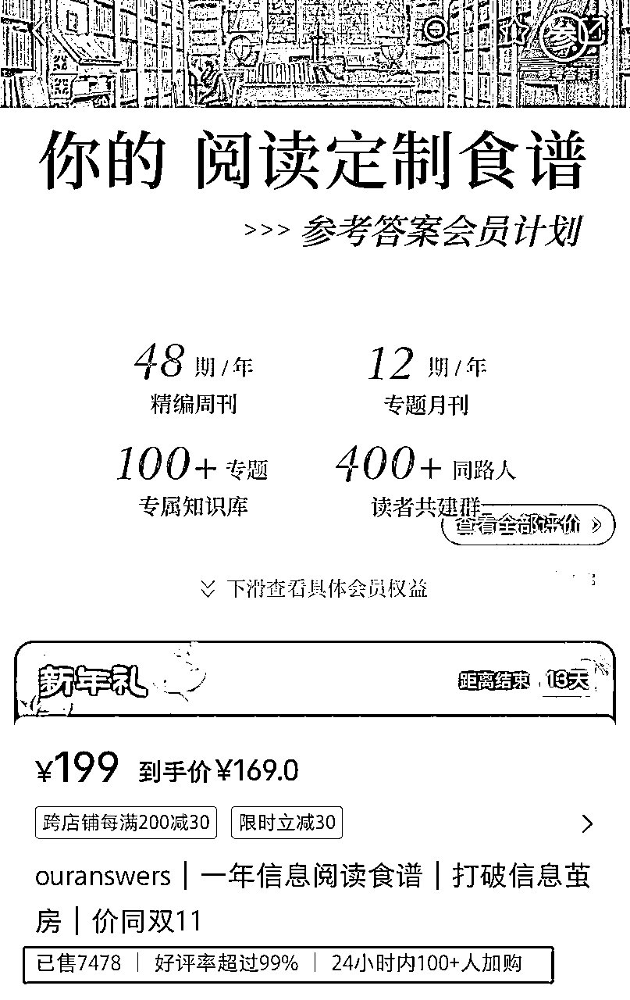

# 风向标拆解第3期-机会9：靠Notion模板年收入100万美元，通过资料整理变现的路径如何实现-灵犀小V

你有没有想过，很多人动手做事之前，第一反应都是去网上搜个模板？别小看这个习惯，它背后藏着一个被低估的“金矿”。有人靠卖 Notion 模板，年入百万美元——没错，是美元。听起来离谱，但这就是事实。

其实，把零散的资料整理好、打包出售，已经是一条被验证过的赚钱路径。全球最赚钱的 Notion 创作者，一年能赚到约 1000 到 1500 万人民币。这个数字，足够说明问题的分量。

那 Notion 到底是什么？简单说，它是一款集笔记、文档、任务、数据库、日历、多人协作于一体的生产力工具。能帮你记录信息、收集资料、追踪进度、呈现看板，既能搭个人知识库，也能管团队项目。

Notion 的用户规模并不小，注册用户在三四千万之间，付费用户也有四五百万，覆盖五六十个国家。但有意思的是，国内用 Notion 的人其实很少，大部分用户都在海外。国外创作者里，80% 靠发模板赚钱，剩下 20% 做顾问服务。

国内市场为何空白？两个原因很现实：一是 Notion 界面不支持中文，语言上有门槛；二是服务器在海外，访问偶尔不稳定。但也正因为竞争少，机会反而大。国内像飞书、钉钉个人版，功能上和 Notion 类似，只是模板市场的开发还处于起步阶段，少有人系统性地切入。

那么，靠这个变现具体怎么玩？可以从两个大方向入手。

第一个方向，靠整理资料卖钱。关键不是资料本身，而是你整理的方式。整理要有价值，逻辑要清晰，最好还能加入自己的观点。简单卖一个规划类模板，价位不会高；但如果把一个模板做成管理体系，融入你自己的设计思路，价格可以翻十倍以上。这就是价值的差异。

资料类型也五花八门。模板类的有：计划模板、复盘模板、记账模板、打卡模板、PPT 模板、思维导图模板、简历模板等。文章视频类的有：优质的文章、刊物、演讲视频、电影资源等。比如刘润、吴晓波这类大咖的年度演讲视频和完整文稿，很多人都会收藏反复看。谁能把这类内容及时、系统地整理好，帮大家省去四处找资料的麻烦，就有人愿意付费。

技巧类的资料也很受欢迎，比如烹饪、育儿、时间管理方法、笔记法。还有就是学习工作相关的资料，像考研资料、公务员考试资料、公文写作模板、各类资格证备考资料等，需求一直很稳定。

资料的获取渠道也很丰富。模板类可以从拼多多、淘宝等电商平台找灵感，或者用 AI 二次创作，也可以对已有模板进行再设计。文章视频类可以去 TED、B站、🧣、👸号、知乎、头条上整理。技巧类资料在知识星球、百度网盘、📕上经常能找到。学习工作类资料可以从考研资讯网、教培网站下载，工作中积累的写作素材也能直接用，或者找专业写手创作，用 ChatGPT 辅助产出。

整理归纳的方法并不复杂，按分类、时间、关键词来组织就行。关键是做得比普通人更细致、更专业，让人愿意为此付费。

第二个方向，是开设训练营和陪跑营。根据你擅长的领域，设计打卡陪伴营、个人成长训练营、技能提升训练营等。资料内容和训练营最好选择相关类目，保持垂直度。比如，Notion 国内用户少，但想学的人其实不少，就可以开一个 Notion 教学训练营。课程以录播为主，一次录制，长期躺赚。平时只需要定期做直播答疑，维护社群。当你获得第一批种子用户后，还可以继续做高阶转化，开设其他主题的陪跑营。

那用户到底是谁？其实要根据你卖什么资料来决定。像计划复盘类的模板属于通用型产品，适用人群很广，几乎人人都需要。你只需要找到对的池子，把内容往里投放。

引流的方法也不少。第一，可以在📕、👸号等平台免费发放部分模板作为诱饵，把访客导入私域。第二，做矩阵账号，用多个账号同时引流，扩大覆盖面。第三，开线上店铺直接卖货，以店引流。第四，如果你英文不错，完全可以去国外平台吸引海外用户，利润空间更大。

变现路径也有多条路可以走。最直接的是在各平台售卖模板。更进一步，可以教别人怎么做模板、怎么用 Notion。毕竟 Notion 是英文软件，语言本身就有门槛。而“建立第二大脑”这个概念在国内并不普及，系统化人生规划的市场还比较空白，谁能提前掌握这套玩法，出课程教别人搭建体系，就是开路先锋。

还有年度付费会员制，把优质信息收集整理后，以年度会员方式提供权益。还能分设不同层级的会员群，提供不同价值的服务。知识星球、微信群陪跑训练也是常见玩法。

最后，还有一对一付费咨询。比如你是专业 HR，那么卖简历模板是第一步，进一步可以提供简历修改服务、模拟面试辅导，价值直接放大。

说白了，所谓卖模板，本质上是在卖“效率”。你帮别人省时间，别人就愿意付费。这个生意看起来小，天花板却很高。关键在于是不是真的理解用户需要什么、疼在哪里。如果你能系统化地整理一套好用的资料，并持续迭代运营，这远远不只是一个“卖模板”的生意，更是一条通往个人知识资产化的清晰路径。