# 风向标拆解第3期——年后重启，花艺绿植号还能不能玩？小Q

这是我第一次尝试做项目拆解，手感很生，所以先照着模板的框架写，引子也先照搬，方便自己上手。

写完才发现，把从起号到变现的链路走一遍，看起来顺，其实门槛在细节里。很有可能商家前期开了很多号，最后只剩下一个成神的。

拆一个项目，思路基本都一样：流量怎么来，产品怎么弄，钱怎么算，能不能放大。这三板斧理清了，项目的大致形状就出来了，再算清楚成本利润，就知道值不值得入局，最后看路径和矩阵，就知道自己能不能做。

拆解要解决的四个核心问题：

✅ 流量怎么跑起来？
✅ 产品怎么搞定？
✅ 利润怎么算？
✅ 自己怎么做，怎么放大？

# 案例拆解

对标账号：云舍花卉 / 粉丝179.7万 / 作品30个

#### 基础信息

账号名：云舍花卉
品类：鲜花园艺
带货方式：先用花卉种草、花艺知识类内容做冷启动，起量后转直播卖货。直播起来后，视频更新几乎停了。

为什么选它：

* 抖音里罕见的纯花卉垂类店铺
* 走图文+短视频引流+直播成交的路子，起号门槛低
* 单条年宵花内容成交21.6万，转化很猛

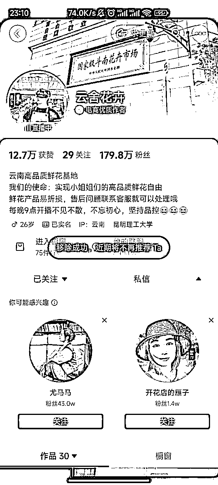

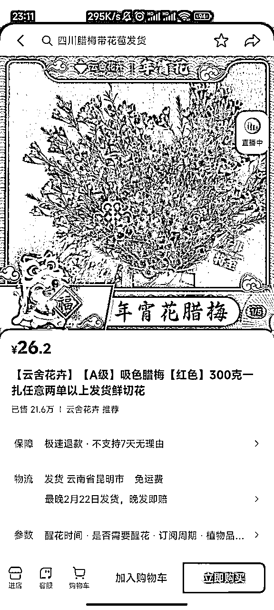

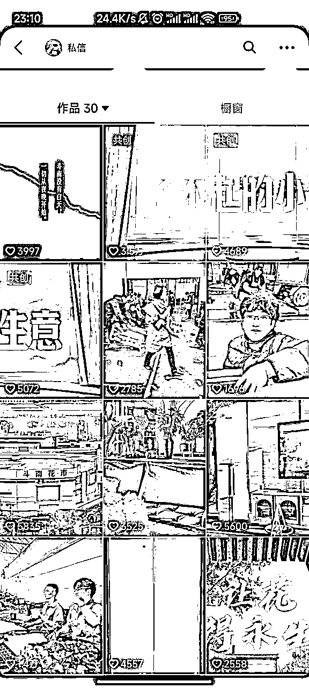

## 1 流量怎么跑通？

先看流量来源，分免费和付费两块。

* 免费流量：短视频、图文、直播、搜索。核心是看它发什么、怎么发、发几条、关键词怎么埋。
  要看它是图还是视频，是实拍还是搬运，搬运怎么做去重，选品逻辑是什么，违规风险在哪，需不需要养号，是企业号还是个人号，权重差多少，一天发多少条，爆的概率高不高，出事了怎么处理，搬运还能玩多久……
* 付费流量：看平台投放的ROI能不能打正。
  可通过第三方数据看feed和付费占比，也能用系统推荐估算ROI，还要看有没有找达人投放。

以云舍花卉来看，免费流量主要靠图文和直播，付费占比很低，下面细拆。

1）视频情况，近30天

* 新增视频4条，挂车0条，都是随手拍的日常运营，很朴实
* 发布时间随机，30天总共5条
* 点赞均在500+
* 不带货，纯介绍，带货都在直播间

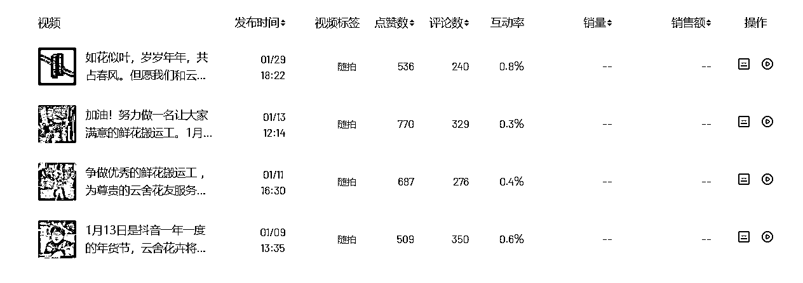

2）直播情况，近30天

* 常用直播间标题：云南高品质鲜花基地
* 播了28场
* 开播时间集中在21点左右
* 播时长：2-4小时9场，4小时以上19场
* 累计销量超100万
* 累计销售额5千-7千元

日更直播，直播占比基本100%，说明转化核心在直播间，视频只是引流承接。

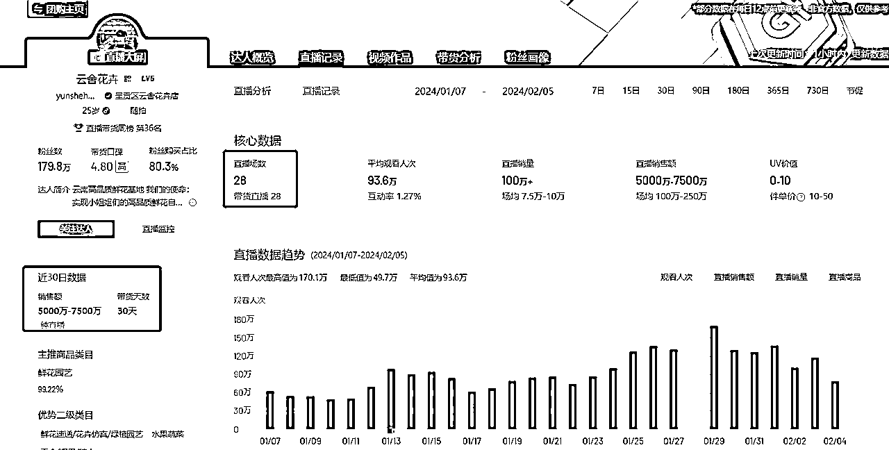

3）付费投放，单场直播

* 系统推荐ROI在1.6-2.0之间
* 付费流量占比14.71%

付费占比不高，自然流是主力。

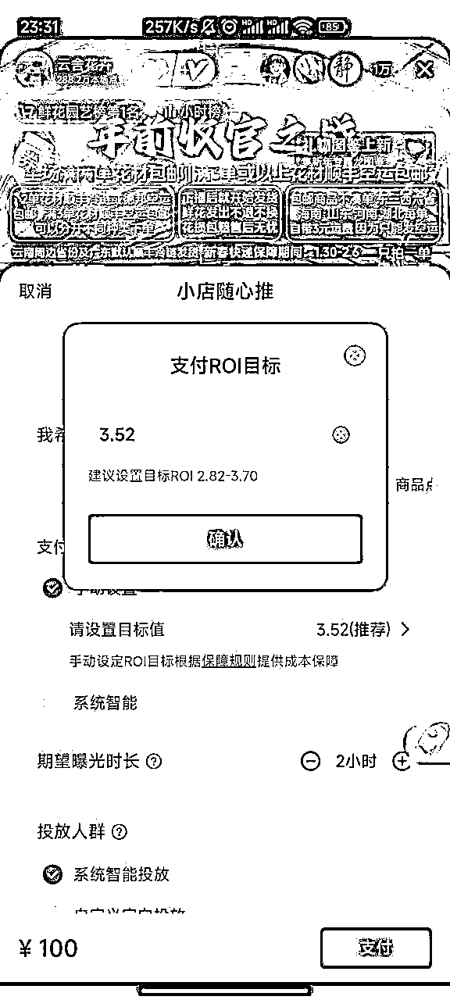

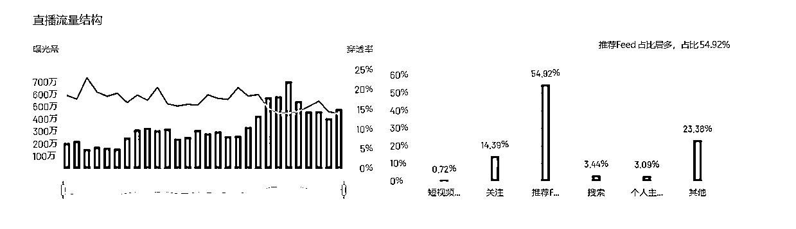

4）小结

* 视频负责拉新
* 直播负责成交，占成交的99.99%，还能承接视频来的流量
* 付费ROI 3.52左右，打正难，账号主要靠自然推荐

## 2 产品怎么落地？

先判断是否需要自建生产。

* 需要自建：要算生产成本、资金垫付、工厂对接
* 不需要：核心是找稳供应链，并利用平台价差赚差价

电商基本是选品逻辑。

* 先看官方精选联盟，比如抖音精选联盟，可直接分佣，无需售后
* 没货或佣金低，就去拼多多、1688找商家谈判，自己解决物流售后

云舍花卉是抖音自营店，普通玩家可走无货源模式：精选联盟带货或拼多多供货。

1）精选联盟路径

* 店铺：云舍花卉
* 佣金：50元以上商品约10%，20元以下商品约20%
* 带货的人多，品类可带

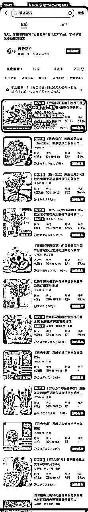

2）无货源路径

* 拼多多、1688能搜到同款，谈好售后物流
* 以粉钻单头康乃馨为例，利润率20%-60%
* 粉钻单头康乃馨差价15.8元，利润率59%。抖音售价26.6，拼多多9.8
* 吸色腊梅差价15.8元，利润率59%。抖音售价26.6，拼多多9.8

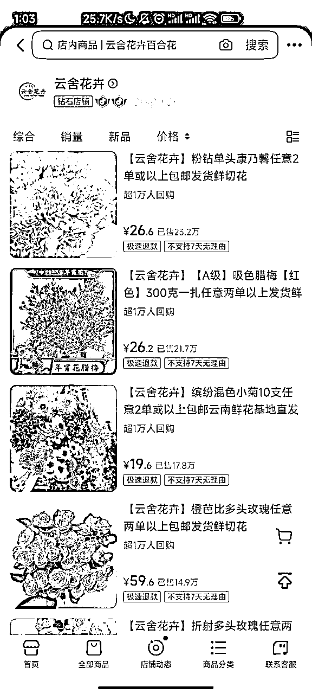

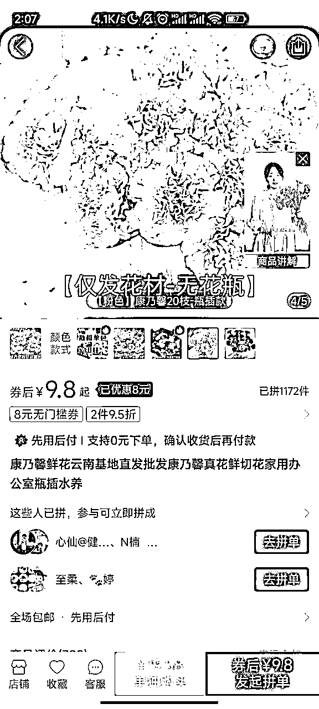

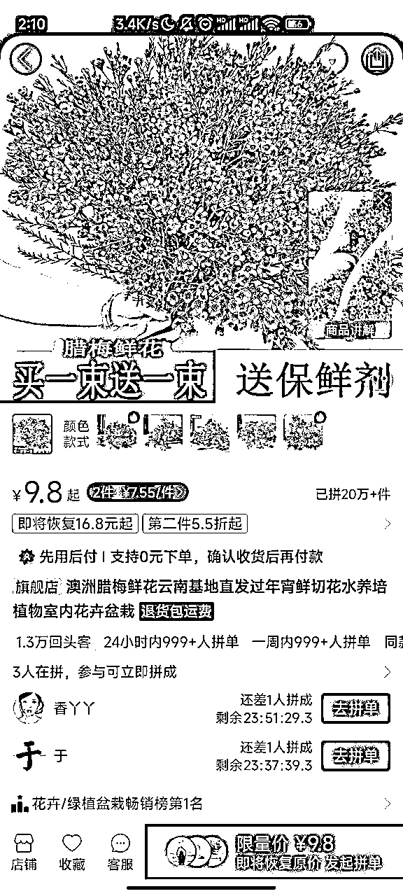

## 3 利润怎么算？

核心公式：利润 = 收益 - 成本

* 收益：看第三方平台估算，或用店铺销量和销售额算GMV
* 利润率：看精选联盟佣金或平台差价
* 成本：开店保证金、平台抽成、退货率、人力、物流、售后。要素越多越准

云舍花卉利润测算：

1）收益侧

* 利润率约59%
* 单店月GMV约10万-25万

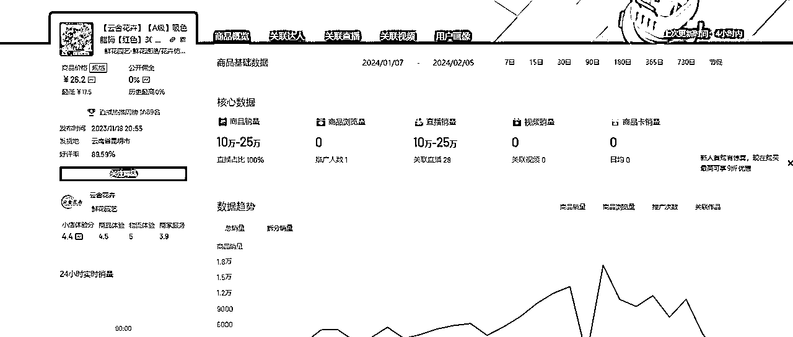

2）成本侧

* 启动资金：保证金+少量投流+垫资+执照。抖音一家店约2620+垫资
* 退货率30%-40%
* 平台抽成5%

3）综合到手

* 保守：利润率59%，退货40%，抽成5%，销售额10万，到手约3.36万
* 乐观：利润率59%，退货30%，抽成5%，销售额25万，到手约9.8万

扣掉前期开店费，单店月净利润区间约3.09万-9.53万，是能赚钱的。

## 4 怎么做，怎么放大

复盘结论：垂类图文打爆+直播成交，这套是可以复制的。

云舍花卉的核心打法是图文怼量起号，直播完成转化。核心指标是人气值和带货率，成交数据好了平台才会持续推。

#### 1）实操路径

一句话总结：图文/视频吸粉，爆了立刻开播卖货

1. 开店
   资金：保证金+投流+垫资+执照，抖音一家约2620+垫资
   一个人可操2-3家店，每家需独立执照，开太多有连坐风险
   新手期通过提升店铺分加速回款，70分以上T+4，以下T+10
2. 开橱窗
   条件：实名+发10条视频+粉丝>1000
   找对标账号模仿，操作简单涨粉快
3. 选品
   定位越垂直越好，如只卖裤子、只卖羽绒服
   流程：选品-测品-小额付费，测出一天20单的小爆品，月利润过万不难
   选品法：找15天内起量快的同行新号
   测品标准：5天内点击率>15%，支付转化>5%
   付费工具：抖加、小店随心推、巨量千川、磁力金牛
4. 图文起号
   要求：画质清晰，至少2张
   素材来源：选品积累、其他平台、少量自拍
   去重：贴纸水印、抠图、拼图、提质
   连发策略：一天至少5条，用数量撞爆款
5. 口播直播
   人播利润20-30%
   单场2-4小时

视频起号可发真实画面+走心文案，或情景实拍增强真实感。

#### 2）放大玩法

1. 矩阵
   多店：1人2-3店，保证金约7860
   多号：1人5号，每天25条图文，直播选转化最好的号，其他号图文带货
   多平台：抖音跑通后复制到视频号、快手、📕
2. 投流
   主要用于测品，爆品出来靠自然流转化
   ROI低于3基本亏

## 5 总结

垂类内容+爆款+直播的组合，年后依然有窗口。单店月利润3.09万-9.53万，空间可观。

这套模式能做，但要注意背景感。云舍的视频背景是云南斗南花市，很有真实信任感。普通人如果做不了现地实拍，可以用混剪做视频，直播间要打造一个专业花卉场景。