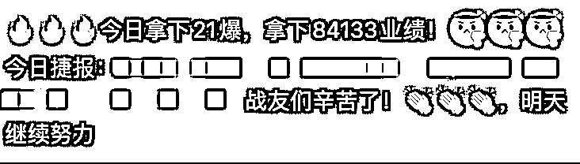
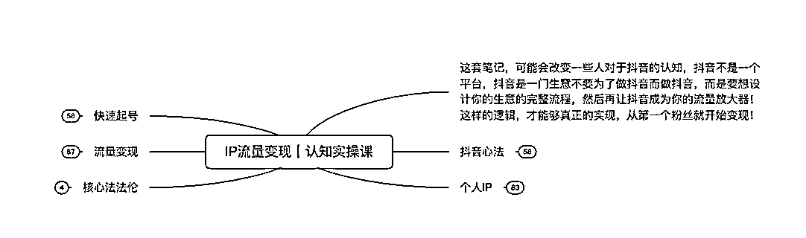

# 四年实战复盘：从0到月营收200万+的抖音流量变现底层逻辑

【四年实战复盘：从0到月营收200万+的抖音流量变现底层逻辑】

大家好，我是子凡，山东95后，大学毕业就入局短视频，靠踩中平台红利一路做到月业绩破200万。今年加入赚钱一年，跟随行舟老师完成抖音老板IP航海营。航海结束后，我把群里伙伴的共性问题整理出来，结合自己四年的运营体感，沉淀成这份笔记。

这篇内容按「道-法-术-器」框架来拆，主要聊的是IP流量变现的“道”。基本把从0到1的认知闭环讲透。后续有空我再补“术”的实操部分。先把底层逻辑吃透，做事效率会提升十倍。方向对了，再加班才不白费。

适合人群：

抖音新手，需要一套完整的从零起步认知，避免走弯路。

已经在做抖音的经营者，一直卡在技巧层面，缺少全局思考

*   这份思考可能会颠覆你对抖音的理解。抖音不是单纯的发内容平台，而是一门生意。别先问怎么做抖音，先设计好你的生意全链路，再让抖音去放大流量。按这个顺序，才能做到第一个粉丝就能产生价值。

# 抖音心法

*   规则认知

*   抖音算法本质是彩票模型

*   有的作品首发就爆，有的第二发才发力，久久不爆就换备胎号试试

*   内容自认为不错数据却拉胯，直接换号测试

*   平台有权重机制，养号是刚需

*   优质账号更吃香，老号权重更高

*   正常使用三个月以上的老号普遍有高权重

*   各平台都有隐性限流

*   定位认知

*   想做却迟迟不动，手上通常有两类卡点

*   把事情想得过于复杂

*   搞不清楚能不能赚钱

*   别按百万粉账号来规划，会一地鸡毛

*   按十万粉级来规划，快速验证，立刻开干

*   先定小目标，干起来再说

*   模式认知

*   先明确能做什么不能做什么，从第一个用户开始就设计变现

*   你会先装修店面再决定卖什么吗？先定品类，再去执行

*   抖音唯一的核心KPI是变现，其他数据都是虚的

*   粉丝数量没意义，粉丝属性才值钱

*   现在还能刷到多少个百万粉剧情号？

*   十几万粉就能带货的账号你见过几个？

*   同行复盘

*   成果靠复盘同行，不是靠空想

*   别思考，直接抄同行做得好的打法

*   定位的答案同行早已给出，去拆解

*   没有同行可抄，这个赛道就别碰

*   别问方法，把赛道再调研一遍

*   调研清单

*   核心标准：简单、可盈利

*   在赛道里找细分，拆解赚钱逻辑

*   赛道背景

*   赛道变现方式

*   账号体量、粉丝量、变现路径、引流手段、收益预估

*   代表性案例

*   变现模式

*   拍摄形式

*   操作难度

*   利润预估

*   实操验证：打电话、加微信、看朋友圈

*   询价、列明产品清单及价格

*   询问单次出货量，推算月利润

*   爆款拆解

*   选题方向

*   前三秒钩子

*   核心观点

*   营销文案结构

*   行业热词

*   巨量算数等工具

*   同行拆解

*   明确目标人群

*   近期同类账号数据表现

*   评论区情绪、营销反馈

*   私域数据

*   三大底层框架

*   粉丝框架

*   产品框架

*   人设框架

# 个人IP逻辑

*   为什么要做个人IP？

*   到底卖什么？

*   卖人

*   用户认得你这个人，后续卖什么都更容易成交

*   可信赖的供应商

*   企业人格化

*   个人品牌化

*   卖货

*   注：卖人比卖货更容易，IP有故事，产品是无情感的

*   产品同质化严重，人设却能差异化

*   做IP本质是卖人设

*   达到一定体量后，总有人会买单

*   获客成本降低

*   生命周期长

*   缺乏第二增长曲线

*   抖音是时代红利，风口高于一切

*   深度软营销

*   广度

*   提升曝光

*   跳出赛道限制，拓展业务想象

*   深度

*   建立信任

*   粉丝达到10万时，用户不会在意你是不是5万平工厂，是不是头部，只看IP背书

*   速度

*   传播效率极高

*   高度

*   人设立得稳

*   降本增效，形成复利

*   持续输出

*   提升成交

*   风险与门槛

*   必须做差异化，打造独属于自己的IP

*   个人IP与企业深度绑定，有风险

*   竞争激烈，需要耐心

*   见效慢，需要长期主义

*   有可变现产品和交付能力

*   内容搭建

*   身份定位

*   昵称简介

*   人设标签

*   没有身份可以包装，点到为止

*   定位+身份

*   你是谁

*   你有什么拿得出手的

*   你能给粉丝交付什么干货

*   Slogan

*   树立人设的置顶视频

*   强营销

*   用户付费意愿源于对身份的认可

*   炫耀成绩依然是立人设最高效的方式

*   视频内容

*   情绪要有波动

*   声音清晰是底线

*   文案大量借鉴

*   选题来源：知乎、热点、围绕身份挖掘

*   内容形式：做切片，高效，数量压倒质量

*   别做得太复杂

*   时间复利

*   坚持三个月

*   什么是好文案？

*   前三秒+选题占八成权重

*   选题决定系统和人性是否先认你，前三秒决定是否再认你

*   前缀+正文+后缀

*   心锚词

*   一句话联想到一个人

*   后缀是精准的行动指令

*   如何打磨好文案？

*   选题前期要宽泛，占比80%以上

*   找10个以上同行，90%的选题都能覆盖

*   不要东一榔头西一棒子，集中时间段做一件事才有效

*   好文案：前三秒抓人，有冲突有深度

*   标准结构：前缀+冲突+强引导+结果+后缀【身份+价值】

*   Slogan+后缀【身份+关注引导】

*   Slogan负责联想

*   铁粉养成：造词

*   账号内容结构

*   日常内容

*   涨粉内容

*   变现内容

*   做流量先做泛粉，再在泛粉里筛选精准用户

*   展示结果更容易吸引精准客户

*   高客单高利润更适合抖音

*   起号期别太垂直，不好起

# 快速起号路径

*   落地五步

*   意识

*   用户意识

*   算法意识

*   对标意识

*   复盘意识

*   方法论

*   可执行方案

*   抖音变现方法论

*   短视频创作方法论

*   直播间留人方法论

*   行动

*   执行力

*   写、演、拍、剪、复盘

*   结果：最快拿到正反馈

*   基于数据复盘

*   账号规划

*   同类型内容看赛道

*   同赛道看选题

*   同选题看结构

*   同结构看剪拍

*   核心在于人心

*   账号定位

*   在你的行业里找抖音的蓝海，别去啃红海的硬骨头

*   有跨界思维，别被行业框死

*   用新打法冲击旧赛道，用创造力打运营战

*   定位定乾坤

*   精准定位，并考虑人群阶段

*   定位自检

*   A、人群是否足够大

*   B、产品是否刚需

*   C、后端能否承接

*   D、流量池是否够深

*   人群要精准，更要看阶段

*   同一产品，定位不同，效果不同

*   比如创业者，有新手、被教育过、有结果者，你要的是哪一类

*   行业和内容定了，还要从精准用户需求出发，他们想听什么你才讲什么，最终目的是变现

*   基于产品延展话题，筛选能吸精准用户且合规的话题

*   挖离变现最近的内容

*   爆款设计

*   总结同行爆款逻辑，优化整合，形成自己的爆款模型

*   强变现必须有强价值输出，不能只有情绪

*   情绪价值：故事、流量

*   先用情绪放大流量，再用价值完成转化

*   直播起号

*   真诚是当下直播最强的套路

*   最好的营销就是自己

*   视频可以泛，人群定位要准

*   直播间人货场高度统一

*   直播间保持真实

*   信任是最强的转化武器

*   提升进直播间率，才能获得推流

*   内容+人货场=提升进间率

*   例如：减脂成功是你的IP，减脂过程是你的故事

# 流量变现体系

*   变现八环节

*   1、设计变现模型

*   引流品、爆款品、利润品

*   2、拆解同行案例

*   粉丝框架、产品框架、人设框架

*   公域数据、评论导向、营销反馈、私域数据

*   3、确定拍摄形式

*   A、口播

*   B、场景应用

*   C、用户反馈

*   D、炫耀：展示客户拿到什么结果

*   4、借力场景打造变现

*   A、办公场景

*   B、服务场景

*   C、使用场景

*   D、未来场景

*   高手卖未来，未来感视频转化强

*   5、团队搭建

*   6、孵化模式

*   打造可循环系统

*   7、矩阵打法，把成功复制十倍

*   8、SEO

*   私域运营

*   1、建立人设，打造IP，要极致稀缺

*   功能属性：人设能提供什么价值

*   性格属性：你是什么样的人

*   2、精准导流到私域

*   非精准用户增加运营成本

*   门店：路过就加

*   电商：小卡片、电话

*   内容：用内容吸引加粉

*   3、存量变增量

*   分销、拼团、分享有礼，榨干用户剩余价值

*   4、内容营销+朋友圈

*   图片：场景图，朋友圈的核心是软广多硬

*   10条朋友圈构成

*   4条产品咨询

*   2条成交截图：晒单不是炫富

*   2条用户反馈：前后对比

*   2条生活场景：植入产品

*   私域转化

*   朋友圈要有对话感，有针对性发布

*   私域直播：面向老粉输出价值

*   社群转化：用社交氛围促单

*   门店转化：私域种草，导流到店

*   短视频制作

*   把合适的内容推给合适的人

*   找到目标客户痛点，用你最自信的状态，说“最正确的废话”，让核心用户持续停留

*   触发热门算法，实现破圈推送给无标签人群

*   协同算法：同好推荐

*   选题

*   选题来自市场，内容来自生活

*   泛选题、人设选题、专业选题

*   结构：完播引导、爆点前置、反智型、价值后置、揭秘型

*   拍摄技巧

*   面对镜头时想着是粉丝和用户

# 平台机制认知

*   矩阵机制

*   一个账号可能是十个号的成果，靠概率和运气

*   规则大于技术

*   多一个号，就意味着触达不同人群

*   用新号复刻老号爆款

*   账号到一定粉丝量后，涨粉和流量会遇瓶颈

*   抖音涨粉有瓶颈期，也有爆发期

*   与其做大号，不如多做小号

*   矩阵操作细节

*   不连WIFI，用流量卡

*   同款视频多拍几版

*   用最简单方式拍摄

*   10万-30万粉阶段流量最好

*   标签机制

*   你发什么就吸引什么粉丝

*   想清楚视频是给谁看的

*   他们的需求是什么，喜欢听什么

*   说用户爱听的话，再根据数据反馈调整标签

*   投流打法

*   投小V，撬动小V粉丝

*   找到上下游账号投流

*   用冠军作品投流打标签

*   粉丝经济

*   养号

*   标签由用户行为决定

*   去对标爆款视频热评互动

*   去对标直播间刷榜引流

*   富人起号：大V互捧

*   只要你提供停留，平台就会给你流量

# 核心方法论

*   扒同行

*   同行在做什么

*   深拆10个头部同行

*   深度研究对手

*   原动力来自于清晰知道这件事能赚多少钱

最后分享我四年的两点感悟。

财富是抄来的，贫穷也是抄来的。人赚不到钱，往往抄错了对象。

只看结果，结果之外的全不信。

踩风口比啥都重要，风口期行业有巨大溢价。比特币、微商、电商早期都是捡钱，同样的打法，风口决定一切。

做离钱最近的事。