新年伊始，身边不少做副业的朋友又开始焦虑：眼看别人收入见涨，自己却迟迟找不到突破口，难免怀疑是不是能力不行。其实问题不在能力，而在于没有踩中合适的机会。今天要聊的，就是一个上手门槛极低的玩法——在小红书上无货源卖脐橙，普通人也能操作。

说白了这就是倒买倒卖赚价差：先在小红书物色买家，把对方带到微信或闲鱼；收到钱后，去拼多多这样的供货平台填单，让商家直发。整个过程不用囤货，也不用自己打包，属于典型的轻资产操作。

说实话，这项目的优点和缺点都同样明显。优点是启动成本几乎为零，只要有平台账号就能做，而且小红书用户消费意愿强，新手也能快速开张。缺点是引流容易触发平台风控，账号时有被封的风险。我们实测下来，一个账号的生命周期只有5-7天，意味着每隔一周左右就要注销重来，相当折腾。想赚这笔钱，这风险你得认。

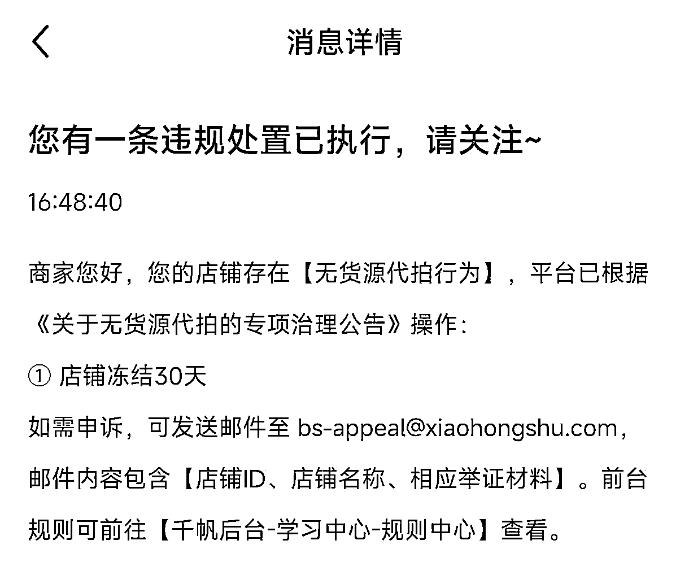

有人会问，那为什么不直接在小红书开店？开店这个选项确实能让账号更安全，但随之而来的开销不小：押金1000元，货款要垫付至少15天、5000元以上，还得有稳定的货源渠道。更重要的是，供货平台的产品链接无法直接挂到小红书上，被系统抓到就冻结30天。另外，带商品卡片的笔记会被平台额外盯上，多两重数据评判，不达标就限流降权，发货和售后也是大坑。对新手来说，开店模式太难了。

相比之下，私域流量模式就轻松得多：不用垫资，客户款项到账后，你再拿着货款去找供货商下单，相当于空手套白狼；不用管发货，复制物流单号给客户即可；不用做售后，有问题直接推给供货商；更不用交押金，有一个微信ID就能启动。这就是两者最大的差别。

整个操作流程可以浓缩成一句话：小红书引流并转化客户→微信承接→闲鱼下单→拼多多进货→闲鱼发货→交易完成。中间的差价就是你的利润。

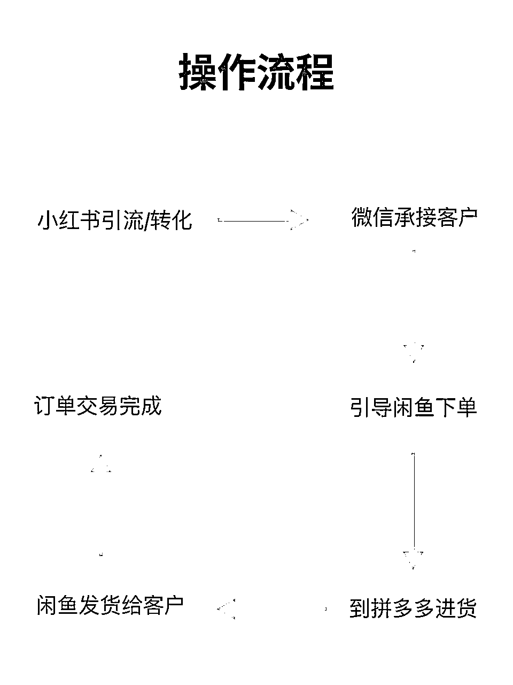

流程看着简单，但细节决定成败。下面按步骤拆解，每一步都要执行到位，漏一步都可能影响赚钱效率。

### 起号前准备

**手机要求**：安卓手机最好近5年发布，太老跑不动新版小红书，流量也会被隐性限制；苹果手机建议7P以上，老机型同样吃亏。

**账号准备**：建议准备主副两个账号，一个日常主号，一个专门卖货的副号。如果只有一部手机，只用一个账号也行，但需要在双重身份间来回切，很麻烦。新注册的副号一定要把微信ID设置得简短好记。这里有个冷门经验：ID越短，添加通过率越高。我们测试过，短ID的添加转化率比乱码长号高10倍。如果你的ID很长，建议改一下。目前还有几个靓号没被注册，可以试试：BB3636、PL2580、GEI397、A6980A、XIANG525、HU98765、QI965QI。

**小红书新号**：注册时不要用非实名的手机号，也不要在WiFi环境里操作，直接用移动数据。不需要刻意养号，只要设备没有历史违规，新号会得到系统的流量眷顾。

### 微信动态打造

微信动态是你给客户的第一张名片。素材完全不必原创，直接借鉴同行内容。找法很简单：在抖音搜“脐橙”“赣南脐橙”，在评论区留一句“想买”或“怎么卖”，大概一两小时后，就有同行来私信你，然后你假装成顾客去加微信。两小时能加20个，再挑出那些内容做得好的，把素材搬运过来。

发动态有三个细节：第一，单独建立一个顾客分组，发的动态只给这个组看，不打扰其他人，也方便统计。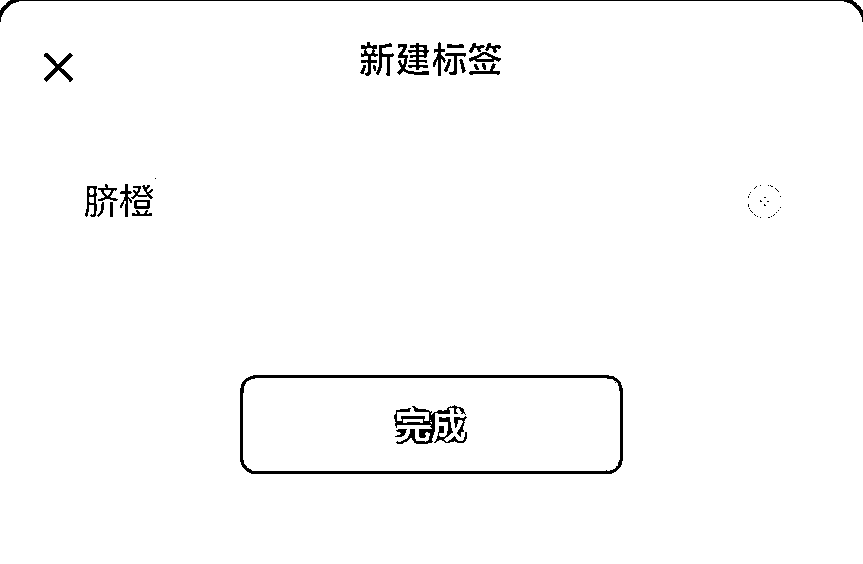 第二，把动态查看权限设为最近三天，免得客户翻到以前不相关的记录产生顾虑；第三，每天发3-5条，产品相关3条、生活类2条，每隔2-3小时发一条。

### 账号基础信息

产品以女性身份运营更容易成交，所以人设按女生设计。

头像：去小红书站内搜“女生自拍”，点“最新”再选“图文”。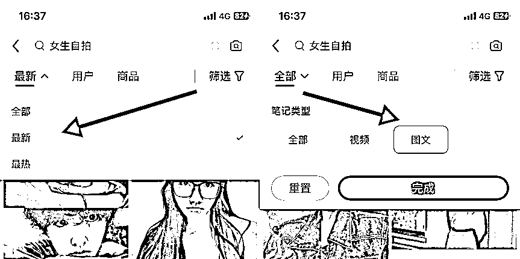 然后找那种看起来像在读学生、长相漂亮有气质的自拍，裁剪为1:1尺寸上传。别用动漫或风景。

参考图如下：

昵称：把账号名设置成“脐橙＋名字＋姐姐”的格式，中间换一个字就行。

简介：人设要立住，比如“家里种果园的姑娘”叠加“在校学生”身份。如果IP定位与产地不匹配，就用“在外读书的果园孩子”这类说法把背景圆回来。至于关注理由，主打“园子直出，没有层层转手”，把价格敏感型用户圈过来。

示例见下：

背景图：打开小红书搜“果园”，挑好看的图裁剪一下，传到资料页的背景位。

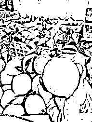

### 素材准备

封面决定80%流量。先翻同行，十有八九用枝头挂果的照片做首图，看久了会觉得腻。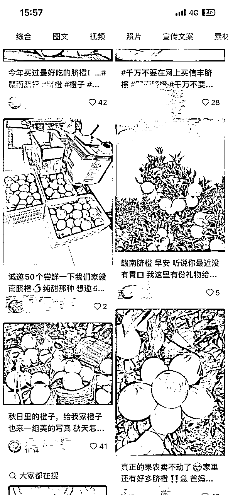 要让画面更抓眼，就得突出“鲜甜”和“水分足”，多用切开的果肉特写。去哪儿找？去搜“赣南脐橙吐槽”，评论区里晒买家秀的人很多，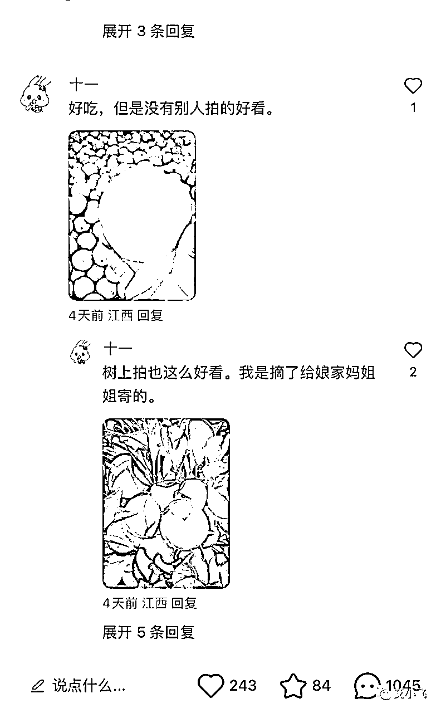 把图截下来，用修图App加工一下。

参考如下：

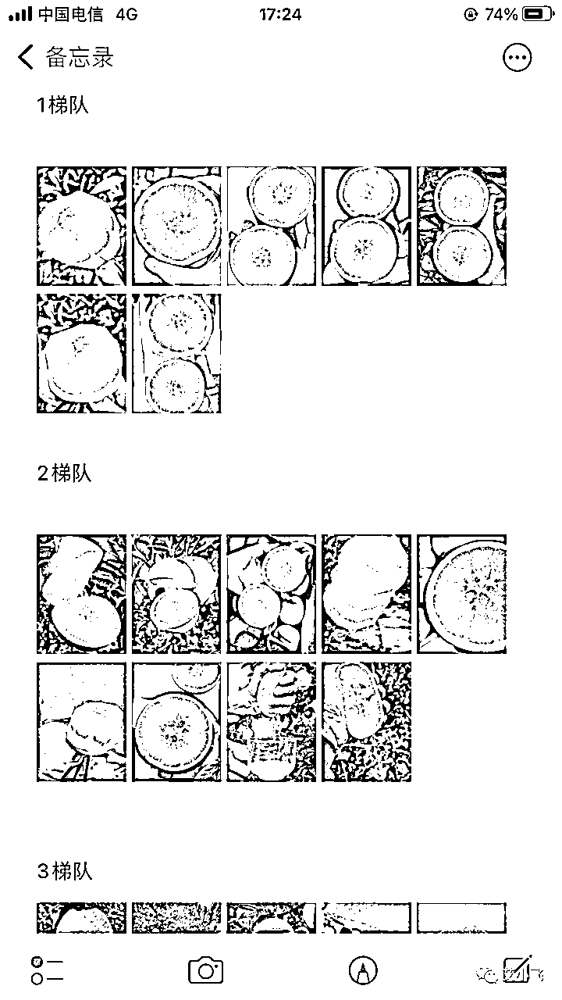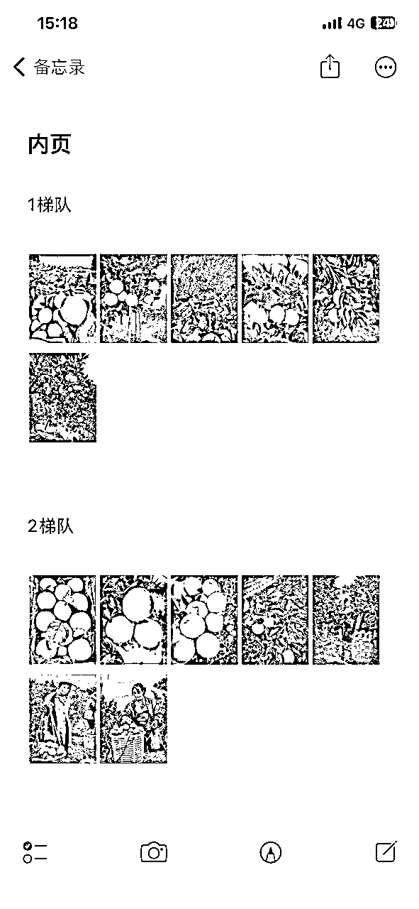

标题：搜“脐橙”“赣南脐橙”，抄商家口吻的爆款标题。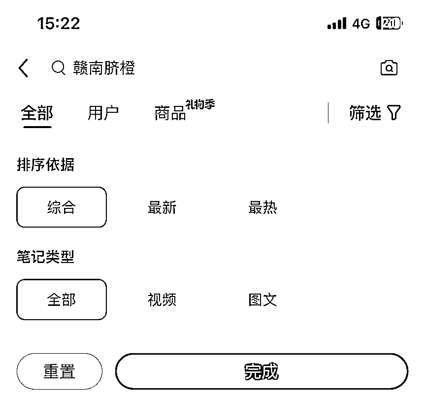 下面这些是我测试过出单率高的，改几个字就能用：

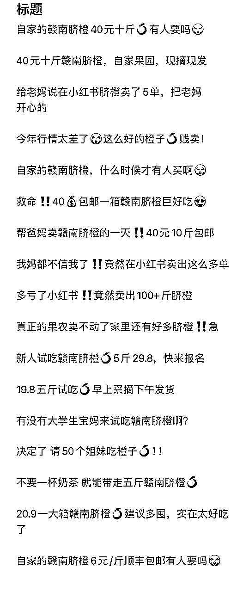

正文：参考同行爆款，但别去学那种工艺类、营养科普类的内容，比如“橙子剥法”“榨汁技巧”“营养成分”，那会招来问问题的人，而不是买家。要学B类那种有销售力的文案：

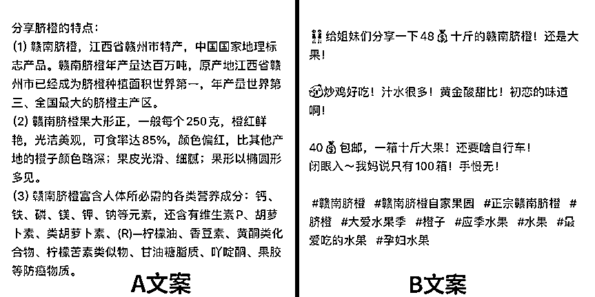

### 发布笔记细节

编辑笔记时三不要：不连WiFi、不开定位、不保存相册。发布后流量慢慢爬，小眼睛100+算正常，低于10就说明账号有硬伤，需要注销重来。第一篇笔记流量不高很正常，毕竟是引流内容，不是娱乐内容。如果内容能给平台带来价值，它也会给你推荐，比如下面这篇家具笔记：

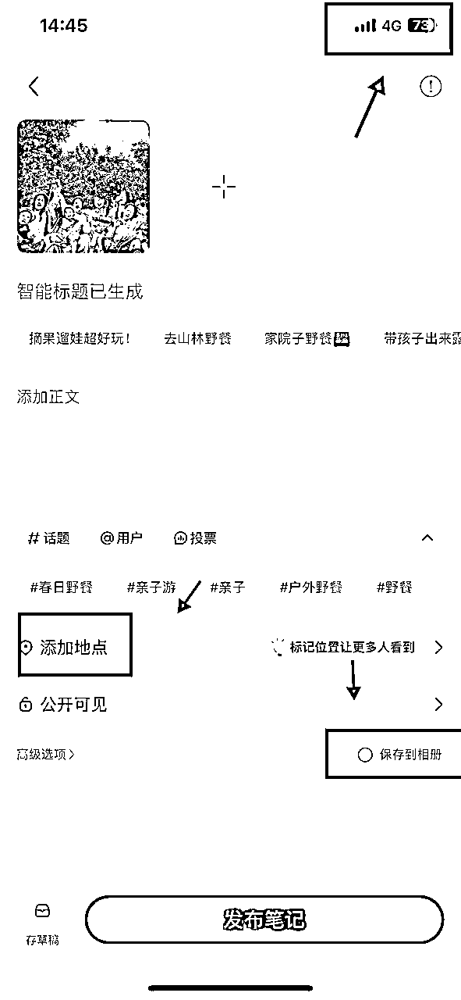

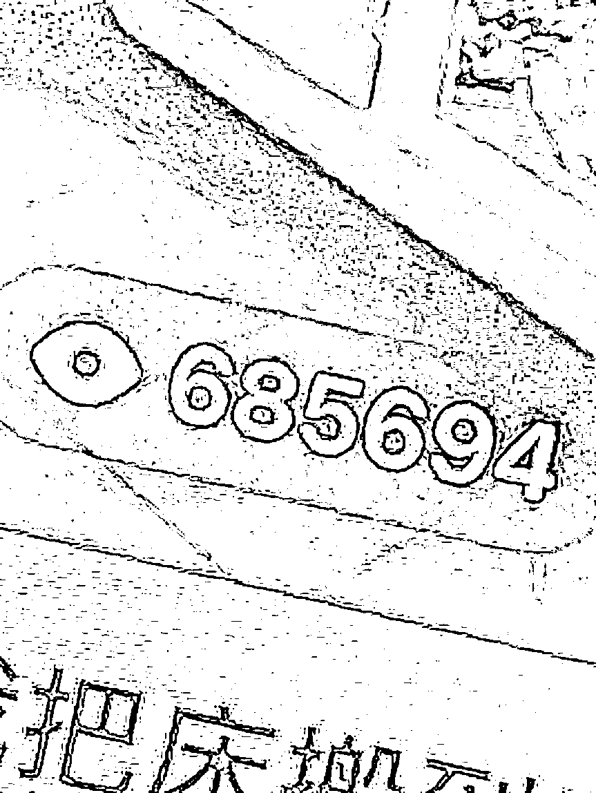

### 转化与成交

评论区引导：有人来评论，说明他认可你的产品，统一回复一句“后台私我，发今日报价单”，把对话转到站内信，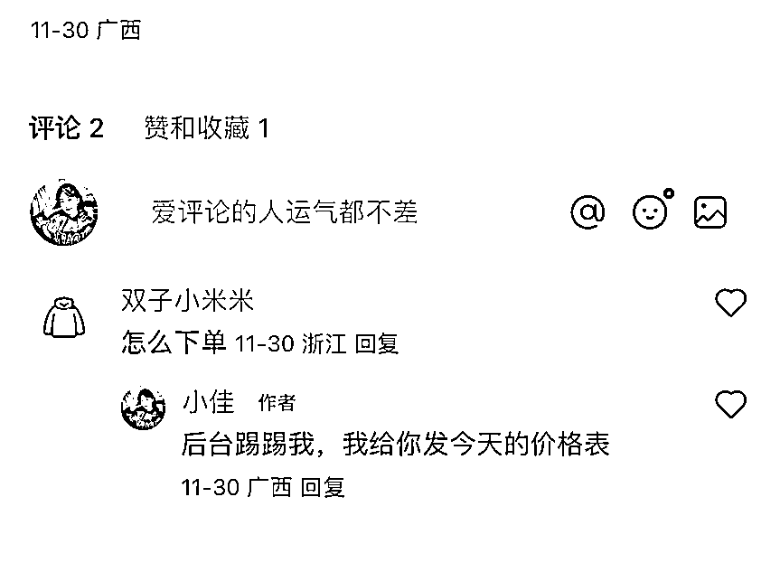 这样既能筛掉纯围观的人，也减少被举报的风险。

私信转化：不要急着甩微信ID，先聊几句判断对方是不是真实买家，确定后再让他加你微信。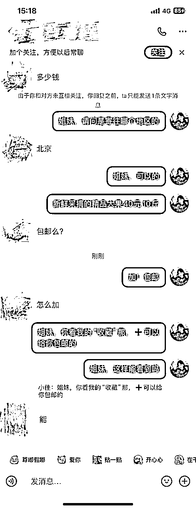

微信成交：通过好友后，先问一句“姐们儿，想买橙子不？”让客户自己在闲鱼链接和微信转账之间选。若走闲鱼，就等他拍下付款，你再去供货平台采购，把单号粘到闲鱼订单里；若直接转账，货款即时到账，你再去补单即可。如果对方说“晚点再说”，就要提防同行或非目标用户，你可以隔两三天去搭一句话，试探两次还没动静，直接清理。

以上就是全部内容。机会摆在这儿，执行与否就看你自己了。

说句很多人不爱听的大实话：那些迟迟不跟你成交的人，留在好友列表里也基本是“僵尸粉”，别指望靠发几条朋友圈就能把他们“感化”成客户。有这功夫，不如去多搞点新流量、多谈几单新的成交，效率高得多，回报也快得多。

# 货源到底怎么选？

做私域无货源，绕不开两个主流平台：1688和拼多多。这俩各有各的脾气。

1688的优点是品质稳、售后靠谱、服务规范，但短板也很明显——价格偏高、品类不够全、很多还不包邮。

拼多多呢，槽点一大堆：质量参差、宣传容易浮夸、偶尔还给你发促销短信恶心人。但它的优势同样硬核——平台售后给力、品类极其丰富、关键是价格真的低到离谱！

怎么选？一句话总结：如果你走高客单价、重视品质的路线，1688更合适；如果做的是低客单价的产品，拼多多就是真香选择。

就像我自己卖脐橙，客单价也就几十块钱，既要最大化利润，又想要平台兜底售后，那必然选拼多多。虽然一边用一边吐槽它，但架不住它便宜啊！很多人对它是又爱又恨，我也是。

# 为什么不直接找线下果商？

你可能会问：线下找果农谈不是更直接吗？

问题出在“量”上。人家一开口就问：“老板，你要多少货？”你怎么接？

拿货规矩大家都懂：量越大，单价越低。可咱这种刚开始试水的小卖家，首批就要那么一点点，人家凭什么给你低价？算下来很可能比拼多多还贵，何必呢？

# 我常回购的5家拼多多店铺

既然拼多多更适合我们这些做低客单的，那具体去哪儿进货？为了帮大家少走弯路，我直接把我最近高频回购的5家店铺链接甩出来，我自己的橙子都是这几家发的：

商家1：
https://mobile.yangkeduo.com/goods2.html?refer_share_id=opXiFxWHhNsv6bib8lUrNnCwSASUsDEC&refer_share_channel=copy_link&_oak_share_detail_id=3927883217&_oc_trace_mark=199&pxq_secret_key=GZVBA5H2Q5HBUXUNNYKRWEZ5LA6H6PEQ54VPZUSMDAPRIPV2GF2Q&_oak_share_time=1704429161&_wvx=10&_wv=41729&share_uin=6C3OJELGPUJJYRBUTHRCEHXPOU_GEXDA&_x_query=%E8%B5%A3%E5%8D%97%E8%84%90%E6%A9%99&page_from=23&refer_share_uin=6C3OJELGPUJJYRBUTHRCEHXPOU_GEXDA&goods_id=568118525582&_oak_share_snapshot_num=1060&_x_org=2

商家2：
https://mobile.yangkeduo.com/goods.html?refer_share_id=GDtMclGmnuGjvI1haE4BdZU2judixtYx&refer_share_channel=copy_link&_oak_share_detail_id=0&_oc_trace_mark=199&pxq_secret_key=GZVBA5H2Q5HBUXUNNYKRWEZ5LDGMPTEFUFPWFYVA6WL5Y6CKHD7Q&_oak_share_time=1704429225&_wvx=10&_wv=41729&share_uin=6C3OJELGPUJJYRBUTHRCEHXPOU_GEXDA&_x_query=%E8%B5%A3%E5%8D%97%E8%84%90%E6%A9%99&page_from=23&refer_share_uin=6C3OJELGPUJJYRBUTHRCEHXPOU_GEXDA&goods_id=572115001623&_oak_share_snapshot_num=380&_x_org=2

商家3：
https://mobile.yangkeduo.com/goods2.html?refer_share_id=lth9r8rxxcdzLmNhc1toFMca8LjcpvHx&refer_share_channel=copy_link&_oak_share_detail_id=3918088463&_oc_trace_mark=199&pxq_secret_key=GZVBA5H2Q5HBUXUNNYKRWEZ5LAWPZPRPIQVSCIFGW4B7NUWFPMMA&_oak_share_time=1704429239&_wvx=10&_wv=41729&share_uin=6C3OJELGPUJJYRBUTHRCEHXPOU_GEXDA&_x_query=%E8%B5%A3%E5%8D%97%E8%84%90%E6%A9%99&page_from=23&refer_share_uin=6C3OJELGPUJJYRBUTHRCEHXPOU_GEXDA&goods_id=571117171854&_oak_share_snapshot_num=652&_x_org=2

商家4：
https://mobile.yangkeduo.com/goods1.html?refer_share_id=A51WNqBLdVyCvYwi2qEBH1KWBW3ux4T7&refer_share_channel=copy_link&_oak_share_detail_id=3934328563&_oc_trace_mark=199&pxq_secret_key=GZVBA5H2Q5HBUXUNNYKRWEZ5LBCFSH2IXXAKRCY5UZXIZJ37F77Q&_oak_share_time=1704429379&_wvx=10&_wv=41729&share_uin=6C3OJELGPUJJYRBUTHRCEHXPOU_GEXDA&_x_query=%E8%B5%A3%E5%8D%97%E8%84%90%E6%A9%99&page_from=23&refer_share_uin=6C3OJELGPUJJYRBUTHRCEHXPOU_GEXDA&goods_id=572314737563&_oak_share_snapshot_num=588&_x_org=2

商家5：
https://mobile.yangkeduo.com/goods2.html?refer_share_id=aCA6p0rbCi4fKhpfGj5MKzMilF3PGH5o&refer_share_channel=copy_link&_oak_share_detail_id=3783055869&_oc_trace_mark=199&pxq_secret_key=GZVBA5H2Q5HBUXUNNYKRWEZ5LC6653CTFPEECZACANQ66SOMLEDA&_oak_share_time=1704429406&_wvx=10&_wv=41729&share_uin=6C3OJELGPUJJYRBUTHRCEHXPOU_GEXDA&_x_query=%E8%B5%A3%E5%8D%97%E8%84%90%E6%A9%99&page_from=23&refer_share_uin=6C3OJELGPUJJYRBUTHRCEHXPOU_GEXDA&goods_id=560439424179&_oak_share_snapshot_num=1279&_x_org=2

只要你有订单，随便挑一家下单就行。不过要注意，这几家店的价格每隔几天会小幅波动。如果你发现供货价涨跌超过20%，那我建议你终端售价也跟着同步调整，别傻傻不跟。

# 售后问题？其实很简单

在拼多多下单代发，说完全没售后是假的。果子坏了、缺斤少两、口感不好……客户总会来抱怨。

我的解决办法就一个词：传话筒。

客户怎么跟我吐槽，我就把原话复制粘贴发给拼多多商家；商家说怎么赔偿，我再把回复复制给客户。一来一回，我只做信息的搬运工，根本不用绞尽脑汁去安抚谁、调解谁。

这样搞下来，我这边可以说是“零售后”，是不是也没那么难？

# 项目本身不值钱，值钱的是模式

别看这篇文章一直在讲怎么操作项目，其实项目本身真不值钱。

真正值钱的，是背后的操作模式！

关注我文章比较久的朋友应该知道，我之前写“残蟹无货源”项目时，用的也是同一套打法。那个项目最猛的时候，一天给我带来3000块纯利！

为什么我换了一个产品、换了个定价、换了完全不同的消费群体，依然能跑通？

答案就是：模式可复制。

今天这个脐橙要是过季了、或者市场上打价格战做不下去了，怎么办？直接放弃？还是另找出路？

聪明做法是——把这套模式的底层逻辑抽出来，套到你想卖的任何产品上。这样既省钱又省力，跑通速度会快很多。

如果你还不知道选什么品，正好我最近在琢磨过年卖什么，就看到小红书上有一款售价726元的滋补品礼盒装，销量474单。

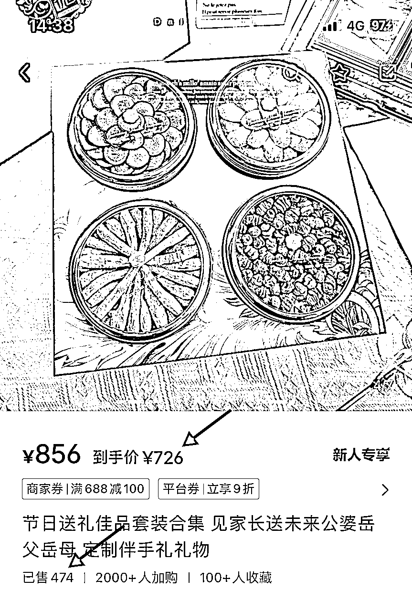

我去拼多多搜了一下同款进货价——不搜不知道，一搜吓一跳：类似的货，进货才97.8元！

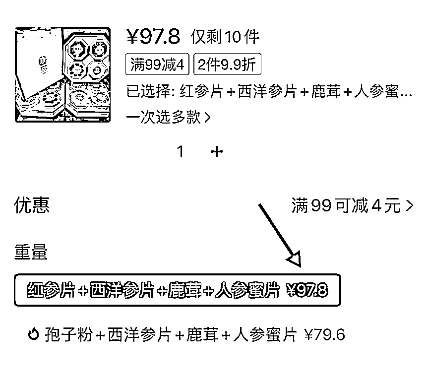

你算算这利润：726 - 97.8 = 628.2元，一单赚六百多，疯不疯狂？

哪怕你基础再弱，用我这套模式照着做，就算一天只开一单， 你觉得你行不行？

这就是模式的力量！

项目是壳，模式是魂。学会套用模式去赚钱，比死守一个项目强一百倍。有了这套打法，去小红书做任何产品，赚钱慢、赚钱难的烦恼都能迎刃而解。

这个时代不缺好产品，也不缺所谓的“好项目”，真正缺的是拿得出手的成功模式去跑通它们！

真心希望大家看完这篇文章后，不只是收藏吃灰，而是直接动手，把流程和模式跑通。先出几单赚点小钱，给自己点信心，后面就会越滚越大。

好了，今天就聊到这，我是艾小飞。祝各位圈友今年越赚越多，越做越大！下期见！

原创：艾小飞
转载可私信
禁止搬运和抄袭