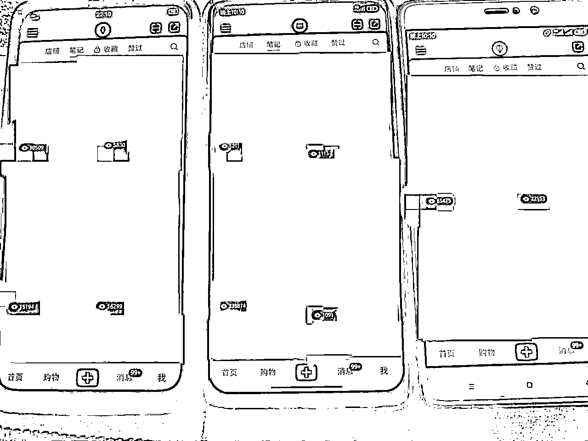
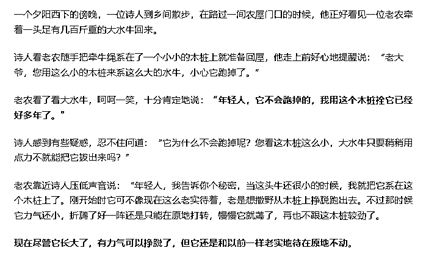

# 傅小闲思维篇 赚钱这件事我是怎么看的

> 来源：[https://w7z4ecauyy.feishu.cn/docx/LsULdIuxco3gyIxtszhcy7lFnOb](https://w7z4ecauyy.feishu.cn/docx/LsULdIuxco3gyIxtszhcy7lFnOb)

哈喽，又是我傅小闲。距离上回更新隔了一个多月了。上次写完帖子就倒下了，烧了好久还没好。刚缓过来就被一堆测项目的事儿淹没，年底这阵子莫名其妙格外忙，团队一下开了好几个新方向，正好撞上之前航海的时间段……

上期我聊了做小红书的一些底层思路和数据分析的方法，感兴趣的可以去翻翻。这回我想换个角度，聊点更糙更真实的想法，还有当年走过的弯路。

先简单说说最近在折腾啥。上个月航海报的名是小红书无人直播，测试周期大概十天。跑通的逻辑其实没那么复杂，除了服饰类跑通了，百货类的无人直播后期也顺起来了。之所以没放大投，核心还是团队的打法基因不喜欢这种玩法。

直播之外我又去试了小红书站内店铺。以前我主玩的是小众冷门路线很久没碰常规打法了，这次就是纯百货常规路子。目前进展是批量混剪发的视频，播放量动不动就四五十万，小眼睛基本都在两千以上。实拍的样片也试了，单条十万播放没问题。还没来得及解决的点也有，比如小红书挂车权重偏低的问题，比如实拍量产混剪的内容排布，以及实拍被举报申诉的底线模板。这些还没开始测，前面的大多数问题已经捋顺。整体测试逻辑其实就一件事：把玄学和迷信全拆掉，把每一个变量拎出来做对照实验。

# 一、从0到1的真相

做项目时总有人说从0到1，从1到100。我们照着走，结果别人早就起飞了，自己还在原地。残酷的现实是，从0到1根本不是一个整数，它可能是0.7、0.8、0.9。不到真正的1，就没有收入。

能接触到的项目，本质都是和别人抢市场。尤其是大众化的赛道，参与者极多，有些团队深耕好几年，玩法已经迭代了好多版。新人进来，你的竞争对手就是整个市场。必须比同行多走一步，把他们压下去，才算真正到1。

有人会问：我都投入这么久了，为什么还赚不到钱？那就说明市场没认可你，而不是你努力得不够。别因为一时的波动就崩盘，盯着同行看，当你的认知和结果都超过他们时，钱自然就来了。

# 二、老赛道还能不能做

项目周期往往比想象的长。能活下来的老项目，门槛通常也比新项目高。前面说过，能不能赚钱，取决于你能不能干过同行。而一个成熟的赛道，你得花很长时间学习，才能追上同行的现有水平。有些复杂的方向，这个学习期可能要三个月以上。

当然不能一棍子打死。得用理性的方式去判断：这个赛道还在上升期吗？是增量还是存量？同行卷到什么程度？自己需要多久才能上手？综合评估后再决定适不适合自己。

没有赚不到钱的项目，只有赚不到钱的人。

讲个我自己的黑历史。17年我第一次带团队做项目，刚毕业没啥背景，学历也不高，家里也帮不上忙。算过一笔账，哪怕我去打工月入过万，想在郑州买房基本没戏。所以只能赌项目。当时也挺后悔没先去大公司历练一下，后面自己搭团队时经验为零，踩了无数坑。

当时我带了两个兄弟，房租都快交不起了，挤在朋友的毛坯房里。毛坯到啥程度呢，连厕所都没有，上厕所得跑到物业楼下去。那会我试了三个方向：

1. 引流+CPA/CPS变现
2. 淘宝店群
3. 自媒体

引流当时做了两条路：引流+群裂变+CPS，和SEO引流。核心都是跟平台博弈，怎么不封号怎么留联系方式。技术上我基本解决了，比如用XML改代码做裂变。但变现方式当时大部分都不干净，我直接放弃了。直到现在我也不碰擦边和良心过不去的事。

淘宝店群我大学就听说了，当时一堆人说不好玩要转行。我没实操过，就潜意识里觉得这是短期项目。17年我们只小试了一下，那时候小鸭还是免费的，挂个商品下午就出单了……就这样我们也没心思做，放着荒废了。真的很蠢。

自媒体我是喜欢的，但我只做二次剪辑不写文。大家刚入行都想做出爆款。我第一条视频熬通宵剪的，点赞几万。后来发现精做不适合我，精力有限。慢慢学会了去重、找素材、怎么面向用户做内容。

总结回来看，当时判断项目能不能做，我既没主观判断也没认真实操，就草率下了错误结论。如果当年All in淘宝，早就拿到结果了。其实只是平台规则小迭代，深耕下去一点都不难。后来我东奔西走换了好多个行业，几年后又回到淘宝，可错过的窗口再也回不来了。

送大家一句心里话：坚持一个经过独立思考后得出的错误观点的人，比盲目接受正确观点的人更值得尊重。因为前者有独立的人格，而人格独立比什么都重要。

# 三、圈子比你想的更重要

错误的信息会带来错误的结果，身边负能量的环境会拖垮你，别高估自己的心理承受力。

一个人的认知就是过往经历的累加。家庭、朋友、经历、所见所思，全部构成了认知上限。我们能正确判断一件事，往往是因为经历过或身边有人做过。对未知的领域，不要相信有人生来就懂。

好的圈子能让你看到优秀的人，悄悄修正你的心态。哪怕失败个一两次，有人给你希望，你就能扛下去。

## 1. 我心理上最大的转折

我小时候算是乖学生，情商不高但学习踏实。初一的时候七门课有六门接近满分，就历史偏科。后来因家庭原因回老家上学。老家的教育环境很难描述，每年一批人辍学出去，观念基本是上学没用，直接打工少走十年弯路。

我回去后同学都觉得我另类。学习本来就是一对多的事，我讨厌重复。班级整体水平上不去，同一个东西讲无数遍，我受不了，最后彻底躺平成了学渣。我不否认有人能在泥潭里坚持，我当时就是没目标没追求。一旦失去意义，人就很难走下去。

后来回想那段心理历程，我才特别敏感于环境对心理的影响。

## 2. 家人朋友的不理解

刚做网赚那会儿，身边没有一个同行，交流全靠网友。你跟同学说你在做网赚，人家第一反应是你搞诈骗。我倒不在意别人看法，难的是没有同路人。一个人坚持一条和所有人都不一样的路，真的很孤独。现在好多了，老家同学也一堆进互联网了。

## 3. 负面能量的毒性

一个老互联网人也不是项目无敌，尤其是小白阶段，没技术没钱没资源。连测一堆项目都拿不到结果，心态已经烂了。这时候外界的指责和现实的压力很容易把人压垮。永远别高估自己扛压能力。有案例在身边，你至少能说服自己还有希望。没希望了就坚持不下去。

这里延伸一个概念：习得性无助。当你反复做一件事都得到负面反馈，你就会默认自己永远做不到。去搜一下这个词就懂了。

# 四、多走同行一步，结果自然来

所有项目最终都是人与人的竞争。同样玩法下，你只要在某个环节比同行多走一步，就能拿到结果。如果你每个环节都平庸，除非遇到风口捡钱的机会，否则很难。

拿淘宝店群举例，最初的逻辑就是批量上品，一个品哪怕只来一点流量，量够了就能出单。但这种野蛮模式很快被平台收敛，规则不断更新。

平台一般不会直接封杀一个行业，只要你向正规化、平台利益化的方向走，就能活。

比如别人上一万个品，你能否用一千个有效品达到同样效果。
比如别人直接上货，你能不能报个村淘活动。
比如别人直接搬运，你能不能优化标题打词路。
比如别人追爆款，你能不能做蓝海品。
比如别人做动销，你能不能做潜力品。

每个细分环节都有无数优化点，市场上很多玩法都是从某个点领先同行进化来的。

选品也不只是看销量。好品的标准是经过市场验证，在同样操作手法下，当下就能跑出效果，这才是潜力品的核心。

很多人选品只看月销10万+，算完同行数量和客单利润觉得能赚钱就上，哪有这么简单。

尤其是兴趣电商，选品要结合内容形式一起看。同行的销量是什么时候的？现在有多少专业团队在做？这个品抗不抗周期？同行的操作效果能不能复现？如果内容你做不过对手，人家又起步早，细节打磨好，平台凭什么给你流量。

小红书也是同理。同样的商品，流量只给内容更好的人。无人直播测完后我又玩了几天站内店铺，只要去重和基础配置不出问题，内容形式接近头部同行，流量就来了。我测试了十来个号，常规百货基本都稳定在两千小眼睛以上，很多跑到四五十万，没遇到过特别离谱的号。关于内容耗不耗时，路子通了批量化就行，我自己测的时候一台电脑一天能出六百条视频。目前只测到挂车前的流量，后面还没空搞。小红书站内挂车不给流量的问题，我还没找到破解方法，年后有实操的朋友欢迎交流。

# 五、用跨界思维避开内卷

大多数人很难拿到真正的一线信息，每个人都有信息壁垒。等一个方向被大规模培训出来，往往已经是项目尾巴了。

所以我更喜欢在红海项目里找细分切口。大众项目的基础门槛已经被很多人试错完成，信息容易获取。这时候我会想，A项目的技术能不能用到B项目上，从而避开同行内卷，比同行多走一步。

有空我也会翻老教程，开拓思路。等积累够了再去测试新东西会顺很多。

# 六、深耕技能，控制测试节奏

一个人要长期深耕的核心能力：获取信息的能力、判断项目的能力、解决问题的能力。

练成之后，最好的方式就是干。快速测试，快速验证，不行就换。小项目几天就能出结果，执行力到位基本不至于空手而归。

当然对于天花板高、有案例、团队能攻克的大项目，就要专注深耕。精力有限，遇到好项目就all in。

# 七、别神化大佬

管理里常说，员工不是培养出来的，是筛选出来的。事实确实如此，听多了还是会踩坑。

大佬看项目都是用自己的标准，他们觉得理所当然的事，对我们来说可能是天堑。大佬团队的高管能力往往比我们强几个段位。同样一个项目他们说能做，换你上去可能就做不通。

除非人家手把手带你给资源，否则一定要结合自身情况选项目。大佬说得对不代表你能做到，做不了等于白说。

段位高的人通常不关注细节，他们更看大盘，喜欢门槛高的东西。而我们需要的往往是他们看不上的细分机会。你去问他们行不行，他们根本不知道。

有个词叫向下兼容。很多大佬干久了就失去这能力了。月入五万后，朋友跟你聊公司老板多坏、同事多难相处、下周饭钱没着落，你根本无法共情。更别说大佬对百万盘子都提不起兴趣了。

要认清自己的优劣势，用科学的方法判断，找到真正适合自己的路。

# 八、SOP搭建的常见误区

有些公司流程看起来很糙，没严谨选品，没标准化，也没自动化，但就是比你做得好。为什么？

我们失败的项目复盘后发现，亏损很多时候不是项目不行、技术没打通，而是员工在实操中理解偏差、信息反馈错误。

做项目时我们往往有案例，就建一个SOP让员工照做。我们定一个数值，比如人气多少、销量多少、潜力值多少以上，模块化甚至自动化。理论上快了，但效果极差。因为员工只会盯着数值完成任务，不会思考为什么。达标就留，不达标就删，思维被阉割了。项目简单可以这样做，复杂的项目不行。

比如淘宝运营，两三个月才刚入门。这种项目，SOP应该以引导为主，让员工理解什么品才是好品，入口怎么找，怎么判断。有时候越简单的方式效果越好。

这里有个知识诅咒。表达时我们默认对方知道我们知道的一切，可听的人完全听不懂。做流程时要站在员工视角，他只关心任务完成没，什么时候能去吃烧烤。

# 九、我为什么要发这些

前段时间我意识到，做了这么多年互联网，朋友不多，但每个都陪我走很多年。做项目对接资源时接触的人，交流都很浅。我不想被某个项目定义，我不想别人只说我是做淘宝的、做小红书的。我们不应该被项目束缚，应该被认可的是这个人，而不是某项资源。

重新介绍下：我是傅小闲，97年，郑州。没啥大野心，想悠闲却闲不下来，所以起名傅小闲。不高冷，只是社恐。15年接触互联网，实操过无数项目，数不清了。所以也不清楚我有哪些资源，可能我零碎的东西正好对你有用，我们团队偏技术。

我的作息：失眠，习惯凌晨五点睡，中午12点到下午两点起床。下午忙杂事，晚上有空去二七广场看小姐姐，忙就不出门。所以回消息慢，不是高冷，是在睡觉或真在忙。

我分享的东西多是思维和感悟，比较少极细的操作。因为有些细节是朋友公司的现金流，我怕泄露别人对我掏心窝子的内容，这不道德。换位思考谁都不喜欢这事。如果是我自己研究或单独做的，欢迎找我，我会毫无保留分享。另外，我亲身经历，最难解决的是心理问题不是技能。一个信念坚定的人，不会轻易失败。

题外话，我现在在测试的方向有：小红书混剪、小红书实拍、小红书真人直播、tiktok小黄车。有些跑通了，有些没跑通。正在实操的朋友欢迎指点我一下，对我有帮助的话我会优化后回馈你，也算交个最可爱的朋友。

文章就到这。上次写完后很多人想付费。再次声明，我这里没有任何付费项目和培训，性价比不高，我也不走这条路。有问题能说的，我不忙时可以直接告诉你。虽然在某些领域有点成绩，我也不觉得自己是大佬，只想找志同道合的人一起成长进步。下次再见！