# 赚钱一年级新人，入局视频号口播带货 25天，单账号5天爆单30W，全过程深度解析

5天时间，单账号打出30万GMV、到手17万佣金，还拿到了60%以上的高佣比例。

这事真发生在我身上了。

先交代一下背景：我加入龙哥盟刚满一年。前两次大航海，我都灰溜溜地中途放弃。谁也没想到，第三次航海时，我竟然在5天里把一个账号做到了29.1万成交额，佣金到手17万。

1月5日到10日，我前后发了差不多60条带货视频。其中7条破了10万播放，分别是13万、21万、17万、22万、42万、18万、16万。

那几天，很多圈友在广场上刷到我的账号，我也算“一夜之间”认识了不少同路人。我一直觉得，分享越多，收获越多。所以这次，我决定把自己从低谷到爆单的全过程，从头到尾写清楚，能帮到多少人算多少人。

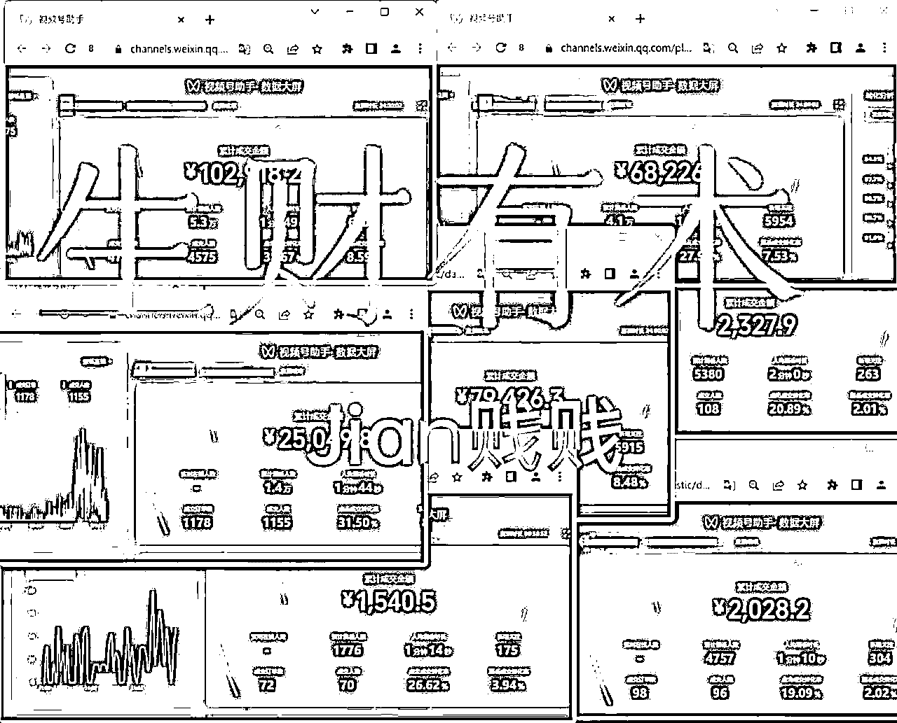

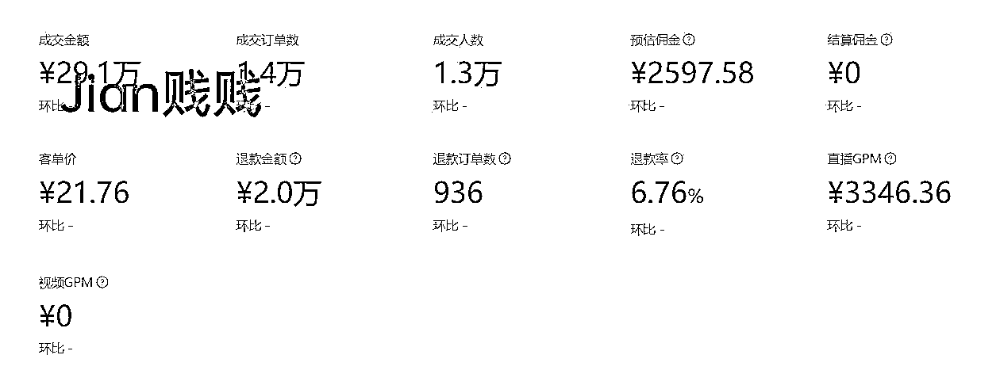

如果你也想在视频号上做口播带货，或者正处于迷茫期，希望这篇复盘能给你一点力量。

先讲讲爆单之前的事吧。

说实话，我从来不是那种“一把梭”就能成事的人，反而特别三分钟热度。考研考上985卷王专业，因为不想天天被关在学校里做核酸，说不上就不上；工作熬过试用期，又开始每天都想辞职。

去年过年，我在数字游民范米索的公众号里刷到了龙哥盟。那会儿我正迷茫得不行，3天的体验期却让我像土包子进城，看到什么都觉得新鲜。4月18号，我二话不说加入了。

从那以后，我地铁上不再刷短视频，开始一篇篇看帖子。看到普通人靠互联网翻了身，我心里也痒痒的，盼着哪次航海也能把副业搞起来。

第一次航海，我选了AI绘画。2023年ChatGPT正火，我认定AI就是风口，甚至因为懂点AI被老板叫到身边，琢磨怎么给公司降本增效。放在今天看，我可能算个早期Prompt Engineer。但理想很丰满，现实很骨感，那次航海我总共只赚了差不多200块。后来老板也没再让我碰AI项目，直接调去了业务部门。

不过，那次实操让我把网感和流程都跑了一遍，也不算白折腾。

第二次航海，我盯上了公众号流量主。当时这项目已经过了“GPT躺着赚钱”的阶段，我又没什么网感和文笔，折腾到航海结束，月收入还是只有100上下。眼看着进场的人越来越多，自己却连一篇爆款都写不出来，真的是干着急。

那段时间，上班累得半死，下班副业又是一潭死水。前女友又刚好出国读书，我整个人像被抽走了多巴胺，约会、夜店、酒局、游戏，玩两三次也腻了。除了看点认知文章自我感动，生活里再没有一丁点亮色。

每天有10多个小时耗在公司、地铁上，钱没赚到，玩也没玩痛快。我当初不是说好30岁就退休、要用一辈子去体验世界的吗？怎么活成了这个样子？

直到12月，第三次把《艾尔登法环》通关后，我终于不想再混了。必须干点正事：找一个风口项目，跟一个靠谱老师，坚持至少半年，豁出去拼一把。

这一次，我不再像当初那么盲目，而是有目的地翻帖子，筛项目。要特别感谢郭晓文，他简直是最懂新手的男人。我一边看他分享踩过的坑，一边重新调整心态。也要感谢各位视频号大佬，让我坚定了一个判断：视频号还有大机会。

最后，我选定了孟_MENG老师的团队。2023年12月18号，正式入局视频号口播带货。

孟总当年是负着100万债去做多多视频的，那我就跟他学，天天幻想自己倒欠银行30万，必须在半年内还完。别笑，这招真能打鸡血，虽然不如实际欠债那么好用，但起码能让人每天动力满满。

刚学的时候，我跟所有小白一样疯狂犯错。到1月5号爆单之前，我也就赚了700块。但我无所谓，反正脸皮厚，厚着脸再去求家人开新号就是了，我总觉得，自己一定能等到爆单的那天。

先科普一下，什么是视频号“连怼瞬爆”带货。

你或许见过这种账号：发了一堆看起来很像的短视频，点进主页却是个很简陋的直播间，但正在不停地出单。没错，那就是连怼瞬爆。

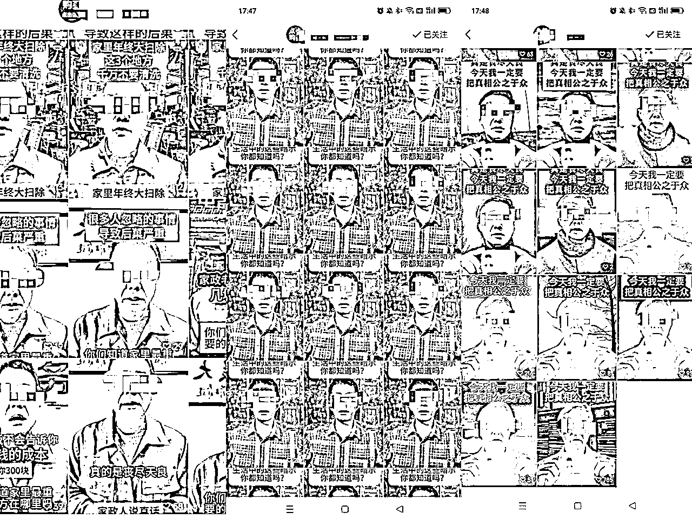

它的核心逻辑很简单：

一是选品，一定要挑当下热门、转化率高的爆品；
二是做视频，用搬运、混剪或者实拍的方式，快速产出带货短视频；
三是开直播，视频带来流量后，马上开播引导用户下单；
四是补视频，同一个爆款可以反复发，老视频没流量了，新视频还能继续承接；
五是持续直播，直播间不断出单，系统会慢慢给账号打上精准标签，推来更多想看的人，滚雪球一样越滚越大。

我的爆单，就始于孟总在群里发来的一句话。

1月4号晚上10点，孟总在群里发了条视频，配了个字：“快”。视频里一个人举着身份证，咋咋呼呼地实名举报，看着不太聪明。

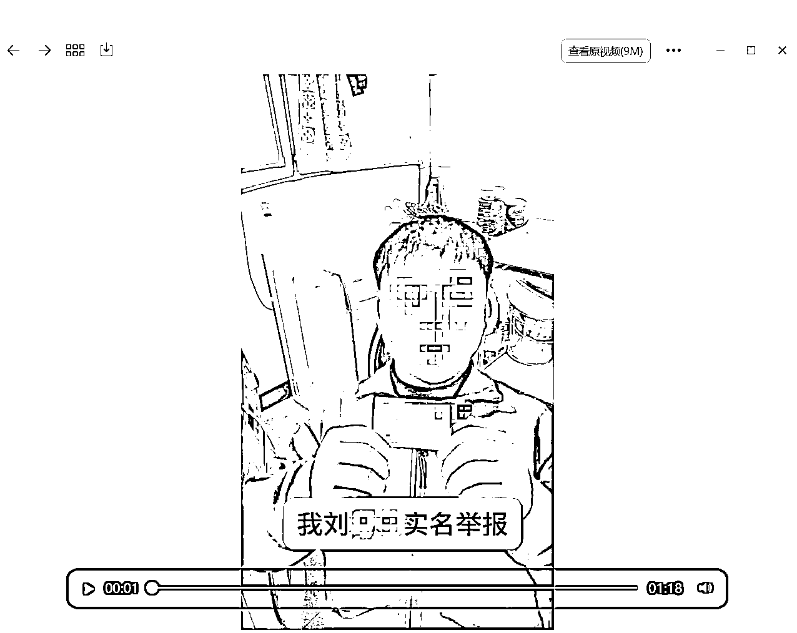

那段视频的大概文案是：

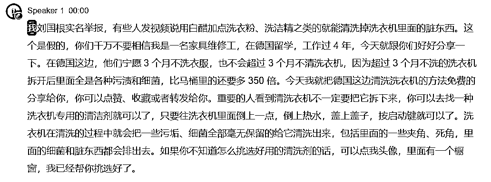

我当时刚从亲戚家出来，是为了求人家帮忙注册新号。在地铁上本来想追一集《狂飙》，看到孟总那一个“快”字，突然就支棱起来了。

我当场开始想文案、找素材，用Google搜“家政图片”。到家已经快12点了，还睡什么觉？我必须赶在早上6点前发视频，正好能吃上一波老年人刚起床刷视频的流量。

凌晨4点，我终于剪好了实拍视频。能不能爆我不敢保证，但细节已经打磨到当时的极限了。

拆解一下我的思路。

爆品的生命周期，其实比爆款视频要长久得多。洗衣机清洗剂这个品，已经火了好久，之前就有很多爆款模板，比如12月底那个“德国30年老家政”的文案，就很出圈。

我把里面最唬人的数据提取了出来：比马桶脏、大肠杆菌、注水后霉菌，以及必须每3个月清洗一次。这些才是转化的精髓，直到今天依然好用。而那条“刘某某”的视频，恰恰把这些重点给埋没了。

我把他的文案和自己的文案摆在一起对比，差距立刻出来了。

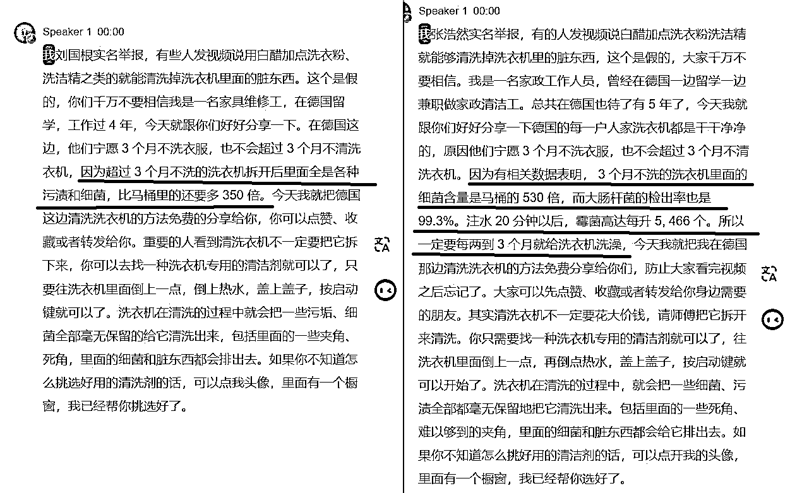

我的版本是这样设计的：

开头第一句就是：“我张浩然实名举报！有人说白醋加洗衣粉洗洁精就能洗掉洗衣机里的脏东西，这是假的，千万别信！”直接拉满矛盾。

接着立人设：“我是家政从业者，曾在德国留学，一边读书一边兼职做了5年保洁。今天我就说说，为什么德国每户人家的洗衣机都干干净净。”

然后是刺激需求：“德国人宁愿三个月不洗衣服，也不会超过三个月不清洗洗衣机。因为数据显示，三个月没洗的洗衣机，细菌含量是马桶的530倍，大肠杆菌检出率99.3%，注水20分钟后霉菌达到每升5466个。所以每两三个月，一定要给洗衣机‘洗个澡’。”

接着引导互动：“方法免费分享给大家，怕看完忘掉，可以先点赞、收藏，或者转发给身边需要的人。”

然后破除顾虑：“不用花大价钱请师傅拆洗。买一种洗衣机专用清洁剂，倒进去，加一点热水，盖好盖子按启动键就行。清洗过程中，细菌、污渍都会全部排出来，那些死角、夹缝里的脏东西也不例外。”

最后完成转化：“如果你不知道怎么挑好用的清洁剂，就点开头像，进橱窗，我已经帮你选好了。”

音画层面也不能马虎。开头3秒既要抓人，又不能浮夸，还得配上节奏感强的BGM。

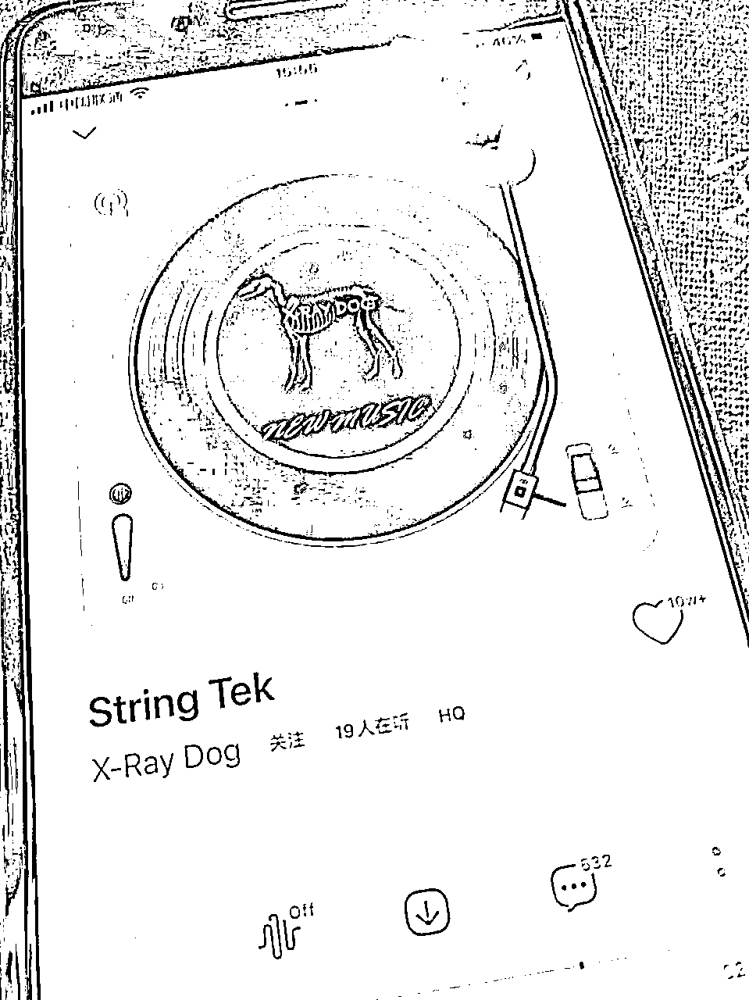

整条视频里，我细分嵌入了6段洗衣机素材，每一段都有它的转化作用。

这些素材大多是从抖音找来的。抖音带货视频是真卷，从脏到干净的全过程拍得明明白白，直接下载，剪进去就行。

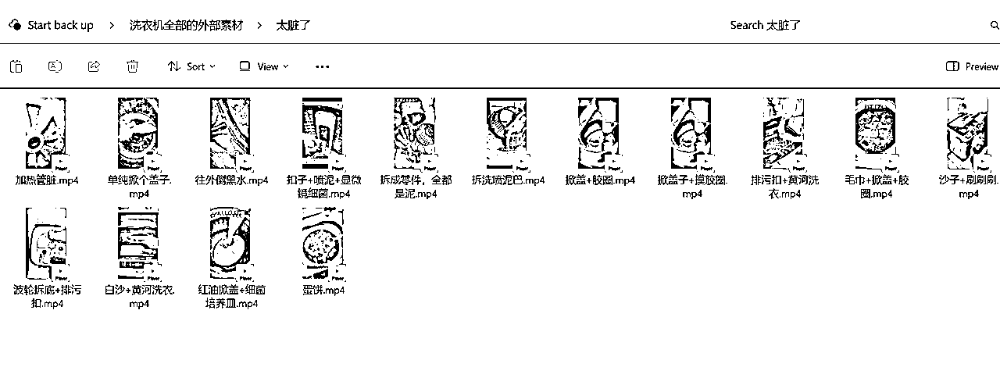

最开始，我也只挑最热门的那几条素材用。结果没几天，群里就有人喊冤：明明认真去重了，还是被判抄袭。原因很简单，同一条爆款素材被太多人搬过了。

所以后来我学乖了，把一堆热门、冷门的洗衣机素材全部下载下来，按功用打散，重新拼装进每一条视频。

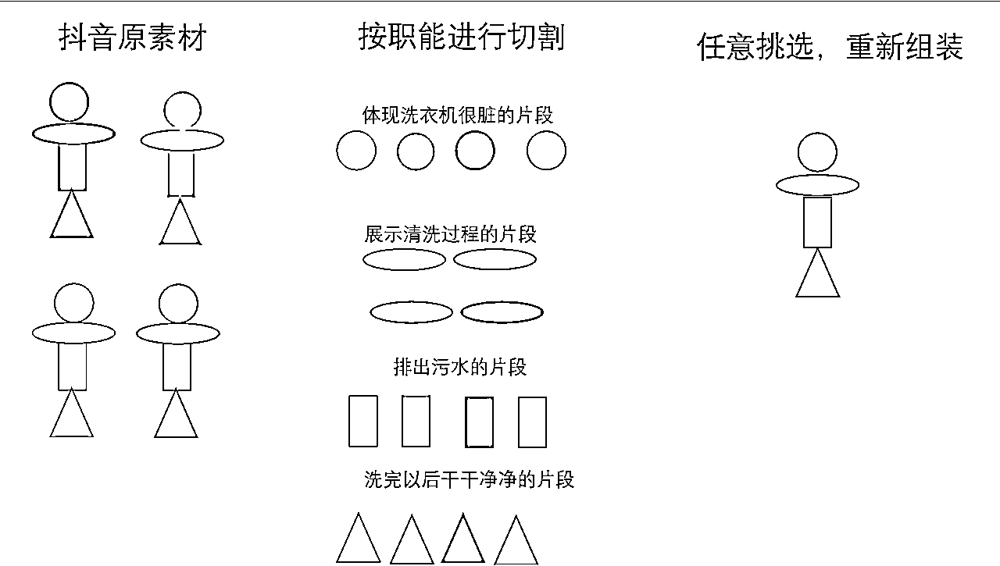

视频发出去后，我给自己定了早上6点的闹钟，想着起来看看有没有爆。结果6点睡死了。一觉醒来已经8点，打开手机一看，点赞几千，播放量冲到了6万。我整个人从床上弹了起来。

还好我爸住得近，我赶紧跑去找他做实名扫脸认证，然后立刻开播接住流量。好在没耽误太久，吃到了最开始的5万GMV。

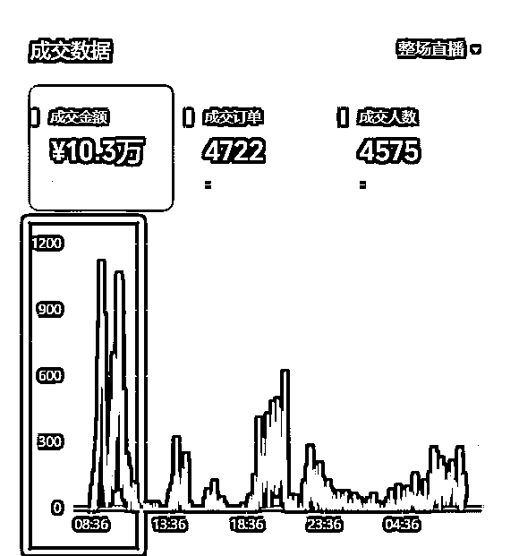

之后我一边混剪、一边补视频、一边拉直播时长，忙得连饭都顾不上吃。孟总全程在群里教我怎么逼单、怎么处理违规。

一个人单兵作战，这么大的流量根本吃不完。所以我干脆把素材分享给群里所有人，让他们去重之后发到自己账号上，出单分我一部分佣金。靠着这条视频，不少朋友也赚到了钱。说实话，看别人赚钱，有时候比自己赚还开心。

我也不知道自己怎么撑下来的，反正就是红牛配润喉糖，一路扛到第二天早上8点，终于自动下播。我拍了张照发朋友圈，装了个逼，然后倒头就睡。

如果能穿越回去，我一定给自己一巴掌，把自己扇醒。

睡了4个小时起来，我才发现自己又犯傻了。

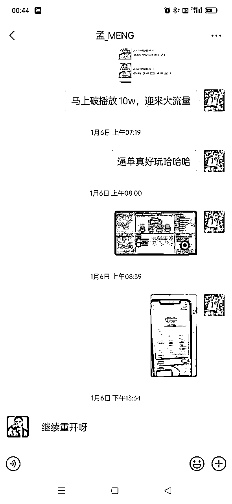

因为我看到孟总一直没回消息，就自作主张跑去睡觉了。实际上完全可以找个代播继续开播，把流量全部吃光。中间这12小时没播，我粗略一算，至少亏了2到3万。

于是1月6号晚上8点，我开了第二场直播。这次明显淡定多了，一路播到第二天早上6点，正好赶上老人早起那波流量。

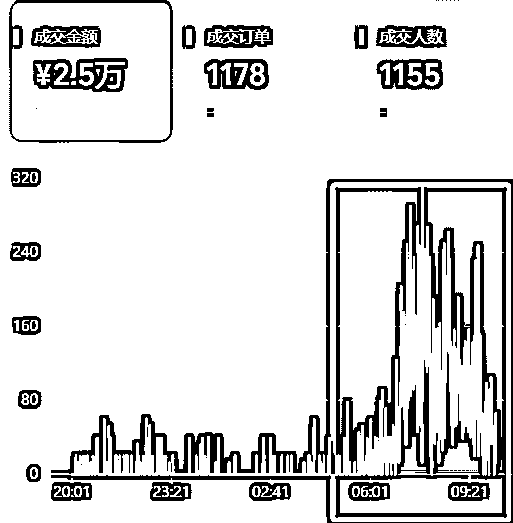

后来一直播到上午10点，我已经意识模糊，开始说胡话。想让孟总帮忙找个代播，结果——

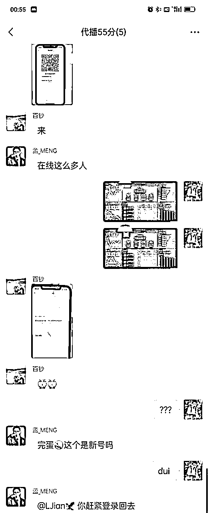

因为我在上海，代播在广东，微信触发了异地登录风控。这下好了，任何一台手机都登不上微信了。

我一下子清醒得不能再清醒，撒腿就往门外冲，去找微信实名认证的人，也就是我爸，让他帮我扫脸解除风控。

还好住得近，骑车一小会儿就到。那三天我一共只睡了8个小时，一路骑一路念：“别死，别死，集中精力，注意车，注意车，别被撞。”

最后在菜市场找到了我爸。一小时后风控解除，我重新登上了微信，也终于可以开播了。专业代播百钞夫妇，就在这时闪亮登场。

他们是真能打，24小时干出了6.8万GMV。我在旁边看得目瞪口呆，第一次见识到什么叫“凶残”——像饿狼盯着羊一样，死死盯着大爷大妈们的钱包。

我以前直播，总让哥哥姐姐们每3个月用半罐，理性消费，别一次囤8罐12罐。他们直播，直接让每个月用一罐，趁便宜多囤点，用不完还能送亲戚。

“太可耻了！”我嘴上这么说，手上却默默记下了他们的逼单话术，准备下次直接照着用。

故事到这还没结束。两位直播战神下播后，一句话点醒了我：你该赶紧继续实拍、继续搞新号，再找一群代播把矩阵放大。

我瞬间醒悟。对啊，专业的事交给专业的人。我这张脸、这身衣服，就该拿来实拍，而不是浪费在直播间！

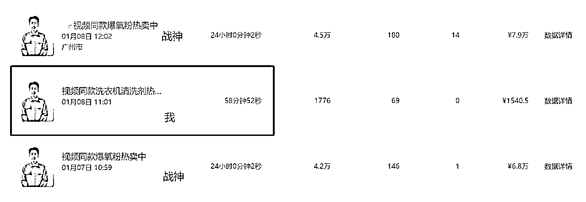

我当时没急着搞新号，先给老号拍了3条全新视频当储备。结果，第3条居然又爆了。

这条能爆，运气占了很大的成分。因为那会儿我的老号已经被很多同行盯上了，几乎每一条视频都被反复举报，很多内容因为莫名其妙的理由被限流。可偏偏就是在这种环境下，还能跑出一条新素材，让老号来了波第二春，确实很神奇。

后来我也搞了几个小号，但视频跑到6000播放就卡住了。当时我还挺飘，觉得6000播放根本不值得开播。现在回头看，真是膨胀得离谱。

又过了24小时，大号前后被限流了22条视频，我们算是彻底把流量榨干了。这次爆单，终于迎来了尾声。

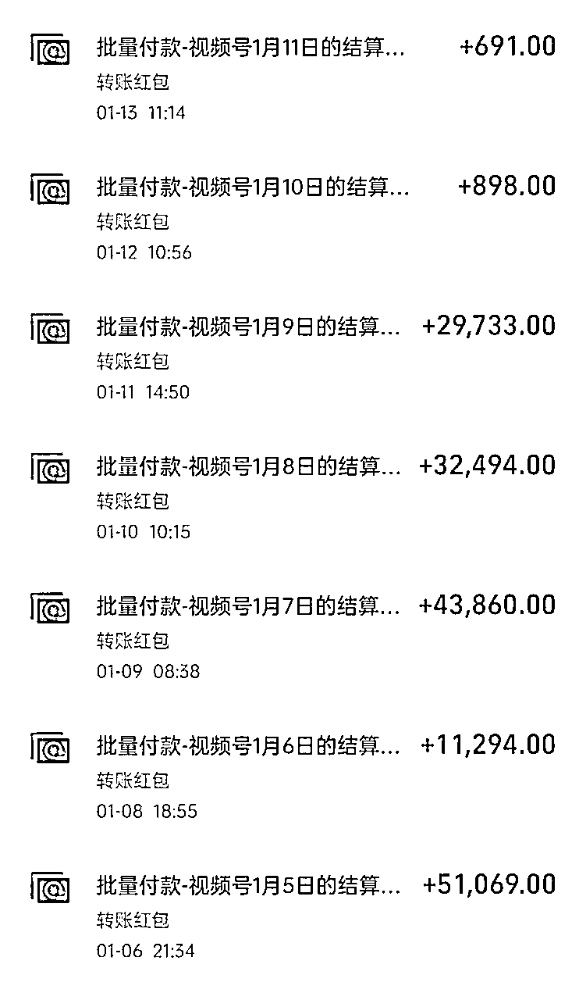

这几天我有些感受特别深。

第一，必须真刀真枪下场，问题才会一个个浮出来。比如多设备封控、隐形限流怎么自查，这些坑只有撞过一次才会懂。光看一百篇帖子，不如自己开一次播。

第二，雷军说，99%的问题都能找到人问出答案。我那五天犯了不少错，也亏了不少钱。如果当时主动多找几位大佬请教，很多损失本来能避免。

第三，团队作战才是长久之道。大号爆了之后，同行们都能跟着喝汤，可汤就这么多，应该优先让自家团队的伙伴喝饱。前期我应该把更多时间花在实拍上，把直播交给别人，而不是自己硬扛。

第四，成全别人就是成全自己。我把素材毫无保留地分享出去，很多朋友也靠跟拍赚到了钱。更关键的是，他们把一线反馈又带回群里，正是这些反馈帮我迭代出第二个爆款。那段日子，群里真称得上“百家争鸣”。

第五，流程一旦跑通，就要尽快拆出SOP放大规模。以前我跑通的次数太少，压根没想过拆环节。现在有了底气，以后要学着多“求人帮忙”，把自己的时间用在最值钱的地方。

最后聊聊我对视频号的判断。

视频号的红利确实还在，玩法也很多。新手进场，只要肯干，基本都能赚到钱，无非是多还是少。

我这周带了一个大一学弟入局。他执行力比我猛多了，一周就跑通全流程，播了两场，赚了差不多1500佣金。这比我刚入局时可强太多了。

我仍然不觉得自己有什么天赋，不过是个执行力还行的普通人，运气好碰上了靠谱团队、向上的氛围、一个天选神号，加上一个爆款素材。

风口上的短期项目，说到底拼的就是执行力。坚持快速跟素材、认真研究实拍、不断开播、不断实战，总有一天会等到属于自己的爆发。

加入赚钱这一年，我最大的感知是：回头看，每一步都没白走。

别看我入局视频号只有25天，这25天的背后，是前面好几次航海踩过的坑、攒下的经验。没有那些失败，就没有今天这场爆单。

愿你也能在正确的路上，等到属于自己的高光时刻。

在龙哥盟这一年，我跟着好几场“大航海”一路扑腾，最大的收获不是赚了多少钱，而是明白了两个道理：顺势而为，以及借力成长。

AI绘画那期，我摸清了平台规则的脾气——它不是用来硬怼的，而是用来借势的；公众号那期，我学会了“开头三秒定生死”，标题不够炸，内容再用心也容易沉；剪辑那期，我把剪映玩得越来越顺手，出片效率直接起飞；时间管理那期，更是打通了我的任督二脉：盯紧目标，再倒推行动，而不是被任务清单牵着鼻子走。

摔跤再正常不过，谁没有当过炮灰？重点是把上次摔出来的疤，变成下次上路的盔甲。经验攒得够多，成功自然离你越来越近。

“选对环境，跟对人”，这是我用亲身经历换来的信条。人天生有怠惰的一面：容易三分钟热度、遇难则退、能拖就拖。非要靠意志力和人性硬刚，基本撑不久。最聪明的做法，是主动跑到能量充沛的人群里，让环境推着你改变。

赚钱就是一个这样的高能磁场，新人在这里真的会“被带飞”。而每一届大航海，都是一个高浓度的小战场：教练们身经百战，志愿者全程护航，他们嘴里说的不是鸡汤，是实打实的经验与信心。你只管跟上，剩下的交给时间。

如果你现在还在迷茫、焦虑、困顿，我想把郭晓文老师去年4月写给新人那段话，转送给你：

“把时间拉回到一年前，我也是个在风口项目里苦熬三个月、一分钱没赚到的菜鸟。写下这些，既是我和龙哥盟这一年缘分的复盘，也想给刚进圈的你松口气：别被满屏的项目晃花眼。方向看远，脚下走实，好的结果会自己跑来找你。前提是，你愿意等，不埋怨，不掉队，每天往目标拱一小步。”

谢谢你能耐着性子看到这里。我是Jian贱贱，一个不甘平庸的00后。愿你和我一样，把短期的项目当长线的事来做，做扎实，做出复利。