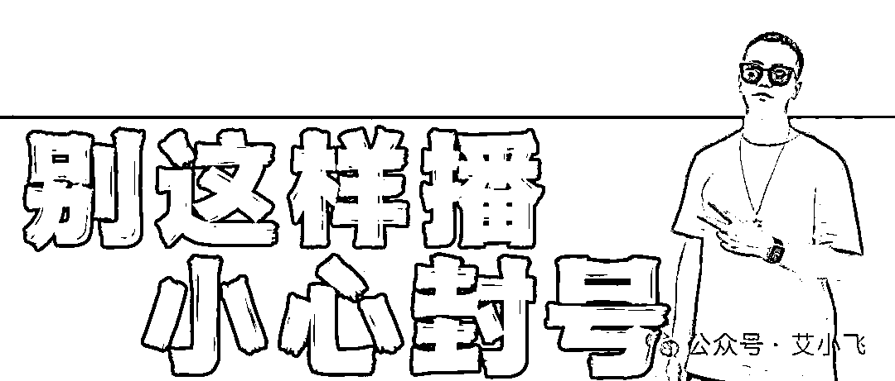
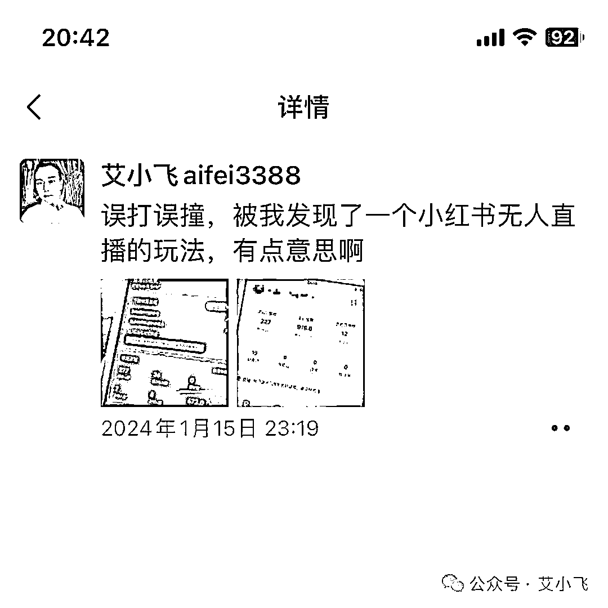
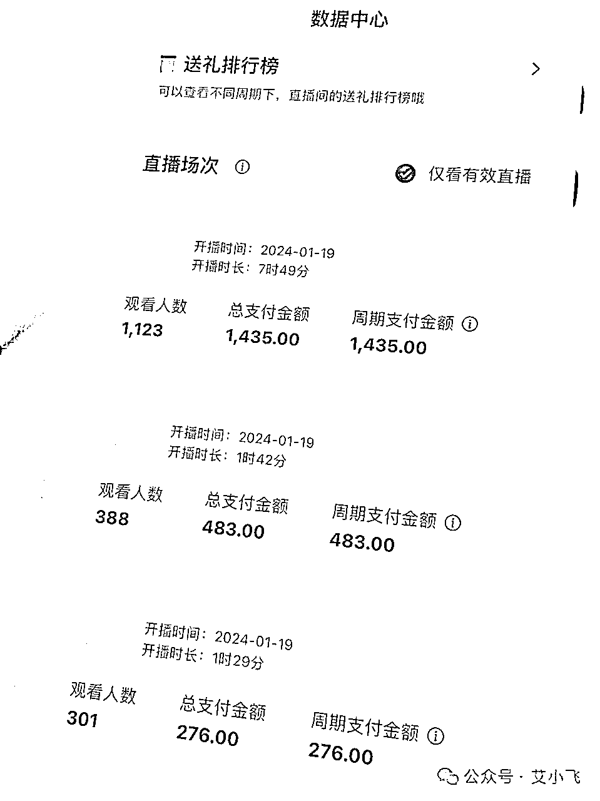
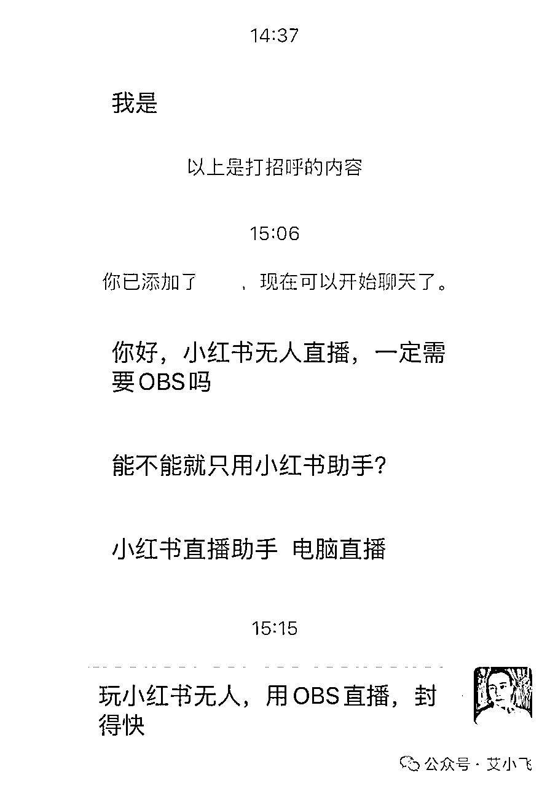

# 📕无人直播还能玩？别再用OBS了，账号说没就没！

> 最近好多朋友都在问我：📕无人直播到底怎么搞？
>
> 怎么才能不被平台盯上？
>
> 怎样才能让直播间活得久一点？

我是龙哥，最近靠在📕上卖水果，机缘巧合之下摸到了无人直播的门道。

后来我反复测试、不断优化，总算打磨出一套应对平台抽检和同行恶意举报的实战打法。

这套思路虽然有时效性，但只要你短期内照着做，赚一波零花钱问题不大。

具体是啥玩法？怎么落地？为什么OBS这条路走不通？平台的检测逻辑到底是怎么回事？怎么绕开？

别急，下面我一个一个讲清楚。

今天有个粉丝跑来问我：用电脑OBS播📕无人直播，行不行？

他这一问，我瞬间意识到，肯定还有一大波人也有同样的困惑——想找答案找不到，想动手又不知道从哪开始。

说实话，现在的玩法和以前完全不一样了。

📕早就不是你们想象中那个“啥都不管”的平台了。以前那套用在抖音、快手、视频号上的OBS录播打法，搬过来就是找死。

见过太多人把老一套直接套在📕上，结果呢？今天封一个，明天封一个，注册再多号都不够填坑的。

为啥会这样？

别以为📕好糊弄。我这边有小道消息透露，平台早就把OBS录播列入了系统自动监控范围，一旦被巡查或者被举报，封号几乎是板上钉钉的事。

# 一、📕是怎么识别无人直播的？

## 第一关：摄像头检测

系统会先判断你的直播间是不是真人在用摄像头直播。如果你用的是虚拟画面，不好意思，直接强制下播。要是短时间内再被一堆用户举报，那这个号基本就凉透了。

## 第二关：画面重复检测

系统会盯着你的直播画面，看它在一定时间内是不是反复出现。一旦发现画面重复率过高，就提示下播，然后给你限流3天。你可能还在傻傻地播，结果直播间一个人都进不来。

## 第三关：声音轨道检测

系统还会监控你的音频轨道。比如同一段话，在60分钟内循环了20遍，而且语气语调完全一模一样，那系统就会判定你涉嫌非真人语音，直接限流让你整改。

## 第四关：互动检测

系统会看你回复用户评论的积极程度。如果你爱答不理，或者牛头不对马嘴，直播间照样被限流。

以上四点，还只是最基础的风控动作，连“开胃菜”都算不上。

之前有人说📕无人直播很简单，我真想问一句：这四道坎，你能跨过去几道？

所以说，玩📕无人直播，拼的就是细节，玩的就是信息差！

# 二、这几个坑，我是怎么填平的？

接下来分享点硬货，全是我真金白银砸出来的经验，建议点赞收藏。

## 1. 摄像头：不碰虚拟，用真的

明知道平台检测摄像头，我还傻乎乎去用OBS虚拟摄像头？那不是自投罗网吗。

路有坑，我绕开走。直接用真实摄像头开播，不管是平台巡检还是同行举报，都说我录播？根本站不住脚，因为我播的就是实时画面。

## 2. 画面：不循环，搞实拍

以前玩OBS的人，都喜欢用一段视频无限循环。平台也不是傻子，这能看不出来？

我的做法是：把产品买回来，搭一个小展示台，摄像头直对产品实时拍。画面每一秒都是新鲜的。我还专门试过用小号举报自己大号，结果全部失败。这一招，直接让同行的恶意竞争失效。

## 3. 声音：录自己的声音，循环也别超1小时

有人问我，声音这块怎么搞定？

我的方案很简单：先录好自己一小时的真实语音，然后循环播放8小时。

为什么这么做？因为几乎没有观众能在直播间里蹲满一整集。而且我录音里的每一句话，在一小时内是不重样的，语调和语气也各有变化。同行想来举报？我实测过，小号举报大号，成功率是0。

## 4. 互动：把问题提前“录”进答案里

这个就更省事了。用户最常见的问题，我在录音里提前全部解答掉。他刚想问什么，耳机里答案已经在播了。90%的常规问题都能覆盖，剩下10%的偏门问题，基本没人会问，直接忽略也没事。

用户的疑问被解决了，从直播间的观感来说，这就是个真人在播的直播间。同行看了也不好举报，平台也不会有啥异常反应。

你如果是平台，你会封这样的直播间吗？

大概率不会。

所以说，玩📕无人直播，玩的都是细节，玩的就是信息差。

以上经验，都是用真金白银换来的，全是敏感又关键的细节。你直接拿去套用，至少账号不会说没就没。

最后再提醒一句：千万别再用OBS模式去碰📕无人直播了。

你的那点套路，平台门儿清，只是看它想不想动手。

今天就聊到这儿。下期我会接着讲，📕无人直播的时长和时间段怎么选，细节怎么把控。点赞越多，更新越快！

有问题欢迎后台私信交流。我是艾小飞，咱们下期见。

原创：艾小飞  
转载需授权  
禁止搬运抄袭