# 一个果铺卖出6.5万单：农人号在内容社区怎么赢的？
作者：龙哥

拆解对象：一位云南李姓卖家的果铺。数据观察周期：2023年苹果季。

为什么值得拆？

赚钱的案例库里提到过这家店。随后我又去平台搜这种表皮不太好看的苹果，按商品排行看，前排三家的关注者分别约为1.7万、5815、7290，成交单量分别是9.8万、1.6万、1.5万；而这间果铺只有1.1万关注者，却卖了6.5万单，平均每篇帖子的点赞+收藏+评论数达到171，明显高于同行。内容更能带动互动，互动又带动下单，所以选它来做观察。

操作上，我学完RPA之后，用自动化工具抓取了它公开主页里的题目、正文、点赞、收藏、评论等字段，成功抓到303篇帖子，先落成表格再慢慢看。

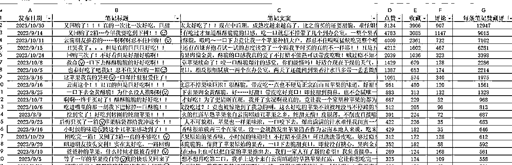

先说节奏与利润。这个号并非头一年做果子生意，主页还残留2022年的少量内容；真正的密集更新从2023年8月开始，每天发3-4条带商品链接的帖子，主推苹果，到12月中旬停更。看起来就是趁果季集中冲一波，之后不再维护。收入方面，某低价电商平台上同样来自昭通的高原苹果，均价每斤五六元；这家店不同规格折合下来约每斤十元，评论区也有人说贵。发货从产地直接出，进货成本大概率不高。虽然没拿到具体进货价，但6.5万单哪怕单均只赚10元，也是不小的一笔。

封面也值得看。她已经测出了适合自己的一批封面模板，几乎所有帖子都围着五种视觉风格来回用，以图文为主，偶尔夹一条视频。照片容易拍，模仿门槛低；现在已能见到不少同类店铺用几乎一样的画面构图。这恰好印证了“验证过的封面模板可以反复用”。

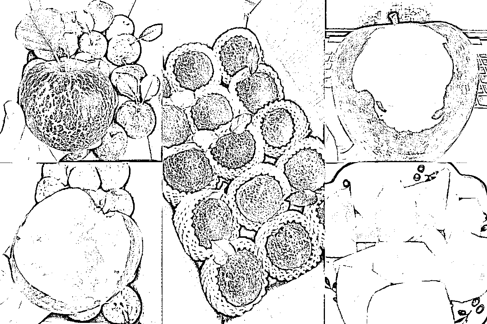

再看文字部分。整号共有415篇帖子，我只抓到303篇，采集脚本还有一些问题，不过样本量足够。账号整体数据不差，但也有大量冷帖子，甚至0赞0藏0评。我把三项互动数据（赞、藏、评）之和大于50的帖子选出来，共102篇，作为“表现较好”的样本；其余201篇作为参照。

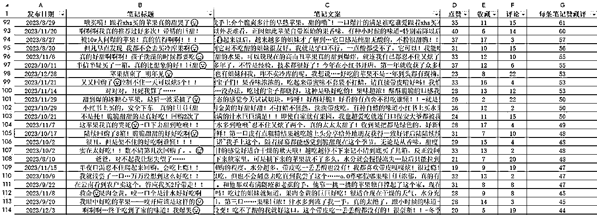

把102篇的题目与正文分别送进词频分析工具，得到两组高频词列表。

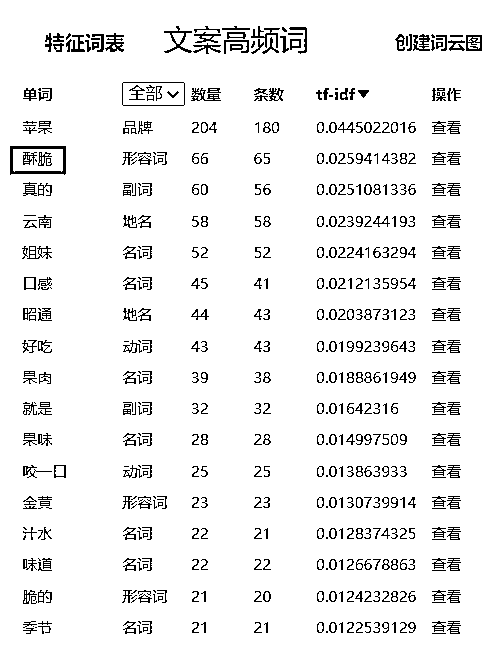

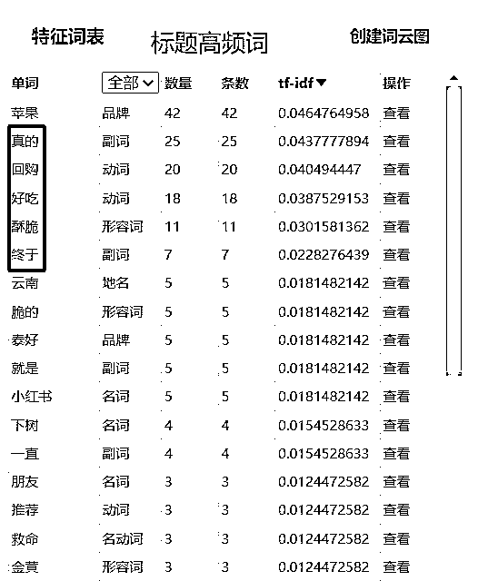

词频统计有什么用？我的理解是：写内容时除了布局搜索词、联想词、热门词，还要观察对标账号里反复出现哪些词，猜她为什么爱用，再看能不能搬进自己的帖子。比如“酥脆”让我很意外。大众对苹果的味觉预期往往是“脆”或“甜”：脆对应粉，甜对应酸。“酥”是什么状态？这个词在她帖子里反复出现，也许是提升点击的小钩子，值得做对照测试。又比如“复购”：表现较好的102篇中，“复购”出现20次，占比约19.6%；表现一般的201篇中出现28次，占比约13.9%。而数据排最前的10篇里，有5篇题目都含“复购”。这大概率不是偶然。用户看到“复购”会好奇“到底多好吃才会反复买”，于是点进去看。在水果、零食类目里，把“复购”写进题目和正文，也许能明显提升点击。类似的词还有“好吃、酥脆、终于”，都可以借来试验。

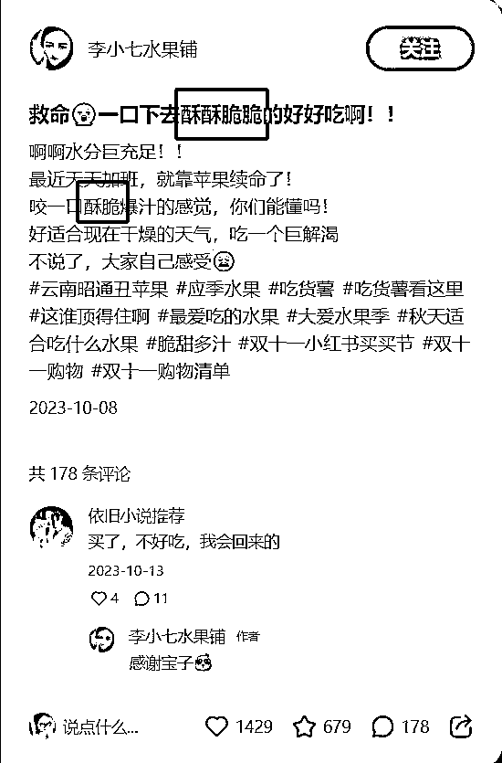

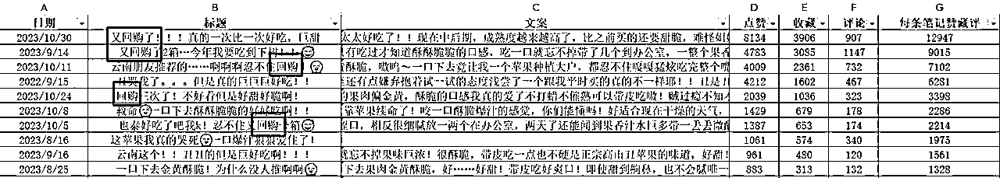

字数方面：102篇表现较好的帖子一共12570字，平均每篇约123字。每天写3-4篇且保持可读性，并不轻松；有AI工具帮忙会快很多。用户点进来之后，多一段有效信息，就多一分下单理由；但前提是信息有用，而不是无脑堆字。很多同行只有一句话题目，正文极其单薄，信息量完全跟不上。

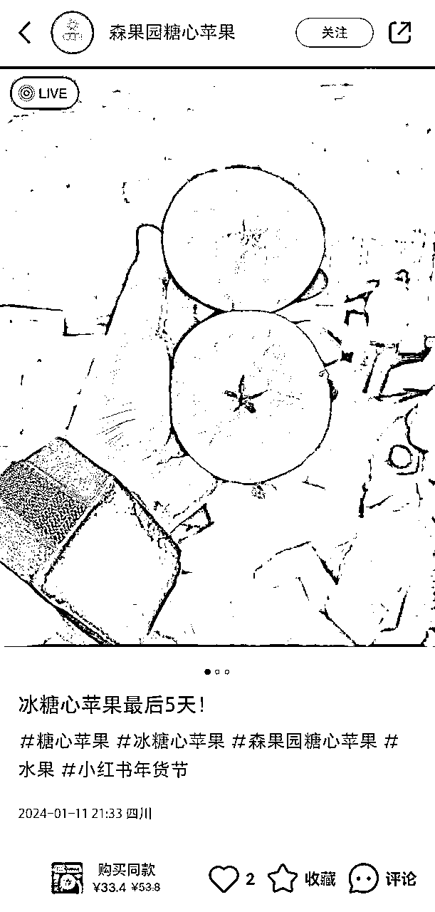

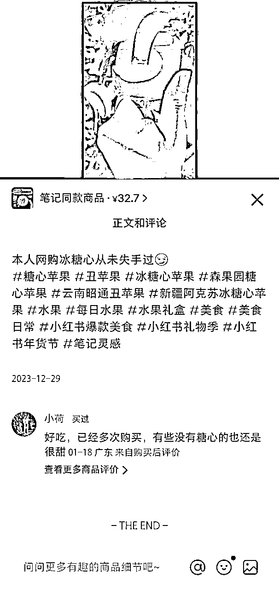

更关键的是情绪感。什么叫情绪感？先看她帖子的语气：

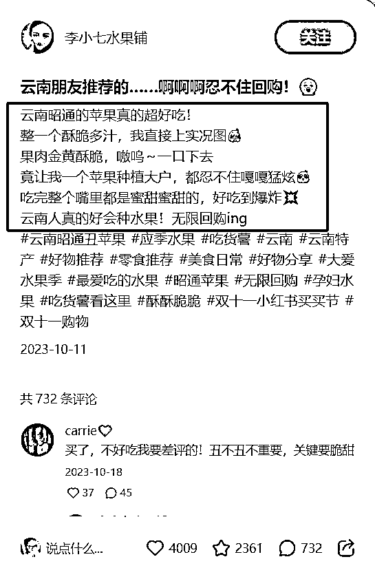

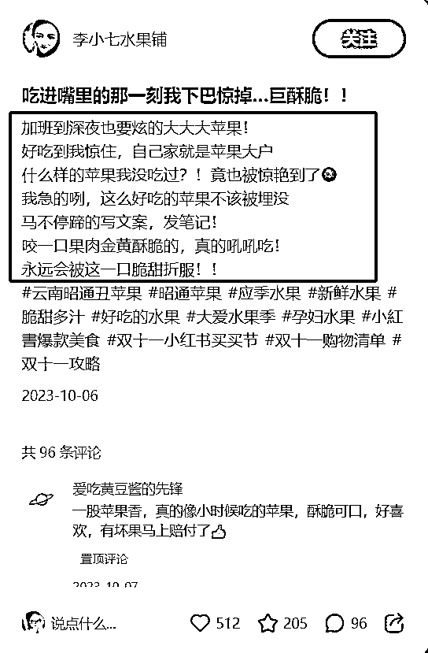

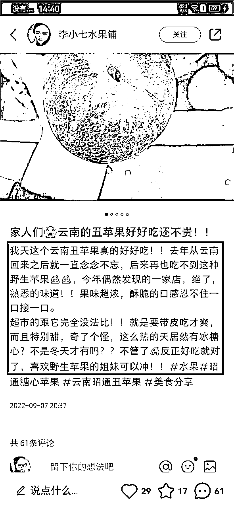

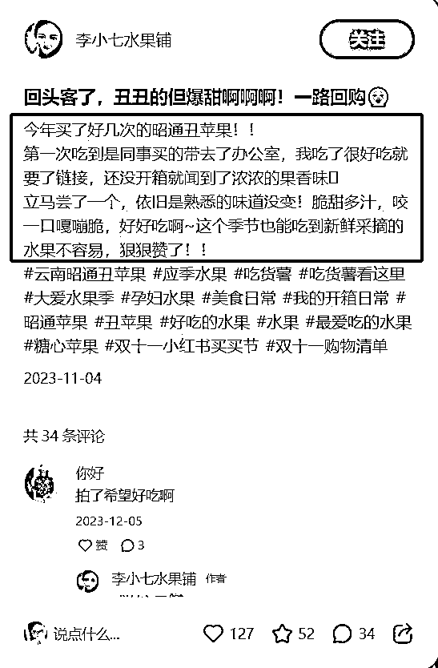

再看另两家同类店铺的口吻：

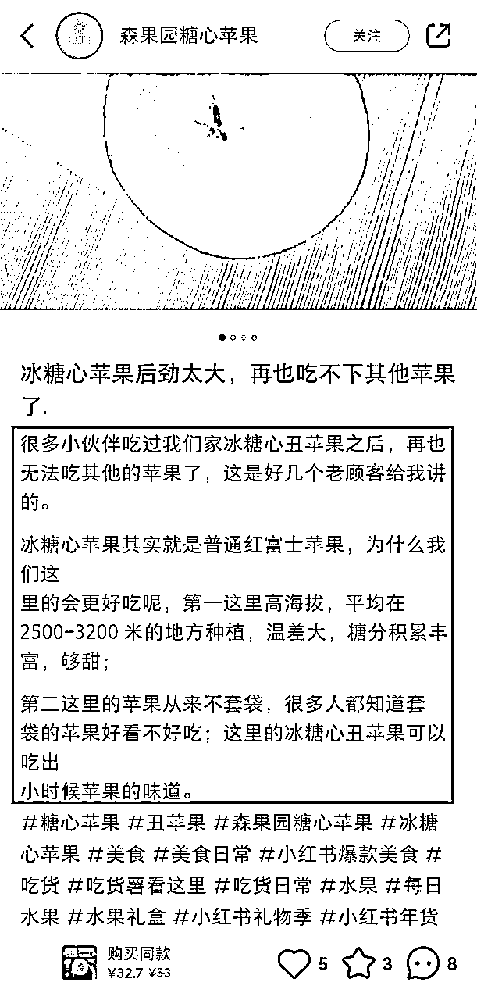

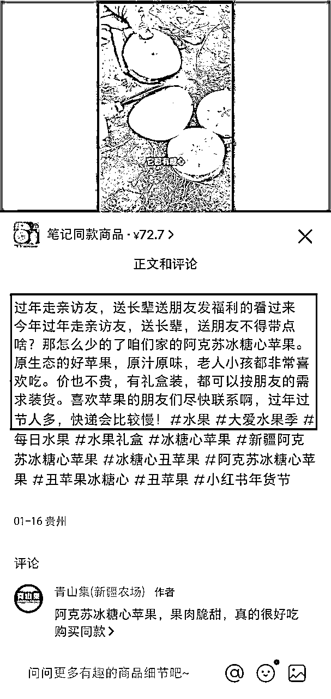

同样是卖果子，哪一种更让人想下单？答案很直观。赚钱里一篇研究热帖黑马的文章提到：情绪感，是粉丝不多的账号出爆款内容的第一杠杆。

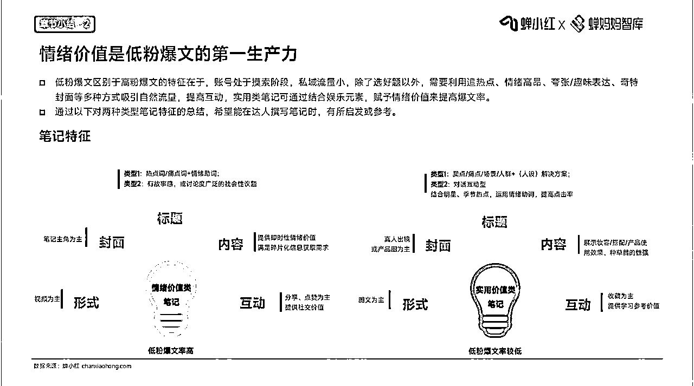

凯哥也说过：没有情绪的文字，如同少了灵魂。https://articles.zsxq.com/id_fpdghkpm6s3c.html

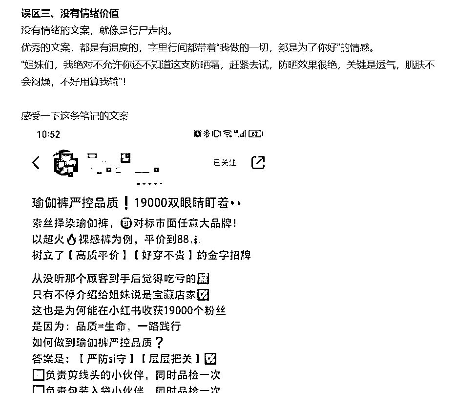

这个卖家的表达，就像一个小姑娘在你面前比划着喊“这也太好吃了吧”，让人忍不住笑出来，甚至想试试。抖音上残疾人、老人卖垃圾袋销量很高的案例，本质也是情绪：反正日常都要用，顺手帮一把，下单也就顺理成章。

结论与经验：

果品赛道能做长。每种应季果子的窗口只有几个月，但全年轮着来；只要能积累足够多的高净值客户到私域，不同季节都能找到对路的品。我认识一位卖脐橙的女生，果好、包装精致、价格偏高适合送礼，现在已从脐橙扩展到奇异果、榴莲、大樱桃、山竹。不露脸售卖也完全成立：这个卖家从不出镜，她说自己是云南本地人，未必为真；找到稳定合作的上游后，自己只负责流量，素材由对方提供，模式照样跑得通。

我提炼出的做法：

封面：找5-10个同类账号，筛出数据最好的封面模板，模仿、重复拍、持续发。

文字：批量收集高流量题目和正文，拆分重组后变成自己的版本，再借助AI提效。表达要口语化、要有情绪、不要端着。品质不能丢，篇幅尽量比同行足。

更新量：每天稳定发3-5条。这个卖家内容能力已经很强，仍逃不过大量零互动帖子，所以只有数量够多，才能摊薄概率。

最后说回拆解本身：这篇观察远不算完整。市场、供应链、全部竞对、流量来源、转化漏斗都没做系统研究，也没想明白为什么果农阿强能卖到9.8万单、他的特别之处在哪里。方法偏主观，属于拿着锤子找钉子，欢迎评论区指正。