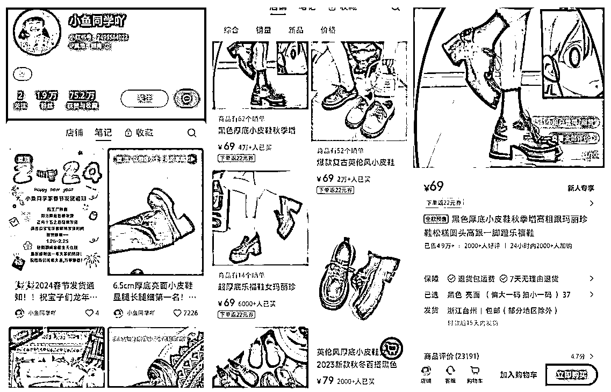
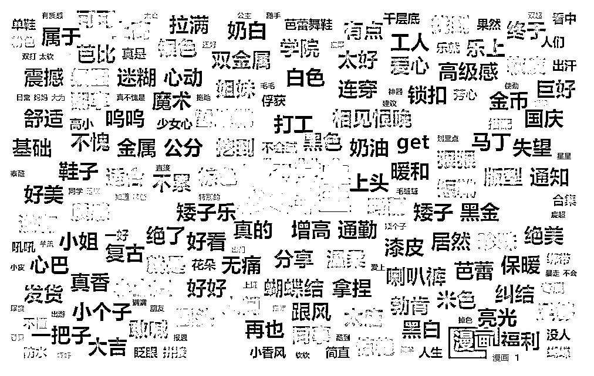
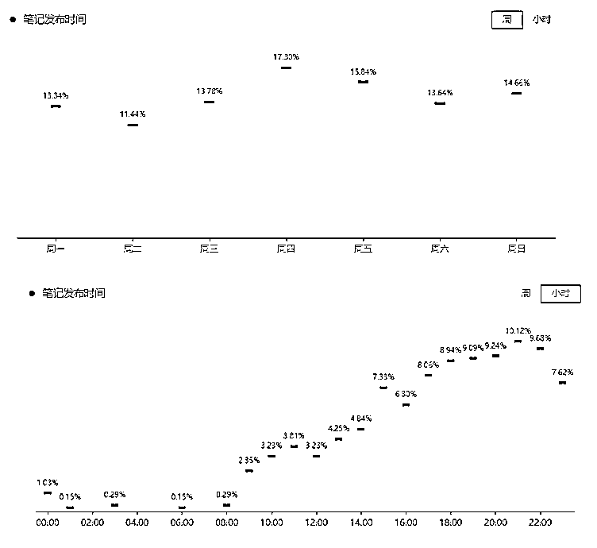
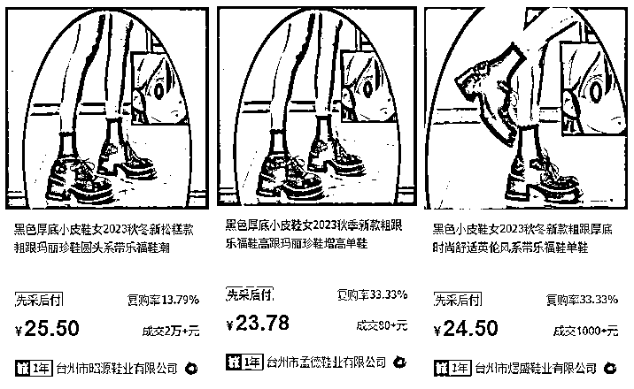
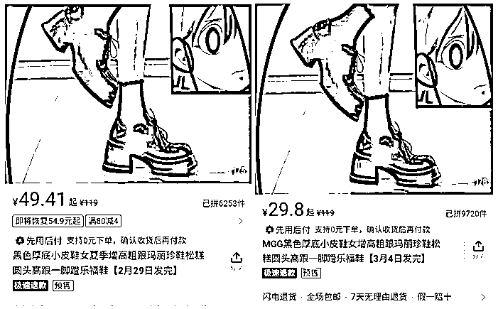
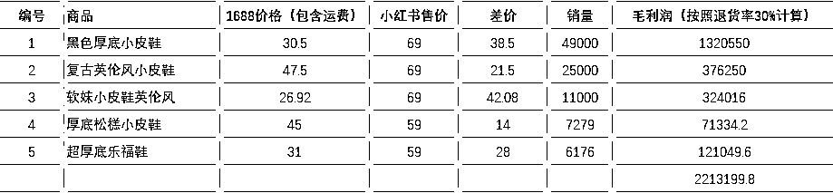
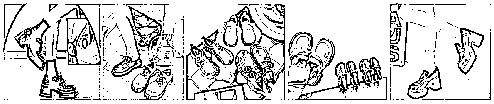

# 风向标拆解第 3期--小红书爆款，售卖件数50W+的店铺到底是怎么赚钱的--闵一

小红书上经常刷到鲨鱼裤80万+、打底衫50万+的成交数据，一家店只死磕一个爆品就能赚得盆满钵满。也有“春节一次性20件套”这类百货话题，靠小玩意儿卖出10万+。到底这种高销量店铺是怎么跑起来的？是靠矩阵铺货、请达人带货，还是图文+无人直播？

玩法已经非常成熟，爆款店的底层逻辑里，普通人能复制的机会点在哪？

## 案例拆解

#### 账号基本情况

账号名：小鱼同学咩的店

品类：女鞋

成交方式：视频带货 ，目前未见直播投放，也未借助外部达人。

## 变现逻辑拆解

### 1 流量是怎么来的？

* 该店铺的免费流量主要来自视频的发现页推荐、搜索曝光以及商品页承接，整体没有直播带货，也没有达人合作；
* 账号累计发布374条笔记，最早可追溯到2023年3月1日，日均更新1-2条，视频时长控制在10秒到30秒；
* 内容形态非常统一，都是鞋子到货开箱和上脚试穿，配乐或变声配音解说为主；
* 标题核心是价格锚点，例如“60+💰 谁懂 被这双厚底乐福鞋高级住了!!”、“才69r这双锁扣厚底小皮鞋是来报恩的吧😭😭” 
* 发文时段集中在晚间18点到22点，其余时段产出较少 
* 笔记评论词云 
* 买家画像：女性用户占比97.1%；粉丝Top3省份为广东10.40%、山东8.80%、河南8.80%；核心年龄段18-24岁占57.7%、25-34岁占28.6%；粉丝活跃高峰在10:00 15.30%、11:00 13.70%、12:00 11.90%。

### 2 货源是怎么打的？

以店铺爆款为例，小红书挂价69元，累计售出4.9万件，产地台州。

1688同款1：25.50+5元运费，毛利空间约38.5元；
1688同款2：23.78+5元运费，毛利空间约40.22元； 
1688同款3：24.50+5元运费，毛利空间约39.5元；

拼多多同款1：49.41，毛利空间约19.59元； 
拼多多同款2：29.8，毛利空间约39.2元；

### 3 利润到底有多少？

1）收入测算

店铺共上架55款，销量前5款的利润情况如下：
其他产品里，千件以上销量有8款；500-1000件有5款；剩余多在百件左右  

2）成本测算

* 投入项：保证金+投流+备货垫资+人力；
* 小红书个人店铺保证金1000元，投流费用暂无公开数据；
* 女鞋品类退货率约30%；
* 平台抽佣5%；

3）综合核算

仅按排名前5的爆品估算全店盈利。固定启动成本：1000+69*55样品费=4795元。

按此口径总利润约220万，账号运营11个月，月均约19万。
*注：广告费、人力及其他隐性支出未纳入，实际数据可能有偏差，欢迎实操者补充验证。*

### 4 项目复盘结论

百元以内定价+真实实拍内容+持续测款迭代+高频更新，精准卡位一个细分人群，比如该案例锁定的是学生群体的增高鞋需求。