# 风向标拆解第3期——躺着也能变现，iPhone一键记账快捷指令是怎么卖爆的--十七
作者：龙哥

## 产品来历

iPhone 的快捷指令搭上云端表格，就把记账这件事从手动变成了自动。

Workflow 是当年苹果商店封面的创新应用，2015 年拿下「App Store 年度最佳」。

2017 年 3 月，这款应用被苹果整盘收购。( [1])苹果不光拿到App，还把原开发团队一并收编。( [2])

2018 年，Workflow 改名「快捷指令 Shortcuts」。

发展脉络：

2017 年 3 月 23 日完成收购，具体花了多少钱外界没公开。( [3-4])

2018 年改名捷径并上新版，做了中文适配( [3])，随后正式定名快捷指令。

2019 年搭上 iOS 13.1，快捷指令上线「自动化」功能，满足条件就能无感触发。

核心能力：

快捷指令能把多个 App 的功能串起来，形成一条工作流，一键搞定多步操作。例如想通知朋友自己要迟到，开了「迟到」工作流后就能自动定位下一个行程、算出路程时间、起草短信并发出。

苹果自家表格工具

Numbers 是苹果 iWork 办公套件里的电子表格，和 Pages、Keynote 一起卖。Numbers 1.0 在 2007 年 8 月 7 日首发。最新迭代到 Numbers'13。起初只在 OS X 上跑，后来随 iOS 普及也推出了移动版，并伴随 WWDC2013 推出 iCloud 版本。

## 用户痛点

生活越智能，人越离不开手机。记账听起来简单，做起来就很让人头疼。自动记账的出现，正好撞上了大家懒和健忘的痛点，让记账变得随手可做。

它靠智能识别与自动归类，把每一笔花销瞬间记下并归位，省去手工输入的麻烦，也不会因漏记或记错而抓狂。忙成陀螺或者记性差的人，遇到它就跟找到救命稻草一样。

而且自动记账不只是记。它还会读懂你的账单，给出专属的消费建议和预算方案，相当于随身带了个私人财务顾问，让人更清楚钱花去哪了。

借助智能技术，记一笔支出、拿一份专业建议、做一份预算规划，对不爱折腾的人也毫无压力，花钱更有章法。

## 案例拆解

### 1.基本盘

账号：Cayson呀

赛道：数码

粉丝量：2476

作品数：45

变现路径：📕店铺

账号：数码朵拉 PM

赛道：数码

粉丝量：1944

作品数：31

变现路径：📕店铺

### 2.为何挑这两个号

1.3 个月从零起号做出低粉爆款

2.内容模版高度统一，图文视频都能直接套

3.品类极致垂直，只做记账这一个单品

### 3.账号首页截图

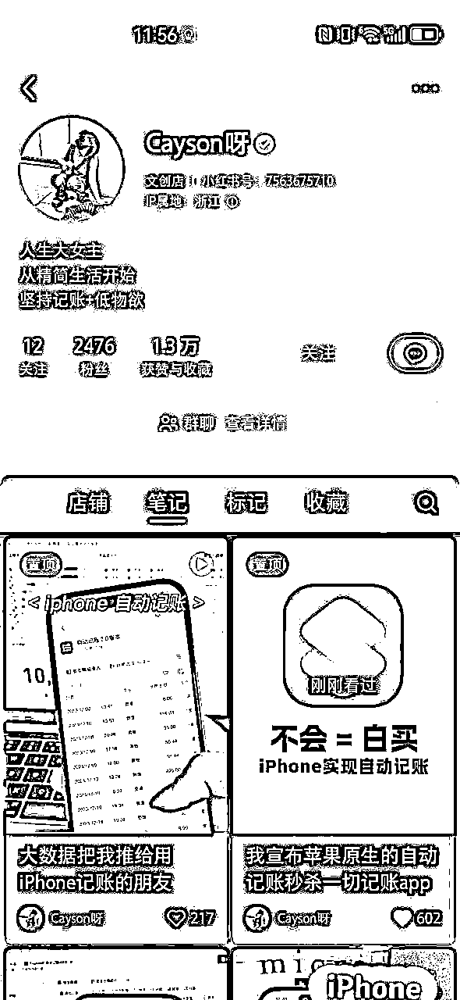

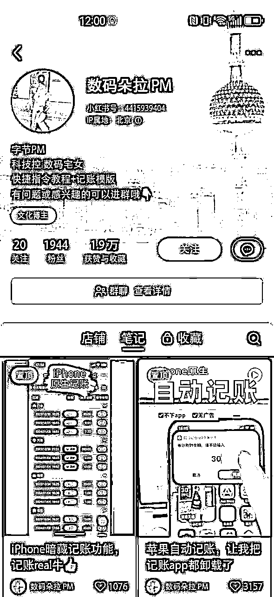

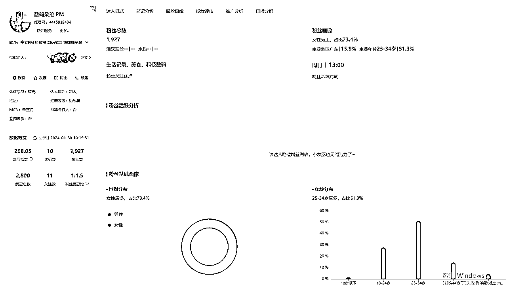

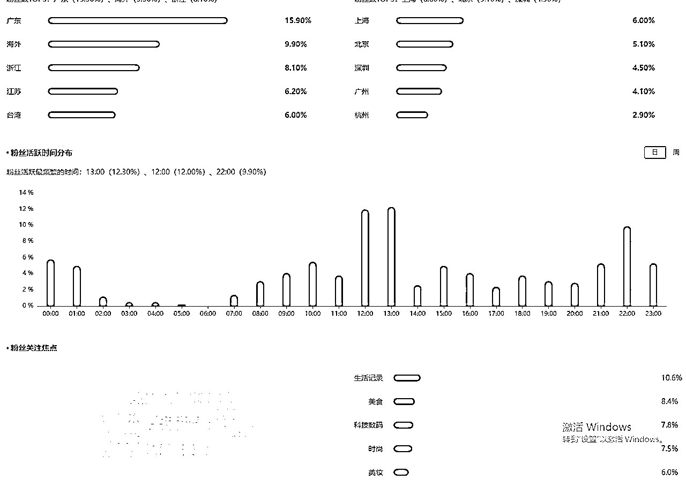

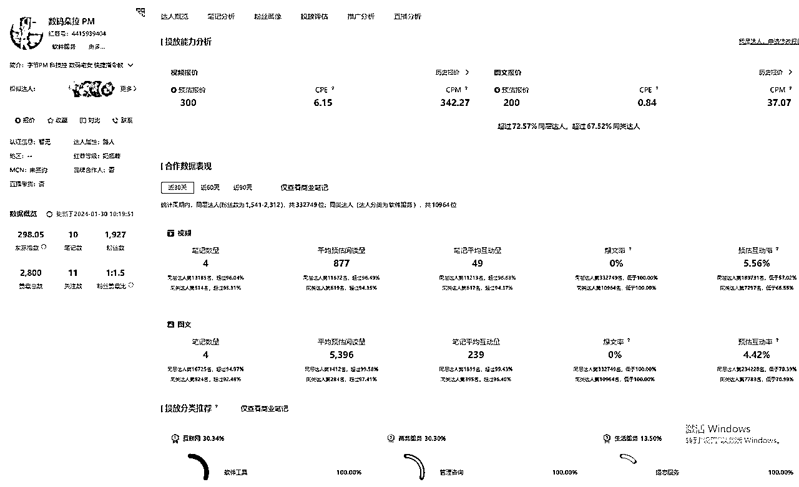

## 1.流量怎么来的

第一步：先搞清流量来源。

分两类：自然流量与付费流量。

自然流量：图文笔记和视频笔记的非投放曝光

付费流量：目前对标号并未看出有投放痕迹

结论：纯靠自然分发

## 2.货怎么搞到

#### 1.直接拿现成套装

在📕/淘宝搜成品，价格 6.9-29.9 元不等，带售后。自己有一台 iPhone，就按商家给的模板和教程先体验一遍，后续跟客户沟通更顺手。遇到疑难杂症也可以直接甩给上游商家处理。

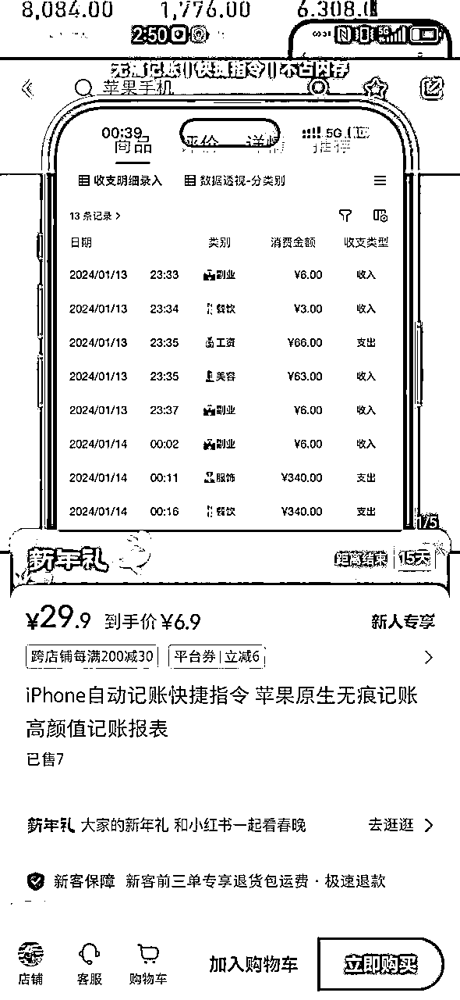

#### 2.自己搭飞书表格

B 站上有手把手教程，1 小时就能上手，顺带学会一个新技能。

iPhone 懒人记账 自动记账 零水分教程来啦

链接：https://www.bilibili.com/video/BV1pg4y1e7oZ/?spm_id_from=333.788.recommend_more_video.0&vd_source=ac6921198599369f27d54968d8acce2e

#### 3.白嫖 Numbers 账本

快捷指令链接

https://www.icloud.com/shortcuts/a31f54edcf784e26937e88139a31de6a

Numbers 账本链接：https://pan.baidu.com/s/1vBBKxDjdgDNvgeJGrHRBbw 复制这段内容打开「百度网盘APP即可获取」

提取码：9Y3Y

使用注意：

*   用不了就进快捷指令里把最后一项的 Numbers 文件重新关联
*   在辅助触控里设成点两下背部启动记账，到支付界面直接唤起即可
*   新手期交易记录先别删，积累 2、3 条后再清理

## 3.钱怎么算

1.收益拆解：

Cayson呀店铺在卖两款

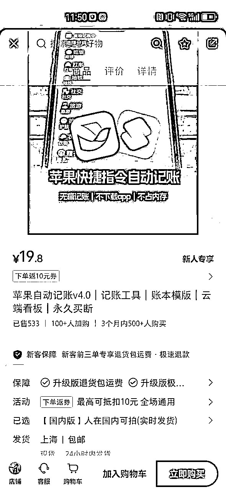

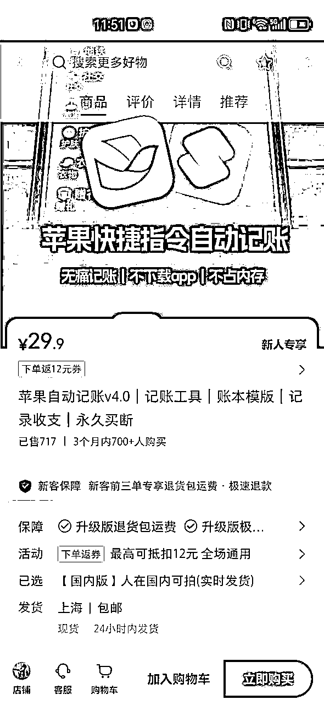

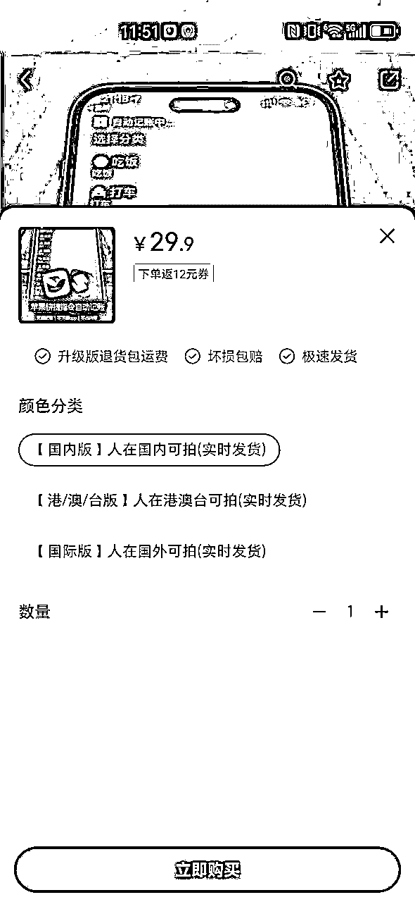

① 29.9 元 销量 717 单 29.9*717=21438.3 元

② 19.8 元 销量 533 单 19.8*533=10553.4 元

从 24 年 1 月发笔记到月底，店铺流水超 3 万

提现手续费：24219.9*5%=1600 元

自动发货成本 200--300 元，细目不详

净利润：32000-1600-300=30000 元

数码朵拉 PM 店铺在卖两款

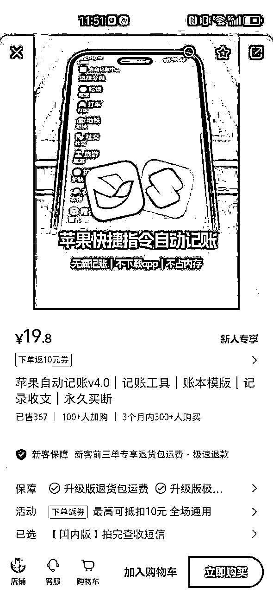

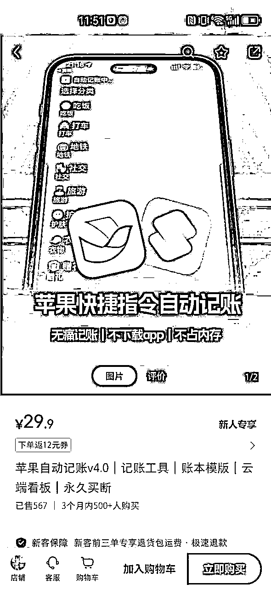

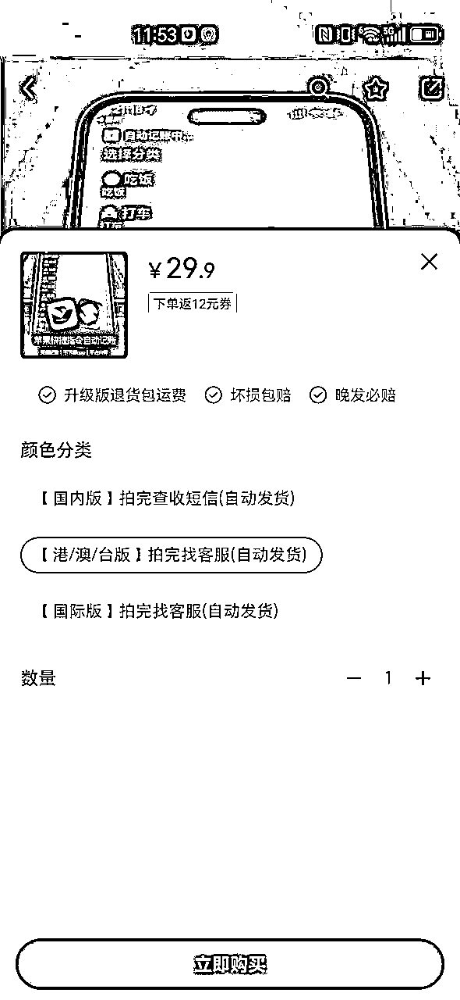

① 29.9 元 销量 567 单 29.9*567=16953.3 元

② 19.8 元 销量 367 单 19.8*367=7266.6 元

从 24 年 1 月发笔记到月底，流水同样破 3 万

提现手续费：24219.9*5%=1210.995 元

自动发货成本 200--300 元

净利润：24219-1210-300=22700 元

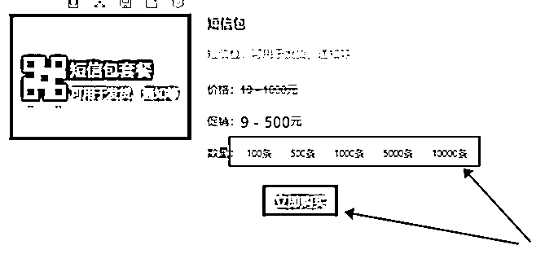

2.成本盘点

前期投入几种打法

1. 买成品：前期买指令成本+1000 元店铺保证金，销售额>1 万后平台抽 5%提现手续费
2. 自制表格：时间成本+1000 元保证金，销售额>1 万后抽 5%
3. 白嫖成品：商品零成本+1000 元保证金，销售额>1 万后抽 5%
4. 自动发货年费 9-500 元不等，按订单量选

1000 元保证金怎么退

1.  登录📕卖家后台，用卖家账号进入后台
2.  进入财务管理，点击「财务管理」
3.  申请退还保证金：找到保证金信息，点击「退还保证金」按钮填信息提交
4.  等待审核，工作日处理
5.  审核通过后打款到预留账户，到账时间视银行而定

额外要求：

*   店铺处于正常关闭状态，无违规处罚
*   无进行中的投诉纠纷，售后记录干净
*   无欠费：广告费、服务费已结清
*   退款账户信息准确无误

整体流程清晰，按要求操作就能把保证金顺利提现。如遇问题及时联系📕客服。

## 4.怎么复制与放大

### 1.实操路径

#### 一：养号

尽量做到一机一卡一号，注册全程不连 WiFi。选兴趣标签时优先选「学习」相关。

资料填写：名字、简介、头像、背景四要素

①名字:全中文，少用英文生僻字，便于检索记忆，可用「名字+赛道」如：XX考研、XX备考，增强亲近感

②简介:不做私域引流，突出优势，交代内容方向，塑造人设标签

③头像:真人头像辨识度高，也可用漫画头像，真人背影侧脸营造学姐/学霸感

④背景图:📕规格 1000*800px

可同步开通店铺挂商品

#### 二、开店

参考航海📕店铺手册：

https://search01.shengcaiyoushu.com/docx/N1lSdZs1JodBnyxSozOcWaa4n5A

个人专业号可申请个人店或个体工商店。

个人店

提供姓名、身份证号、手机号，人脸识别通过即开

*   店铺名 XXX(昵称)的店
*   保证金最低 1000 元
*   月销<1 万免技术服务费，超 1 万部分收 5%

个体工商店

需备：

一个执照可开三店，需先注册三个📕号

(1)营业执照照片、公司名、统一社会信用代码、经营地址、有效期

(2)店铺运营授权书

#### 三：认证

个人店

点击【创作中心】-【更多服务】-【开通专业号】-【我是个人】-【实名认证】-选身份证填资料即可

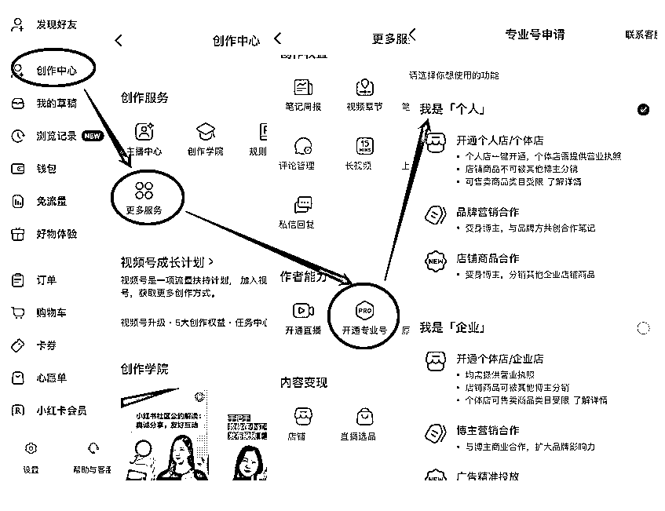

个体工商店：先选经营类目，按提示上传资料

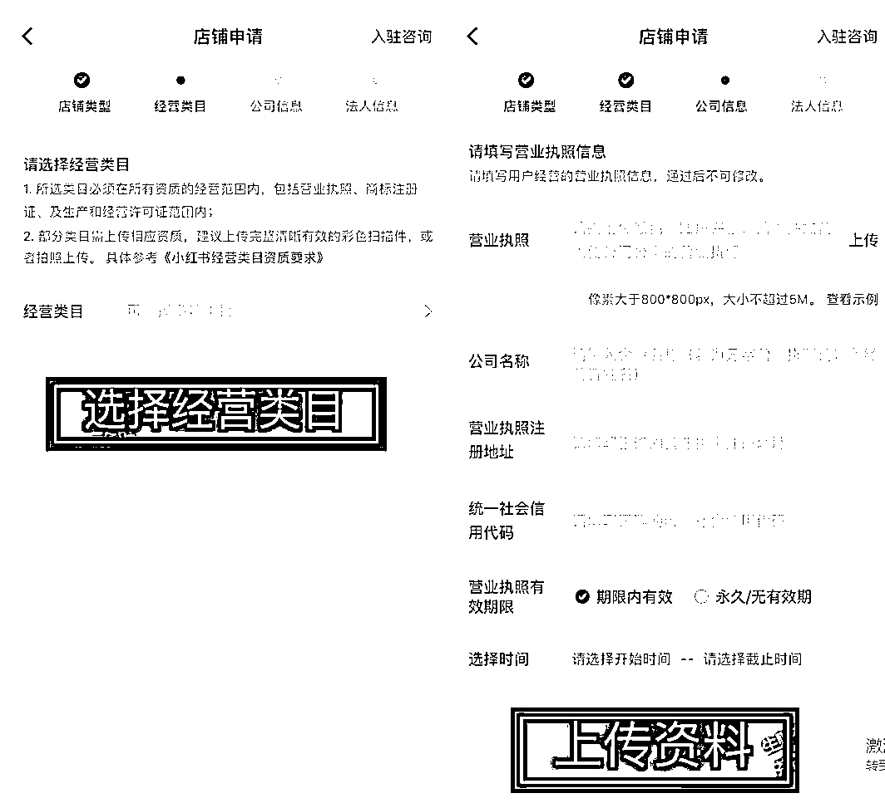

#### 四：上架

手机装【📕商家版】，登录商家管理后台

上架流程：【发布商品】→【编辑商品】→【填写信息】→【提交审核】→【审核通过】→【上架】

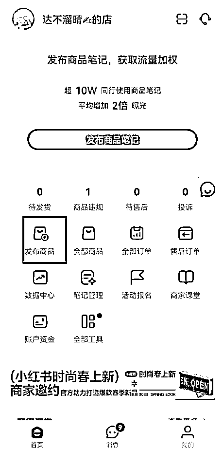

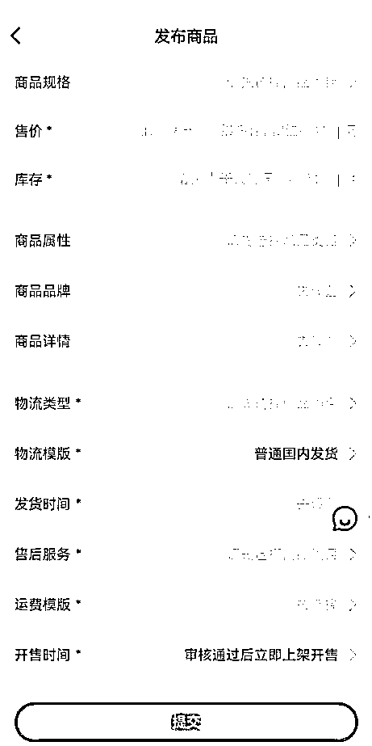

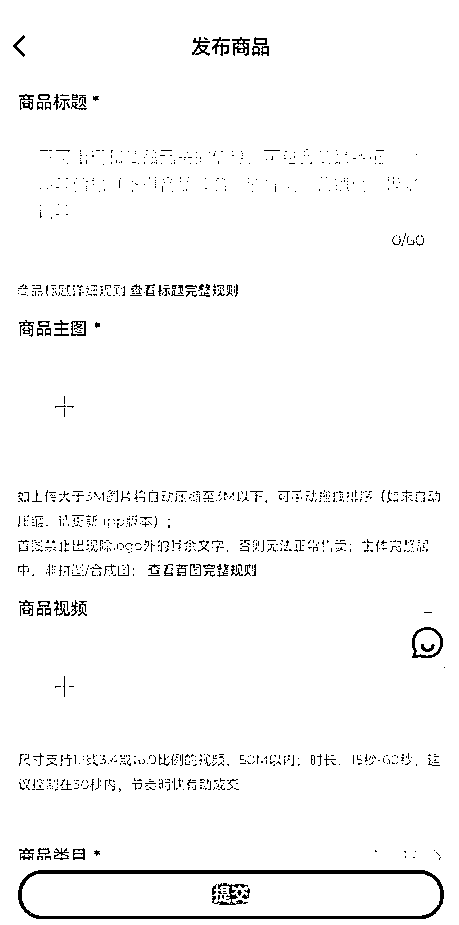

注意事项：

A.类目选电子数码

B.标题按平台规则写，不带品牌名、诱导词、极限词

C.短标题=产品名

D.价格库存可随意填，虚拟商品无所谓

E.首次发布前先建物流模板：商家后台-交易-物流工具-物流模板-创建模板，虚拟产品统一包邮

##### 1.发笔记

怎么找对标

搜领域关键词，例如「iPhone 自动记账」，看主页筛选可复制的爆款

笔记形态：图文+视频

###### a.图文

工具：PS、搞定设计、美图秀秀

<h7>① 图片尺寸：1080×1350 像素</h7>

像素级复刻对标爆款

<h7>② 标题：</h7> <h7>直接复用近3个月爆款标题</h7>

③ 正文：

多抓几篇爆款混合改写

<h7>④ 话题：</h7>

直接搬运对标标签，如：#日常生活里的快乐瞬间##-人一个iPhone使用技巧##记账##记账app

###### b.视频

工具：剪映、PR

① 比例：3:4 或 9:16

像素级模仿对标

<h7>② 标题：</h7>

近3个月爆款标题复用

③ 正文：以视频为主，文字少量，参考对标

<h7>④ 话题：</h7>

同图文，复用对标标签

##### 2.自动发货

步骤一：下单服务

📕自动发货：https://aldsxhs.agiso.com/

步骤二：设置商品

后台-商品管理-付款后发货-前往设置-商品单独设置：出售中-选商品-设置-选无卡类型-附言填发送内容-确定

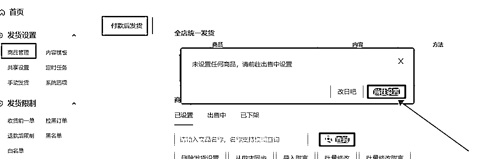

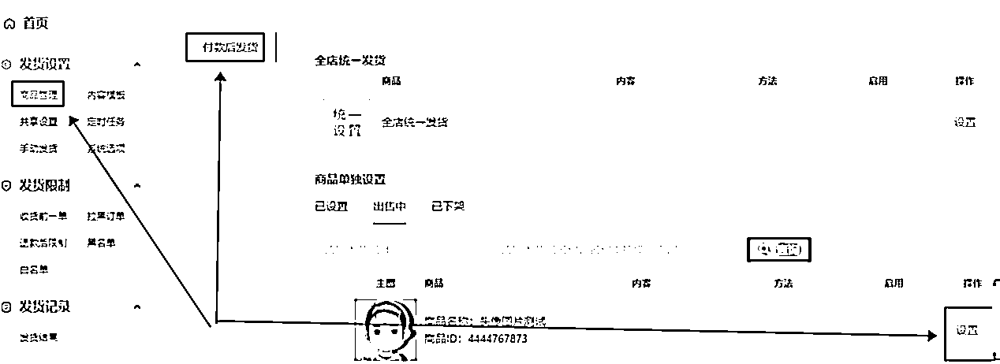

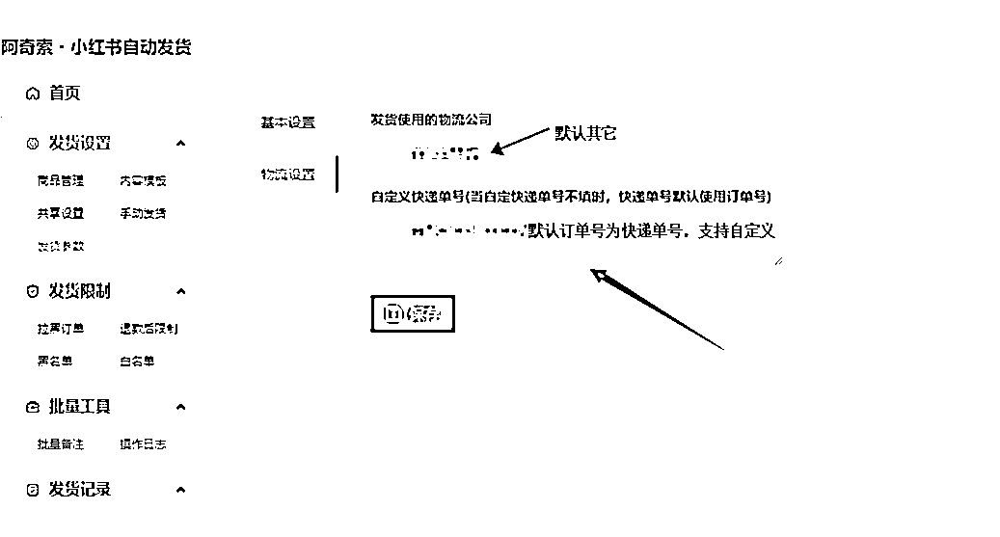

步骤三：绑定 91 卡券仓库

自动发货页-91 卡券仓库-卡券管理-前往绑定-登录/注册 91 账号-授权-账号出现即绑定成功

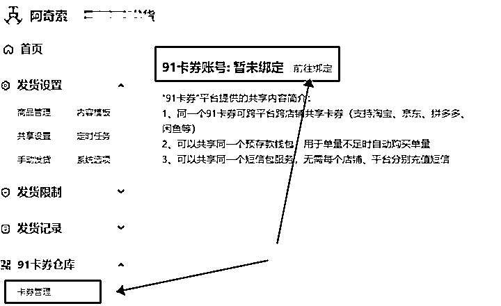

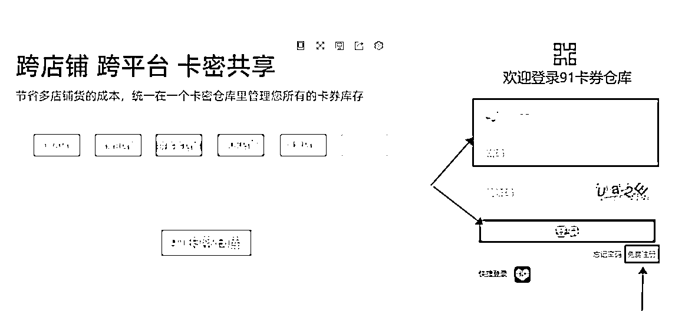

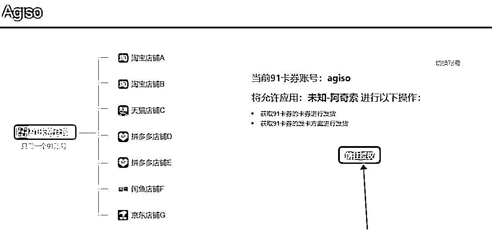

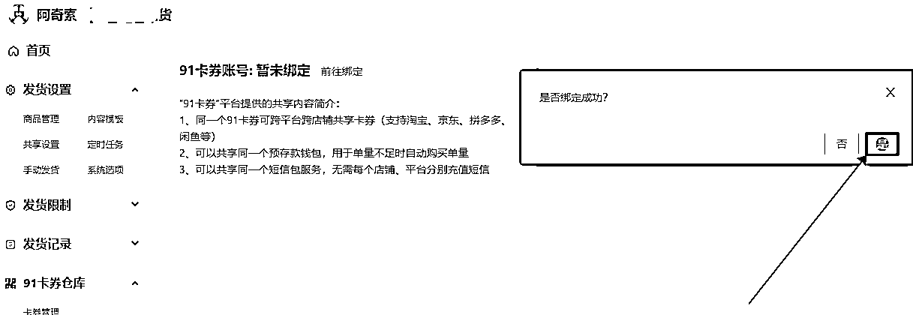

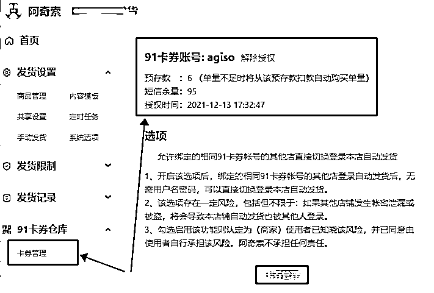

步骤四：短信发送

仅支持短信或自提页，短信需勾选并绑定 91

自动发货页-发货设置-商品管理-付款后发货-点短信问号-短信充值-跳转 91 卡券-资产-钱包-短信数量-购买

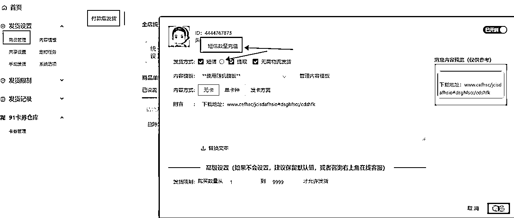

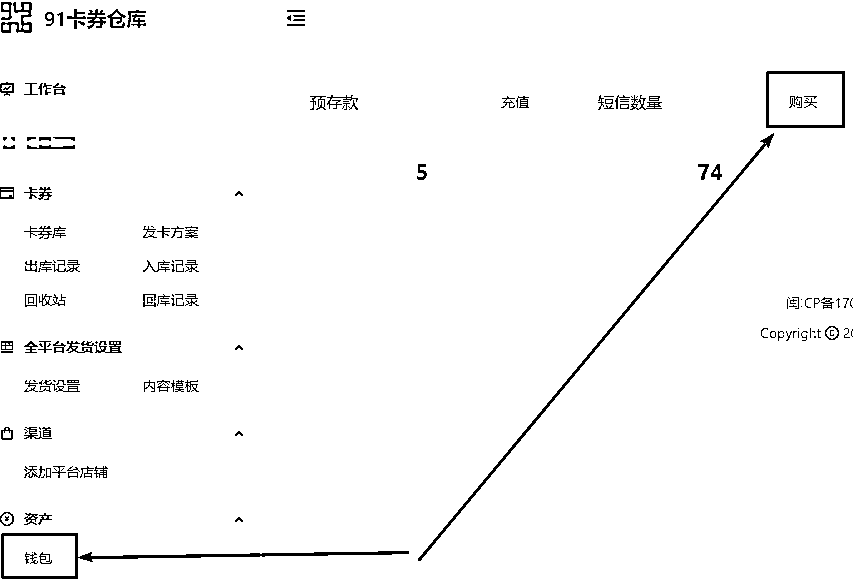

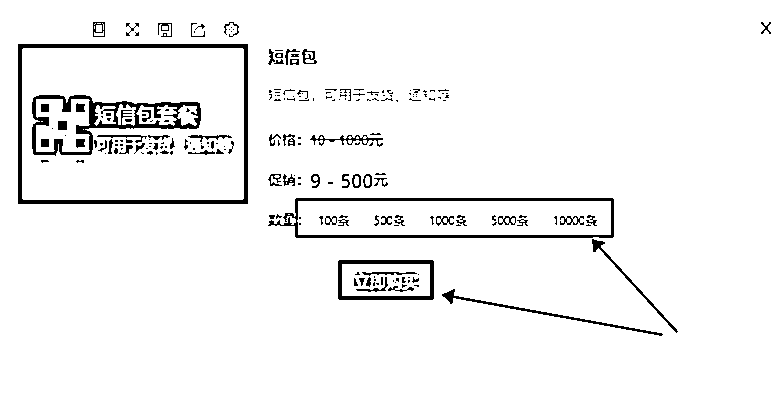

* * *

抖音视频观看

复制到抖音打开查看设置步骤：

5.84 09/04 SYZ:/ p@d.NJ 📕自动发货 无卡密篇 # 📕 # 电商运营 # 教程 # 卡密 # 自动发货 https://v.douyin.com/iLwKBFkx/ 复制此链接，打开Dou音搜索，直接观看视频！

##### 3.挂链

1.账号先完成实名认证
2.笔记编辑页点「标签」功能，输入商品链接并保存。用户点击即可跳转购买

#### 五、尺寸规范

图片规格

头像 400*400px 1:1

背景图 1000*800px

封面竖版 1280*1706px 3:4

封面横版 2560*1440px 9:16

配图竖版 900*1200px 3:4

配图方图 1080*1080px 1:1

常用比例 1:1、3:4、4:3，观感最好的是 3:4

做📕账号，细节往往决定流量。很多人在配图和评论区上吃了亏，今天就把这些实操要点一次性讲清楚，帮你少走弯路。

先说配图。📕图片常用的比例是3:4，对应的分辨率有720×960、768×1024、960×1280、1080×1440几档，分辨率越高，画面越细腻。另外，笔记封面图的尺寸决定了整篇笔记的展示比例，如果后面的图片和封面尺寸不一致，系统会自动裁切，或者补上黑白背景来强行统一。所以最省事的做法就是所有图片都用同一个比例，整体观感会干净很多。

关于配图，还有两个小建议：第一，封面风格尽量保持稳定，别今天一种风明天一种风，同时封面要能明确传达主题；第二，一篇笔记最多放9张图。如果你的图片尺寸不在上面列出的那些规格里，其实也能正常发布，只是可能无法完整展示。想要不裁切，上传时点一下“调整背景”，让系统自动扩展背景就行了。

说完配图，再看评论区怎么玩。

引导关注：这边建议放上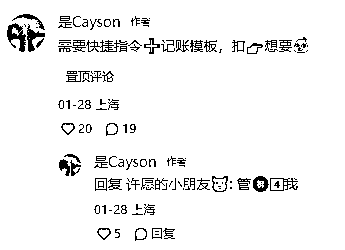，把关注动作自然地带出来。

引导入群：可以参考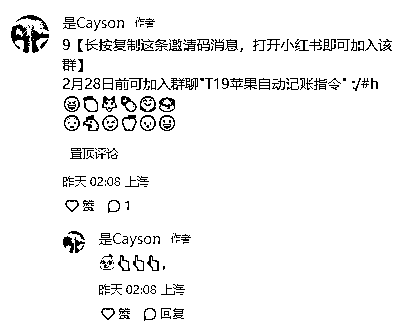和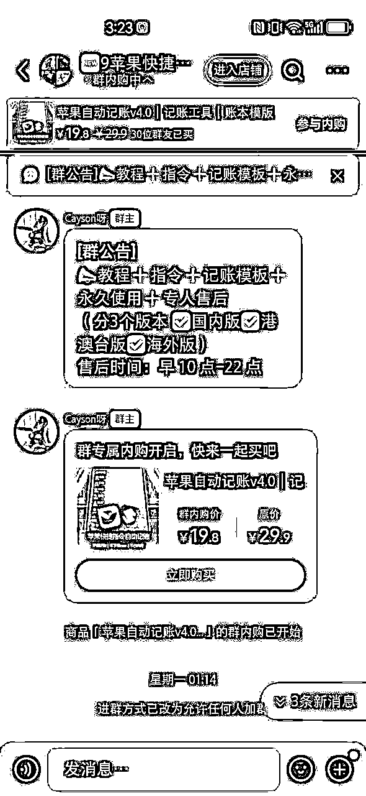的套路，用小号给大号评论，再把入群方式置顶。

接下来是建群的具体操作，这里有两种路径，对应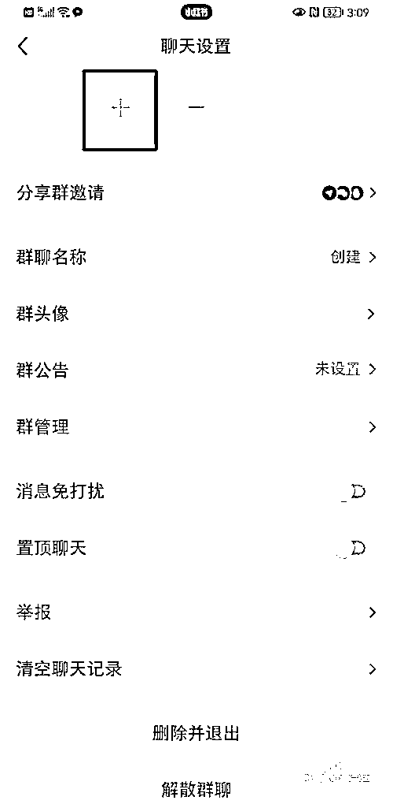这几个关键点。

先说直接建群：打开📕，点底部“消息”，进右上角“创建聊天”，再选“创建群聊”，输入群名称后点“立即创建”就搞定了。

再说转移建群：如果你的账号没有“创建群聊”的选项，可以找一个能建群的账号（朋友或小号都行），按上面的方法建好至少5个群，然后把每个群的“群邀请码”发给自己。你通过这些邀请码进群后，打开“群管理”把自己设为管理员，最后在群里点“删除并退出”，群聊就转移到你名下了。另外记得把群设置成“个人主页展示”，这样别人才能看到你的群并申请加入。

笔记挂商品链接也有门槛：账号得做过实名认证，年龄满18岁，粉丝超过1000，而且账号状态正常、没有违规记录。如果你想卖货，还得申请入驻📕社交电商平台，平台只接受正规企业，个人或个体户不行。同时要提供实体店或线上店铺的证明，确保商品质量和售后服务到位。

再聊聊项目怎么放大。第一招是矩阵操作：多准备几个小号，在评论区@大号，把流量导到主号店铺里成交。第二招是开直播：在直播间演示记账过程，直接把商品链接挂上，观众看着感兴趣就能下单。

最后说结论：这个项目成本很低，笔记制作不费劲，竞争也不算激烈，而且有利润空间，值得尝试。