# 用外国脸吸睛的数字人带货玩法拆解
作者：龙哥

# 数字人带货到底是什么？

核心逻辑是借用海外面孔来输出情绪价值，从而完成内容引流与变现。内容调性主要聚焦在爱国情绪和情感共鸣两条线。

适用形象非常宽泛，俄罗斯、乌克兰、日本、美国等都能用。利用的就是“外国月亮更圆”的心理落差。

变现方式双轨并行：既能挂车带货，也能靠视频评论区广告分成吃收益。

下面以视频号的红利期为例来说明。

这个账号在视频号累计发了134条内容，一个月带货销量就破了1万单。

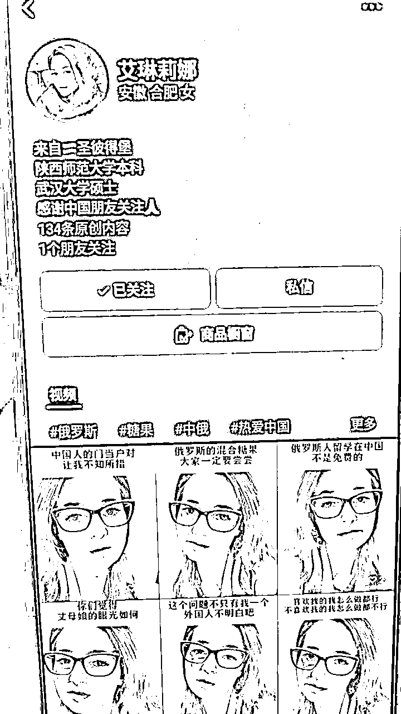

我拿自己的测试号来说，发布27条视频，其中3条是带货不挂车、没有做过直播，产生的GMV也有500元左右。

广告分成收入36元，单条3万播放赚了17元，单条10万播放赚了19元。

粉丝增长8000+。

可见不管是走带货路线，还是走广告分成路线，都能有效产生收益。

为什么22号之后我就停更了？说白了就是我懒了。

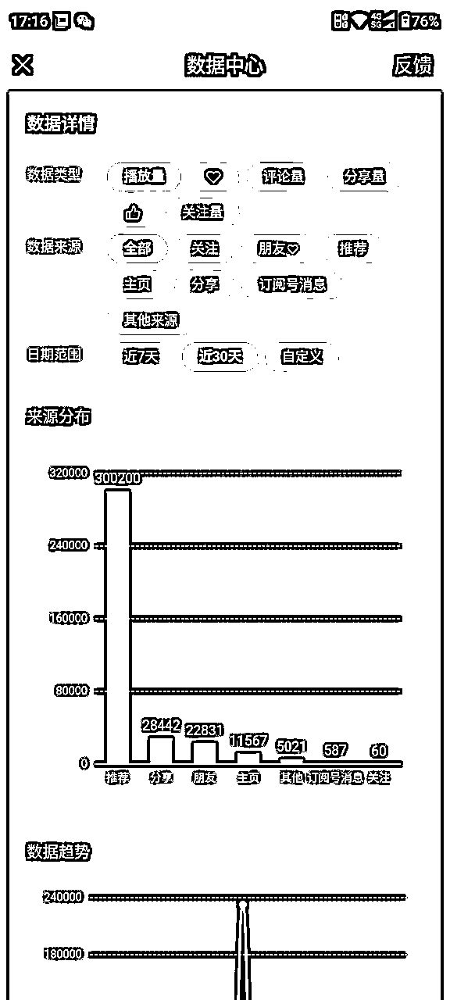

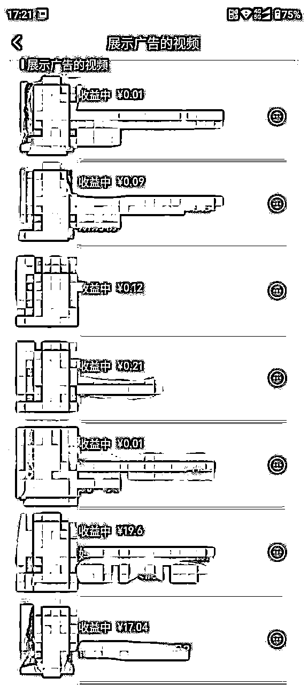

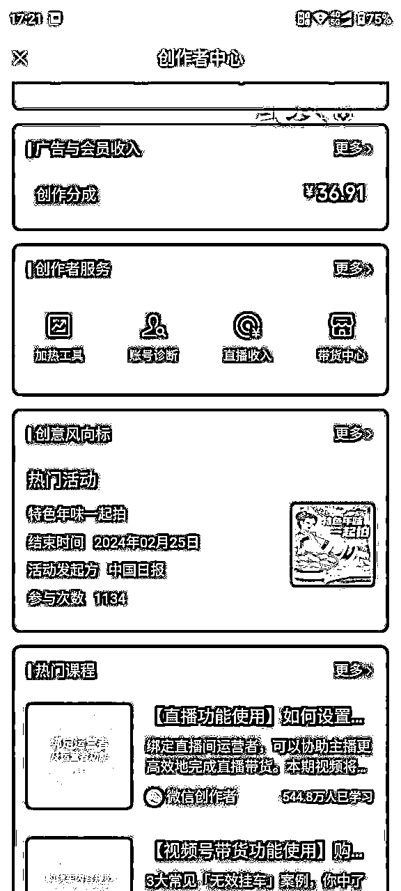

# 文案怎么来？根本不需要原创

我们做的不是创作，是情绪价值的搬运和加工。

直接拿爆款改写即可，用ChatGPT润色也行，一条口播文案十句以内完全够用。

## 1.去哪里找爆款文案

https://trendinsight.oceanengine.com/arithmetic-index?type=2

用巨量百应搜关键词，重点找低粉高赞的爆款。

把视频链接丢到电脑端的轻抖小程序，把文案复制下来。

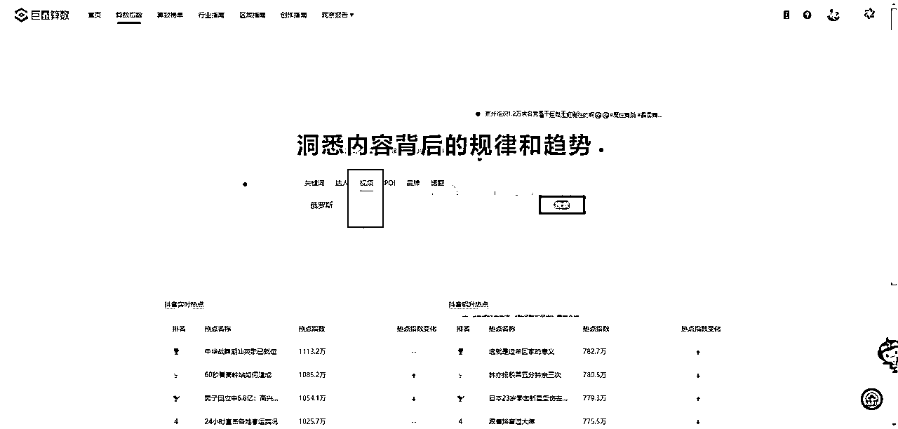

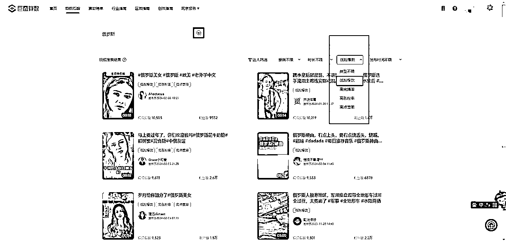

10万+点赞的经典案例：

收复台湾 我一定捐款

打美国 我捐款

打日本 我拿出全部家产捐款

我爱中国 中国万岁

彩礼？要什么彩礼？

俄罗斯男孩子都被拉去打仗了，

剩下一群姑娘倒贴都找不到男朋友。

中国男孩子要是愿意娶我，

那真是上辈子烧高香了，

我的五个闺密也都是这样想的，

中国的小伙子们，你们真的愿意娶俄罗斯媳妇吗？让我看到你们的评论好吗？

## 2.用ChatGPT改写

参考圈内精华帖里的思路，或者直接微调。

注意前三句尽量保持原样，这三句决定完播和钩子。

# 口播视频怎么生产？以Heygen为例

## 注册账号

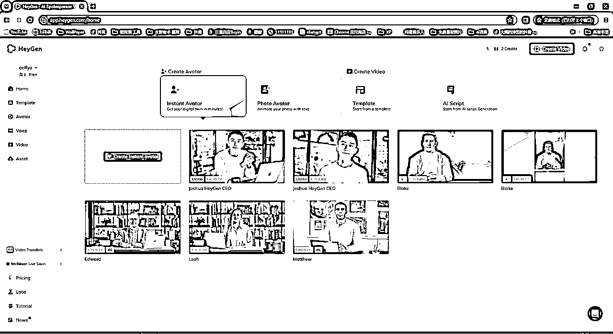

## 免费获取积分

点右上角的礼物图标拿邀请链接，用小号循环邀请能刷到3积分。

市面上也有自动化刷分的工具，本质都一样，只是省力。

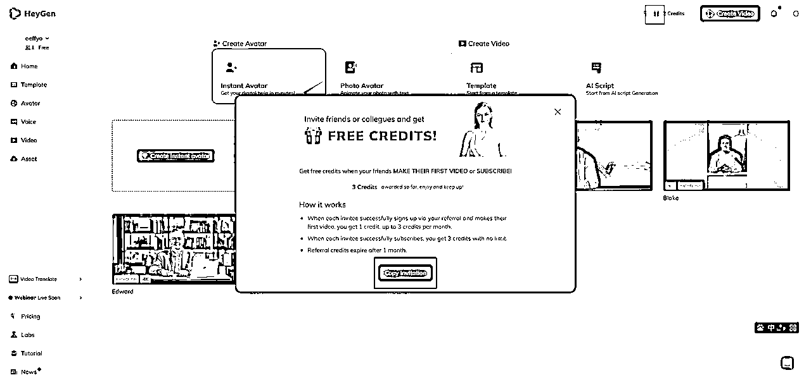

## 定制自己的数字人

目的有两个，去重和提升亲和力。

最好自己去TikTok、YouTube找一段冷门、很少人用的素材，这样剪辑也更省事。

2月1号，Heygen因为一个乌克兰小姐姐投诉，关闭了免费定制入口。

所有沿用这个脸的账号都被批量封禁。

真的服了，有人把这个小姐姐的视频搬运到油管，害了一堆人。

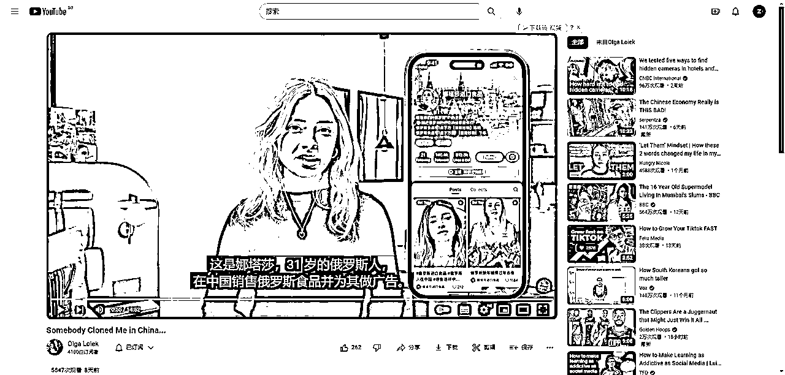

1.准备一段约2分钟的正面固定机位视频，画面稳定最好是口播演讲，面部不能被遮挡，时长不够可以循环拼接。不能用明星脸。

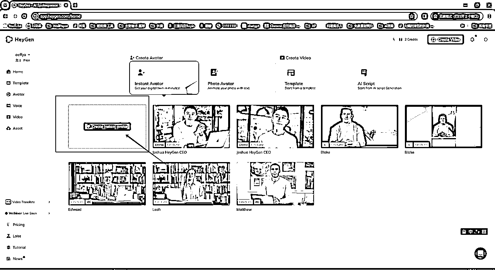

现在定制要收费了，淘宝上能买到Heygen充值号，100元左右买到15分钟时长。

也可以直接用官方自带的数字人模板。

### 1.拿到真人授权

我是自己照着保证词念一遍，用Rope做换脸，也能用D-ID生成授权视频。

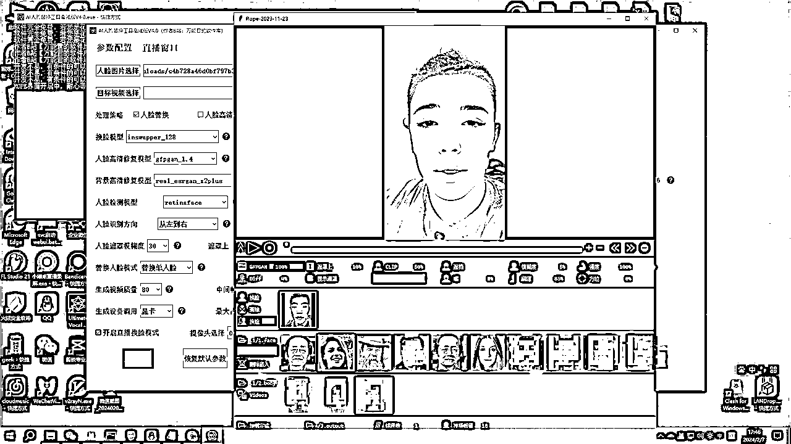

### 2.制作定制数字人视频

审核通过后就可以开始制作，数字人会自动克隆原视频的声音，你只需要输入文字脚本就能出片。

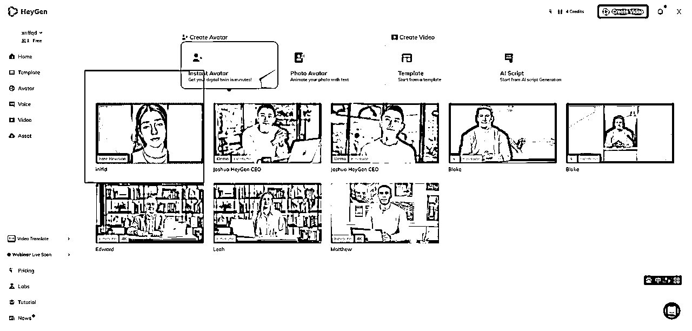

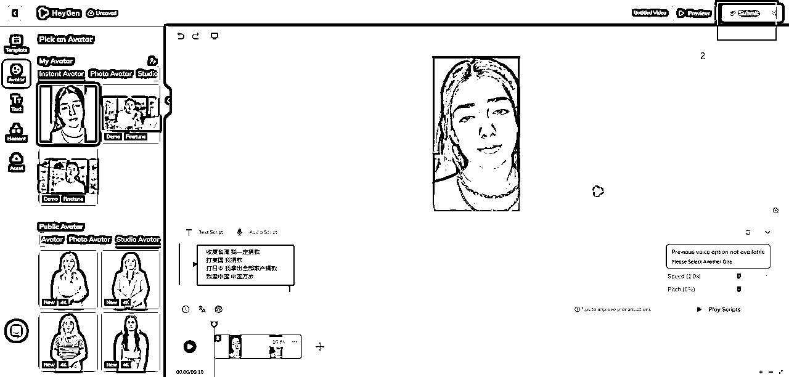

# 用Wav2Lip做口播，Heygen的平替方案

流程更繁琐且吃显卡，不太推荐新手折腾。

1.安装Stable Diffusion
2.安装Wav2Lip插件
3.用GPT-SoVITS生成带外国口音的配音
4.用Wav2Lip合成口型视频

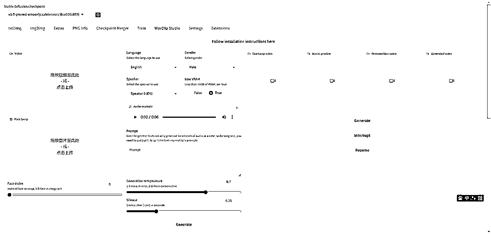

# 视频号的人脸实名验证怎么过

把Heygen的制作界面和剪映的剪辑界面截图上传即可通过。

就算有提示也没关系，目标用户基本是中老年人，看不懂也无所谓。

# 另一种不用真人出镜的做法

如果你连数字人都不想做，这里额外送一个玩法。

这个账号纯靠剪辑日本街景画面，讲述日本工作和生活的差异。

人设是生活在日本的中国人，用内容引流、直播间带货。

部分视频已经被限流，感兴趣可以自己去看。

这个模式可以复用到美国、俄罗斯、伊拉克等任何国家，建立人设后即可变现。

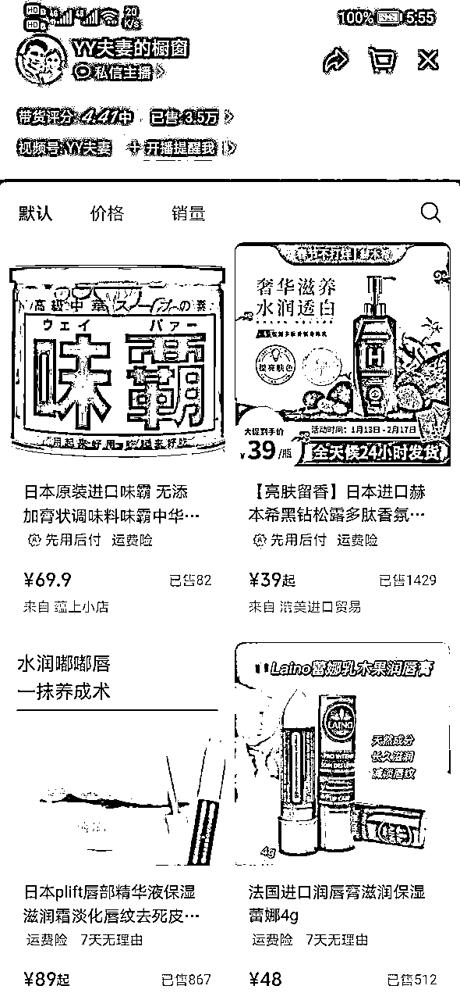

# 总结

数字人带货的本质是利用海外视频的版权盲区，合成口型，塑造一个俄罗斯单身美女的人设。

通过Heygen等工具生产内容，精准吸引中国单身中年群体和对数字人认知不足的中老年用户。

变现方式包括带国外商品、参与广告分成计划、收徒教学。

资源多的还能对接真实的外籍女性，后台全是带着结婚需求的粉丝。

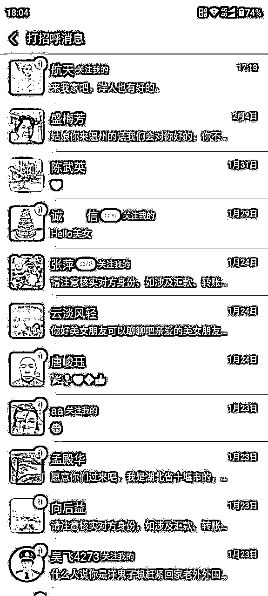