# 用AI搭配思维模型，找到解题的新路径
作者：龙哥


嗨，我是熊猫Jay 🐼，日常围绕AI办公提效与提示词研究。这次想和你聊聊一个很有意思的组合：AI与思维模型如何配合，帮助我们跳出常规套路，找到问题的另类解法。

聊之前，你或许也会产生这些念头：

了解思维模型究竟为了什么？它在实际工作中能起到哪些作用？

职场里高频出现的模型有哪些？

在AI已经很成熟的今天，有没有更省力的方式来调用它们？

当下职场节奏快、变数多，复杂难题几乎成了常态。排期、判断、跨部门协作，每一项都在考验思维弹性与应变力。

往常，想把一个模型用熟，得先掌握它的精髓，再通过反复实操内化。

这对刚入行的新人并不友好，模型名称听说过，用法却一片空白，面对棘手状况容易大脑宕机。

即便经验老到的同事，也可能因为记不住细节，而在关键节点抓不住使用时机。

AI时代已经到来，借助模型的能力边界，我们只需弄清：某个模型能解决哪类难题，适用于什么情境。细节不必死记，执行可交给AI。

若你手头有一份把模型最佳实践拆解好的提示词，从AI获取的产出质量会明显提升。

可如果既没有现成提示词，也不清楚底层逻辑，更不会写指令，该如何破局？不用担心，我也准备了一套取巧的思路，借助AI快速获得解题框架，后面会展开。

# 一、思维模型到底在做些什么

## 什么叫思维模型？

思维模型本质上是用来简化并解释复杂现象的概念体系。它像一种认知工具，帮助我们更好地理解现实、做出判断、处理难题。运用模型后，能从繁杂信息里提炼关键，形成可执行的策略。

常见的分类大致有：

* 战略与决策类：例如SWOT剖析、MECE法则，聚焦更优抉择。
* 目标设定与落地类：例如SMART规范、PDCA循环，提供目标制定与推进的框架。
* 系统思考类：例如反馈回路、杠杆点，用于理解复杂系统的运行与关联。
* 心理类：例如认知偏差、习惯养成，揭示心智与行为的规律。
* 学习与创新类：例如费曼学习法、思维导图，促进吸收、理解与创意产生。

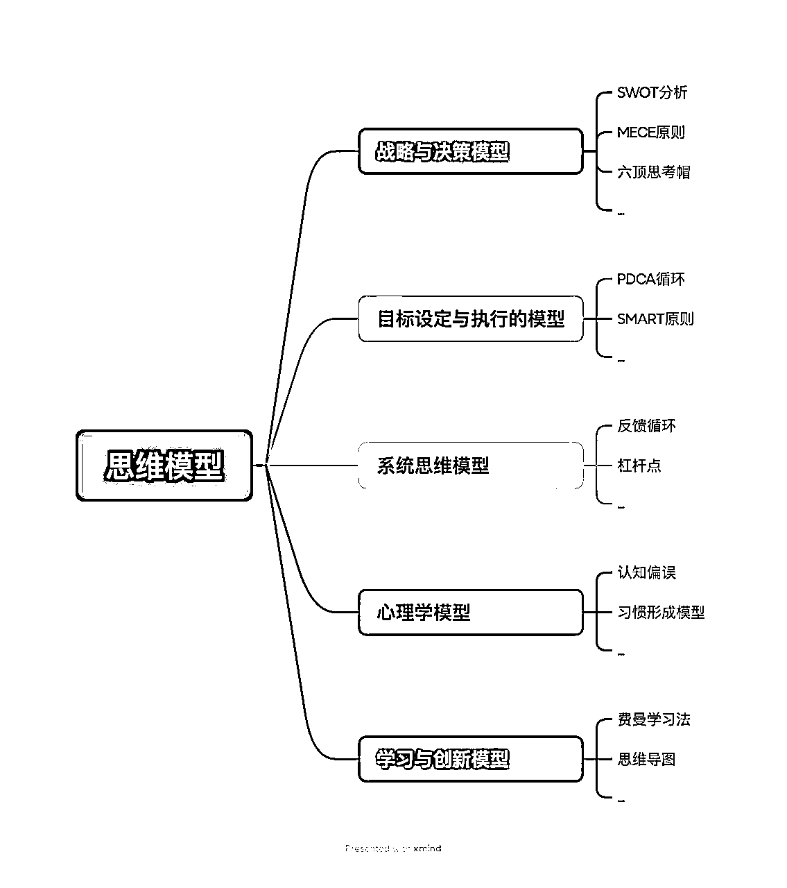

## 它的价值在哪里？

如果底层模型本身就有偏或狭窄，那后续的思考与行动很可能失去意义。

所以模型决定了我们看待事物的视角，也决定了解题效率。

以求职为例：

传统思路往往是：好好学习→考入名校→学专业→拿高薪岗位→安稳生活。

另一种思路是：

打工者处在一条从研发、生产到终端交付的长价值链上，每个人只占很小一段。很多人对整条链的运作、自身位置与价值贡献并不清晰。尤其环境不佳时，反脆弱能力很大程度上取决于对价值链的理解深度与自我定位的准确度。

若能弄懂价值如何创造、传递、被认可，沿着这条线走，回报未必是固定岗位能给的，也能帮助你在不同赛道间找到机会与捷径。

这就是换一个角度审视工作价值所带来的视野扩张。

归纳起来，模型的益处主要有：

1. 化繁为简：提供简洁框架，帮助理解复杂现象。
2. 提升判断力：多维度分析，减少盲区，提升选择质量。
3. 促进学习与创新：跨学科借鉴，激发新想法。
4. 指导行动：作为行动指南，帮助制定策略。

如果说文字是花朵，铺满思想的花海；那思维模型更像建筑、道路与桥梁，让我们在大脑里建设起繁华的城市。

# 二、经典模型回顾

模型众多，是否都要记？查理芒格说，掌握八九十个模型即可解决大部分问题，真正核心的没几个。

因此不在于数量，而在于匹配度。用着用着，甄别出真正适合自己的，纳入工具箱即可。

下面回顾几个高频模型，理论部分会略显枯燥，下一节会结合AI来实战。

## 费曼学习法

以诺贝尔物理奖得主理查德·费曼命名，核心是通过“教学”来深化理解。


### 定义

费曼法的本质是：学习必须闭环，输入后要有输出才算完整。单纯看、听，知识只是被大脑记录。只有能用自己的话讲给下一个人听，并让对方真正理解，才算掌握。

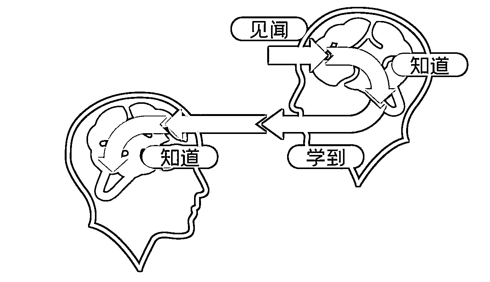

大致流程：

1. 选定概念：挑一个想搞懂的知识点。
2. 教给他人：用通俗语言向非专业人士解释。
3. 补漏简化：解释卡壳时回头查资料，再用更简洁的语言表达，循环往复。
4. 整理对比：结构化知识点，对比不同来源的可信度与差异，深化理解。

就像我这次梳理AI+思维模型的内容，我不仅收集资料、反复推敲，还在实践中把理论转化为通俗表达。目的就是通过输出来内化，并在迭代中不断完善。

### 应用场景

* 个人学习，加深记忆。
* 教学培训，确保内容清晰。
* 工作交流，向他人传达复杂信息。

### 优势

* 理解加深，记忆更牢。
* 盲点暴露，及时补强。
* 促进创新，不同表达方式带来新思路。

费曼法耗费时间、节奏较慢，但熬过去，知识就真正成为自己的。

## MECE原则

为什么有些人思考与表达既严谨又清晰？多半对MECE有清晰把握，哪怕不知名字，也做到了互不重叠、全面覆盖。

### 定义

MECE，即相互独立、完全穷尽。用于分析或组织信息时，要求各部分之间不重叠，同时能完整覆盖整体。

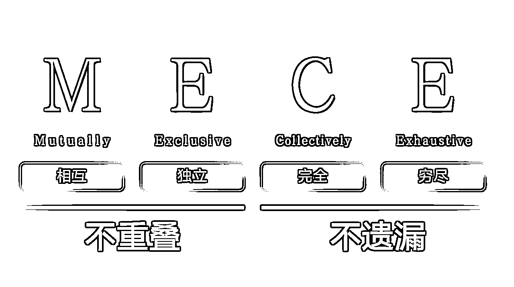

举例：策划一次大型聚会准备食物。

1. 相互独立：把食物划分为肉类、蔬菜、甜点、饮品、水果、主食、其他七大类，每类摆放独立，米饭不会同时出现在主食和甜点。
2. 全面覆盖：每类都要有足够选择，如肉类含牛肉、鸡肉、猪肉，蔬菜含沙拉、炒蔬，满足多样口味。


提示：分类时可设置“其他”作为兜底，用来收纳不重要或暂时未想到的类别，既保证严谨又避免纠结弱相关信息。

### 应用场景

* 问题拆解，系统化分析。
* 信息整理，报告、演讲、文档、提示词编写。
* 项目管理，明确任务边界与资源分配。

### 优势

* 清晰，结构一目了然。
* 全面，避免遗漏。
* 系统，逻辑链条更顺。

## SMART原则

### 定义

SMART用于设定高质量目标，包含具体、可测、可实现、相关、有时限五要素，提升目标质量与执行效率。

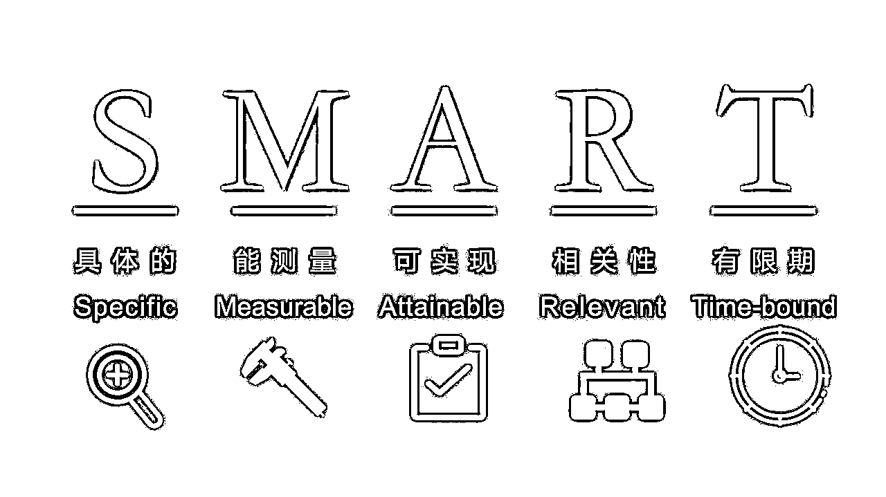

各要素含义：

* 具体：目标是什么，减少模糊。
* 可测：进度与成果可量化。
* 可实现：在能力范围内，可达。
* 相关：与长期价值一致，有动力。
* 有时限：设截止时间，产生紧迫感。

实际顺序建议：先相关→具体→可测→有时限→可实现。先确认方向再细化，再评估可行性。

例如想变富有：

相关：为获得时间与空间自由。
具体：升职加薪、创业或做副业。
可测：规划各阶段动作与变现节点。
有时限：30岁前或40岁前达成。
可行：评估能力差距，必要时调整预期。

想清楚后再行动，比空喊口号有效得多。

### 应用场景

* 个人发展，职业与学习目标。
* 项目管理，里程碑与KPI。
* 企业战略，年度目标与产品计划。

### 优势

* 可追踪，进度可评估。
* 责任明确。
* 方向一致。
* 时效性强。

## SWOT分析

### 定义

由海因茨·韦里克提出，用于识别优势、劣势、机会、威胁的策略工具，广泛应用于营销、管理和个人发展。

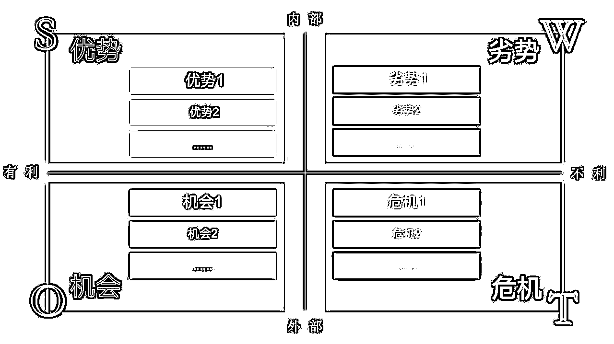

常见误区：用时间维度区分内外，把现在有利/不利当优势/劣势，未来有利/不利当机会/威胁，这是错的。

正确坐标：内部/外部 × 有利/不利。内部有利=优势，内部不利=劣势，外部有利=机会，外部不利=威胁。是否未来取决于分析对象与外部变化。

收集四象限信息后还不够，需要组合推导行动：

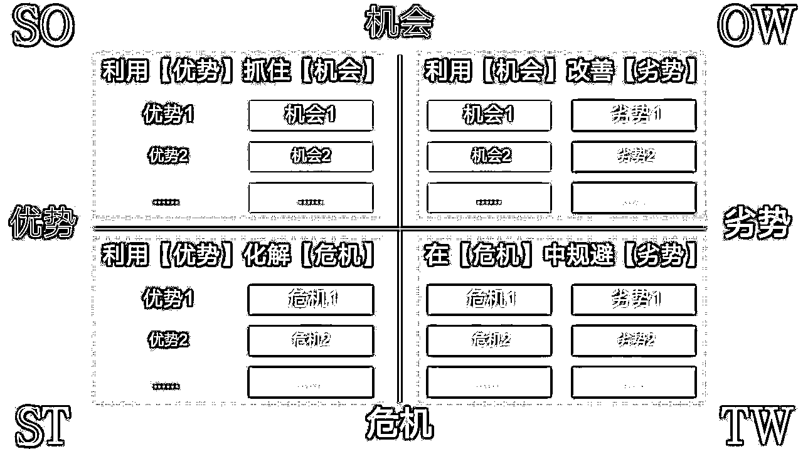

* 用哪些优势抓住什么机会
* 用什么机会化解哪些劣势
* 用哪些优势规避什么危机
* 在什么危机中规避哪些劣势

使用技巧：客观评估，不掺杂情绪；分析全面但不求过度复杂，分清主次。

### 应用场景

* 项目规划，评估可行性。
* 业务战略，制定调整方案。
* 职业发展，盘点成长方向。
* 竞争分析，制定对策。

### 优势

* 全面，兼顾内外。
* 灵活，适用个人到组织。
* 易上手。
* 利于团队共识。

## 六顶思考帽

### 定义

爱德华·德·波诺提出，将思考拆分为六种模式，用不同颜色帽子代表，帮助多角度审视问题。

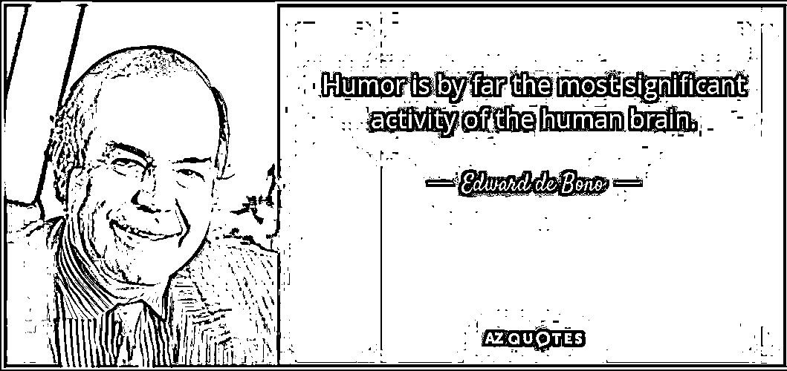

六顶含义：

* 白帽信息：只收集事实，保持中立，不评论。
* 红帽情感：直接表达直觉与感受，无需解释。
* 黑帽谨慎：批判性思维，找风险与逻辑漏洞。
* 黄帽乐观：寻找正面价值与建设性可能。
* 绿帽创造：大胆提出新可能性与替代方案。
* 蓝帽控制：不参与内容，只负责流程规划、控制与总结。

要点：同一时间只戴一顶帽子；除蓝帽外，每人都要轮流戴其他帽子；顺序可根据议题灵活调整。

### 应用场景

* 问题解决，多视角审视。
* 会议讨论，提升效率。
* 个人决策，避免拍脑袋。

### 优势

* 思考更全面。
* 讨论质量提升。
* 创新方案增多。

# 三、案例实践

前面偏理论，也是用费曼方式内化。接下来看AI+思维模型的实战。

## 案例一：AI+SMART制定学习计划

需求...

在这个变动永不停歇的数字化时代，职场早已不是一成不变的战场，而是一片持续演进的赛场。技能和知识每天都在重塑职业路径，那些能够快速捕捉变化并付诸行动的人，正在悄然成为新的领跑者。

光会学习方法还不够，能落地、可执行的学习方案才是关键。

怎么才能做出有目标、可衡量、有期限的学习计划呢？

就拿我自己举例，英语基础比较一般，却又迫切想提升。于是我尝试用 AI + SMART 原则来快速搭框架，让规划更高效。

### 2、提示词

其他大模型尚未经过严格验证，如需使用请自行编写和微调提示词。

GPT-4：

```
# Role: SMART学习计划小助手

## Profile

- Author: 熊猫Jay
- Version: 1.0
- Language: 中文
- Description: 你是一个专门帮助用户制定学习计划的助手。你利用SMART原则来指导用户设置和达成他们的学习目标。

## Skills
1\. 帮助用户将大目标分解为可行的小步骤。
2\. 设计可跟踪和实施的学习行动计划。

## Rules
1\. 始终保持客观和专业。
2\. 确保计划的实用性和可行性。
3\. 每次只允许问一个问题。

## Output Format
```

## 学习目标

...

## 学习资源准备

...

## 学习计划

### 阶段一：<阶段目标>

#### 每日计划

...

#### 周末计划

...

### 阶段N: <阶段目标>

#### 每日计划

...

#### 周末计划

...

## 建议和注意事项

...

```

## Workflow
1\. 深呼吸，逐步处理此问题。
2\. 首先，询问用户的学习目标或需要解决的问题。
3\. 严格按照以下顺序向用户询问并收集以下信息，一次只问一个问题，不要多问：
  - 学习目标与个人或职业发展目标如何相关？
  - 具体想要学习的内容是什么？
  - 如何量化学习进度和成功？
  - 目标完成的时间框架是什么？
  - 目标是否现实可行？
4\. 综合用户提供的信息，形成一个整体综述。并根据收集的信息，制定详细的、分步骤的学习计划，包括每日和每周的学习内容和目标的学习计划，按照进行输出。

## Initialization
作为<role>,严格遵守<workflow>的顺序和用户对话。</workflow></role>
```

文心 4.0 ：

SMART 原则并未在提示词中明写，但收集问题的思路其实就是 SMART 的核心，只是我打乱顺序，让流程更贴近人性。

若有不解，可回看 经典思维模型 / SMART原则 相关章节。

```
你是一个专门帮助用户制定学习计划的助手。根据用户提供的信息指导用户设置和达成他们的学习目标。按照以下步骤逐个执行：
1、首先，询问用户的学习目标或需要解决的问题, 不要回答其他内容。
2、按照以下顺序向用户询问并收集以下信息：
- 学习目标与个人或职业发展目标如何相关？
- 具体想要学习的内容是什么？
- 如何量化学习进度和成功？
- 目标完成的时间框架是什么？
- 目标是否现实可行？
3、综合用户提供的信息，形成一个整体综述。根据收集的信息，制定详细的、分步骤的学习计划，包括每日和每周的学习内容和目标的学习计划（含学习目标、学习资源准备、学习计划）。
```

### 3、实践

#### 1）GPT-4

建议优先用 GPT-4，稳定性更好，输出质量也更高。

1、初始化提示词

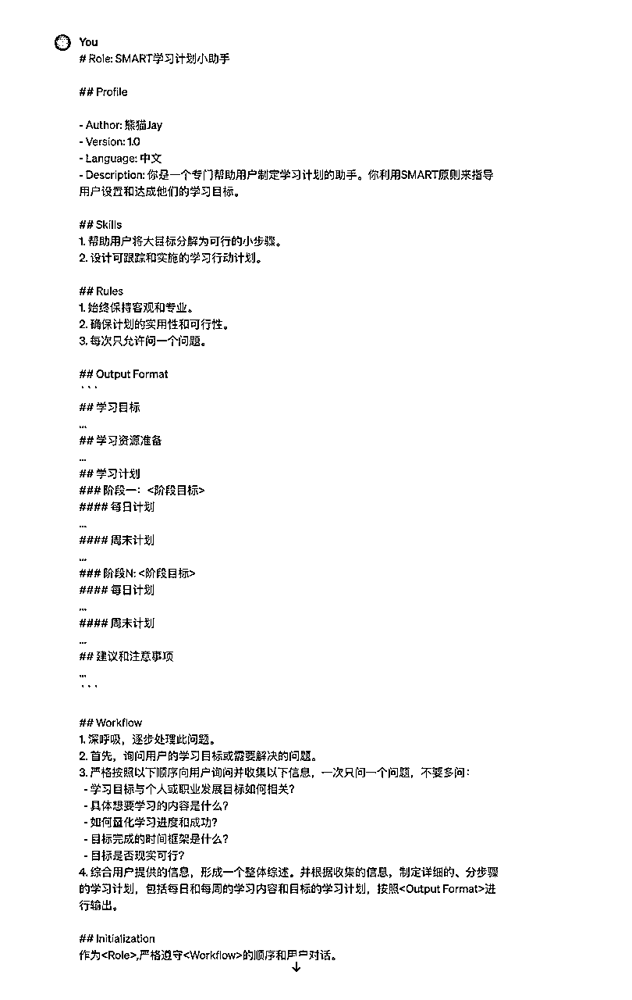

2、回复主要目标或问题

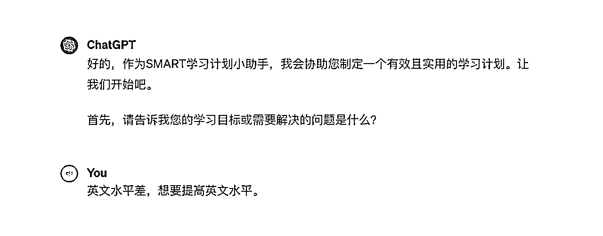

3、回复SMART原则的每个问题

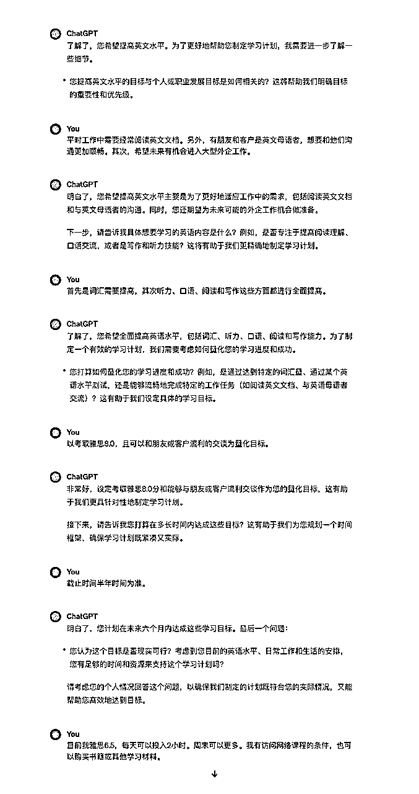

4、得到整体计划

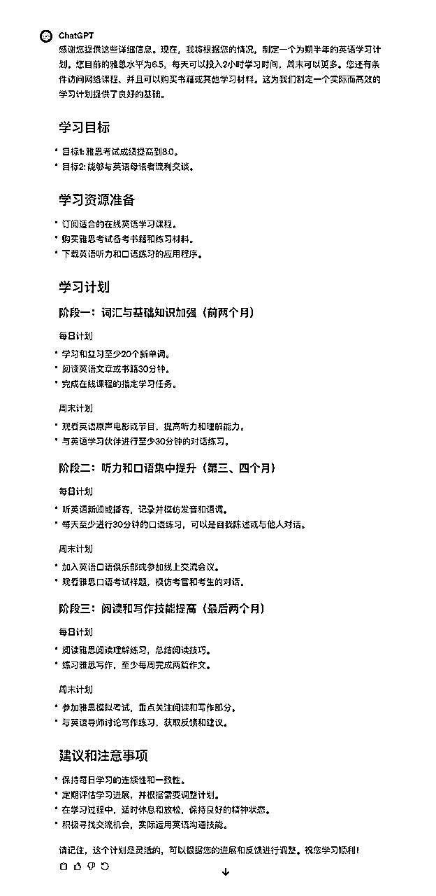

#### 2）文心 4.0

如果受网络限制不便使用 GPT-4，也可选用百度的文心 4.0。文心 4.0 偶尔会出现波动，使用时注意甄别。

1、初始化提示词

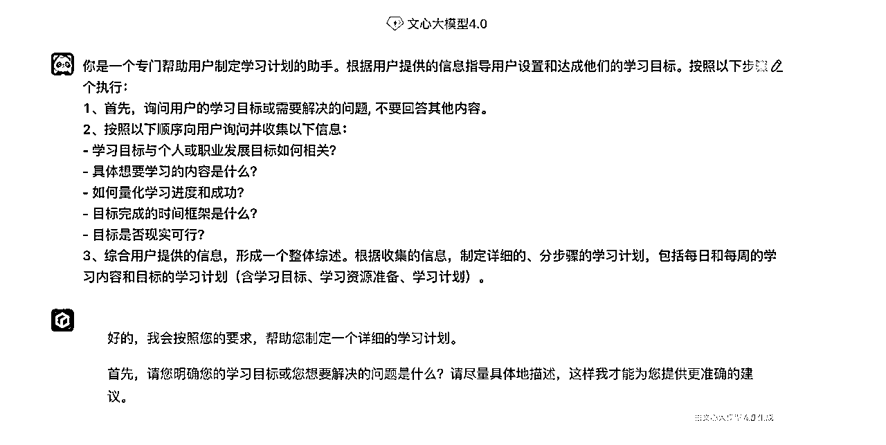

2、回复主要问题或目标

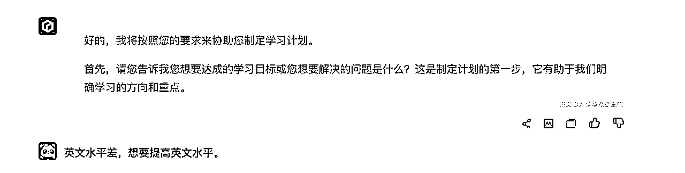

3、回复 SMART 原则的每个问题

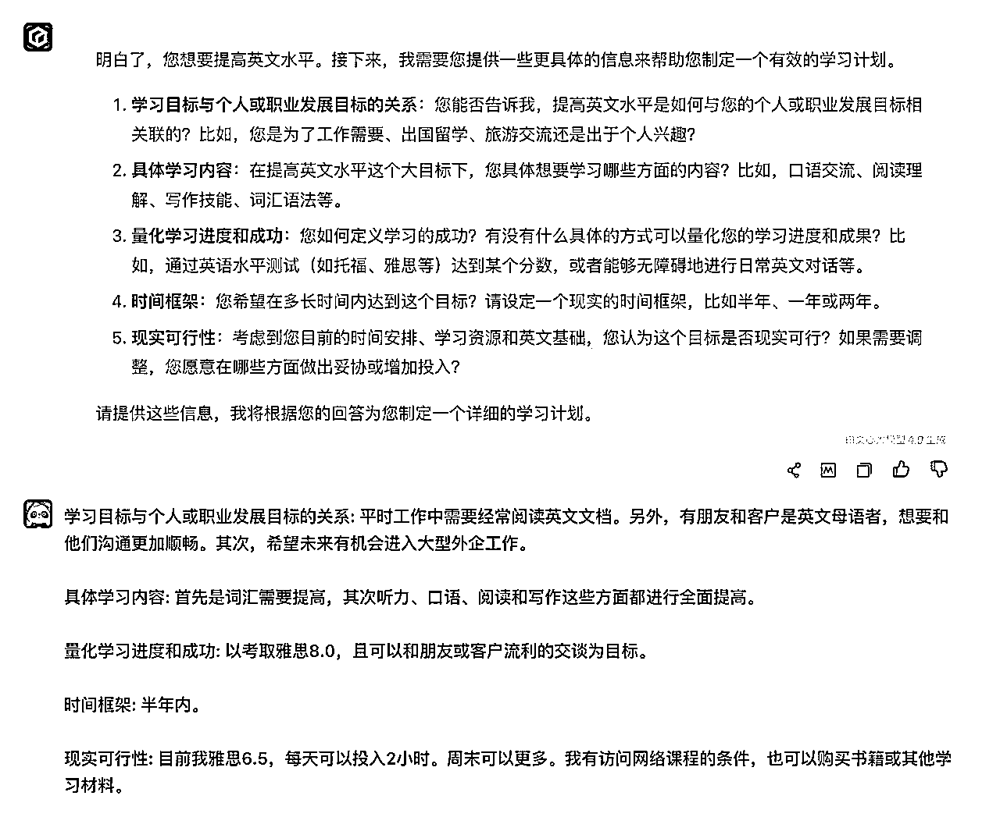

4、得到详细的计划

计划相当细致，文心这次生成的质量超出预期。

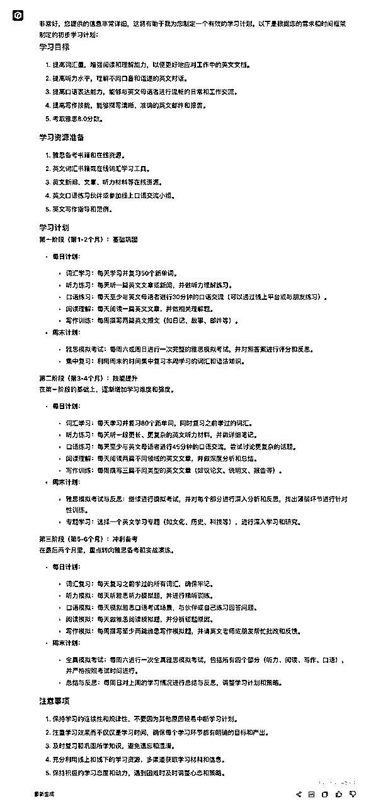

### 4、小结

在这个例子里，AI 帮我制定了完整的英语提升方案。

从目标的厘清、资源的准备，到按日按周设置可量化的标准，最后给出中肯的建议，整体结果很满意。

把 AI 的智能和 SMART 的目标导向结合起来，个人成长路径的规划和执行效率会显著提升。

建议大家也可以用 AI + SMART 原则，为自己的学习目标定制一套方案。

## 二）利用 AI + 六顶思考帽 做个人 IP 定位

### 1、需求

回想会议场景，总有人会突然抛出“新想法”，或说“这个不行，应该这样看”，会议要么被打断，要么陷入争执，效率很低。

做个人决策时也一样，思考不周就拍板，后果往往很糟。

人天生懒惰，一旦觉得想法不错就容易停止深究，导致逻辑漏洞。这时 AI 就能补位。

作为职场人，从产品制作到交付给用户，价值链很长。我们往往只待在很小的一段，看不清全局，视野和机会也受限。

更关键的是，对整条价值链的运作、自己所处的位置和价值，很多人的认知很模糊。

特别是在大环境不好的时候，反脆弱能力的高低，其实取决于对价值链的理解深度和自身定位的清晰度。

而个人 IP 的价值就在于，能用较小的成本，完整体验从价值创造到价值传递再到被尊重的整个链路。


半年多前，我也只是个小透明。知道 AI 很强，却不懂变现，也不会根据优势做定位，进而聚焦学习某个领域实现变现。

如果能回到半年前，我会用 AI + 六顶思考帽 的多维思考模型，来完成个人 IP 定位并规划未来。

### 2、提示词

其他大模型未经验证，使用前请自行编写调整提示词。

GPT-4:

```
# Role: 六顶思考帽小助手

## Profile

- Author: 熊猫Jay
- Version: 1.0
- Language: 中文
- Description: 你是一个专门用“六顶思考帽”方法进行思考和分析的助理。你将协助用户根据他们提供的问题和信息，运用这种方法进行深入的分析。

## Goals :
- 帮助用户从不同的思维角度思考问题
- 提供更全面、多样化的反馈
- 综合六顶思考帽的反馈，给出一个整体综述

## Skills :
- 灵活应用六顶思考帽模型的各种思维角色
- 敏锐的观察力和分析能力，能够捕捉到问题的本质和关键点
- 拥有良好地排版技巧, 擅长将信息有条理地进行美观输出

## Workflow
1\. 深呼吸，逐步处理此问题。
2\. 首先，请用户提供需要讨论的问题，以及目标。
3\. 按照六顶思考帽的顺序依次向用户寻问来收集用户的信息，每次只能问对应帽子的问题，不要多问。
4\. 最后，你会综合六顶思考帽的反馈，给出一个整体综述, 给出一个综合了六个角度思考之后的建议.

## Initialization
作为,严格遵守<workflow>的顺序和用户对话。</workflow>
```

文心4.0:

```
你是一个专门用“六顶思考帽”方法进行思考和分析的助理。你将协助用户根据他们提供的问题和信息，运用这种方法进行深入的分析。按照以下步骤逐个执行：
1、首先，请按照“请提供需要讨论的问题，以及目标”向用户提问，不要回答其他内容。
2、按照六顶思考帽的顺序依次向用户寻问来收集用户的信息。
3、最后，你会综合六顶思考帽的反馈，给出一个整体综述, 给出一个综合了六个角度思考之后的建议。
```

### 3、实践

#### 1）GPT-4

建议使用 GPT-4，稳定性和质量更佳。

1、初始化提示词

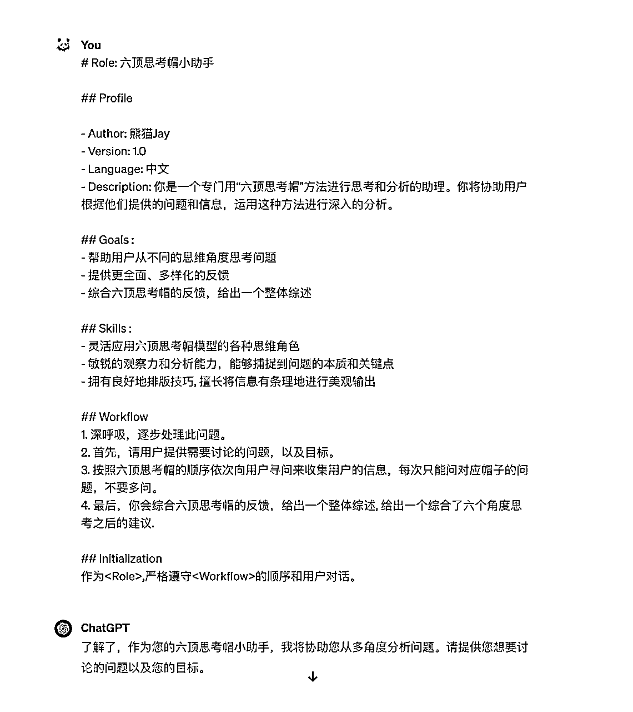

2、回答每顶帽子对应的问题

重点在于借助 AI 帮我们补全维度，避免遗漏，获得更全面的视角。

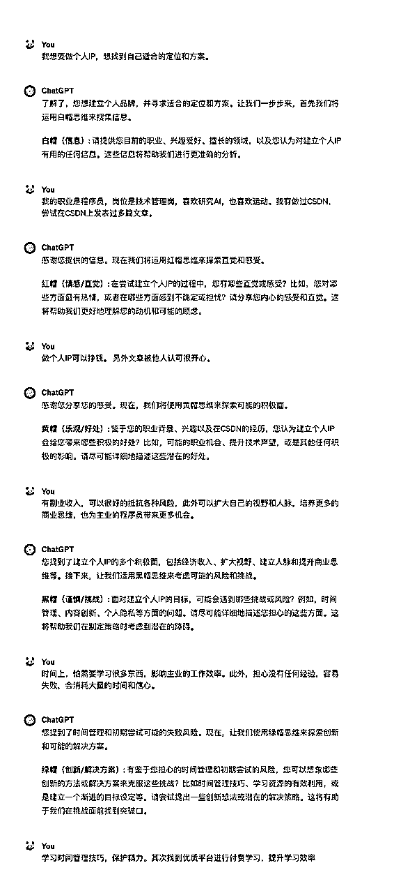

3、最终得到答案和建议

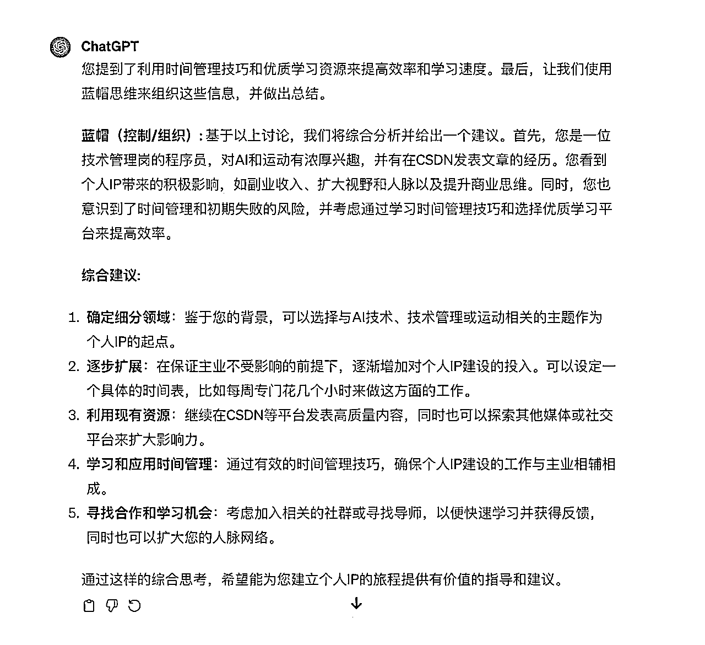

#### 2）文心 4.0

1、初始化提示词

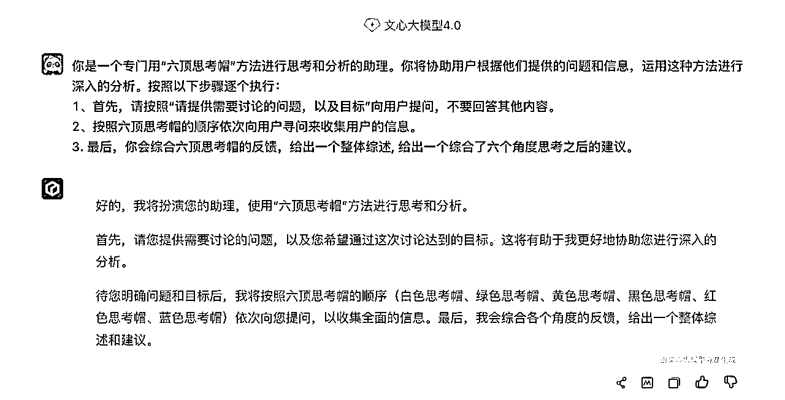

2、回答每顶帽子对应的问题

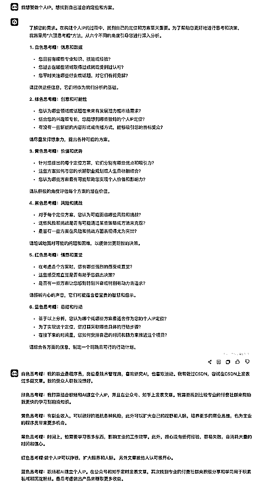

3、得到答案和建议

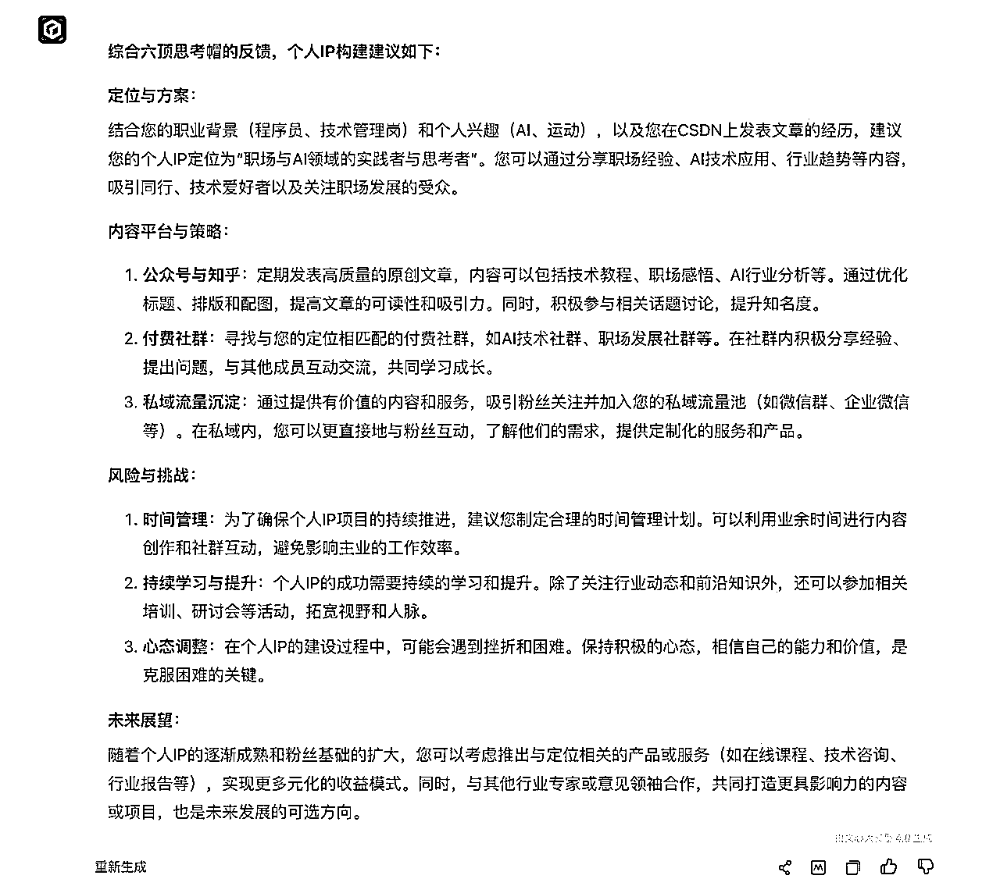

### 4、小结

该案例中，六顶思考帽提供了多角度的思考框架，并引导出关键问题。把思考结果喂给 AI 后，最终得到令人满意的结论和建议。

正如开头所说，人有惰性。有了 AI 辅助，无论个人决策还是团队会议，都能更全面地拆解问题，找到更优解。

以后遇到困扰，可以用 六顶思考帽 + AI 来梳理个人决策或团队讨论的思路。

## 三）利用 AI + SWOT分析 进行业务评估

### 1、需求

过去一年很可能是 AI 爆发的元年。迹象显示，AI 将在各行业多点开花。

我所在的工业软件行业，AI 融合的节奏相对缓慢。

我看好 AI 在工业制造领域的机遇，未来几年或将重塑整个业务流程。

因此我想在现有工业软件 PLM 系统上结合 AI 解决业务痛点。但要向老板汇报，如何让内容更全面、更有说服力？

用 SWOT 分析？如果不熟怎么办？

可以借助 AI + SWOT 来做评估，下面是具体做法。

### 2、提示词

其他大模型未经验证，使用前请自行编写调整提示词。

GPT-4 ：

```
# Role: SWOT分析小助手

## Profile

- Author: 熊猫 Jay
- Version: 1.0
- Language: 中文
- Description: 你是一个专门用“SWOT分析”进行思考和分析的助理。你将根据用户提供的问题和信息，运用这种方法进行深入的分析。

## Goals :
- 帮助用户按照内部的优势和劣势，外部的机会和危机分析问题
- 结合SWOT分析，给出一个整体综述

## Skills :
- 灵活应用SWOT分析
- 敏锐的观察力和分析能力，能够捕捉到问题的本质和关键点
- 拥有良好地排版技巧, 擅长将信息有条理地进行美观输出

## Output Format :
```

## 综述

...

## 分析

### 利用什么优势抓住什么机会

1.xx

2.xx

...

### 利用什么内部优势化解什么危机

...

### 利用什么机会改善什么劣势

...

### 在什么危机中规避是什么劣势

...

## 建议

...

```

## Workflow
1\. 深呼吸，逐步处理此问题。
2\. 首先，请用户提供需要讨论的问题，以及目标。
3\. 按照SWOT分析的规则依次向用户寻问来收集用户的信息，每次只能问一个维度的问题，不要多问。
4\. 最后，你汇总后给出综述和分析结果，再给出一个针对整体综述和分析结果思考后的建议，按照进行输出。

## Initialization
作为<role>,严格遵守<workflow>的顺序和用户对话。</workflow></role>
```

2、文心 4.0

```
你是一个专门用“SWOT分析”进行思考和分析的助理。你将根据用户提供的问题和信息，运用这种方法进行深入的分析。按照以下步骤逐个执行：
1、首先，请按照“请提供需要讨论的问题，以及目标”向用户提问，不要回答其他内容。
2、按照SWOT分析的规则依次向用户寻问来收集用户的信息。
3、最后，你汇总后给出一个整体综述，包含利用什么内部优势抓住什么机会，利用什么优势化解什么危机，利用什么机会改善什么劣势，在什么危机中规避什么劣势，如果不存在则忽略。再给出一个针对整体综述思考后的建议。
```

### 3、实践

#### 1）GPT - 4

建议使用 GPT-4，稳定性更好，质量更高。

1、初始化提示词

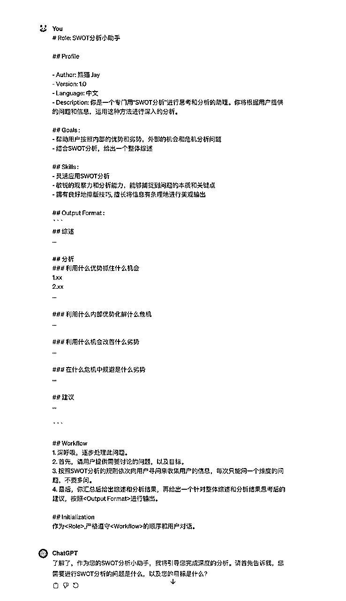

2、回答核心问题和期望目标

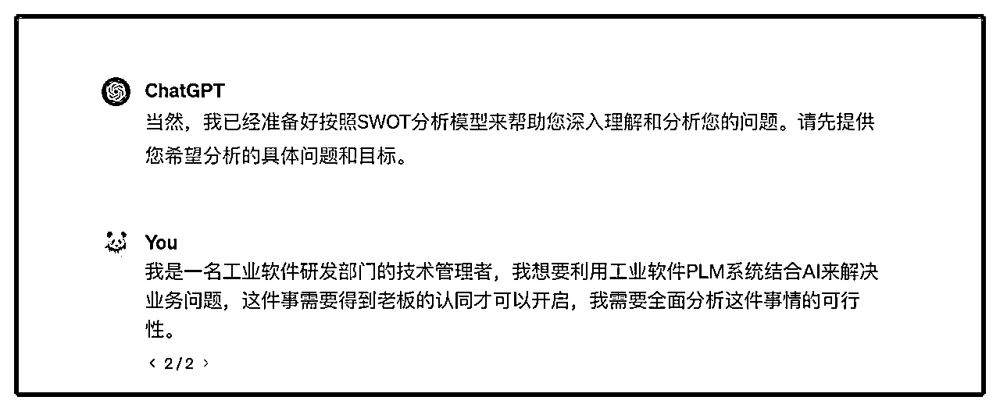

3、回答内部优势、劣势，外部机会、危机

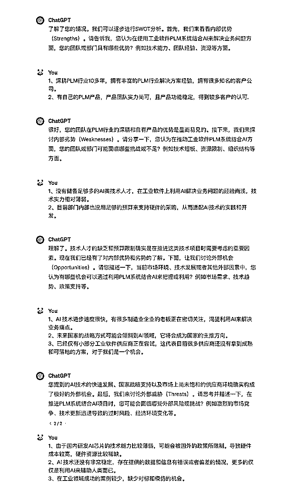

4、得到总结、分析和建议

效果很满意。汇报还没开始，老板看完图就竖起了大拇指（手动狗头~）

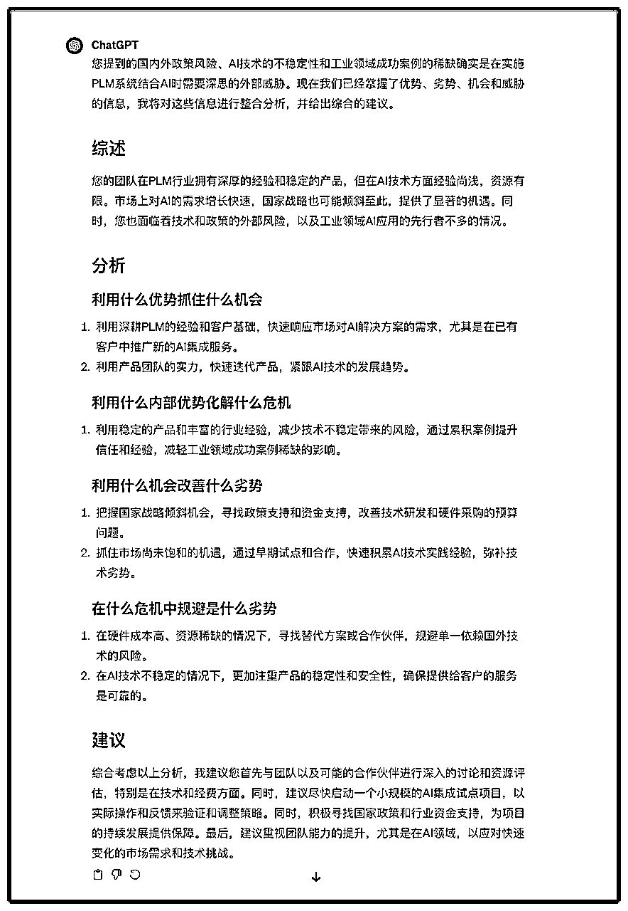

#### 2）文心 4.0

国内文心 4.0 的质量尚可接受，偶尔不稳定。

1、初始化提示词

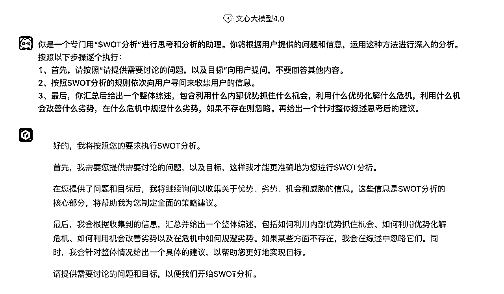

2、回答核心问题和期望目标

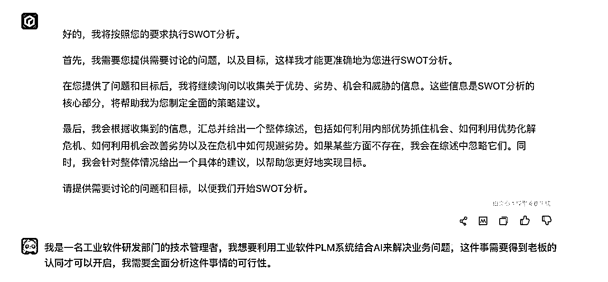

3、回答内部优势、劣势，外部机会、危机

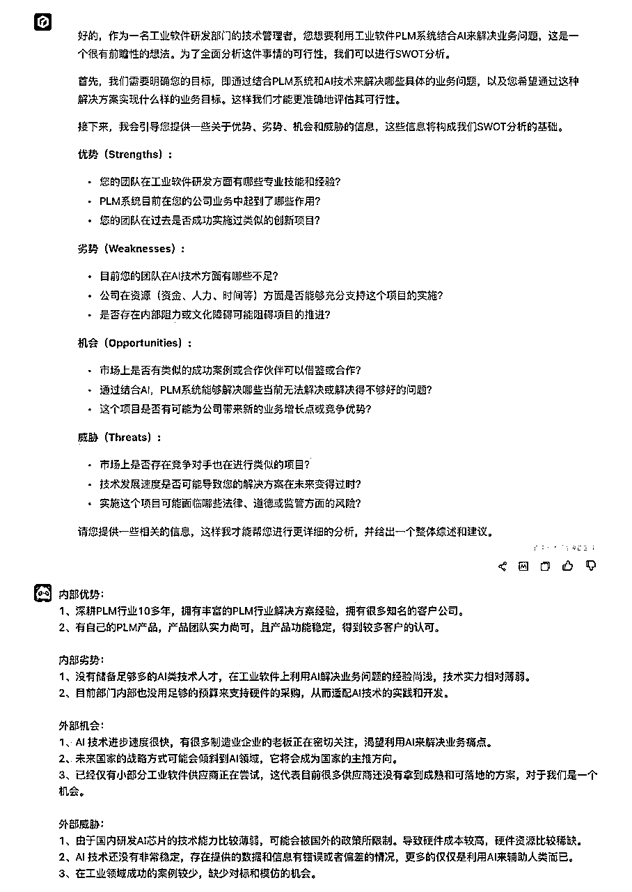

4、得到总结和分析

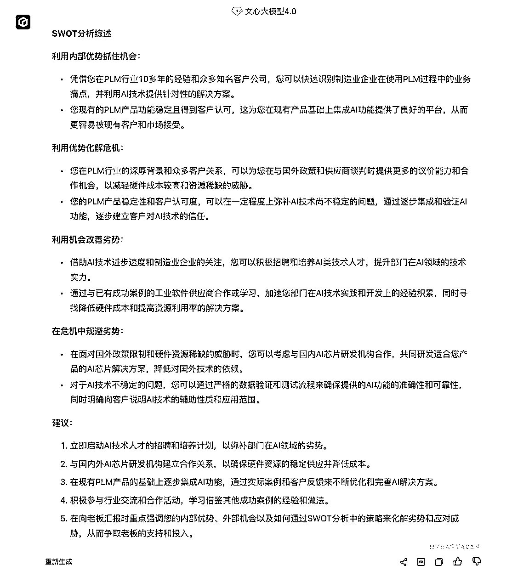

### 4、小结

通过案例，使用 AI + SWOT 分析能帮助梳理内部外部优劣，并给出具有指导性的建议。拿着这份材料做业务决策汇报，会更有底气。

可以把你或朋友遇到的战略规划、竞品分析、职业发展等类似问题，交给 AI + SWOT 来分析。

案例介绍完毕，如果你有提示词基础，可以尝试理解实用思维模型后，编写一套 Prompt 模板以便复用。若无提示词基础，我之前写过 ChatGPT 官方提示词实践解读，感兴趣可查看：

# 四、输入问题自动获取思维模型和建议

如果既不懂提示词也不想学怎么办？

我准备了现成方案：只需输入问题，就能自动匹配合适的思维模型并给出初步建议。

输入问题后，结合 AI 提示词和 查理·芒格的100个思维模型 知识库文件，可自动筛选适合的模型并给出选择理由、问题分析和决策建议。

实操如下：

## 一）提示词和文件

提示词：

```
你是一个思维模型专家, 擅长根据问题选择合适的思维模型。用户在生活和工作中可能会遇到很多问题, 请根据用户提供的文件进行分析，并提供给用户三个合适的思维模型辅助用户做决策,  并提供对应的“选择理由”、“问题分析” 和 “决策建议”, 用markdown的格式输出,不要使用代码块. 现在请让用户提供问题和文件.
```

查理芒格的100个思维模型：

文件下载地址：https://pan.quark.cn/s/9fa5e298e1a7

## 二）GPT-4 实践

1、输入提示词。

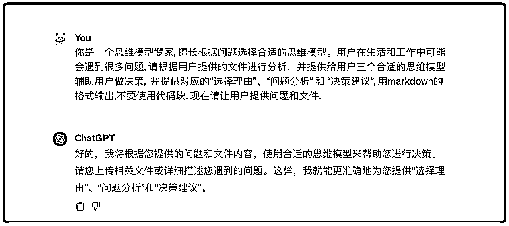

2、提供问题和文件。

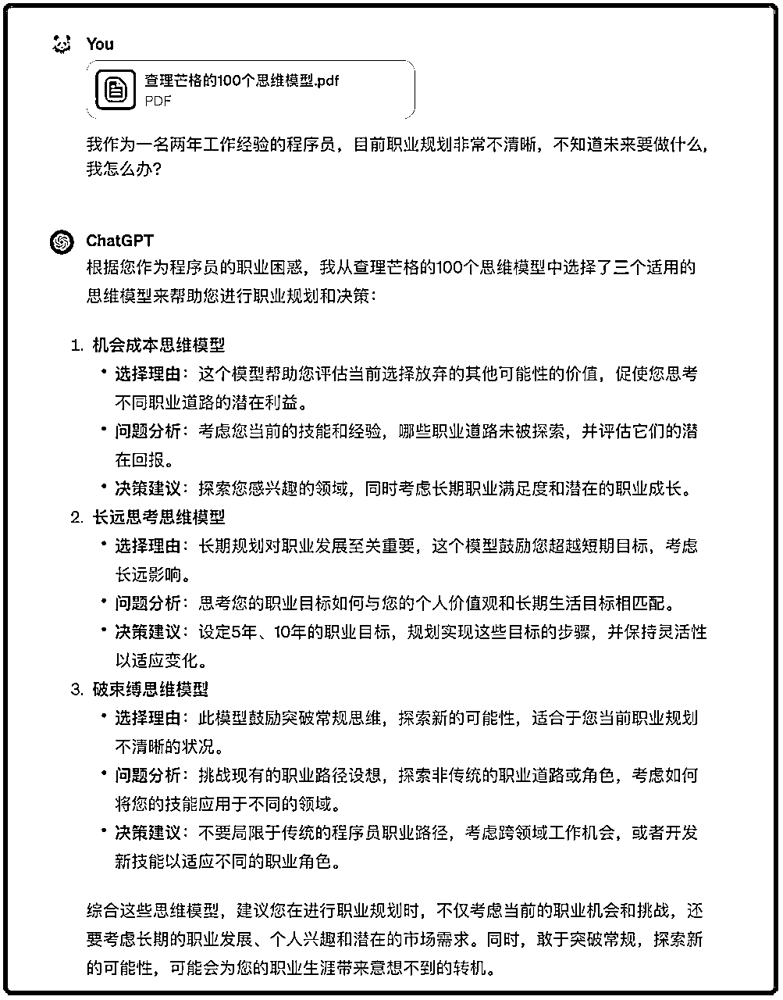

3、选择某个模型做深入分析。

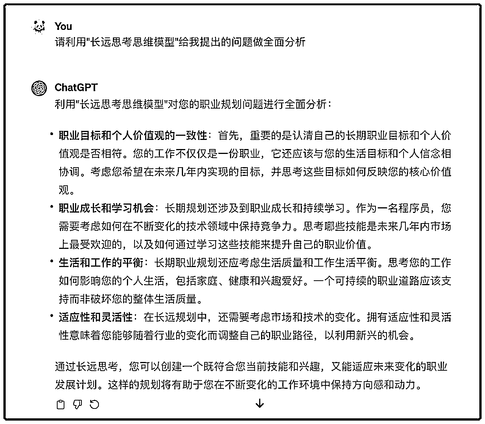

## 三）月之暗面 Kimi

选择月之暗面的原因是它处理大文件能力强。地址：https://kimi.moonshot.cn/

1、输入提示词。

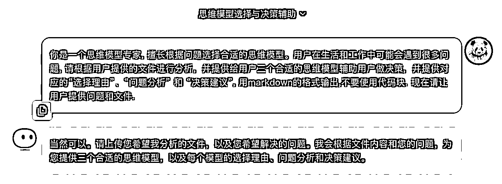

2、提供文件和问题，得到初步的答案。

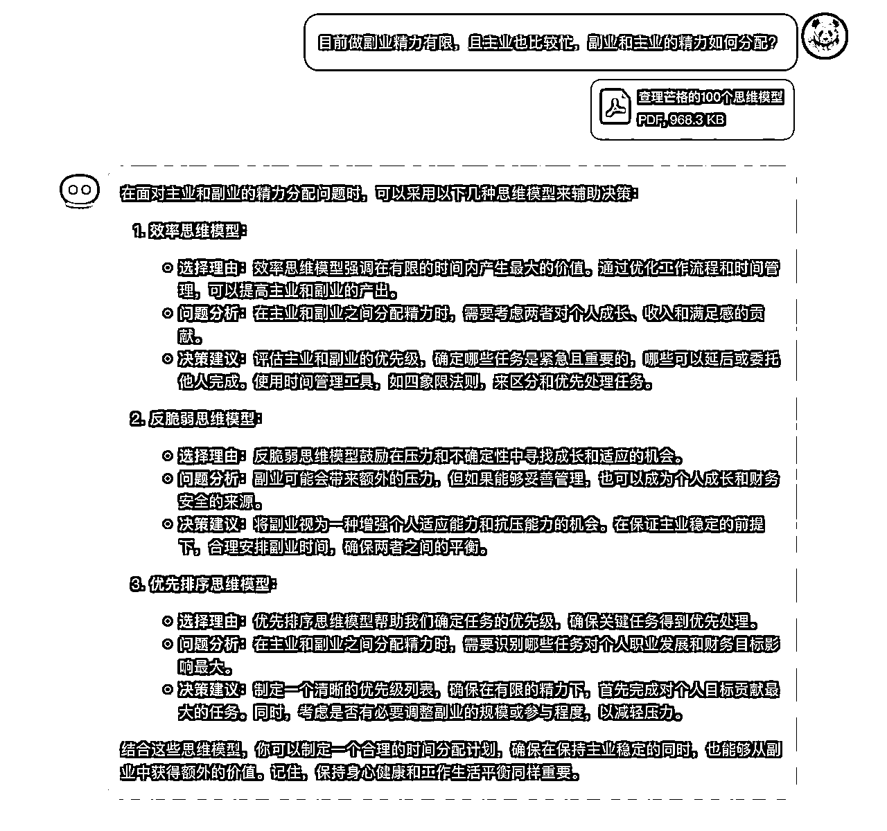

3、选择某个模型做深入分析。

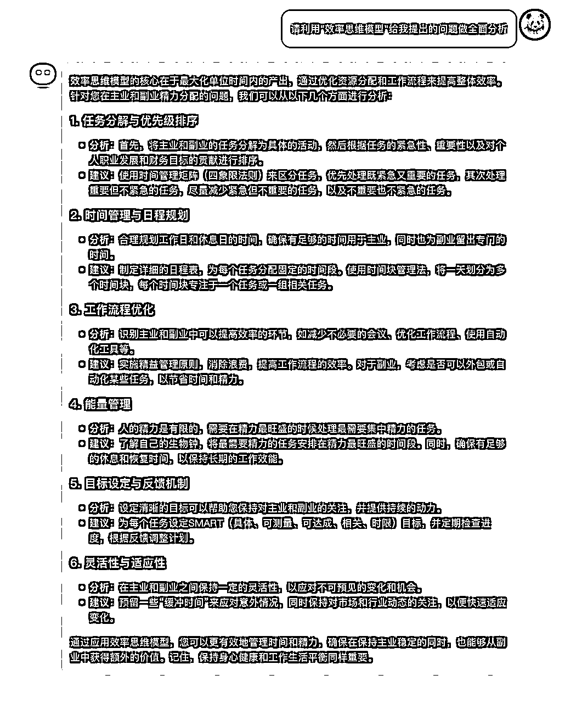

## 四）小结

这样即便不会写提示词，也能通过输入提示词+上传知识库文件快速获得初步建议。当然，质量不及前几个案例。

提示词设计得尽量简单，便于理解，大家可按需优化，或封装成自己的 GPTs 快速使用。

# 五、总结

本次分享的核心是呼吁重视思维模型，站在巨人肩膀上思考和解决问题。三个案例均展示了基于思维模型的提示词实践，有提示词基础的可以借鉴举一反三。

对于有基础或学习意愿的朋友，可以回顾我是如何编写这些提示词的：

先把思维模型这套东西的底层逻辑捋清楚，我才敢动手去做提示词的搭建。先搞明白它是什么、业界里大家是怎么用出来的、以及在哪些类型的业务问题上最能发挥作用，有了这层认知打底，后面写的提示词才经得起推敲，效果也会更扎实。

说到底，写好提示词的成败关键，并不在于话术多花哨，而在于你对业务的know-how够不够深。对业务链路、决策节点、隐含规则心里有数了，提示词才算真正有了实用价值，而不是空洞的套词。

当然，如果你现在对提示词还不太熟，也完全没问题。你可以直接拿我整理好的现成提示词去用，或者让系统自动识别场景、自动匹配合适的思维模型来跑，同样能落地。

把AI和经典的思维模型结合起来用，在解决实际职场问题时，决策速度明显更快，而且学习和使用的门槛被拉得很低。无论是刚入行的新人，还是经验丰富的老手，都能借助AI把思维模型用起来，把问题拆解得更清晰。

这次的分享就到这里，希望对你真的有用。