# 视频号赛道挖掘与快速涨粉秘诀，详细实操一条龙，学完即可上手操作
作者：龙哥

最近不少朋友问我，视频号创作者分成计划还能不能做？我的回答是：能做，但别再靠老一套了。真正卡住大家的，无非就两件事——赛道不会选，粉丝涨不动。很多人一上来就琢磨刷粉，说实话，这条路走不通，刷完还要靠爆款激活，纯属自欺欺人。粉丝不过百，创作者计划开不了，后面全是空谈；粉丝过了百，又不知道该做什么赛道，项目照样落不了地。

这篇文章，就是把我自己实操下来的经验和盘托出，帮大家解决选赛道和快速涨粉这两个核心痛点。我也会把我之前跑通的赛道拿出来挨个拆解，包括每个赛道的数据表现、变现逻辑、以及当时为什么能起量。看完你会发现，很多赛道其实没有技术壁垒，拼的就是信息差和执行力。

# 一、赛道怎么挖？先搞懂这几个问题

很多做视频号的人，最大的困惑就是不会选赛道。参加培训，人家只丢给你一个赛道，比如祝福赛道，告诉你这个收益高，晒几个收入截图，你就觉得稳了。结果学完了才发现——只会这一条道，赛道一旦卷起来或者规则一变，你就彻底懵了。说白了，只教你一个赛道不教方法的培训，都是耍流氓。

我们最开始做的时候，市面上能选的就是娱乐赛道。当时刀郎、中国好声音、那英、杨坤，还有李玟去世那阵子，热度简直离谱。娱乐赛道确实能吃红利，但后来单价掉得厉害，还容易把号做死。视频号规则一改，你就得不断挖新赛道。没有方法，光靠一条道走到黑，很难持续拿到结果。

# 二、我们跑过的赛道，挨个给你盘一遍

下面这些赛道，都是我们实打实做过的。每个赛道都有值得拆解的点，大家看完要学会举一反三，别只盯着我写的这几个。

**1、接福赛道**

接福其实就是混剪、风景、真人出镜加上祝福语。当时我们做了三个几乎一样的视频，稍微改动一下就重复发。只要其中一个爆了，改一改再发还能继续爆。点赞都是几千起步，一天收益两三千很正常。现在这个赛道已经不行了，但当时真是捡钱。

接福这个玩法，现在去视频号搜关键词还能看到很多类似账号。我们当时是从抖音搬过来的，你要有那种“跨平台搬运”的思维——抖音上验证过的爆款，拿到视频号上大概率也能火。

**2、娱乐赛道**

去年最火的就是刀郎、那英、中国好声音、李玟那几个事。尤其是刀郎，那段时间怎么发怎么爆，五六十万、七八十万播放都跟玩一样。王思聪为刀郎说话被封杀那件事也炒得很热。收益的话，一般就是五百左右一单。

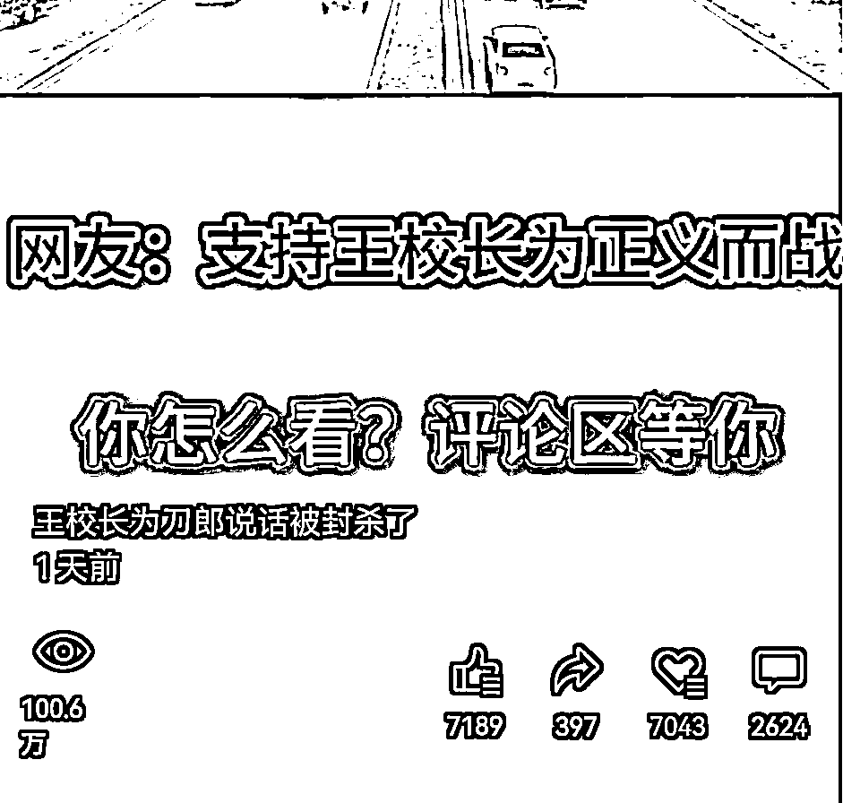

娱乐赛道能做的对象很多，比如过年春晚就出了不少话题，白敬亭、马丽都很火。不过现在娱乐单价降下来了，不像一开始那么给力。2000多评论大概能有80到150的收益。另外娱乐也分很多方向，体育明星、娱乐明星都有，但你要选那种自带热度的，有些明星怎么发都火不起来。中国好声音那阵子就是典型的“怎么发都热门”，因为恰好踩在热点上。

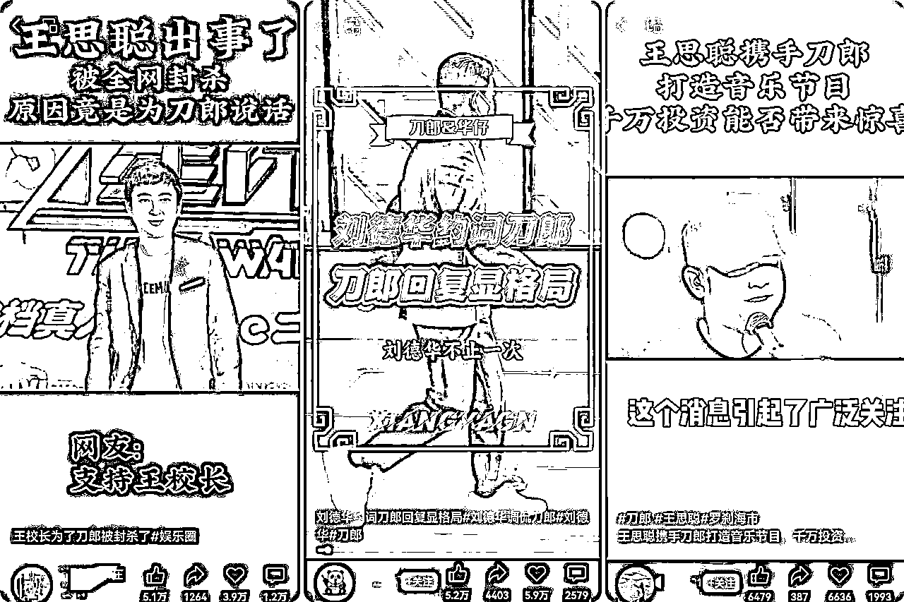

**3、对话赛道**

对话赛道分好几种：搞笑对话、夫妻对话、婆媳对话、司机与乘客对话。

搞笑对话我们做过一个80多万播放的视频，2000多点赞，400多评论，收益两三百。就是把网上很火的比如“王大爷”那种对话形式，你一句我一句地呈现出来。去视频号搜“搞笑对话”，能发现一堆。

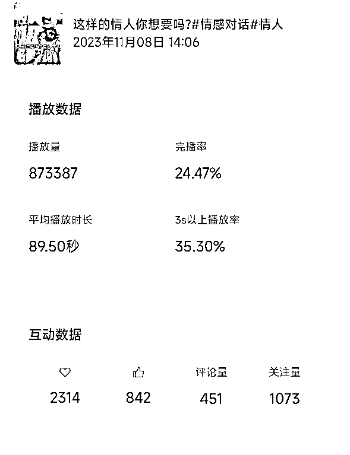

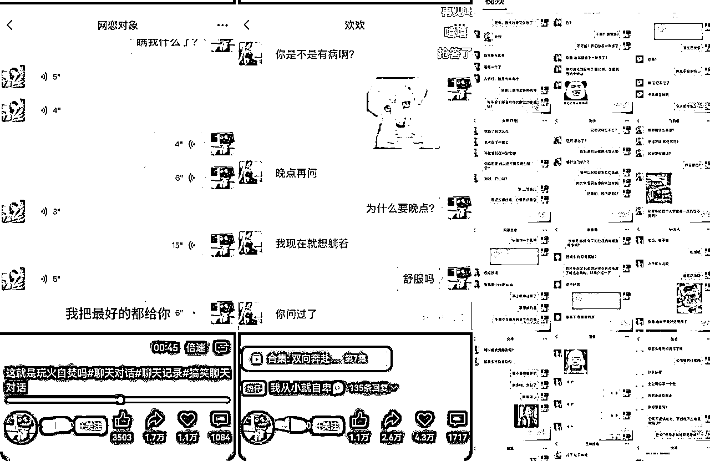

夫妻对话也属于搞笑类，容易爆，但制作稍微麻烦点，需要用平板画出来，不过只要会描就没问题。

婆媳对话这个特别有意思，其实就是纯聊天记录截图。我们当时是抠图抠出来的，从抖音找纯色视频，下载后换背景，放到视频号上就会出现动态背景、风景背景那种效果。这不算侵权，因为抠完图之后基本就成原创了。量非常可观。

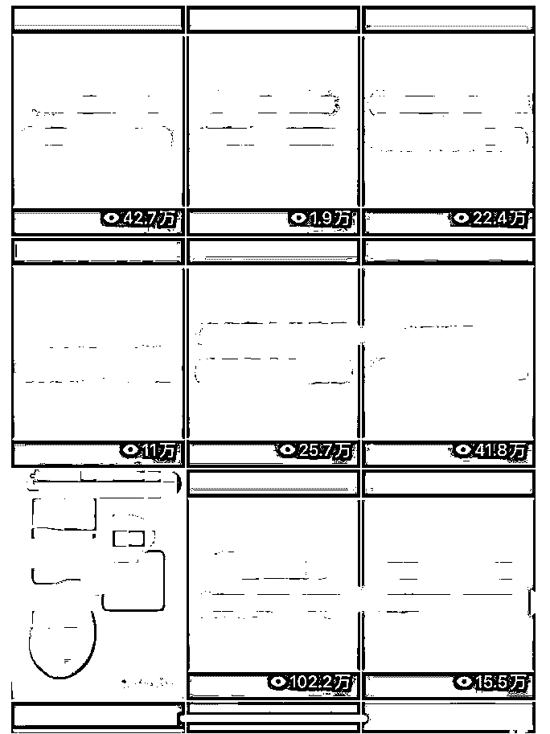

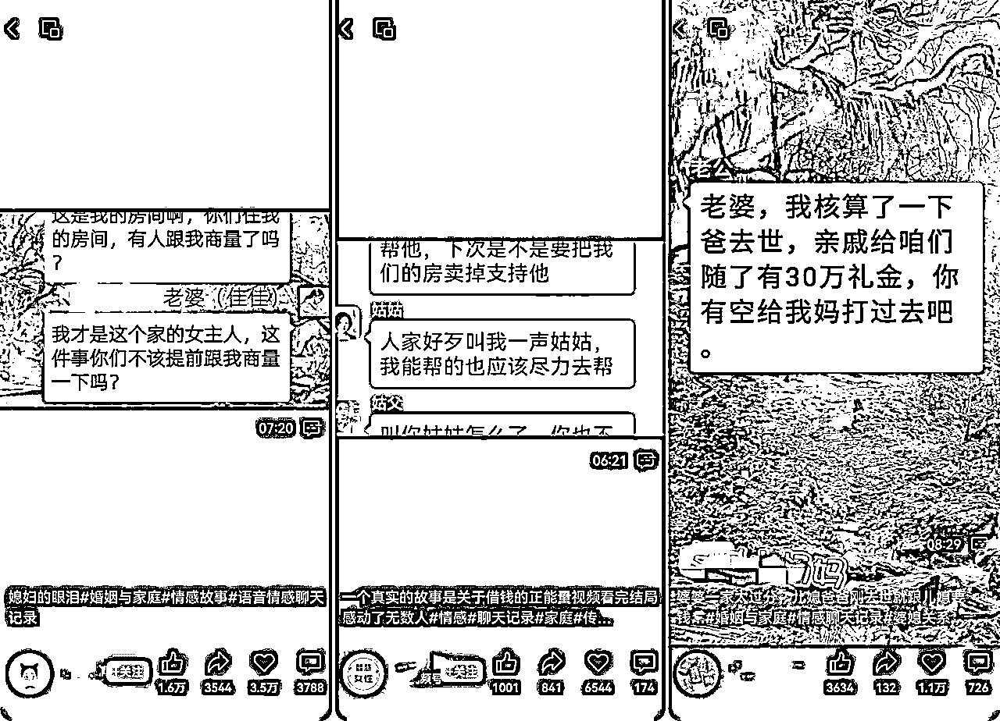

司机与乘客对话也做了不少，190多万播放，3000多点赞，400多评论。做法就是找人家的文案，用AI改写一下，同一个事情换个说法。表现形式也多样：漫画、行车记录仪、自己坐车里拍都行。行车记录仪拍出来就是原创，这个赛道值得好好做。

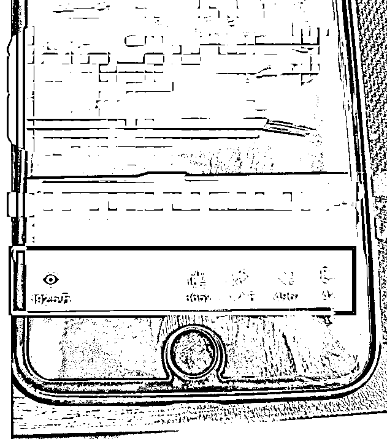

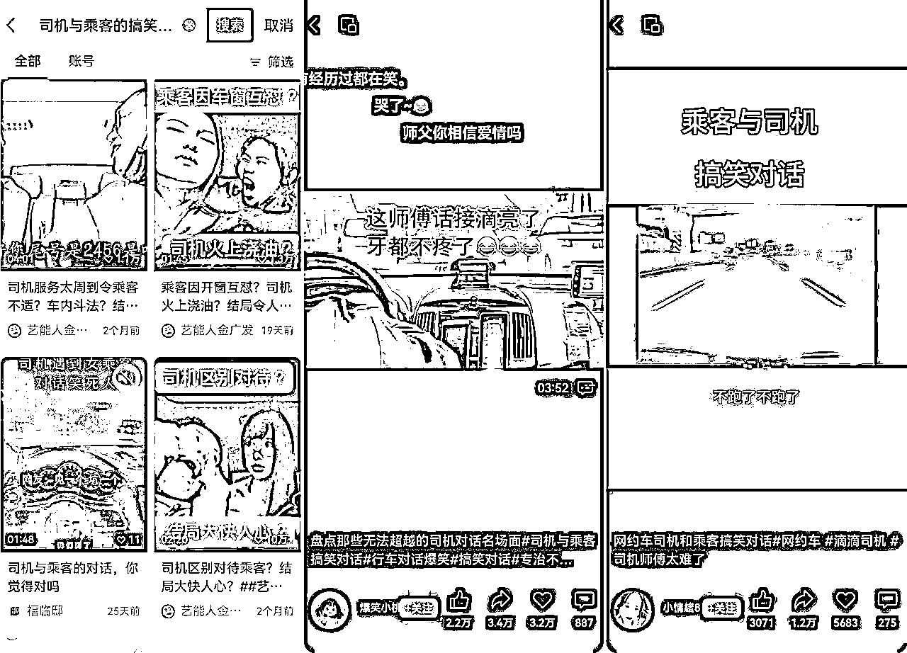

**4、情感赛道**

情感小故事很容易爆。用AI生成文案，配一段原创风景视频，五六月份的时候特别好做，但现在规则改了，不太好做了。我们当时发了一个500多万播放的，将近3000点赞，900多评论。

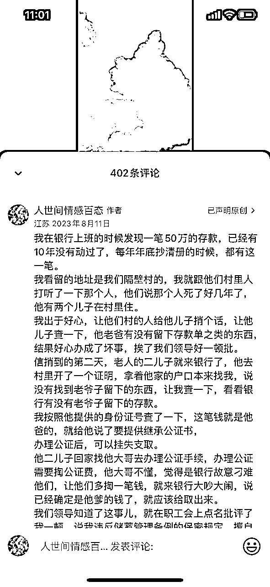

那个故事是讲血型的小作文。文案就是扒同行的爆款，用AI改写一下，今日头条上也有类似的，改完配上风景就能发。爆款文案抄出来，基本都能爆。

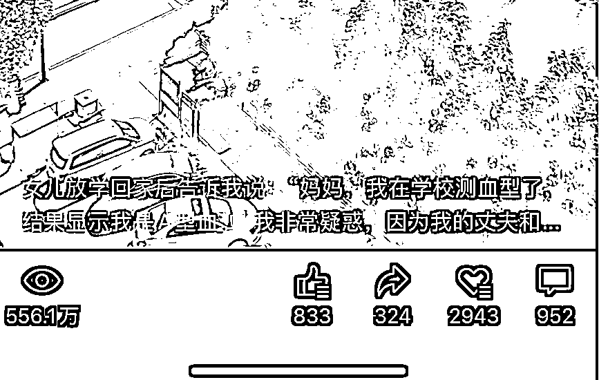

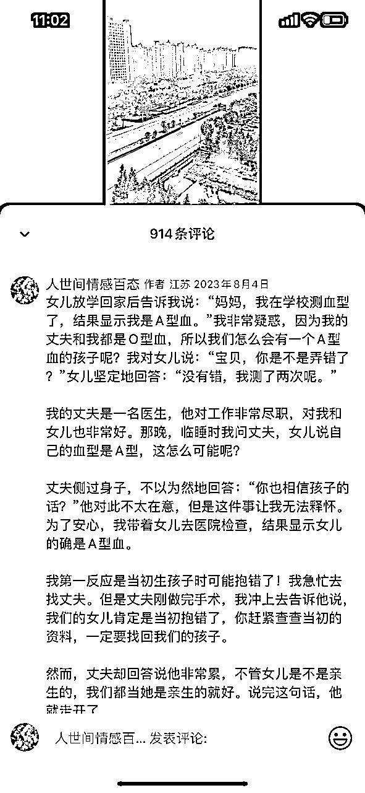

**5、漫剪赛道**

这个赛道比较费钱，因为视频生成动漫需要收费。做起来了确实能挣钱，但没做起来就是纯亏。不推荐大家轻易尝试，只是告诉大家目前有这种热点存在。

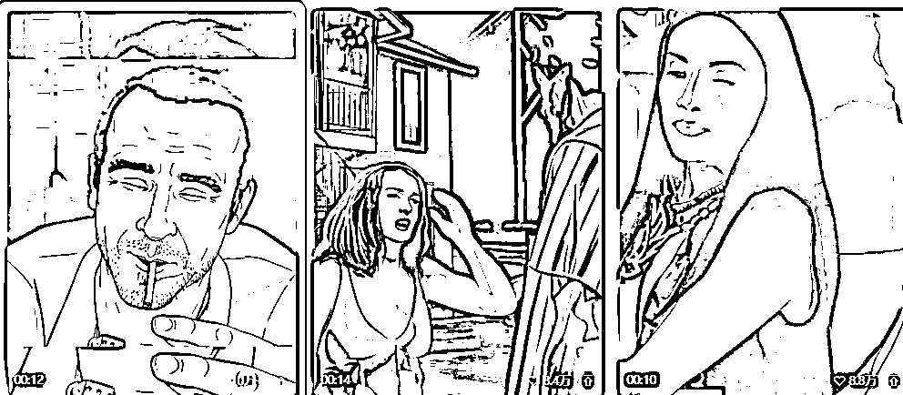

**6、探索赛道**

探索类现在不太好做。我们去年8月发过一个1000多万播放的“罕见月亮”，当时大家都在讨论月亮为什么那么大、为什么是蓝月亮。账号后来注销了。你可以去搜同行对标，这种类型其实挺多的，要善于发现。

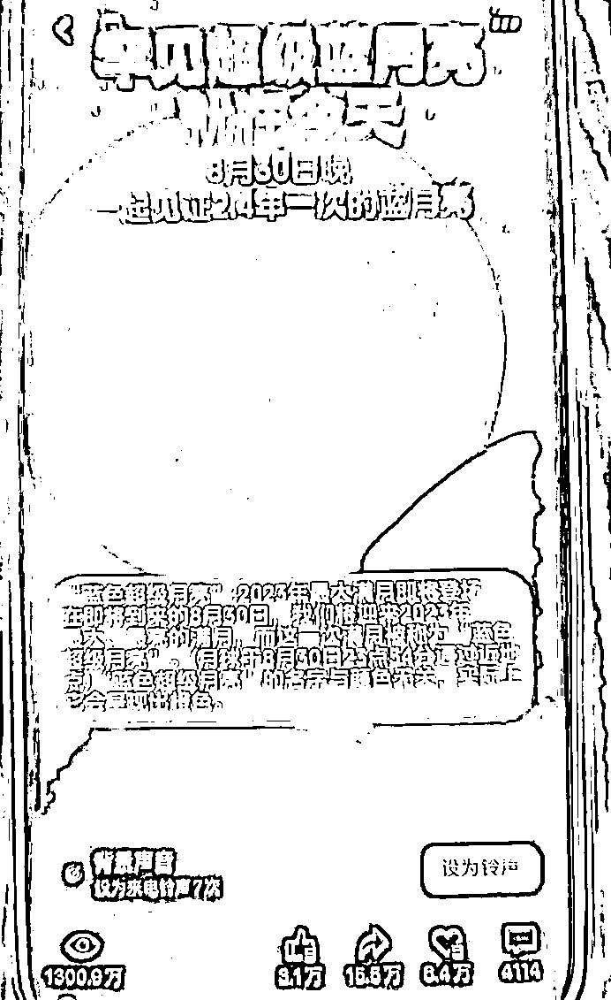

**7、话题赛道**

今日话题也是不错的选择。我们发过一个167万播放的爆款，7000多评论，9.2万点赞。标题就是“你和喜欢的人现在是什么关系”，底下评论区特别热闹。

**8、体育赛道**

体育赛道有个特点：一个视频爆了，可以重复发。因为都是混剪别人的体育视频，稍微改一下再发，还是能爆。除了滑冰，跳水、游泳这些都可以。不过现在规则改了，不能像以前那样发了。大家听完这些赛道，是不是有点灵感了？

# 三、赛道挖掘的几个实操方法

**1、多刷视频**

抖音和视频号都要刷，但要找那种刚注册的、没有做过视频号的新号去刷。如果你拿自己天天刷娱乐的账号去刷，推荐给你的永远是那几类。新号会给你推很多从来没见过的类型。看到好的，先别急着点赞关注评论，一旦你点了一个，后面全给你推这类，其他类型就不推了。

**2、付费找同行**

刷视频的时候，你要是发现某个人在某个赛道做得不错，就去看他账号签名、介绍，很多都留了🛰️。花个一百多、两三百的学费去学，这钱花得不亏。但你要挑那种同行少、不泛滥的赛道去学，像接福、送祝福这种都烂大街了，真没必要。找对师傅，能少走很多弯路。

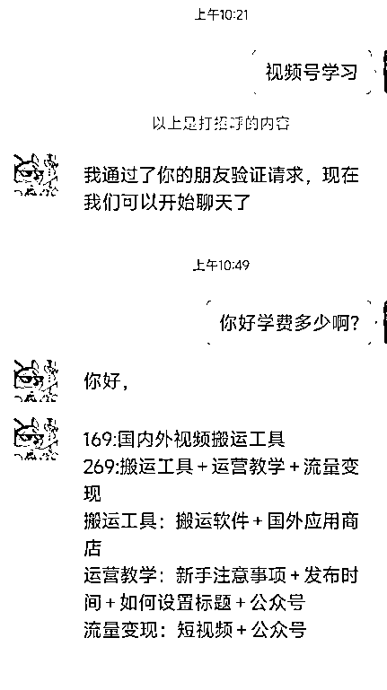

**3、看风向标**

像淘金情报、赚钱风向标这类平台，多看多研究。比如那里有人分享音乐的新玩法，用路边广告词来表现歌词；还有董宇辉的情感语录。这些都是不错的素材。但光看没用，拿回来测一下才行。不测试永远不知道能不能爆。

**4、举一反三**

一个赛道能延伸出更多赛道。你自己脑子里得有货，才能挖出新东西。知识储备越多，能发现的赛道就越多。这四个方法，真心建议大家好好用起来。

# 四、快速涨粉的核心思路

涨粉的目的一般就是开通创作分成计划、开直播带货，或者直接卖号。千粉号、万粉号都有市场。

现在很多人涨粉慢，一百粉要熬半个月，问题就出在赛道选择上。你要选涨粉快的赛道，首推娱乐和体育。娱乐赛道为主，去抖音热榜、腾讯新闻上找最近的娱乐新闻，只做娱乐圈的，其他领域别碰。体育赛道也一样。用这个方法，1到3天就能涨到100粉。要是出了爆款，一天就能搞定。涨完粉之后，把之前发的涨粉视频隐藏掉，再发你准备做收益的赛道视频就行。

娱乐赛道涨粉案例，比如腾讯新闻和抖音热榜上的这些：

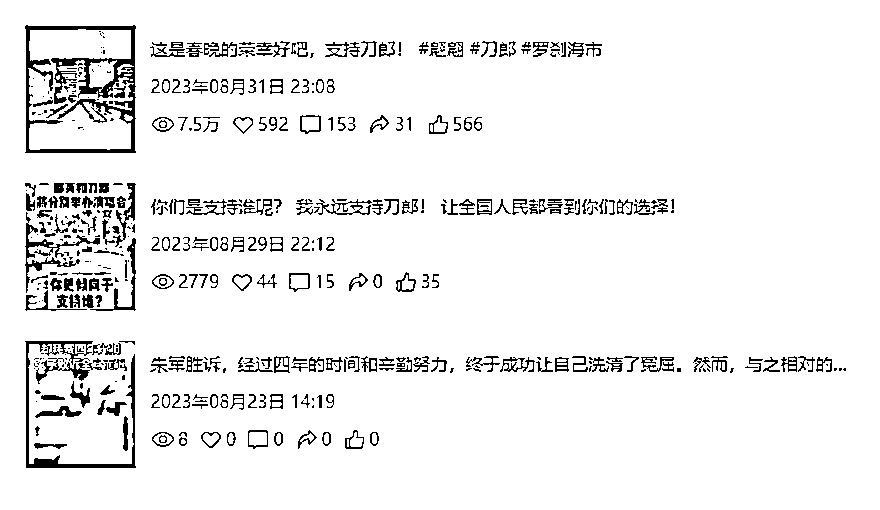

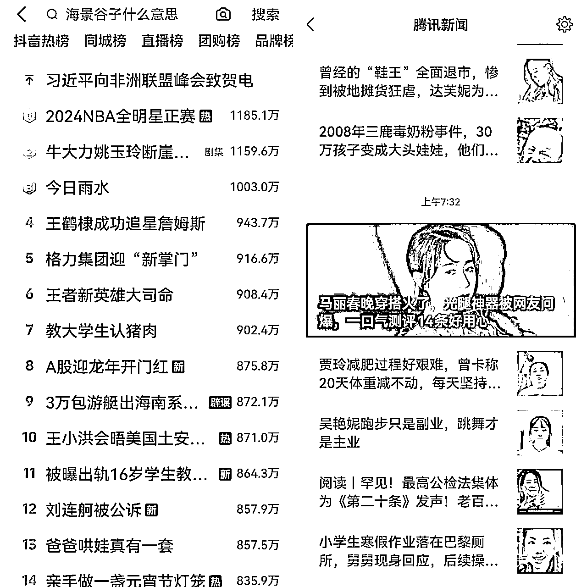

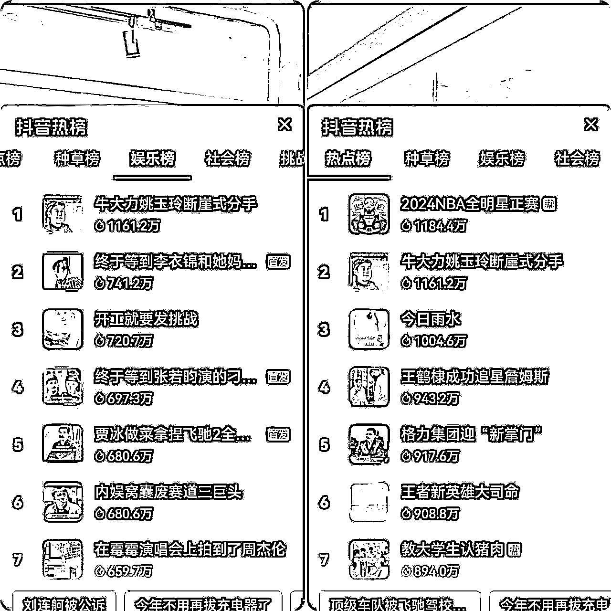

我们去年基本都是靠刀郎、李玟、全红婵这些人涨粉，真是一发就爆。开通创作者计划后，把涨粉视频藏起来，再去做正经收益的赛道就行。

选好娱乐赛道后，制作方法也特别简单。下面这个方法你只要看一遍就会，而且涨粉效果立竿见影。不信你看，一个视频涨粉660个，45万播放量：

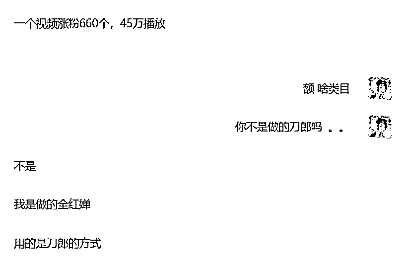

# 五、涨粉视频具体怎么做？

首先，一定要找对标账号。随拍视频是为了提高原创度，文案要足够吸引人，用剪映做成视频。

打开视频号刷对标，平时你搜什么、看什么，系统就给你推什么。遇到同类型的爆款账号，先关注收藏。爆款的标准至少点赞200以上。经常刷，系统就会持续推荐类似素材。你确定要做哪个方向，就一直刷那个方向的账号，这样账号也会更垂直。热点要跟，但最好是半个月以内的。

拿全红婵举例：找一个点赞评论高的同行视频，照着他的文案改，意思别变就行。参考他底下的热门评论，注意别出现太绝对的字眼。有些同行中间会放真人图片，但平台会提示图片侵权，所以我们不放。

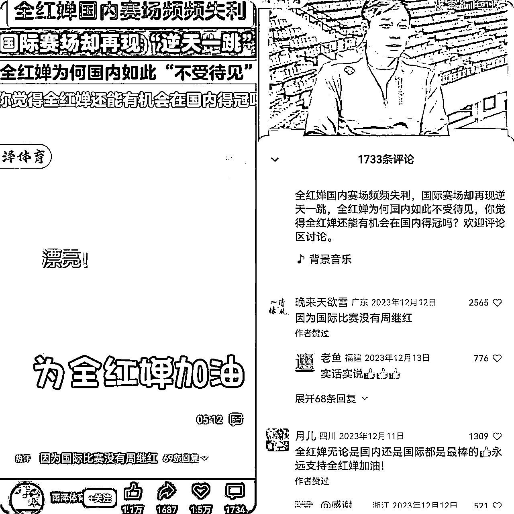

打开剪映，导入风景随拍素材，配上合适的音乐，关闭原声。随拍视频10到15秒完播率最高。虽然有时会提示视频质量低，但这对原创度没影响。到爆款量级时可能会限制推流，比如卡在五六十万上不去，这时就点剪辑、分割，把多余的部分删掉。

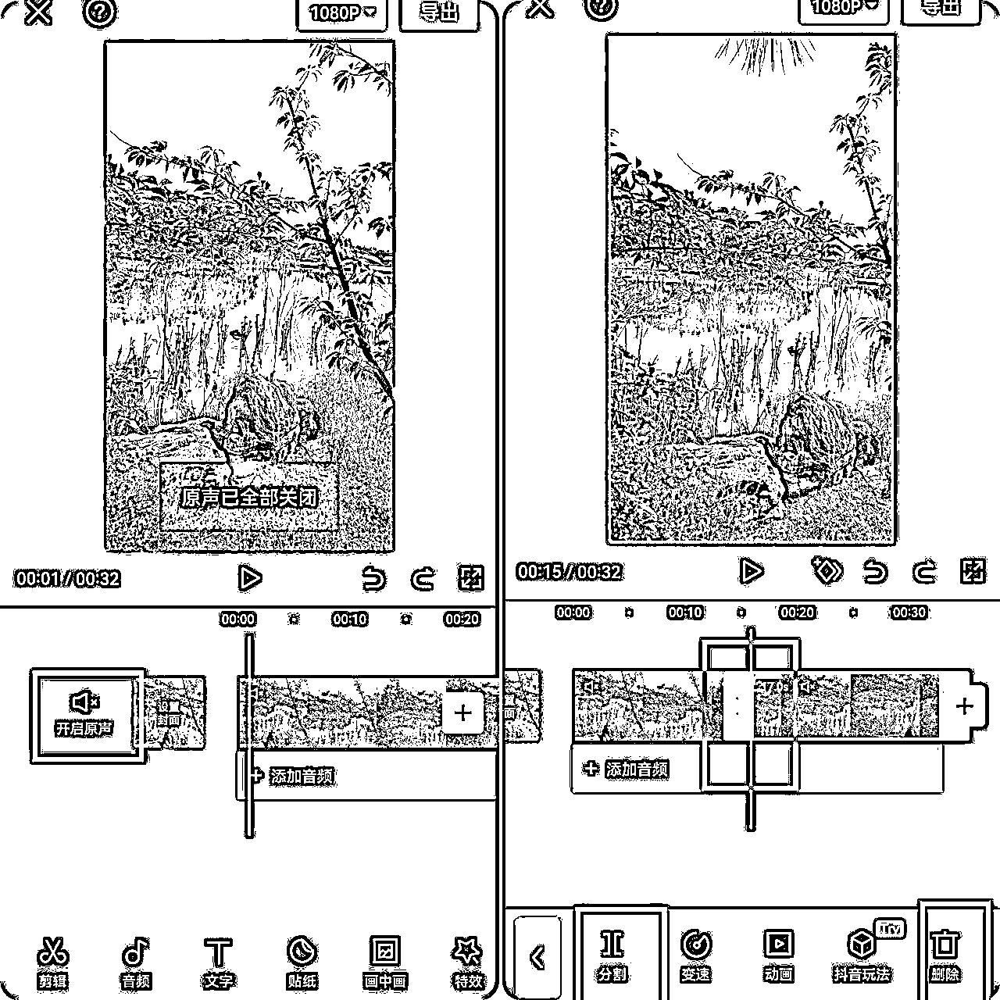

然后点文字、新建文本，把准备好的文案输进去，把文字轨道拉到和视频一样长。几行文字就复制几个文字轨道，比如复制5个，依次输入内容。

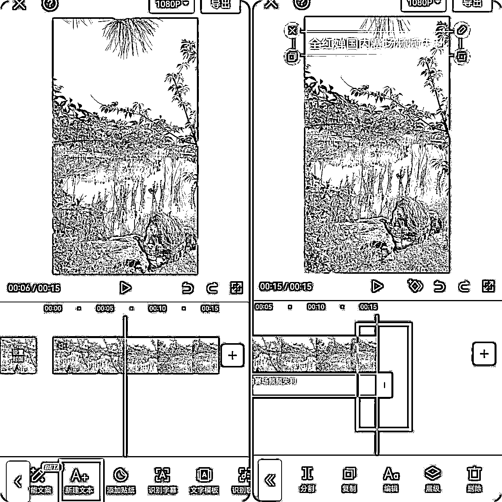

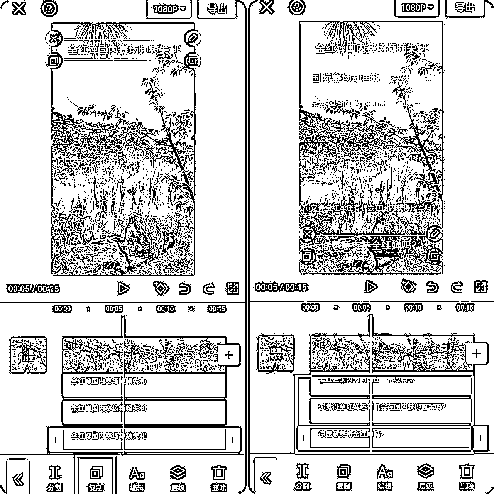

文字颜色参考同行的样式。热点来了再发，还会再爆。想要更多热点，就得养号，多刷同行，系统才会给你推更多相关素材。文字可以用模板，也可以自己调样式和颜色。多看看别人怎么配的，选中文字轨道直接改字体、颜色、位置就行。

背景音乐分两种：自己配，或者直接用爆款音乐。发布的时候，直接选对标爆款的背景音乐就行。导出视频时，帧率设60，码率拉到最大。

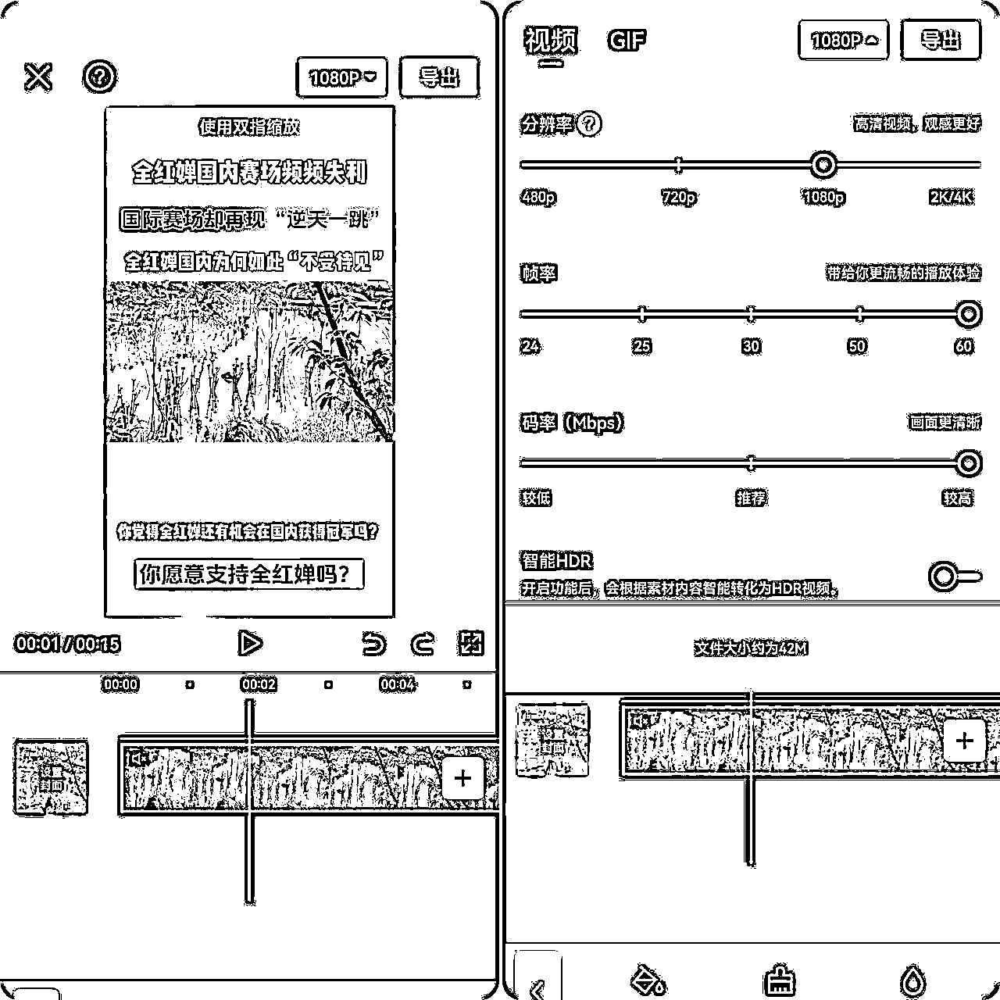

发布时可以借用同行的文案。点背景音乐，还能通过音乐发现更多爆款。找到自己制作的视频发布，或者用之前收藏的爆款音乐，从里面挑一个就行。

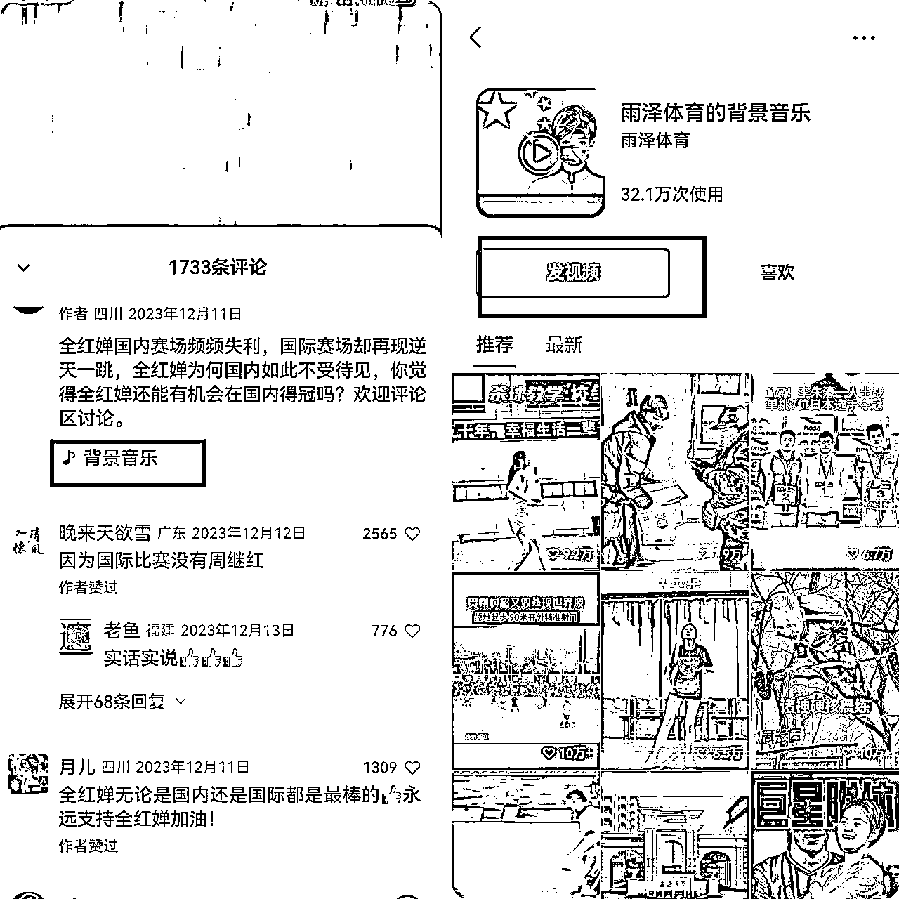

电脑端的操作也差不多。可以把比例调成16:9横屏，背景用纯黑或模糊背景效果更好，纯色也行。导出后配上热门音乐就可以发。

# 六、过计划的具体流程

前面讲完选赛道和涨粉，接下来就是大家关心的“过计划”。我做了个核心总结，一看就懂：

新号先发十个风景视频。如果能真人出镜，那最好直接拍真人出镜——真人出镜比风景质量高。今年不知道风景还能不能稳妥过计划，但我们最稳的办法还是真人出镜。每天发3到5个，分2到3天发完就行。

比如航海学员反馈的数据，可以参考：

注意：真人出镜的视频，你可以拍情感语录、祝福语等等，都可以。

发完这十个铺垫视频后，正常发你要做赛道的视频，然后开始涨粉。你可以理解为：先发十个原创风景或真人视频做铺垫，再发涨粉视频去涨粉，或者直接发赛道视频涨粉。当然娱乐赛道涨粉最快——先涨到100粉，然后再选一个收益稳定的赛道正式开干。

简单总结就是：**原创铺垫 → 涨粉视频涨粉100 → 赛道视频过计划 → 赛道视频做收益。**

在涨粉过程中，可能会自动过规范需求，但大多数情况下不会自动过，系统会一直提示不满足。这种时候，问题多半出在加热工具上。如果一直没满足规范、过不了计划，就去看看加热工具的视频加热是否正常。所以我建议大家这几天随时关注视频加热的状态，不正常会提示整改。然后你再发十个风景或真人出镜视频，分两天发完，审核过后基本就能自动过规范或者直接开通计划了。

我们目前都是按这个流程来操作，2到3天过计划的效果相当不错。

关于加热工具的使用细节，我再单独说两句：

每天发完涨粉视频，都要看一眼加热工具是否正常。具体操作：先打开创作者中心，找到加热工具。

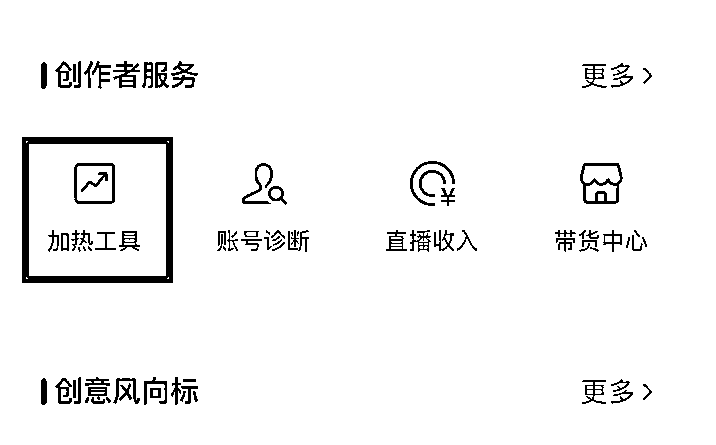

点进去之后，如果提示“账户异常”，再点“不可加热”进去看是哪个不能加热。如果是商品，那没事；如果是视频，就有问题。

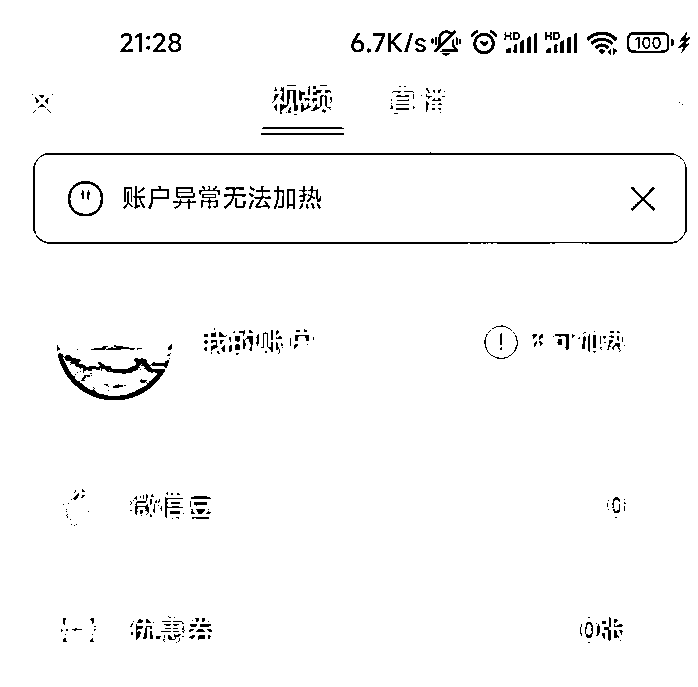

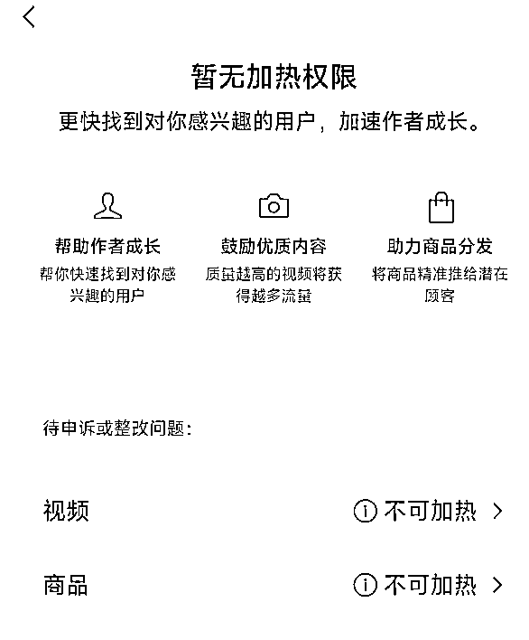

如果显示视频不可加热，就点进去看是否提示“整改中”。如果提示整改中，那就按要求发十个原创视频。

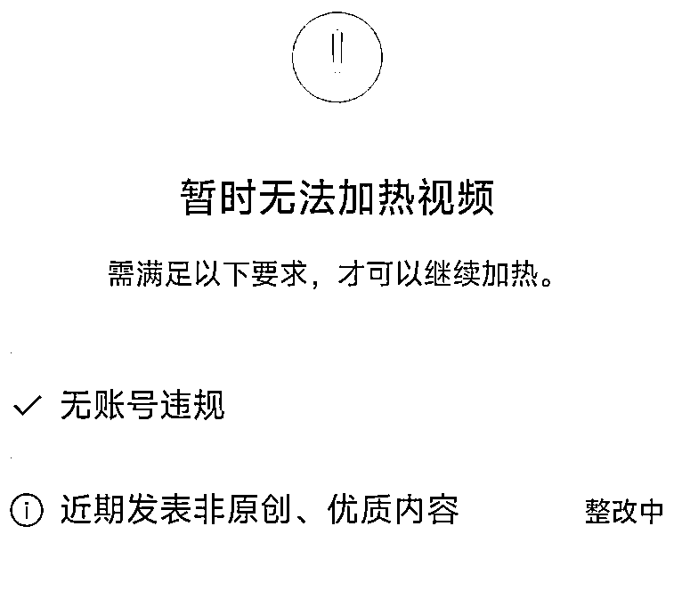

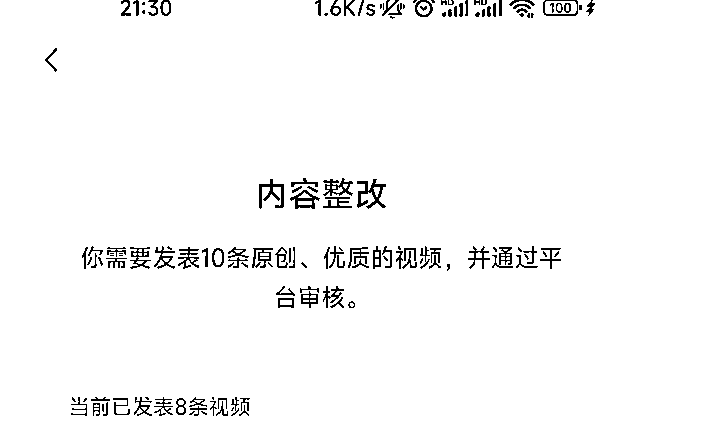

以上就是全部内容，算是我对这段时间的一次复盘总结。如果你正在做视频号，却卡在选赛道和涨粉这两关，不妨对照着上面的方法去试一试。方法都不复杂，贵在落地执行。有任何问题，也欢迎随时来和我交流。

如果你的视频号账号突然出现了那个提示，别慌，这其实是系统在提醒你：该做内容整改了。最直接有效的办法就是——抽两天时间，连续发10个15~30秒的风景或者真人出镜视频，用来平衡账号状态。这时候千万别去发聊天记录类的视频，很容易让审核问题变得更麻烦。万一你之前已经发过这类内容，而且它还没审核完，就赶紧把那个视频隐藏掉。之前正常发的涨粉视频不用动，放在那里就行。等这次整改审核通过后，再继续发你的涨粉视频。

想加快审核进度？这里有个小技巧：等你发完那10条视频后，先让系统自己审核个1天，然后打开“创作者中心”→“帮助与反馈”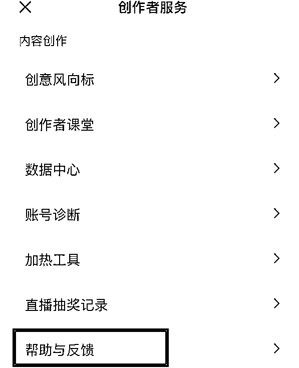→滑到最底下，点“意见反馈”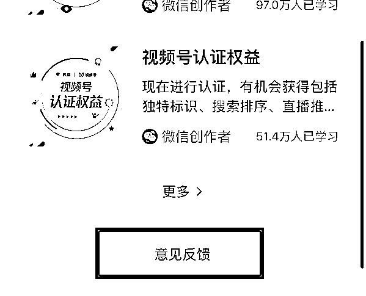→点“创作者权益”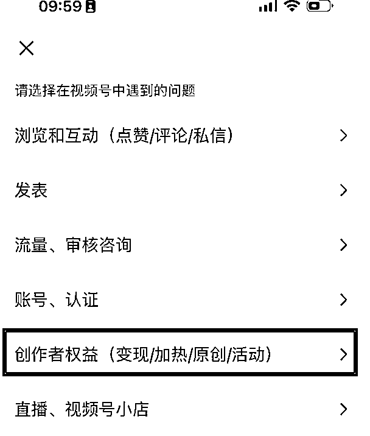→看到输入框后，把下面这段话复制进去：

“视频号平台的老师们，你们好！我很清楚视频号是一个阳光正能量的短视频社区，能在上面展示自己，我感到特别荣幸。我发出的每个作品都是自己亲手拍摄、剪辑完成的，平时对规则也十分上心，从没有故意违规的念头。如果有什么细节没注意到，那也不是有心为之。恳请平台重新审核，尽快给我恢复一波账号流量。今后我也会认真学习规则，用心创作，上传前仔细自查，争取做出更好的内容。麻烦官方再给一次机会，把账号限制关掉。谢谢大家！”

填好后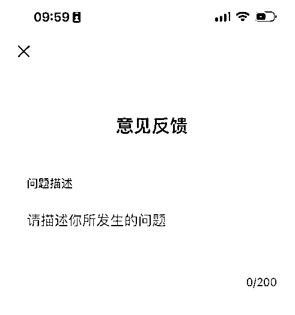，再截一张自己主页的图片，把联系方式和账号昵称一起写上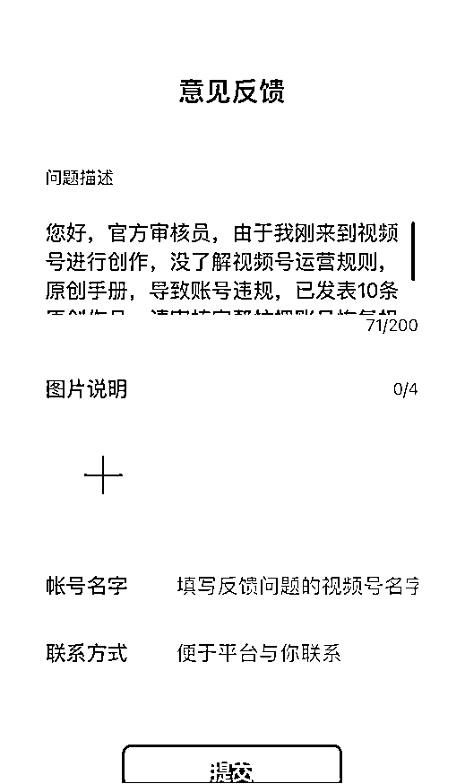。很多情况下，这样操作完就会自然过审。如果还没通过，就按上面这个方法再走一次反馈流程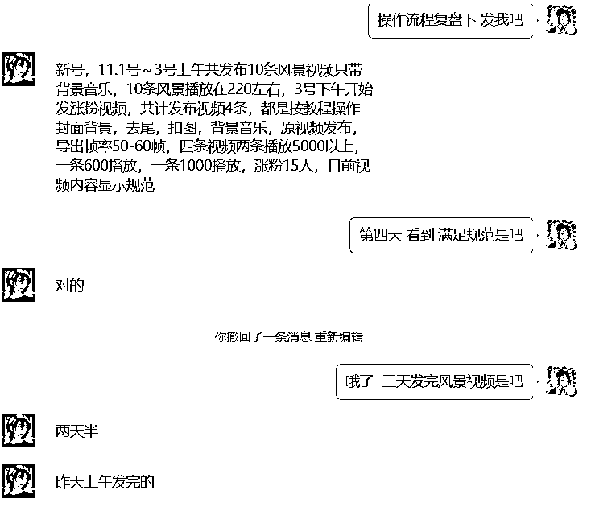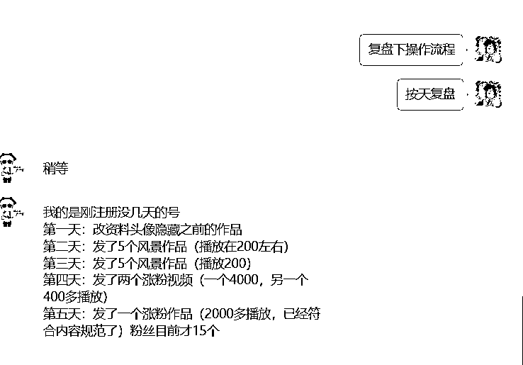。

如果你在涨粉、选赛道、过计划这些方面还不太擅长，这篇文章就是为你准备的。咱们一起“龙哥盟”，互相加油！有拿不准的问题，也欢迎随时来沟通交流。