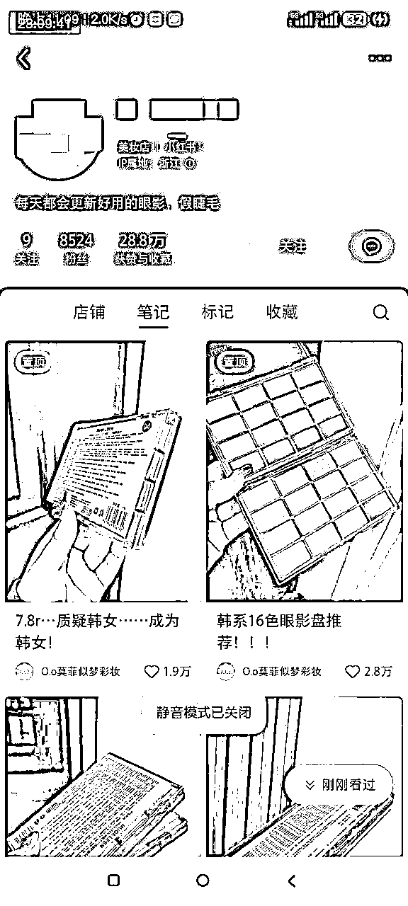
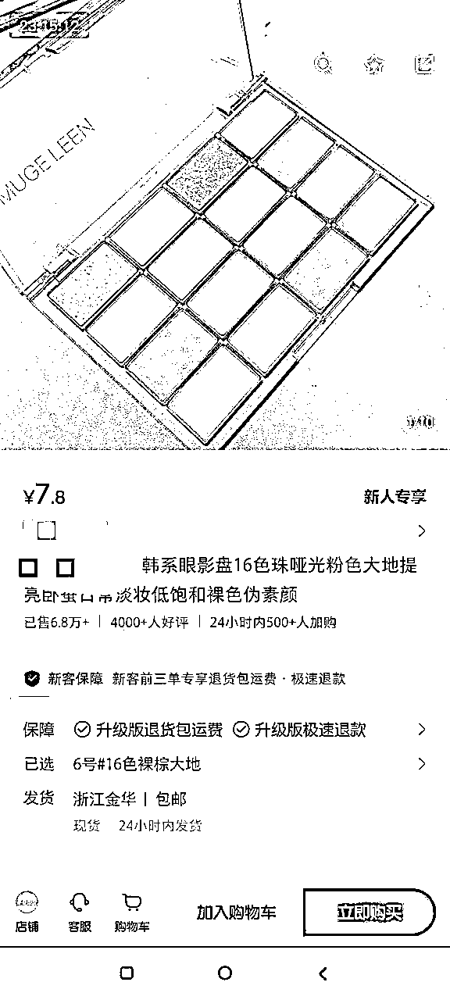
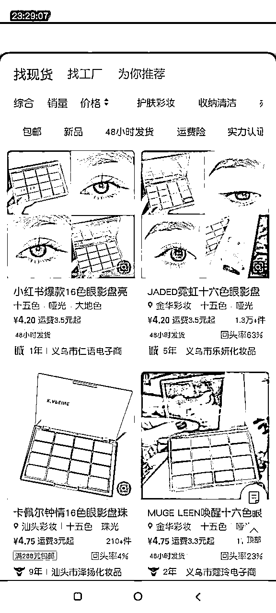

# 风向标拆解第 3 期-销量7w单的超低价十六色眼影盘 -七哥

最近在刷小红书的时候，发现了一个很有意思的爆款玩法：一款十六色眼影盘，硬是卖出了7万单。很多人会好奇，这么低的价格，到底怎么赚钱？今天咱们就来扒一扒这个风向标案例。

先聊前景。对女性朋友来说，化妆品几乎是刚需，尤其是眼影这类产品，消耗快、复购高。如果能提供一个价格特别实在、品质又过得去的选择，那在竞争里显然更容易吸引人下单。

再看产品怎么做。这个玩法的核心很简单：第一招是发图文笔记，靠视觉种草直接带流量；第二招是开企业店铺，让转化路径更正规、更顺畅。

接着说说变现逻辑。这款眼影盘走的是典型引流品路线：小红书店铺标价只要7.8元，而阿里巴巴进货价才4.75元。按7万单来算，光是这一款产品的利润就能达到：70000 ×（7.8 - 4.75）= 213500元。别忘了，这只是单一爆款的收益。

更长远的价值在于，把买眼影的用户沉淀下来，做一个女性化妆品社群，后面再推荐其他女性相关产品，利润空间就更大了。

不过有个关键提醒：靠性价比吸引来的流量，往往只是一时的热闹。真正要走得稳、赚得久，还是得去抓高品质用户，卖高客单价、品质过硬的产品，这样既能提升利润，也能让用户粘性更强，生意才做得长久。