# 内容生意做到高收入的六个底层密码

各位新朋友老朋友，见字如面，我是老宋。

从 2021 年入局内容变现，到现在已经带着上万名创作者做过选题、课程设计、卖法梳理和粉丝池成交。线下实体集训办过 3 届，每届八十多人满员；高价值的一对一陪跑，也累计做了近三百人。

先放一组成绩快照：抖音自带的课程售卖工具里，订单数超过四千；另一个成交系统里，累计也跑了一万多单。

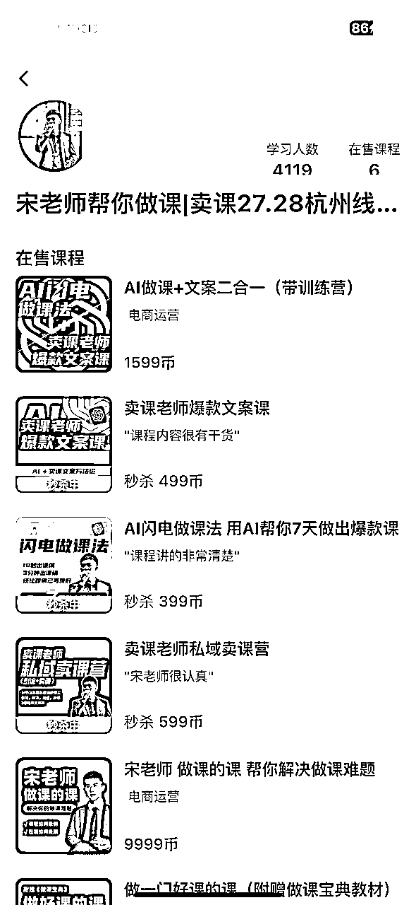

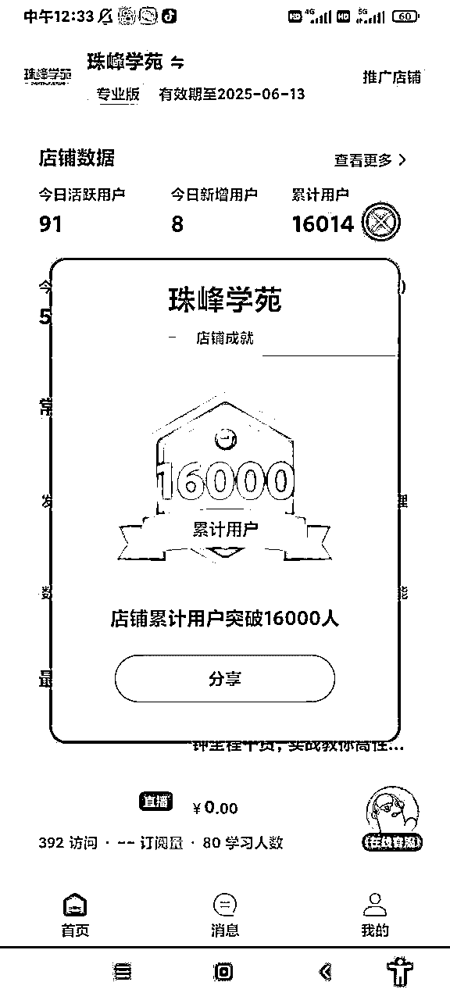

我做的账号方向是“帮人做课、帮人卖课”，全网关注二十多万，另有一批联动小号。抖音和小红书上做内容生意的朋友，大概率刷到过我。从零起步到被这个圈子看见，我花了一年左右。

简短交代一下来路，方便你判断这篇文章的含金量：

1. 头部的做课卖课方向创作者，擅长从公域拿量。
2. 在大教育公司做过业务管理，带过八十万人规模的学员社群，懂教学交付。
3. 上万名内容创业者的幕后陪跑者。
4. 不少百万账号背后的课程规划与卖法设计顾问。

如果流量一直起不来、内容带货收入上不去，往往不是执行不到位，而是认知框架卡住了。

过去这段日子我拿出六万多块做市场调研，把主流玩家的玩法几乎都过了一遍，还专程约访了几位单月销售能冲到千万级别的团队负责人。不同人的风格差异很大，但剥掉包装以后，底层高度趋同，无非是下面这六种思路。我把它们提炼成一份可以直接套用的清单，文末还附上了亲测好用的工具。

进入正题。

## 第一招 先定盘，再出手

定位这个事，在这个行业里被提得最多，也最容易被回避。懂的人一路顺风，不懂的人反复试错。

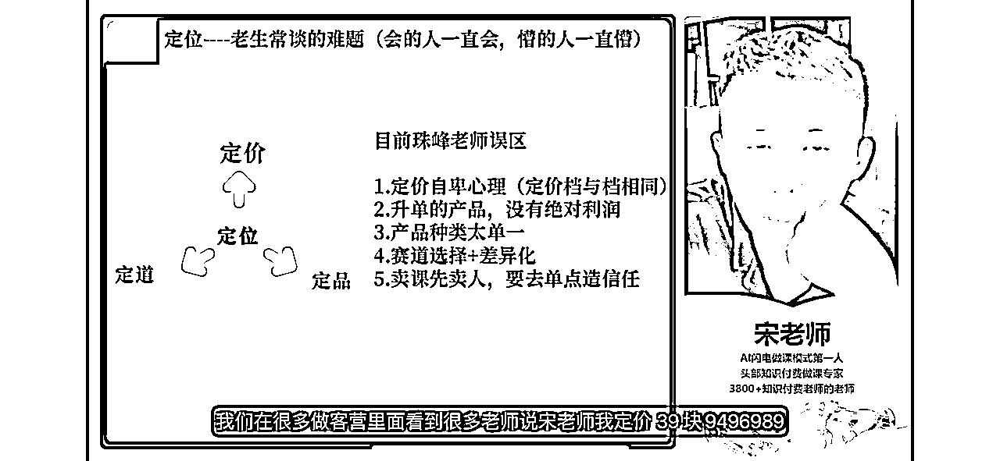

先聊价格心态。我接触的创作者里，不少人习惯把自己的课挂得很低，39、49、69、89 都有人卖，好像标高了就没人买。后台统计结果是，不超过 299 的内容几乎全被平均掉，用户根本分不出差别。低价不是因为市场行情，而是因为自我怀疑。

再聊提价。有人怕把 99 调到 299 会直接卖不动。实际数据显示：出单量减少大约两成，但到手的钱反而多了一到两倍。这还只是保守测算。做过的人都知道，便宜从来不是最好的销售方式。直播场景里，399 以内最好卖，挂到 699 到 999 就会明显变难推。

然后是产品结构。如果一个账号只挂一款课，用户买完就结束了，没有理由继续回来。产品要形成台阶，前一个产品自然带出下一个产品。常见的做法是相邻两档之间拉开六到十倍价差，用户每走一步都能看到升级的理由。

还有赛道与辨识度。课卖不动，很多时候不是没流量，而是流量来了也看不出你特别在哪。先弄清楚第一批用户是谁，他们到底被什么问题卡住，然后去做让自己显得独特的设计。所谓独特，不是一句“我是做教育的”就完了，而是“我专门解决某一类人的某个具体问题”。一群一米八五的人站在一起，你看不出谁是得分手；有人原地做一个背后运球，答案瞬间清楚了。

细分赛道特别适合资源有限的团队。育儿方向已经够拥挤，但如果你只讲“7 到 12 岁男孩的陪读方法”，或者只服务“一个人带孩子的妈妈”，竞争环境立刻不同。我有位朋友专做孤独症儿童家庭的陪伴方案，价格一路走高；另一个老师围绕“休学在家的青少年”做心理支持，一年也能做到数十万的体量。市场从来不会亏待“具体”。

比课程更先被买走的是人。用户先信你，才愿意为内容买单。与其在内容里堆砌方法论，不如把一个具体人群的处境讲透。

课程背后真正被买走的，是一种身份认同和一份可预见的改变。

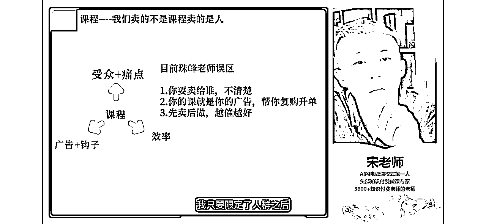

所以做内容拆条时，不需要把干货全部铺开，而是精准戳到那种焦虑感。先让用户觉得“你懂我”，后面的成交才顺理成章。

产品还没齐全时，先把人圈起来。不要等所有课都打磨好了再启动社群，等太久，信任就凉了。我早期带过一批学员，服务过程很愉快，但后续产品迟迟没跟上，关系慢慢就淡了。付费圈子是维持信任很有效的容器，先让人留在你的关系网里，再一步步交付后续内容。

入门课同时也是广告位。前端内容不能只给干货，必须埋好通往下一层的钩子。最理想的状态是，学员学完主动来问更高阶的内容，而不是等你追着推销。人性本来就容易拖延，所以钩子必须提前放好。

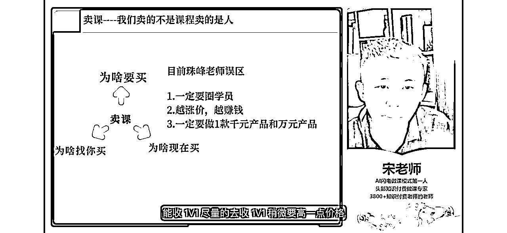

粉丝量很少的时候，先别急着上架标准化课程。我的建议是，在粉丝还没过完之前，优先接高价值的单独辅导。比如帮助用户规划职业路线、做个人表达训练、做英语提升陪练，这些都能收到不错的费用。先把一批学员带出结果，手里有了真实案例，再回到公域做内容，说服力会翻倍。单独辅导本身就是一条利润不错的线。

涨价反而是推动成交的利器。大家天然喜欢买涨不买跌。手里有流量的时候，可以每隔一阵提一次价，每次提 50 或 100，也可以挂出“15 天后涨价”的倒计时。不少人试过以后发现，涨价预告一放，单量反而上来了。

同时要准备高单价的解决方案。当内容影响力逐步起来，你会接触到完全不看基础课价格的人。比如一位企业高层想提升当众表达能力，他要的不是 399 的录播，而是高强度的单独训练。你得有这样的产品去接住他。把这类用户照顾到位，他一个人能帮你带来十个新用户。

## 第二招 先收钱再开工

预售的核心逻辑，是让用户帮你验证产品方向，同时给制作过程注入一股不可忽视的动力。

抖音和小红书卖课，本质上都是在做市场测试，先上架再打磨。我有个朋友账号数据正好的时候，临时决定开一场卖课直播，当时开播在线几百人。他没有现成的课，就当场列出内容大纲、当场挂出购买链接，499 的价位开始出售，当天卖出 100 份。第二天他立刻进入疯狂做课状态，因为约定的交付周期只有两周，不交课就面临退款和投诉。预售硬生生把他推着把课做完，而且做得很快。

先收钱的价值有两层：一是确认需求真实存在，二是给自己一个不可拖延的交付节点。已经被用户预付过的内容，做起来的状态完全不一样。

## 第三招 一次投入，多重产出

想靠单打独斗把内容生意做成年营收破百万，几乎不可能。个人产能的上限很低，撑死不到一百万。要做到更大的体量，必须借助系统、团队和分发网络。

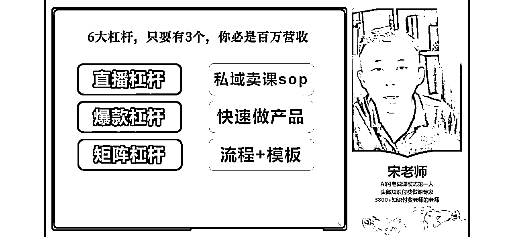

所谓借力，就是一次动作能带回多次收益。举个例子，有位做线下集训的主理人，每次开课都把收入结构设计得极有层次：门票收一笔，公域直播放出去再收一笔，全程多机位拍摄，关键部分剪成无数条短内容，后续持续获取流量。现场还专门设计了学员访谈环节，问“你是谁”“这次收获最大的是什么”，素材剪完以后直接变成用户见证。同一场集训，主讲人只需要讲一遍，回报却叠了三四层。

爆款内容也值得这样使用。一条视频火了，马上重拍十个角度版本，分发到不同内容渠道，后端销售团队统一承接。只要流量足够，团队可以靠一个爆款吃好几周。

多渠道分发本身就是乘数。同一个内容在 A 平台有十万浏览量，拿到 B 平台又多五万，到了 C 平台再有五万。只盯着一个渠道，就等于丢掉了一大半曝光。更进阶的玩法是同时经营多个账号，一个账号带来十万浏览，五个账号就是五十万，再搭配五个渠道资源，总曝光量非常可观。而这一切对 IP 本人来说，只需要把核心内容拍好，剪片和发布交给团队就够了。

这个行业没有懒人，能做出结果的人多半都很努力。但真正拉开收入差距的，不是努力本身，而是努力之外有没有设计感。

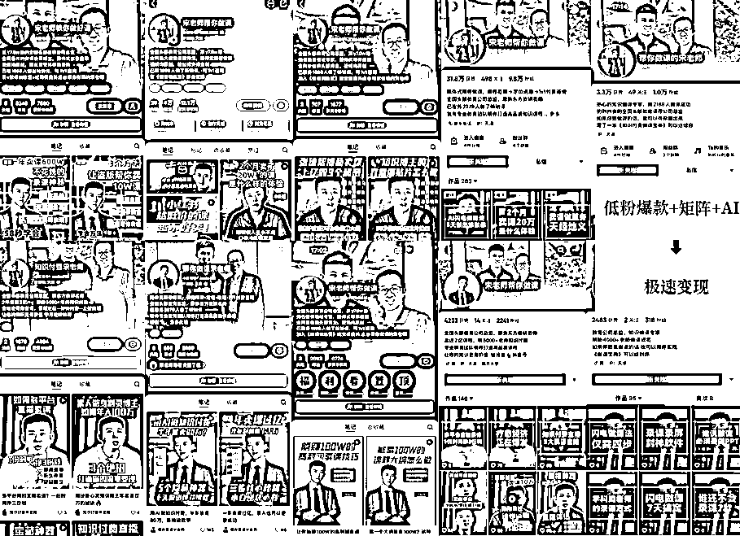

## 第四招 让成交流程自己运转

想成为“不用一直盯盘”的内容卖家，你需要一套完整的标准化流程。

这也是我坚持办线下集训的原因。流程里的细节太多，线上讲不清楚，必须在线下带着大家一步一步搭起来。我现在一周里有一半时间不在公司，课照样在出单。原因很简单：运营执行者按模板推进，自动化工具定时发送内容，用户在持续触达里自己完成付款。IP 本人被彻底解放出来，不再陷进日常客服和运营的琐碎里。

这类流程不是一次成型的，需要反复迭代。我们目前沉淀了近二十套标准文档，而且每隔几周就会更新一轮。

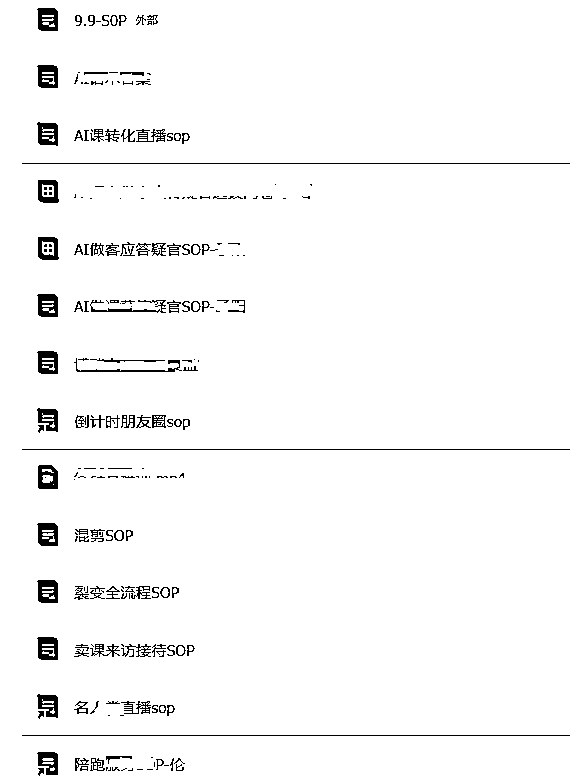

## 第五招 产品要持续换代

内容生意里，一个单品的热销周期通常只有半年。连续卖六个月还不更新，半年之后就没有新用户可接了。所以要快速推出新品，不断把新流量接入产品体系。

产品结构可以按这个思路来搭：入门款负责引流，中段款负责盈利，高端款负责服务高预算用户。结构完整以后，成交会变得自然，甚至形成自动循环。

## 第六招 用模板放大团队

想做大就必须带人。单干阶段我的个人上限就是小一百万，因为没有团队承接，增长到一定程度肯定会卡住。要放大，只有一条路：把关键动作变成模板，让新人快速上手。

拿收入测算来举例：假设入门课定价 399，几个公域平台每月卖出 300 单，粉丝池里再出 200 单，入门款这条线一个月就是 20 万左右。中段课程定价 2499，按三到四成的升级比例，大约能带来 37 万。顶端放一万元档的深度服务，每月出 10 单，就是 10 万。加起来，公域端月入 12 万，粉丝池端月入 55 万，单月总进账约 67 万。

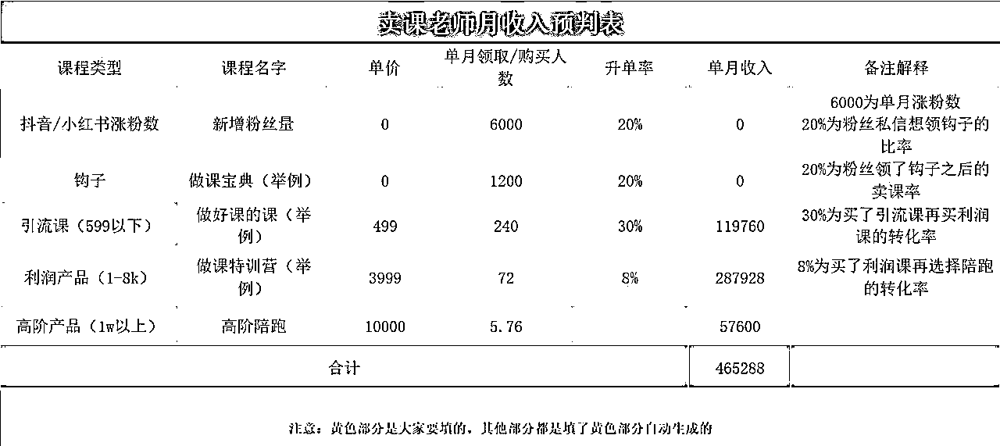

把数字代入你自己的产品结构里算一遍，就能看清哪些环节还值得继续加码。

下面补一份实用的工具清单。

## 工具一：群组管理工具

自动欢迎语、自动应答、自动建群、定时任务，还支持一条消息同步到多个群组。做用户沉淀的团队很值得配一套。首次搭建略花时间，熟悉之后会相当顺手。

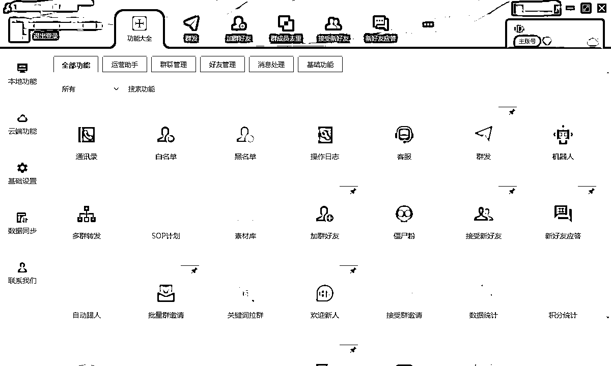

## 工具二：接待话术工具

把经常重复的回复存成模板，命中关键词即可一键发出，省去反复敲字的麻烦。

## 工具三：直播回放录制工具

可以录下业内朋友的开播画面，再通过飞书自带语音转写，把讲稿变成文字，方便拆解表达结构、提炼可复用的东西。

## 工具四：选题挖掘工具

能批量找出小众账号里的高赞内容，也可以按领域做深度检索。挑选题的效率能明显提上来。

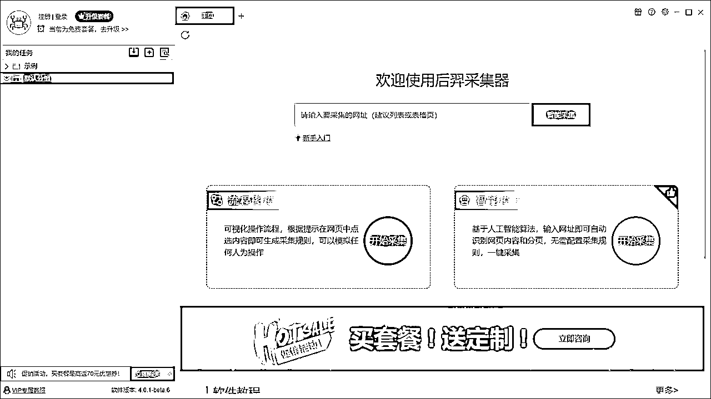

最后说多号联动。多号联动的真正价值，是把 IP 本人从重复劳动里释放出来。内容拍一次、分发多轮、多个账号共享、订单持续回流，这才是合理的业务结构。

多号同时起步，也是常见的冷启动打法。一条内容先在两个渠道试水，表现好的再铺开，用数量换机会。平台规则允许的范围内，账号越早铺开，跑出结果的概率越大。

到这里，六招就拆完了。总结成一句话：内容生意看着拼表达，实际上拼的是结构设计和复用能力。把这六种思路慢慢内化到日常运营里，收入结构自然会发生变化。

这次先聊到这儿。想继续深挖的朋友，评论区见。

关于流量，除了剪辑混剪这类技术、原创输出能力，以及AI辅助写文案，这些都是提升曝光的好方法。以后我再单独展开讲；我这边也准备了一份短视频剪辑SOP，需要的老师可以直接来取。

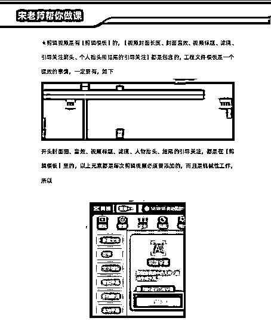

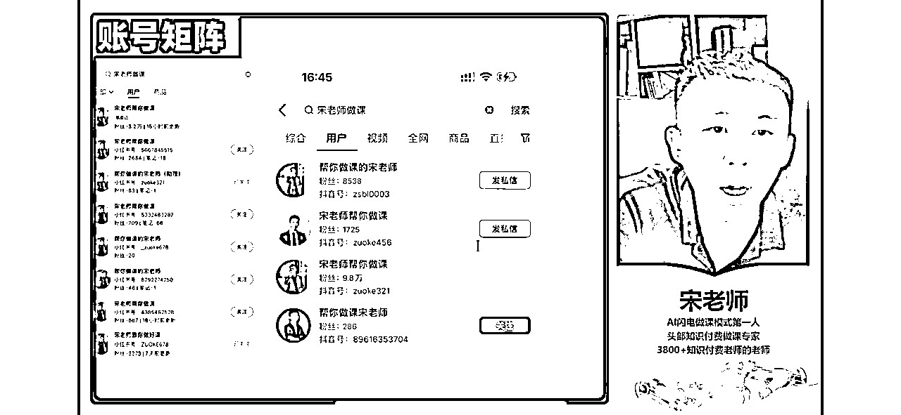

## 二、产品矩阵

课程内容想覆盖更多人群，就要从多个角度设计方向。只要是愿意为知识付费的人，我这边基本都有匹配的课程，可以让人直接跟着学。同时，并不建议把品类做得很杂，选择太多反而让用户难下手。与其铺开，不如挑出一两门优质爆款课当主力重点销售。

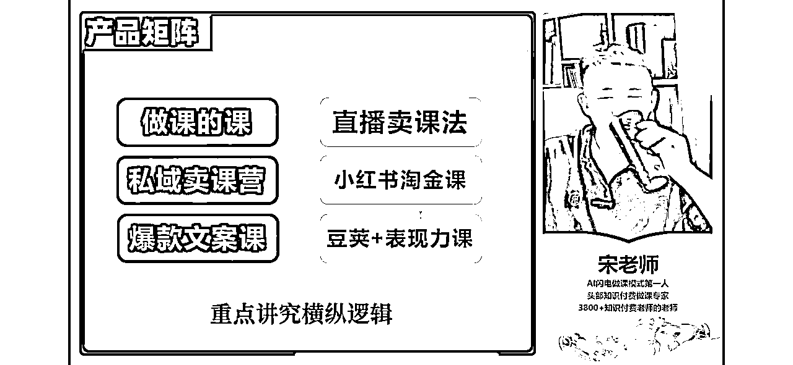

## 三、多 IP 矩阵

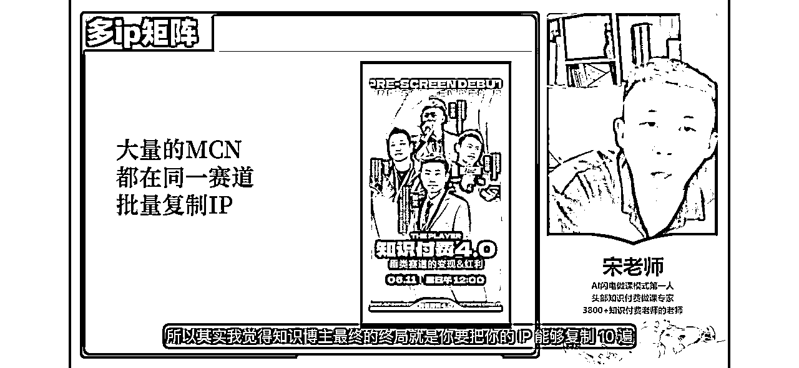

知识类博主做到最后，核心不是只经营自己，而是把个人IP复制、放大。也就是说，把已经被验证过的成功内容和模式，一次一次复制出去，才能形成更大的影响力和持续增长的收入。

打个比方，我们现在就在签约一些有潜力的IP，尤其欢迎愿意来天津、和我们深度合作两个月以上的人才。我们想找的是已经在财务、会计、家庭教育等垂直领域做出过成绩的博主：比如某位老师已经在一个专业方向上跑通了，但想获得更大发展，只靠一个人的力量很有限。更理想的路径，是找到更多同样优秀的专家，把他们也复制成可复制的成功模型。

一个IP做到一定规模后，比如年收入稳定在一千万左右，再往上增长就需要换打法。这也是为什么我们要找能复制成功模式的合作者，博主之间合作，不只是互相借力，更能一起把经验和策略放大。说到底，IP的终点无非两条：要么开MCN，走小徐那套模式；要么把个人能力做到极致，成为李一舟那样的超级个体。

## 四、多平台矩阵

做多平台起号，也要理解每个平台的脾气。抖音更看重内容，小红书更依赖封面点击，视频号更多靠私域转化。每个平台都有各自容易爆的玩法和人群，深聊的话可以私下交流。

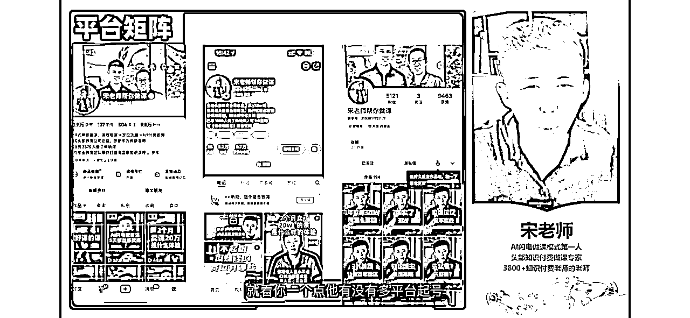

# 六、日进斗金

知识博主想赚到更多钱，说到底要盯住两件事：一是提高总收入，二是降低总成本。

提高总收入，别把自己限制在“卖课”这一件事上。可以卖课，也可以做咨询、陪跑、卖其他服务，开线下课，甚至做分销。每个渠道都能带来现金流，所以真正要想的是：除了课程，我还能给用户提供什么？卖信息、卖陪跑、卖服务、卖线下课、卖分销，都是可选项。找到合适的人或渠道帮你分销课程，也是不错的收入来源。

降低总成本，则要关注人效、评效、绩效和投资回报率。具体来说，就是看每个员工、每笔投入到底能带来多少产出：招人值不值，租场地划不划算，背后都要算账。如果不知道怎么精细算，至少也要算清投资回报率——投入一块钱，最终能赚回多少钱。想提升利润，这个账必须心里有数。

一句话：日进斗金的底层逻辑，就是把收入源头做大，把成本做小。知识博主只要把这两条抓住，收入增长只是时间问题。

# 写在最后

今天的分享先到这里。不管你是企业老板还是个人博主，知识付费都可以说是一件成本极低、回报极高的好事，行业利润能做到75%以上。老板可以把经验做成课程，用课输出产品逻辑或管理思维，也更容易赢得合作伙伴的信任。

个人博主则能借助课程增加收入、拉高粉丝粘性，也为后续合作铺路。任何知识付费相关的问题，欢迎随时来找我聊。

知识付费的体系确实很大，但有时候我们不需要抓住整棵大树，只要先拿到一片叶子就够了。把底层逻辑摸透，找到合适自己的入口，就能持续挖到矿。

这条路上，知识博主拼的不是谁跑得快，而是谁能做得久。祝大家2024年龙哥盟、知识赚钱，也谢谢每一位读到这里的老师！

我是宋老师，2024年已经帮助500位老师卖出50万课程，欢迎和我一起卖课赚钱！