# 用AI撬动用户增长，我踩过的坑和最有效的打法

阅读提示：

1、本篇约2800字干货，全是实操笔记，配图较多，建议用PC端打开查阅更顺畅。
2、想交流细节可以加我🛰️：qiaobangzhu-cn，一起聊AI、聊变现。
3、乔帮主AI实操训练营现已招募中，两天一夜线下实战带练，课程升级、案例更全：

目录：
1、2023年我验证过的四个AI变现赛道
2、AI到底怎么推动用户增长
3、我们交付的是什么产品和服务

新年快乐，我是乔帮主。借着新年开工的势头，跟大家聊聊我认为当下最具竞争力的AI项目，希望龙年大家财源广进。

过去两个月里，我在圈内的路演、聚会、年会等线下场合，反复讲了AI在营销上的落地。把这些经验整理成文，分享给大家参考。

# 1、2023年我验证过的四个AI变现赛道

ChatGPT一周岁了，2023年也算是AI商业化的元年。我自己在这条赛道上摸爬滚打了一整年，亲手试了几个方向，总结出四个相对靠谱的盈利路径，现拆解如下。

其一是AI+技术。说白了就是我的老本行。我一直说，上一个十年属于云计算，下一个十年必定属于AI。

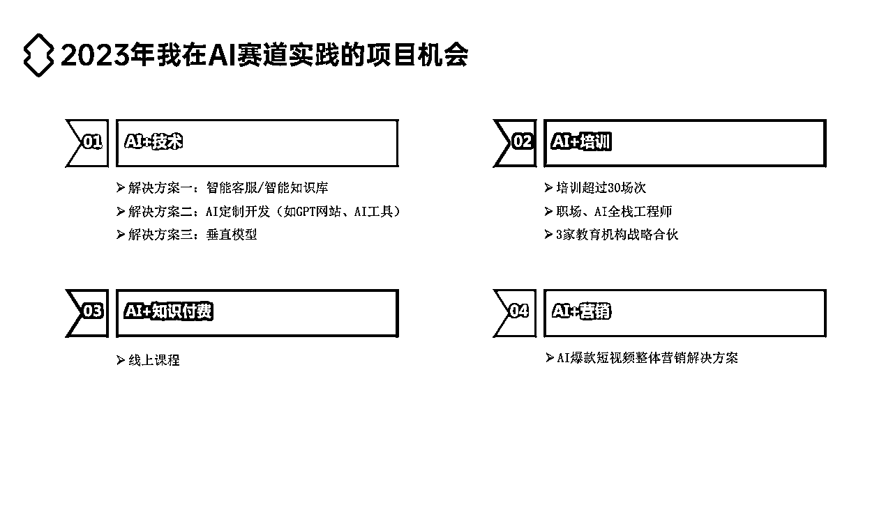

企业端的应用，本质上是AI技术和业务场景的结合，定制化开发、部署实施都会成为刚需。智能客服与知识库、定制化GPT网站到AI工具系统、类私有化垂直大模型，这些方案已经比较成熟，也能赚钱。

但问题是，智能客服、定制开发、垂直模型这几条路，都需要专业技术团队加专业销售团队，企业资质要求也高，对个体创业者和小团队并不友好，落地难度大。

其二是AI+培训。这也是我熟悉的领域。虽然主业不是培训，但我长期兼职讲课，也在高校带过课，对培训的体系很了解。

AI会重塑所有行业，每个行业都可以用AI重做一遍。培训行业也不例外，过去的内容体系终将被AI体系重塑。这个方向我也看好，是个蓝海。

需要说明的是，这里说的培训是指至少一个月的系统课程，不是两三天快餐式知识付费。因为课程体系开发体量很大，光内容搭建就得半年以上。

不论面向C端学员还是B端企业，AI+培训都和AI+技术很像，需要讲师团队和营销团队，门槛偏高，也不适合单打独斗的个体户。

其三是AI+知识付费。大家熟知的案例就是李一舟卖课，抖音上流水三四千万。这个赛道的核心是先懂知识付费的玩法，再用AI加持。知识付费的本质是做自媒体，会做公域引流、会做IP运营，基本就能起来。

门槛比技术和培训低很多，卖课、做社群、做陪跑营，赚多赚少普通人都能上手，很适合个体创业者。

其四是AI+营销，这是我最看好的赛道，后面重点展开。核心是用AI来驱动用户增长，帮助企业做获客引流。这也是我绕了一大圈后，认为竞争力最强、目前主攻的方向。

# 2、AI到底怎么推动用户增长

我们用一个专注AIGC企业营销落地的科技公司来跑这个模式。公司定位是做AIGC驱动企业增长，业务覆盖AI行业培训、内容营销、落地执行，坚持实战和陪伴。

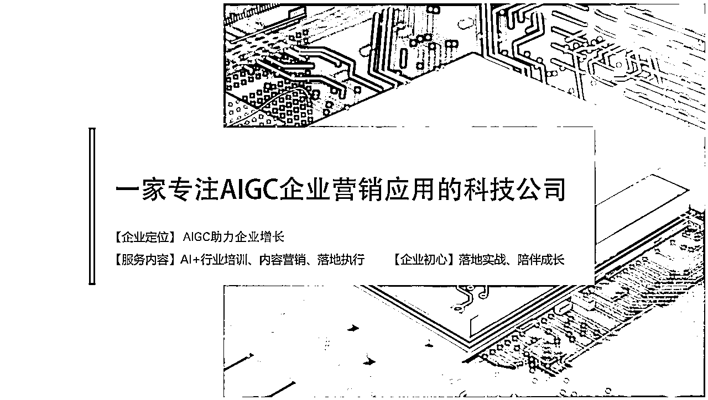

我们是如何助力企业增长，提升营销效能的？

提升营销效能的第一步是协作效率，也就是把SOP跑通，这是地基。然后借助AI爆款短视频+数字人引擎+智能矩阵系统，实现个体效率的十倍放大。

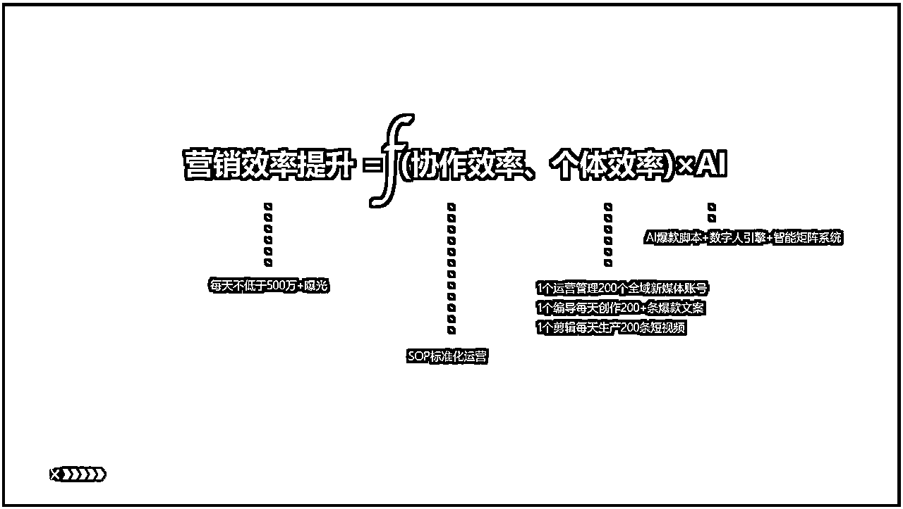

具体效果是：1个运营可管理200个全域新媒体账号，1个编导每天能产出200条爆款文案，1个剪辑每天能做出200条短视频，企业日曝光轻松做到500万+。

典型案例是博商的张琦，采用了我们的企业智能解决方案。通过AI企业营销短视频矩阵：AI内容生产+数字人+智能矩阵系统+私域SOP，一名员工一天就能剪出200条营销短视频，企业获得百万级曝光，覆盖上百关键词，获取上千条精准线索。

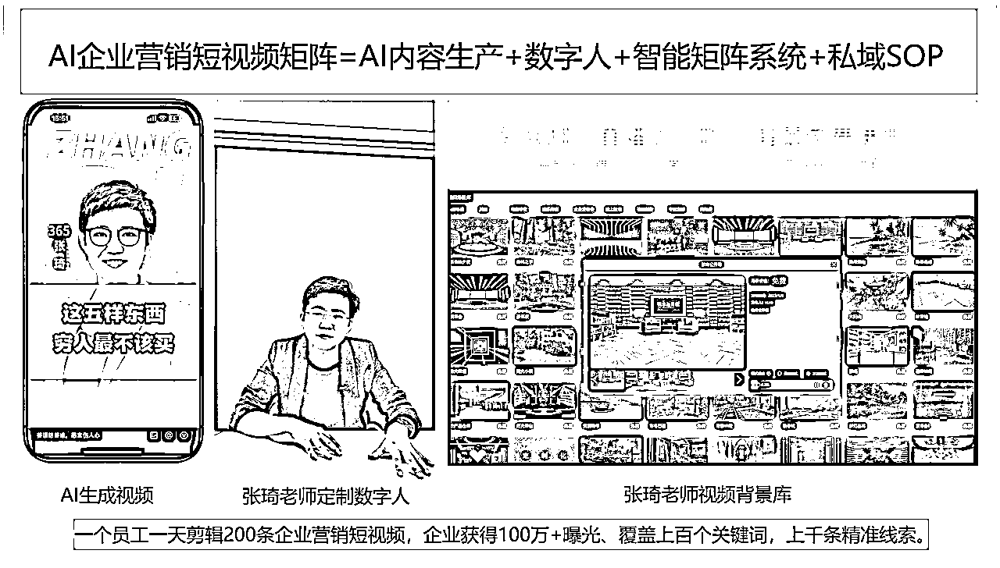

借助该方案，张琦全网播放量破百亿，全网分发超10万条短视频，矩阵账号数量上千。

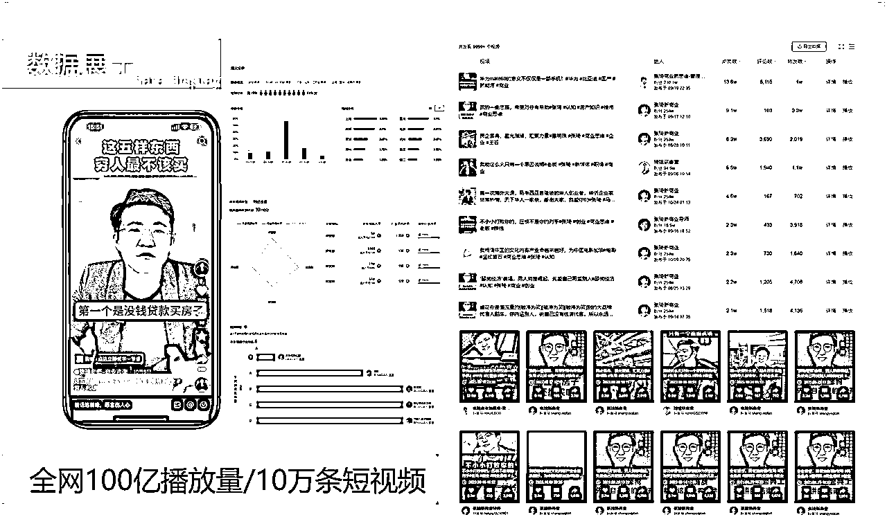

我们的矩阵系统核心能力是：管理上千账号、AI自动写脚本写分镜、全平台一键分发、数据追踪和消息自动回复。巅峰时期单日可产出15万条短视频。

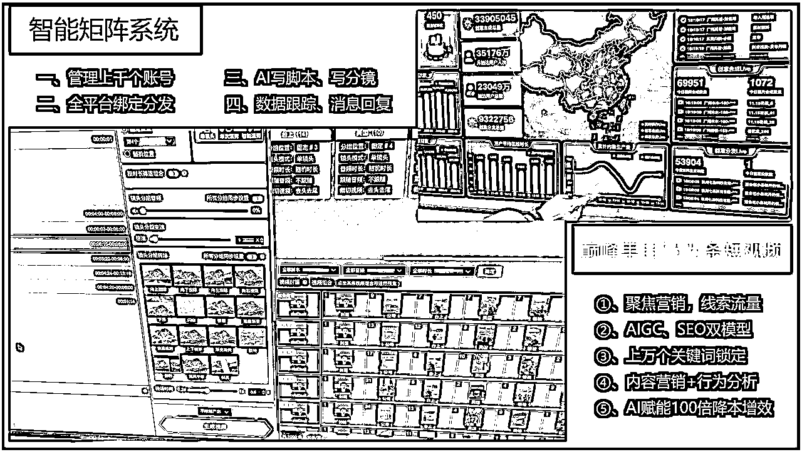

我们正在上线的AI视频宝，就是为了让爆款脚本创作更智能。它把我们多年积累的各行业爆款短视频文案经验沉淀进去，直接赋能用户。

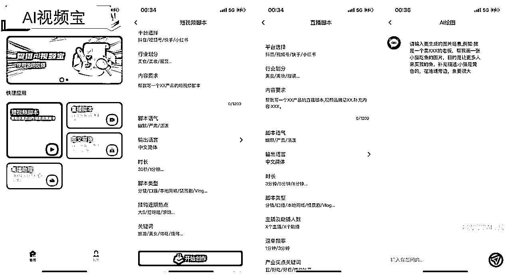

# 3、我们交付的是什么产品和服务

我们主推的是围绕AI视频宝+矩阵系统+数字人的一体化解决方案，核心是手把手教企业把AI企业短视频营销矩阵跑通。

培训模块包括AI创作、营销定位、账号矩阵规划、内容体系、运营体系、本地化部署、矩阵系统实操、数字人系统实操。费用为两天29800/人，69800专场5-8人。

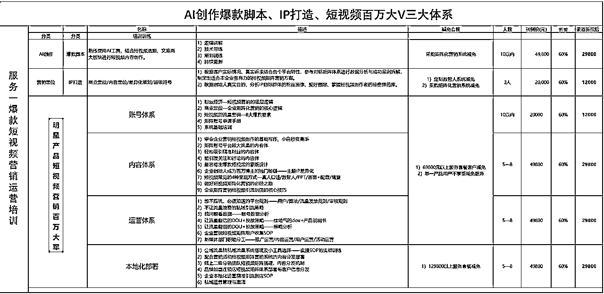

培训结束后，用户可自行采购矩阵系统，用于批量管理矩阵号。

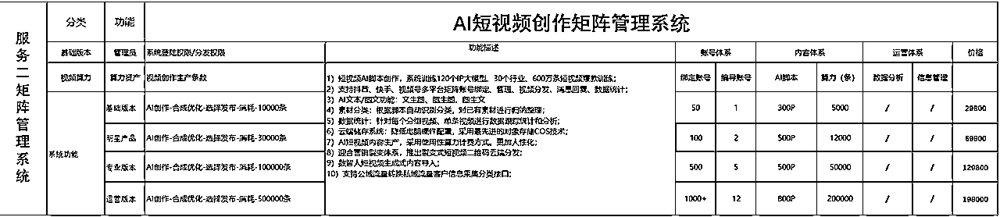

也可采购数字人系统，定制专属真人数字人形象。

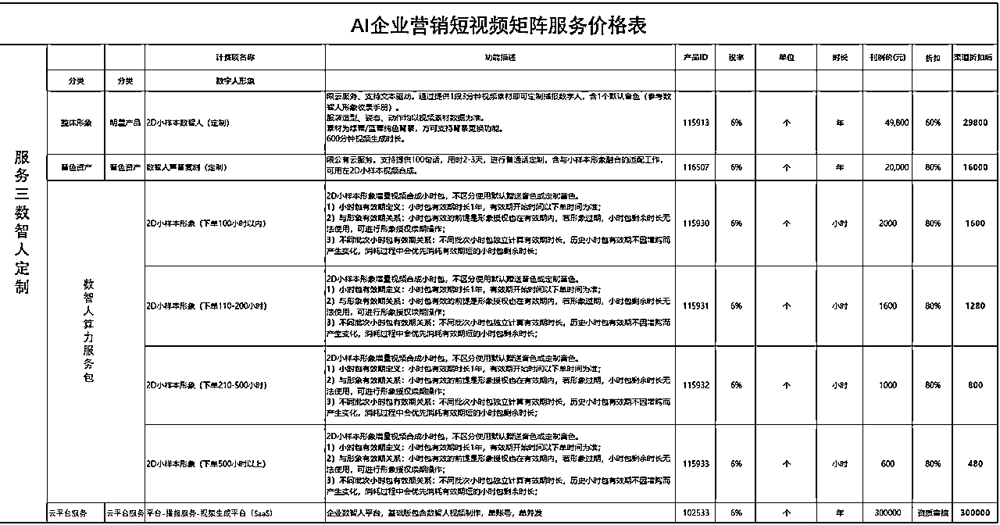

但实话实说，即便把方案和细节都掏出来，很多企业依然跑不通。这是技术活，需要专业人手操作，门槛不低。所以我们的高客单服务就有了空间。

目标行业集中在美学、本地生活、培训、新能源汽车。因为这些行业的SOP我们已跑通，对业务足够熟悉。

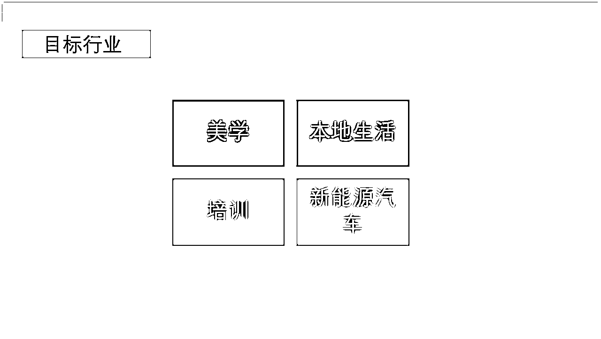

高客单服务起价20万，由我们团队结合企业业务落地短视频矩阵。交付承诺是发布1万条以上短视频，保证播放量和点赞量。线索部分按100-300元/条额外收费。

这个项目具备四个特征：企业刚需痛点、AI风口红利、回款快、严重缺人。特别是现在客户已经付了钱，交付压力很大，急需人手。

目前团队以上海为总部，是业务中心。我会先在上海待半年带团队，把SOP跑稳。之后在杭州设立新公司，组建后端交付团队，完善交付体系。

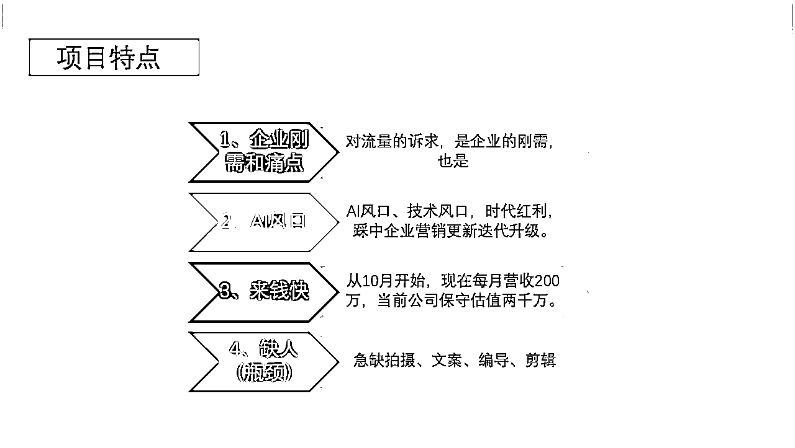

这就是我近期主攻的AI项目。1月起一直在上海密集执行，很多圈友想来交流都被我推掉了，实在忙不过来。

跟同事感慨过，我以前是技术总监，现在却在做营销，和过去的编程工作完全不同。但对创业者和营销短板明显的我来说，这个项目带来的提升非常大。

一个月高强度做AI+短视频矩阵，对账号起号、定位、内容方向都有了系统认知，现在能自信地给客户提供方案。

受限于篇幅，很多实施细节没法展开。有兴趣深入交流或想一起参与的伙伴，可直接加我联系。

* * *

乔帮主的AI实战训练营正在火爆招募中，在线下通过两天一夜手把手带大家玩转AI。全新课程不仅在课程内容价值上实现了质的飞跃，而且实战性更强，案例更加丰富：

* * *

往期干货精选：

往期干货合集：

🛰️：qiaobangzhu-cn，添加请备注：赚钱圈友。欢迎交流！

👸号：点金乔帮主

