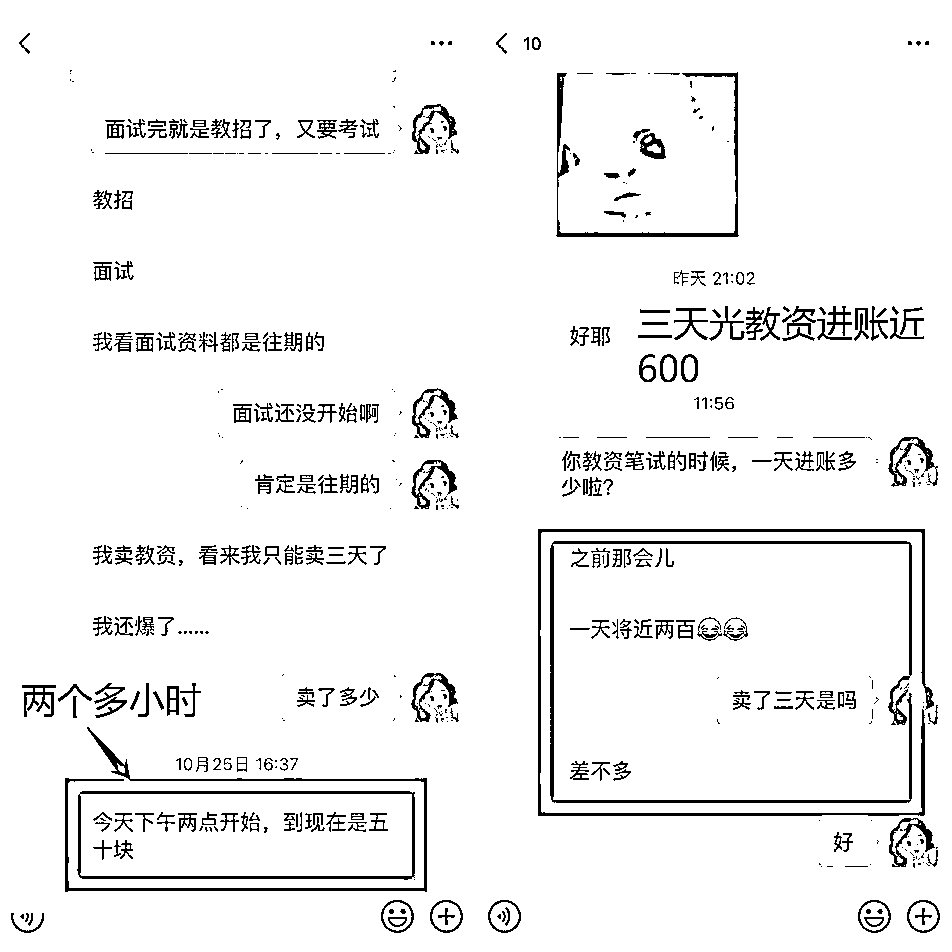
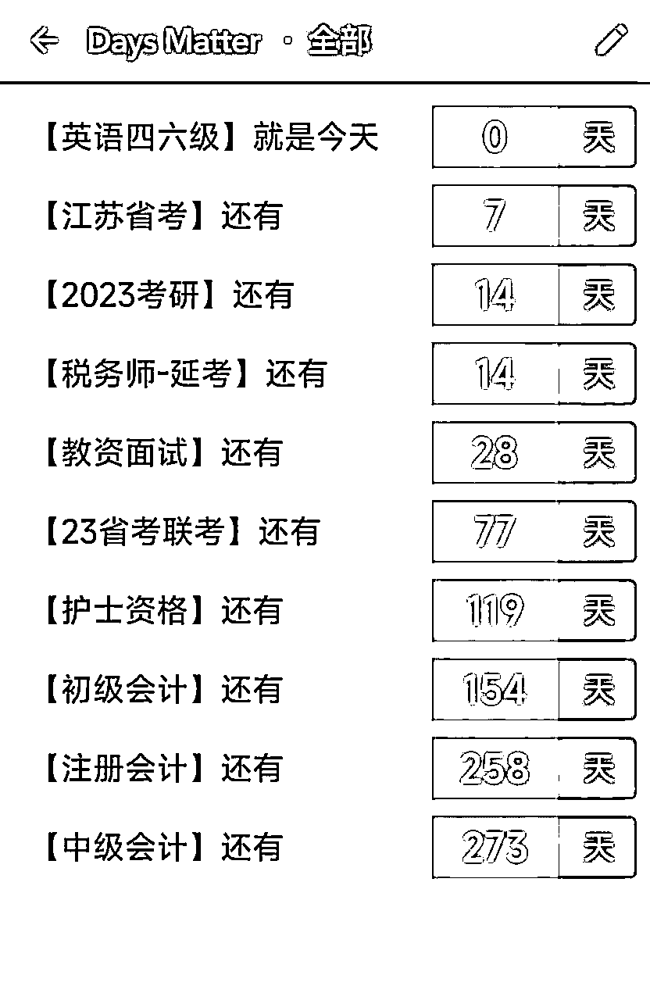
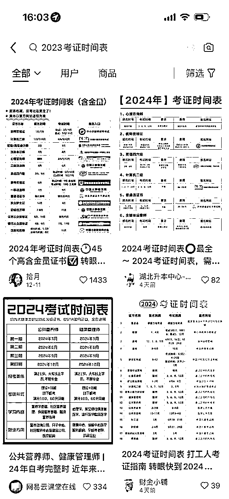
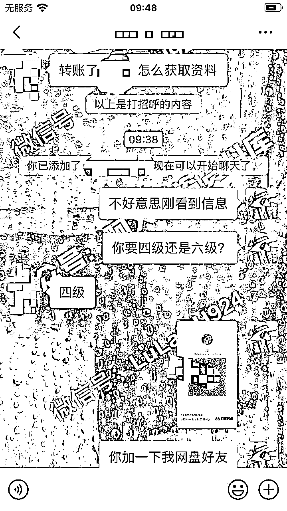
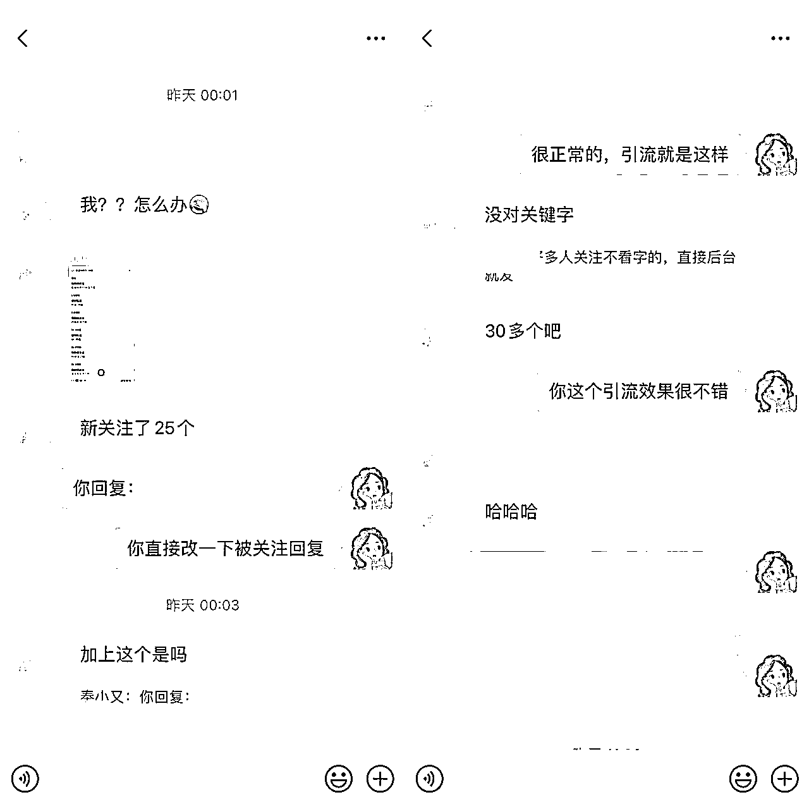
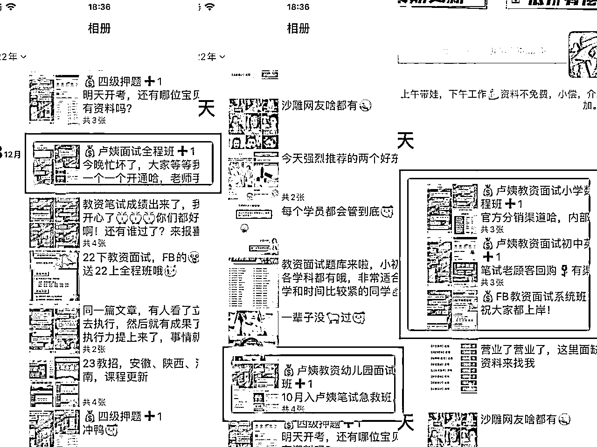

# 2023总会分享会：月入过万，学习资料项目如何没有淡季
作者：龙哥

裸辞做自媒体这一年多，我的总收入接近18万。很多人问我，卖学习资料是不是只能靠某一类考试吃饭？今天就跟大家聊聊，怎么让这个项目没有明显的淡季。

刚开始接触资料项目，别贪多。先死磕一个考试赛道，把它做透做深。因为新手一上来就想全抓，最后往往哪个都做不好。但当你把一个赛道跑通了，其他考试赛道其实也能快速复制。而且有个“主打方向”，粉丝会更信任你，粘性也更高。

不过，想让收入更稳，最佳策略是：一个主打赛道做精，再用其他考试赛道做补充。毕竟再热门的证书考试，也不可能每个月都开考。以教资为例，一年两次笔试、两次面试，频率已经算高的了，但每次考完后的那个月，资料基本卖不动。那这段空窗期就不赚钱了吗？当然不是，我们可以临时转向其他考试热点去引流。

我之前有个学员，主做考研资料，结果在教资笔试期间，每天也能进账近200元。我自己主攻教资，去年年底临时切到四六级押题，也额外赚了近两千。

具体怎么操作？我拆解成几步。

**第一步：盯紧考试日历。**
至少提前一个月或考前20天开始布局，趁着考试热度集中输出内容。网盘资料团队一般都有完整的考试时间表，没有的话，去📕搜“XX年考试时间表”，随便一翻就是一大把。

另外，招生考试官网也会发布详细安排，多留意就行。

**第二步：别被“不专业”吓退。**
我们要搞清楚，这种临时引流根本不要求你是专家，懂个大概就够。临近考试，大多数考生的心态就是临时抱佛脚，他们不会追着你问细节，只希望拿到一份重点资料，突击几天，能过就过，不过下次再来。
所以，你只要找到靠谱的网盘资料团队，整合出押题包或复习重点，然后去各平台引流就够了。

我自己当时就是把其他平台的人引到👸号，后台设好关键词，很多人都是直接转账再加我🛰️领资料。资料发完之后，再说点“祝你上岸”之类的吉利话，顺嘴提一句“我这边还有考研、考公、考编的资料，以后需要随时找我”。就这样，很多老顾客和转介绍都来了。

**第三步：去哪儿引流？**
所有你能想到的平台都能用，👸号、📕、抖音、🧣，全都可以。我做四六级押题那会儿，白天要带孩子，每天只有四五个小时干活，所以只用了🧣和👸号。但就这么两个平台，也够我忙的——👸号只发了一篇文章，就来了20多个精准用户，成交率高得惊人。我学员用同样方法，也跑出了不错的成绩。

一条推文给新号涨了30多个粉。🧣就去对应的超话里发内容，但小心被举报或拉黑，一旦被两个超话拉黑，你的号基本就废了，权重会掉得很厉害。

📕的效果也很好，分享一个最基础的操作：装成一个求资料的人，发一条帖子，带上热度高的话题标签，等流量起来后，自己在评论区留言说“找到了！太不容易了！”再换小号来回复“姐妹，可以分享一下吗？”然后用大号继续引导。如果平台提示违规，把笔记隐藏就行。
或者，去各种相关帖子的评论区截流，说自己上岸了，用的就是博主分享的这套资料。再安排小号在自己评论下面问“姐妹，可以分享一下吗？”自然就有人跟风求分享，这时候再针对性引流。

**第四步：别把“垂直度”当枷锁。**
我教这个方法时，有学员问：“不是说要尽量垂直吗？发别的内容会不会影响账号定位？”记住，是“尽量”垂直，不是“绝对”垂直。平时深耕一个领域没错，但偶尔追下热点完全没问题。主赛道淡季时，你是保号重要，还是赚钱重要？
说实话，偶尔发点别的不会让账号死掉。我们的终极目标是变现！变现！变现！就算账号真没了，重新做一个也不难，有做号的能力，照样能赚钱。我自己都做废过好几个🧣引流号、4个📕号，废了就废了，钱赚到了，账号就完成使命了。一个号做得再漂亮，不赚钱有什么用？

这就像川菜大厨，主打川菜，可来了位想吃清淡的客人，他也能临时炒个别的菜。客人知道他的本行是川菜，其他菜稍微差点意思也不会怪罪。这不影响他川菜大厨的定位，先把临时客人服务好、把钱赚了，才是正事。我之前专心做四六级引流，教资那边基本没顾上，结果四六级热度一过，教资笔试成绩公布，照样一堆人来找我买面试课。

无论是虚拟学习资料还是其他副业，都要把资源利用到极致，才能赚到更多。

**最后，没有押题资料包怎么办？**
简单，去找同行买！怕买了卖不出去？那就先去同行账号里找引流素材，自己处理一下图片，先开始引流，等有顾客下单了，再去同行那买一份过来就行。同行就是最好的老师，遇到不会的，翻翻同行的操作，很多问题就迎刃而解了。