# 视频号语音直播，涨粉几百，上千的完整流程玩法

这段时间视频号语音直播是真的火，很多人靠这个路子把粉丝做起来了。我自己连着播了三场，每场差不多涨一百来个粉，身边更有朋友单日直接涨粉过千。没啥基础粉丝也能玩，全靠平台推荐流量在推。

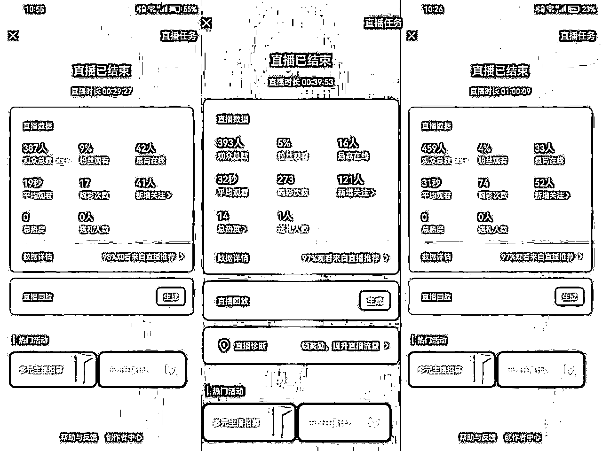

玩法说白了很简单：用语音电台的形式开播，挂上福袋，偶尔聊聊天，把人留在直播间，核心目标就两个——给私域导流，顺带把视频号粉丝做起来。后面变现无非是私域成交，或者直播带货。

先讲注册这步。视频号在微信里就能开通：打开微信，进“发现”页，点“视频号”，再点右上角那个小人头图标，就进入开通页面了。

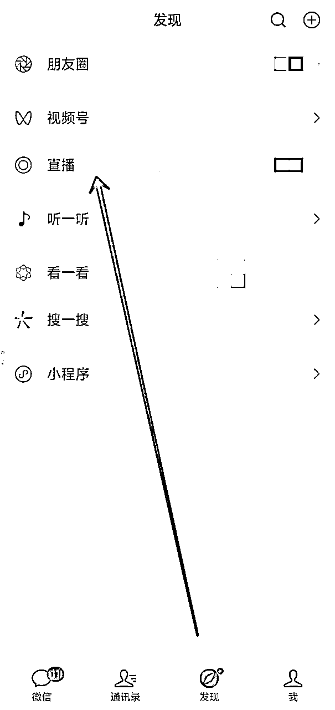

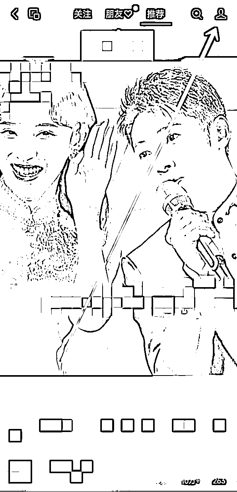

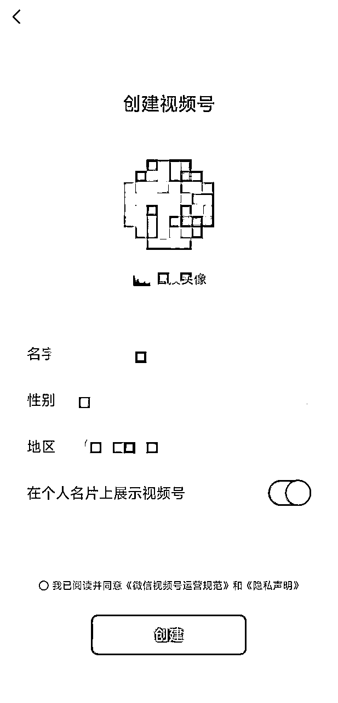

创建的时候，选好头像、性别，填上名字和地区，再决定要不要在个人名片上展示视频号。把协议勾上，点创建就行。小提醒：建议开启“在个人名片上展示视频号”，这样别人在群里点你头像，或者加你好友时，你发的视频就能被更多看到，播放点赞转发评论概率都会上来。

接下来就是实名认证。

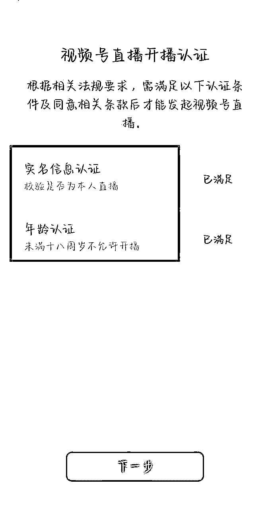

然后开语音直播。进直播页面，选“语音电台”，就能开播了。注意语音电台不能贴图，想展示图片的话只能走视频直播。

开播前记得设置封面和标题。比如初五迎财神，直接用财神封面就很应景。视频号用户主要偏中老年，审美要往他们的喜好上靠，别整太年轻人的花活。

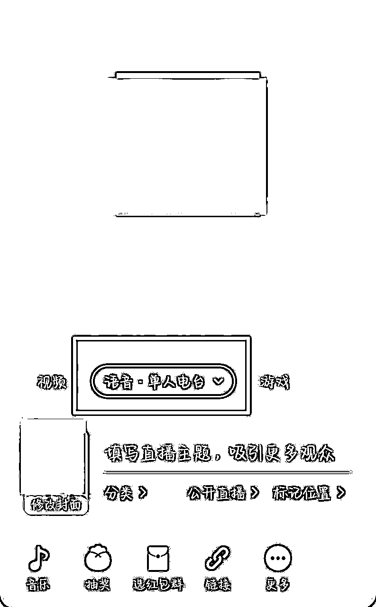

音乐也很重要。在音乐搜索里找些喜庆的，像《好运来》《财神来到我家门》这种过年歌曲，加进歌单。

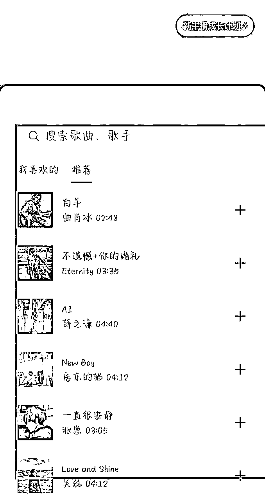

点一下就能播放，音量在上方调。

接下来挂福袋。选择发放爱心，一次设三到四个，开奖时间设在五到六分钟。不同时长对留存和关注转化可能不一样，得多测试。

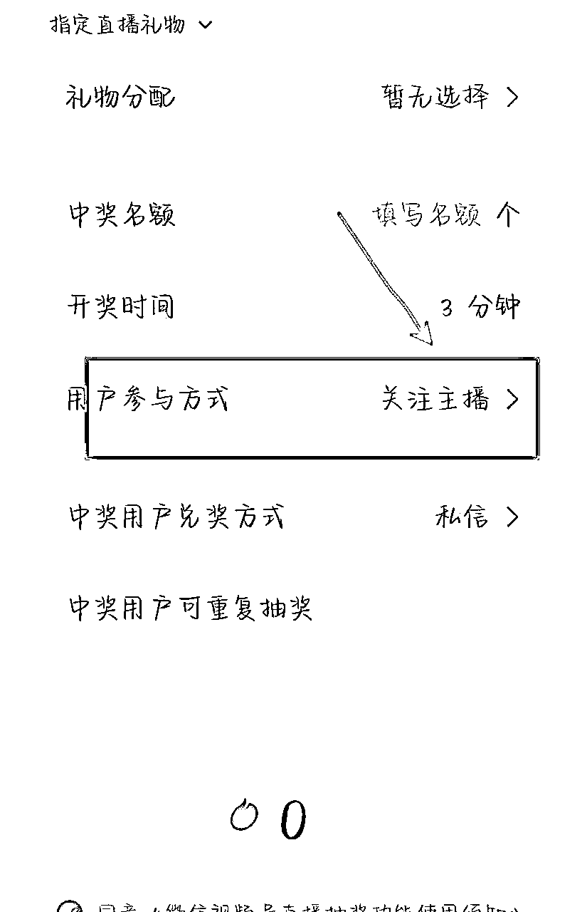

关键是设成“关注主播后才能抽奖领福袋”。再用小号在评论区引导大家抽奖，设置上墙，让大家在评论区互动起来，能给直播间加热。直播时多喊几句“左上角领福袋，有惊喜”“家人们加个粉丝团，给直播间点点赞”。参考话术：“家人们，把直播间赞点上来，到5000给大家送波福利。”

推流这块也有门道。刚开播时推荐流量不错，过一会儿可能就没什么人进来了。这时候把直播间转发到社群和朋友圈，在群里发红包引导大家进直播间，用私域流量撬动系统推荐。熬过没流量的低谷期，系统还会再推一波。

新号首播会有直播成长卡，大约600点流量。每次可以用100点，一天一次，可以设置30分钟或60分钟的时长。一张卡能带来几百流量，60天内有效，过期就不能用了。

引流还能靠公众号互绑。前提是同一个管理员，而且得是老号才能绑。在视频号里进“账号管理”，绑定公众号。

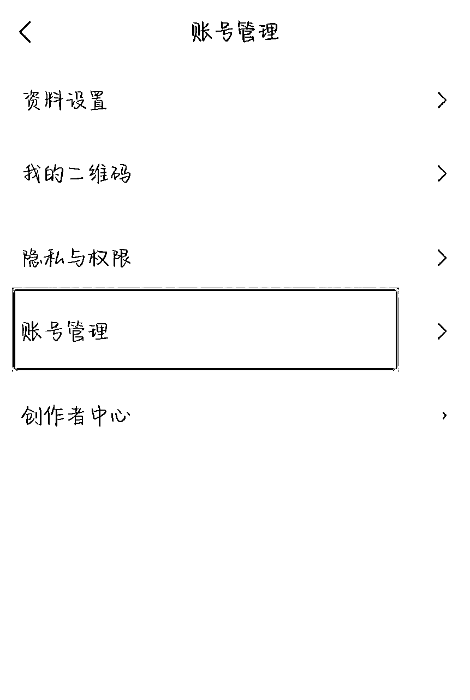

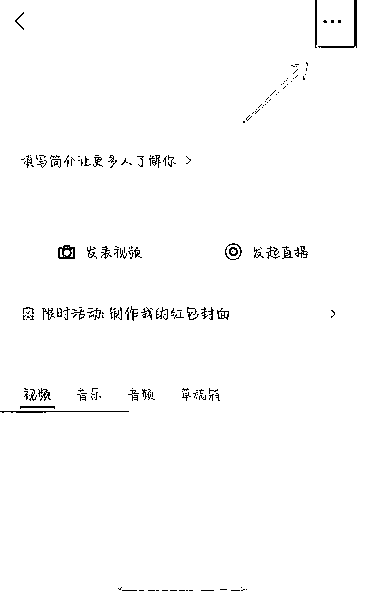

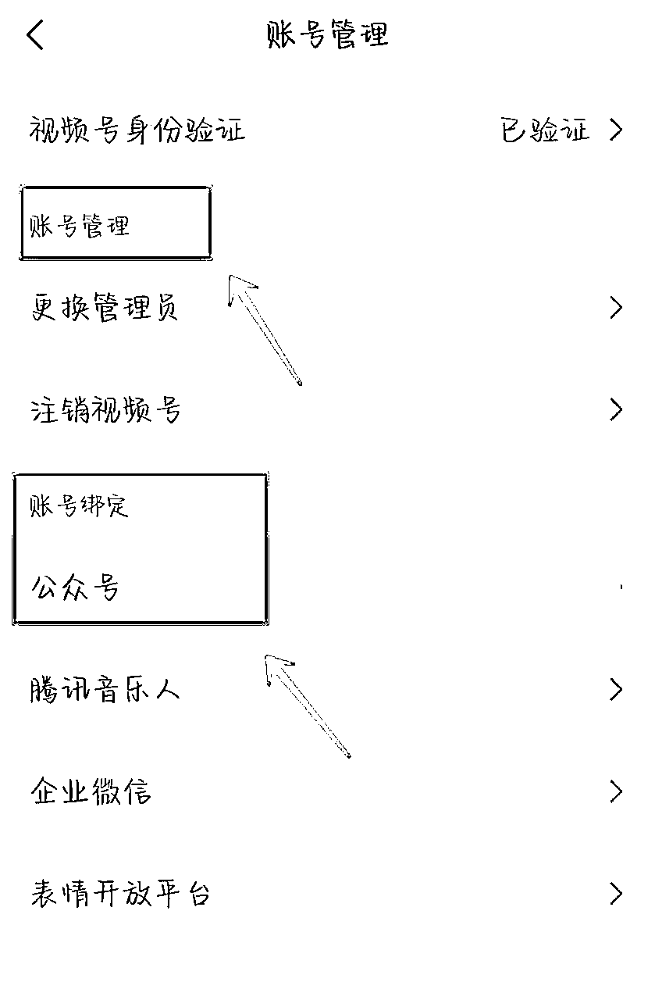

绑定后，开播会用公众号身份发起，公众号主页也会出现开播提醒。

变现路子主要有两种。第一是公众号导流：以公众号身份直播后，用户关注会直接跳到公众号。提前设置好关注自动回复，在内容里嵌入微信号或cpa广告，用户回复关键词就能看到广告，点击有收益，或者直接把人导到私域微信。第二是橱窗带货：1000粉能开通带货，部分类目要交保证金，价格不低。100粉能开创作分成计划，发原创视频有收益。

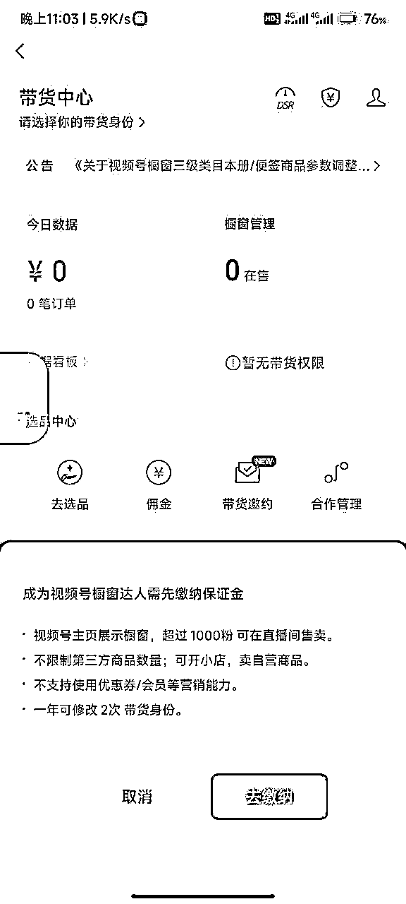

避坑要特别注意。违禁词别碰，比如提及其他平台就很容易出事。别完全无人直播，我之前挂着歌不说话，被判“多开直播”中度违规，后面就没流量了。还有个朋友遇到提示“网络环境问题”，也类似。视频号的违规规则不透明，没有明确说明和解决方案。发视频如果原创不过关或带违禁词，会直接被限流，有的连私信提醒都不给。我之前发了个提到“红包封面项目”的视频，被判虚假兼职限流，后来连夜发了十个口播视频自证，才给解除。

关于封面和标题：开播页能设置，开播后也能改。封面标题太重要了，多用有爆点的标题，带数据，带IP感。

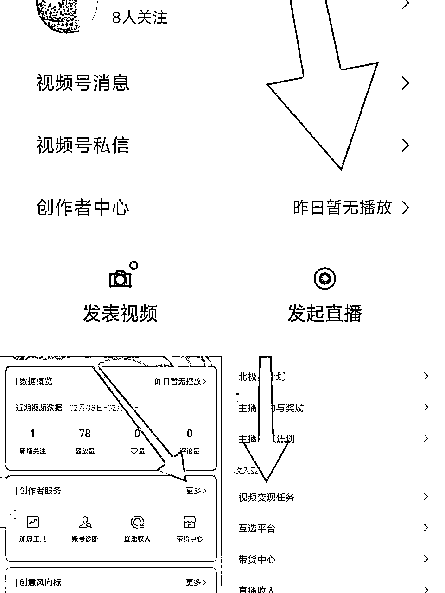

粉丝团设置很简单，一个微信豆就行，能自定义名字和公告。

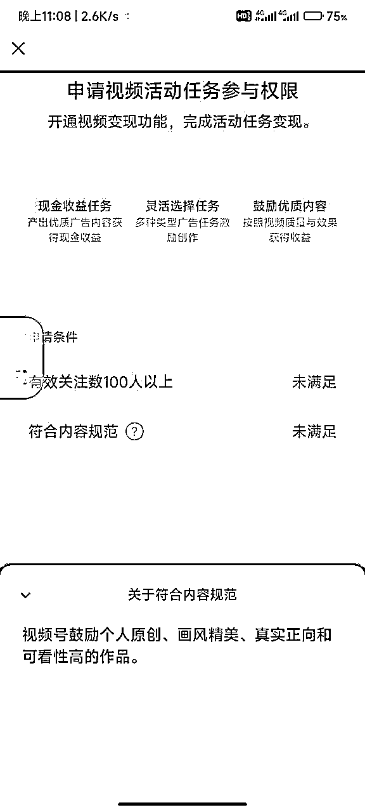

没基础流量也能做，主打推荐流量。推荐流量差就靠私域，转发朋友圈社群带一波。

提高涨粉的关键：福袋设置好，数量和时间别断；适当说话引导大家抽奖；人多时反复喊话术，提升曝光和观看量。

提高直播间流量：第一优化封面标题；第二视频号看的是加粉丝团、点赞、评论、停留时长，重点搞这些数据；第三转发社群朋友圈；第四提前发预告。

想用公众号身份开播？得同一管理员绑定公众号和视频号，再到视频号里打开“以公众号身份展示视频和直播”，然后小号看自己的直播身份是不是公众号。用户关注时就会关注公众号。

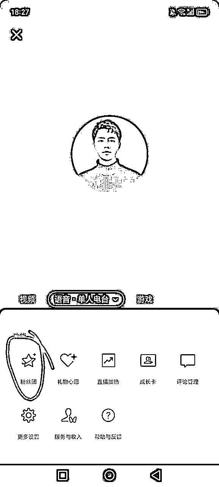

评论怎么搞？自己不能评论，用的小号进直播间评论，设个管理员，长按评论设置上墙。

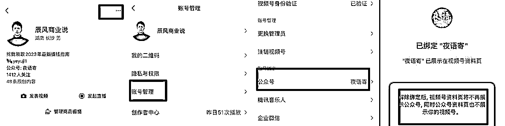

限流自查可以用加热功能试试，或进创作者中心，账号诊断，查看视频号和直播状态。平台对内容限流很严格，一旦被限就很难搞，必须熟悉规则避免进小黑屋。解决的话，去创作者中心最下面的问题反馈提交，选人工客服，等回复。有时候不理你，就多骚扰几次。

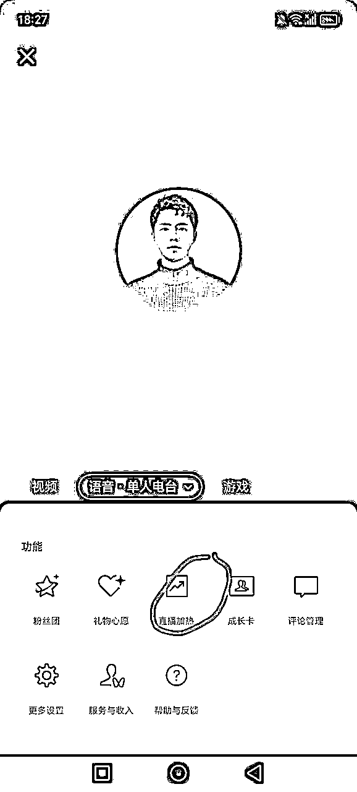