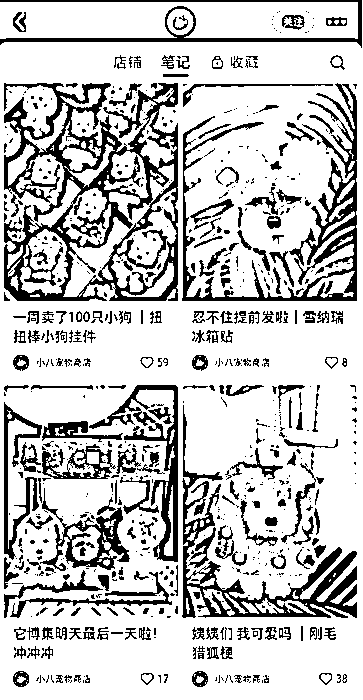
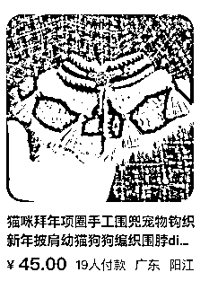
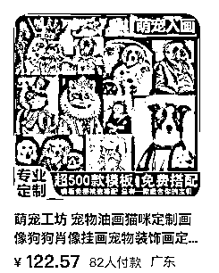

# 风向标拆解第 3 期--手艺人垂类知识付费是一个小而美的生意吗？--榴莲小象

# 一、项目背景

## 项目背景

海外买家对匠人制作的物件付费意愿很高，国内随着消费升级，重复性的工业品审美疲劳加剧，消费者更在意差异化和温度感。面向内销或出海，手工艺品类始终具备讨喜的切口。

## 项目现况

对数位内容创作者做了走访，普遍反馈当下市面上很多打着手工标签的单品，实际是流水线出来的。唯有像姓名牌、肖像画这类强定制需求，难以被替代。其他品类一旦设计被验证好看，消费者对是否真正手工制作的敏感度下降，企业更倾向用规模化生产去降本提速。

这让创作者意识到，拼的本质已从“是否亲手造”转向“设计是否打动”。因此把自身技艺沉淀为可复制的内容交付，让更多人跟随学习，反而是冲突最小的路径。

# 二、项目优点

### 1.稀缺感强
创作者亲手完成的单品，每一件都带个人印记。与工业化模板截然不同，对重口味审美用户很有吸引力。

### 2.按需定制
可依据买家诉求调整配色、原料、轮廓、文字等细节，是市面上难以寻得的专属物件，送礼时表达力更强。

### 3.轻量启动
擅长一项技艺后，将其做成可售卖的教学体系，就能实现从交付实物到交付方法论的跃迁。无需组建大编制，也不用操心生产、包装、发货等链路，单枪匹马即可闭环。

### 4.边际成本低、回报率高
一套课程成型后即可反复传播售卖，后续边际投入极低，复利效应明显。

# 三、项目缺点

1.实体制作耗时耗力，订单量上涨时体感明显吃紧。
2.技法门槛存在，复制难度高，必须经过系统训练才能上手。
3.受众面窄，更多是圈层内的爱好者。

# 四、项目案例拆解

## 1. 案例展示

### 案例1: 扭扭棒手工制品

以扭扭棒为媒介可产出宠物、鲜花等多种形态。该号聚焦宠物主题，单价148元，单周成交量达百只。

### 案例2: 宠物装饰品定制

### 案例3:宠物画像定制

## 2. 流量怎么运营？

当前主流平台对无库存倒卖内容持压制态度，对具备独特性与工艺感的内容更为友好。尤其是📕，晒成品、讲过程的笔记容易聚集同好，评论区常出现“求教程”的询问，这正是切入课程成交的入口。

## 3. 项目如何做 & 如何放大

1.收徒：面向想掌握一门手艺、实现自制的人群输出教学。
2.发展分销：对赛道感兴趣却无暇钻研技法的人，可以分销合作形式由其承接订单，创作者专注生产交付。
3.双语同步售卖。手工艺品在全球范围内都有市场，只是各区域审美偏好存在差异，可同步开启国内与海外市场。具备语言能力者还能直接吸纳海外学员。

# 五、结语

以手工艺品撬动个人品牌是可长期经营的路径。独家设计让市面难以找到撞款，定价自然具备支撑。市场体量足够大，国内与海外皆可拓展，且海外客单价往往更高。

把私藏技法整理成课程售予潜在学习者，结合内容付费近乎零边际成本的特性，录制、引流、成单、服务全部可由创作者一人闭环。组织成本小、投入低、收益可观，这类小而精的模式对匠人而言具备实操价值。