# 虚拟主播+批量再创作，700万播放怎么做到的？10分钟剪3条，多平台一键分发

这篇内容来自一份内部项目复盘，核心是虚拟人口播素材如何做批量再创作。虚拟人怎么搭建不是本篇重点，后续单独拆。

## 实测结果

我挑了6个平台做测试：抖音、快手、📕、视频号、B站、得物。快手之外的数据截图都放下面了。

快手那边内容没打中用户，每条播放基本停在几十。

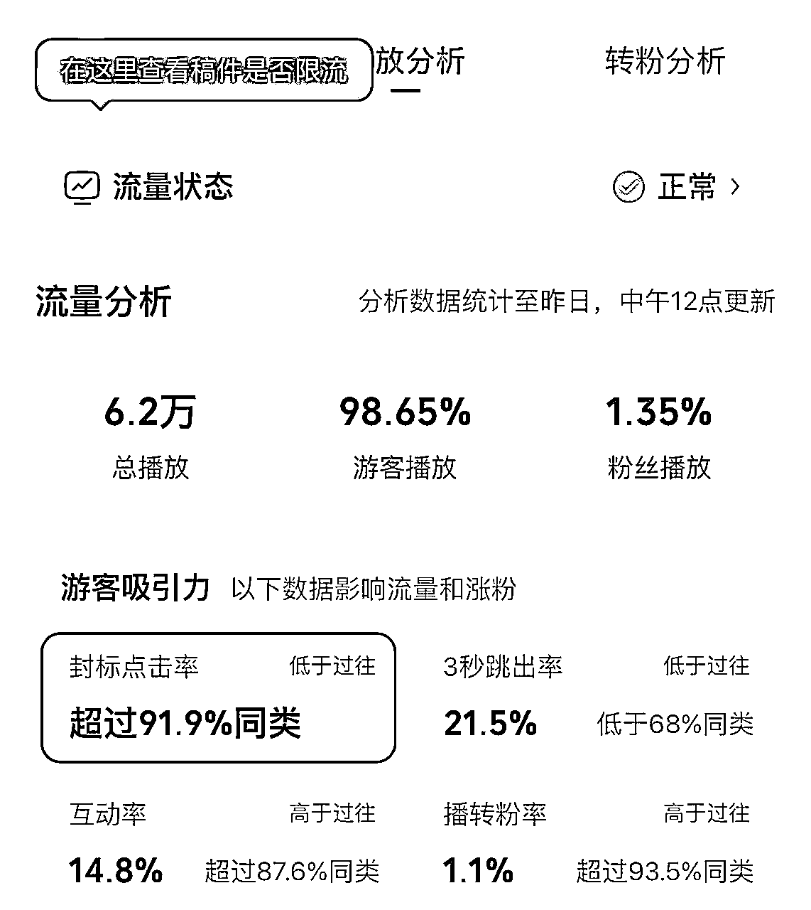
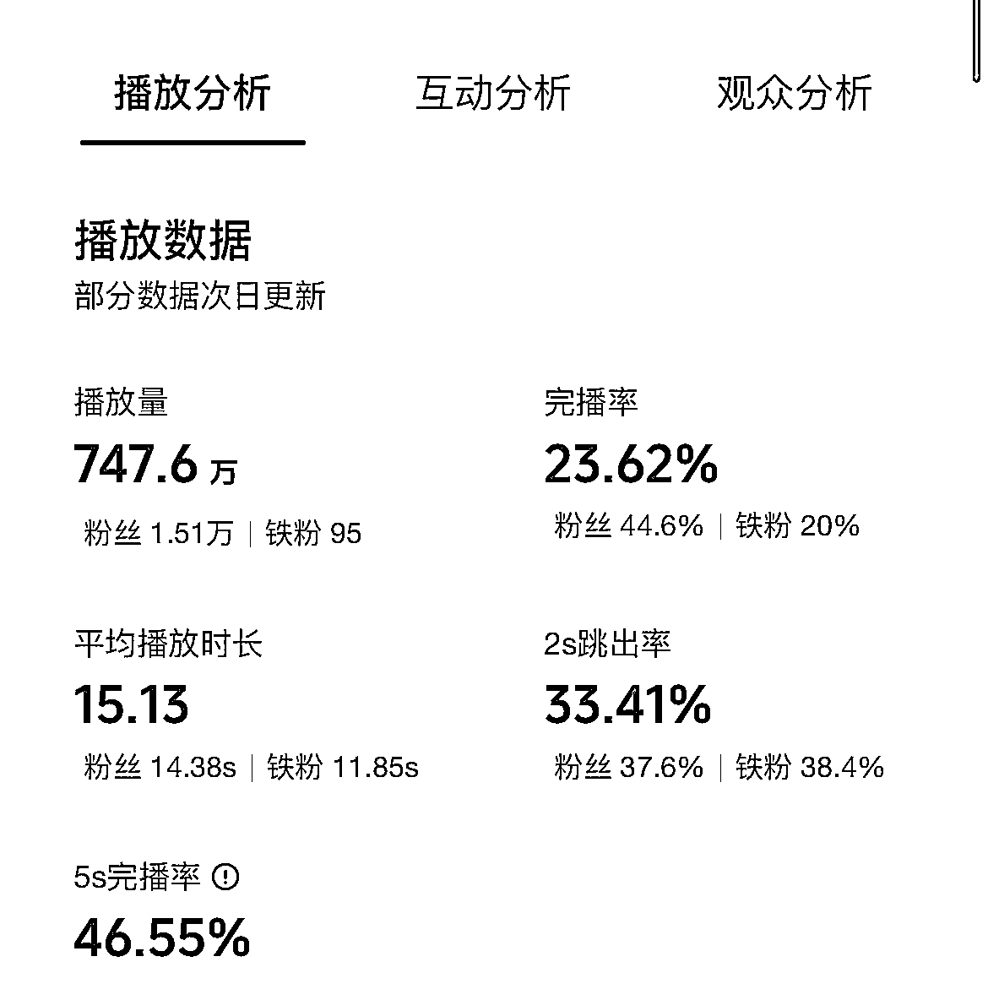
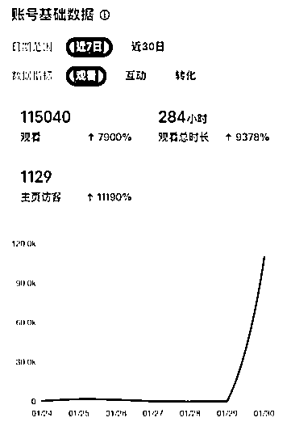

## 前言：打破自己的设限

矩阵、混剪、搬运再创作、洗稿，这些玩法在互联网圈子里很常见。但我这种做了多年自媒体、一直坚持“真人出镜+原创内容”的人，之前是看不上这些的。

先说明一下：这篇文章在资深玩家眼里可能很初级，不值一提。但对裸辞重来的我而言，是一次挺大的跨越。

如果你和我之前一样还没迈过心理坎，可以继续往下看；如果已经入行，直接跳到下一节。

### 打破“必须真人出镜”的执念

用AI虚拟形象代替真人出镜，口播产品、挂链接变现。过去我坚持个人IP，必须自己讲、自己拍，去年我先生劝我做个数字分身，我完全不屑，觉得那是假人、太敷衍。后来真正上手才发现，科技带来的改变远超预期。

### 打破“只做单条”的执念

以前每条视频都精剪，怕观众觉得“似曾相识”，不敢用矩阵号多平台发。一个话题最多只敢讲一次。现在回头看，那其实是自我设限。这次尝试帮我跨过了那道坎。

## 变现方向

当时同时布局了几条路，即使这波没赚到钱，先卡位也有意义。

- **带货**：📕满1000粉可挂买手选品，不用囤货；抖音、快手、视频号也能挂链接赚佣金。已知的俄语AI主播头部，两个月流水做到400万。
- **开店**：自己手上有货，或做无货源代发，只要平台能开店铺就能上架。自己定价、自己发货、填单号，这就是常规电商。
- **创作者激励**：B站和视频号都有，一天大概7元左右。
- **收徒**：几乎每个项目都能靠带人变现。我在账号里留了地球号，匹配很精准。因为项目对网络环境和账号注册要求比较高，交付有点重，后来出了课程和图文包，轻交付，但答疑还是不少。

## 测试反馈

从开始学习到熟练只用了大约2天。每天至少产出10条，分发到6个平台。正反馈来得非常快，对新手来说是极大的鼓励。以前一周拍2条都嫌累，现在产量至少翻了10倍，这就是科技带来的杠杆。

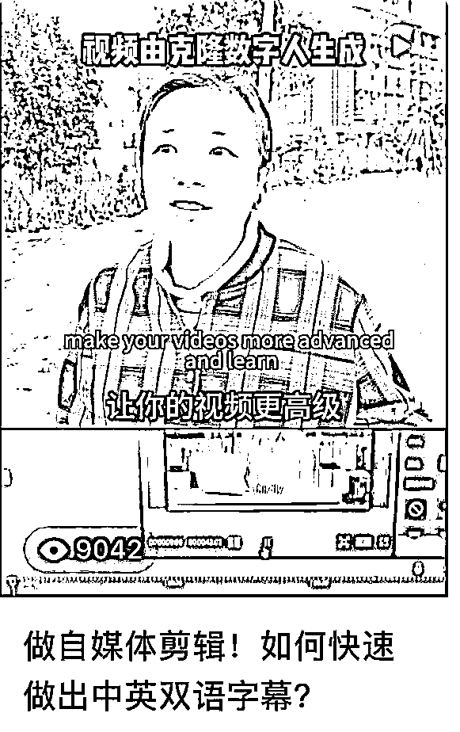
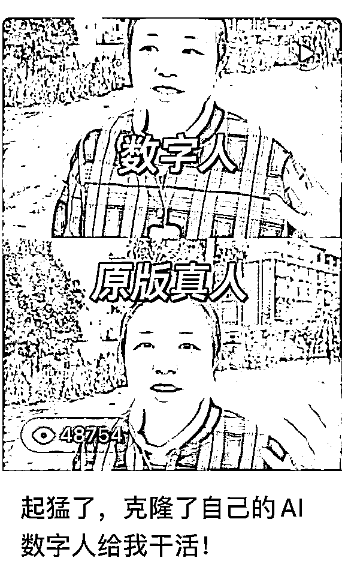

## 正文：再创作怎么做？

所谓再创作，就是在原始素材上二次加工：改变人物设定、重排时间线、重定主题。说白了，就是把已有视频剪成新的内容。

### 平台态度

顺着平台的大方向走，大概率没错。如果平台都在限流，做这个就没意义。抖音专门宣传“二创”并给大流量，说明官方是同意甚至鼓励的。剪映还推出了“镜头分割”功能，就是为了方便拆解分镜。

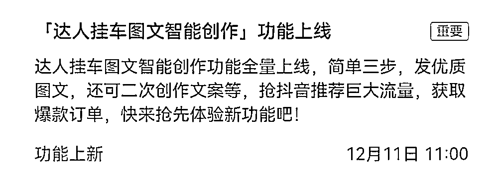
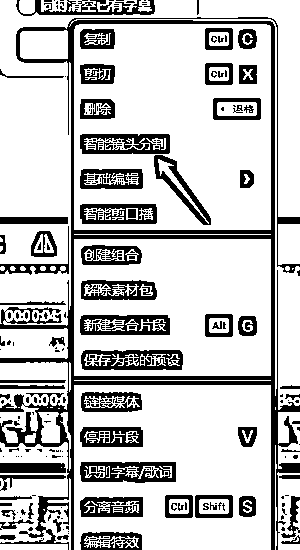

### 试探红线

- **同一条视频加滤镜、加图标**：两条内容一模一样，右边先发，左边后发。第一条数据不错，第二条只加了一层滤镜，结果也不算差。这就是用“一点点小改动”去测试平台的审核底线。
- **同一条素材换文案**：虚拟人账号里试过，同一个表情素材，换一套文案和标题，就成了新内容。

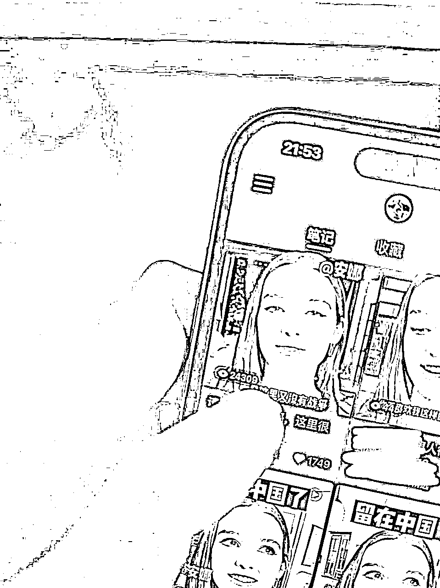

## 剪辑基础

建议先看基础教学再往下读，不然容易卡住。剪映官方有很完整的入门课，可以直接去搜。

## 再创作思维导图

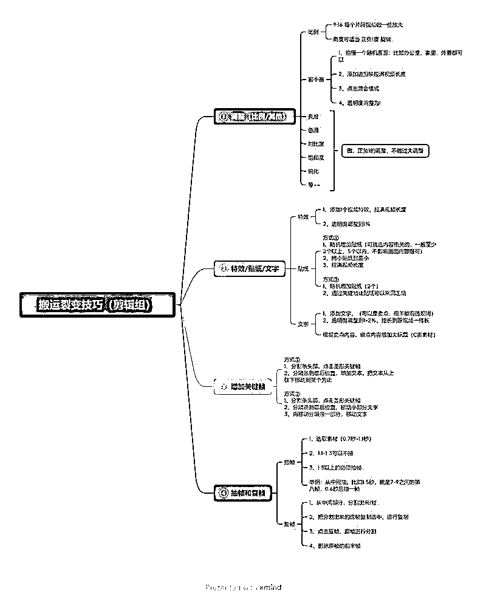

## 再创作剪辑步骤

### 核心逻辑

素材分三层：最底层是“主视频层”，内容随机匹配、最关键；中间是人物口播；上面放贴纸、标题字幕、水印、音乐、边框。

批量制作的核心是——把底层素材做“花”：找段、切割、随机组合、水平翻转、放大缩小，怎么改都不为过。再叠加其他元素，每个账号发出去都不会被判相似或低原创。

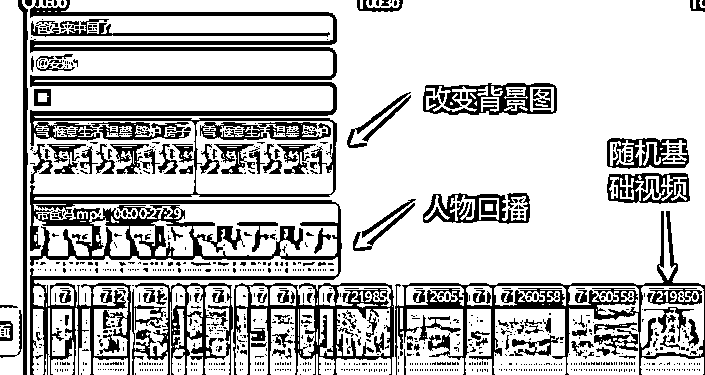

### 导入素材

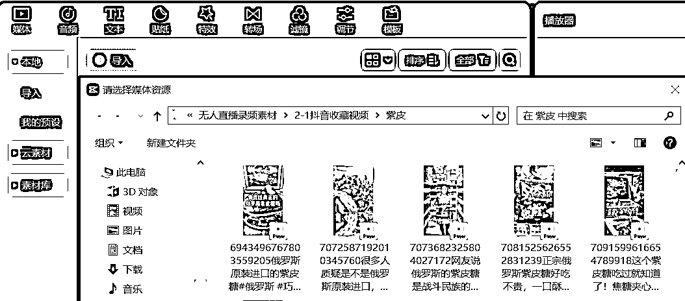

### 放入轨道

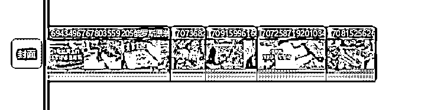

### 素材切割

剪映自带智能镜头分割，选中画面点右键就能切。优点是方便，缺点是不能把切出来的片段按文件夹保存，管理有点乱。听说“鬼手”工具能解决，可以试试。这里也补充一下剪映的处理方案。

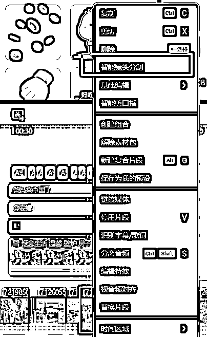

切割会按镜头切换自动进行。我这条视频一个镜头大概2秒，如果你的视频在30秒以内，切成2秒一段比较合适。具体还得看文案长度，随时调长或缩短。

左边是已切完的，已是碎料；右边是未切的，还是大块头。把这些碎块随机打乱、换位，画面就完全变样了，但主题依然一致——这就等于能产出无数不同的基础素材。底层素材其实不是主角，人物、文案、字幕才是真正重要的。

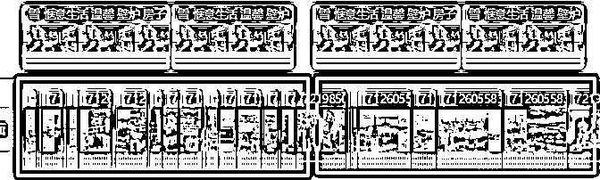

### 分组保存

剪映不便保存切好的碎料，可以换个思路。比如我做俄语方向，就把风景、糖果、蜂蜜、国内景点等分别放到不同的工程文件里。每次做视频，按需求选一类文件，反复用的其实就是那几样。注意最好每一周左右换一次顺序，并补充些新素材。

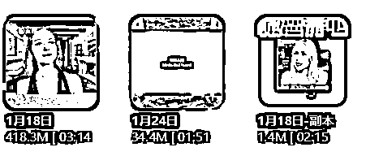

## 找素材

找素材这件事，比剪辑和发布都重要。

常用办法：拼多多买无版权素材包，或者去抖音、B站找非官方账号发过的视频。你刷同类内容刷多了就会发现，到处是重复素材、洗稿痕迹，这种一般问题不大，直接下载。抖音优先选点赞高的，因为市场已经帮你验证过内容。

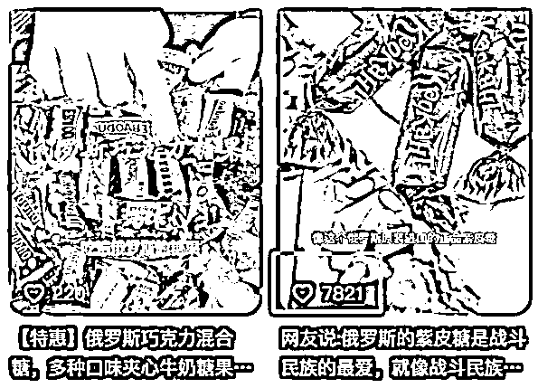
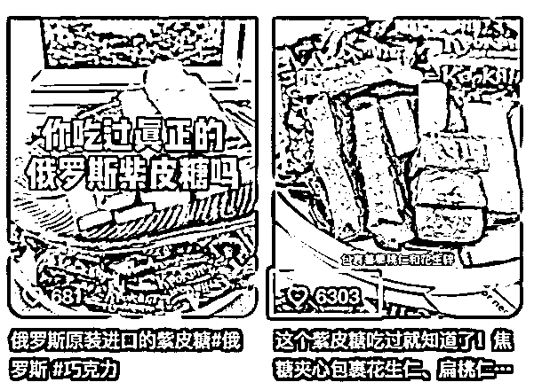

## 下载工具

用江湖工具箱、轻抖。

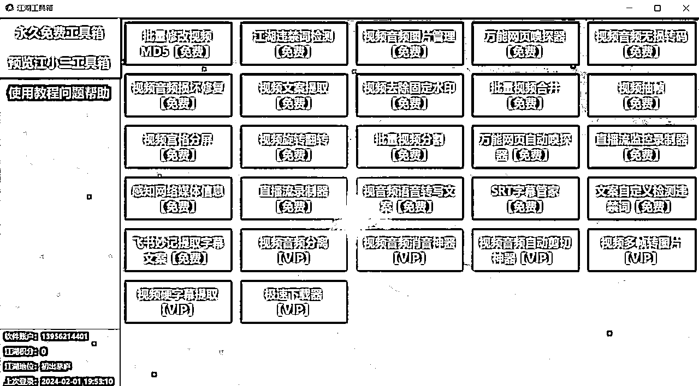
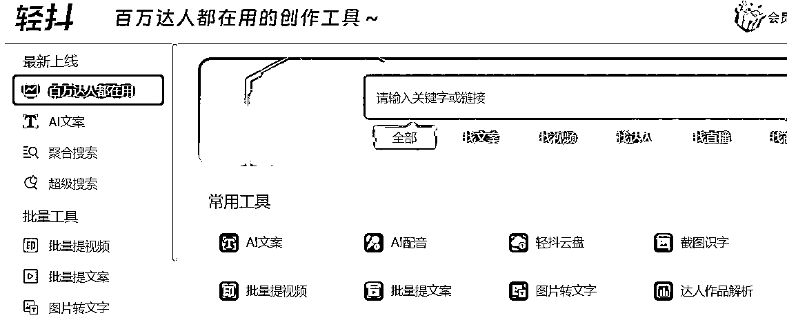

## 批量制作

### 复制素材

把除了基础层之外的内容复制粘贴到轨道上，红色框里的部分想要几份就复制几份。份数多了，最好标个1、2、3，防止后面导出搞混。下图中，底层轨道各不相同，但红框里的上层内容完全一样——所以接下来要为上层元素去重。

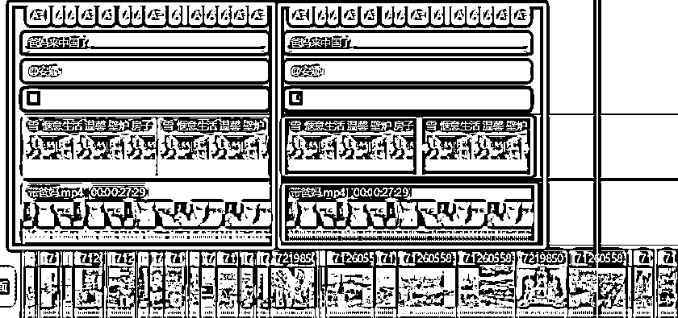

### 水平翻转

把口播视频做一次镜像。

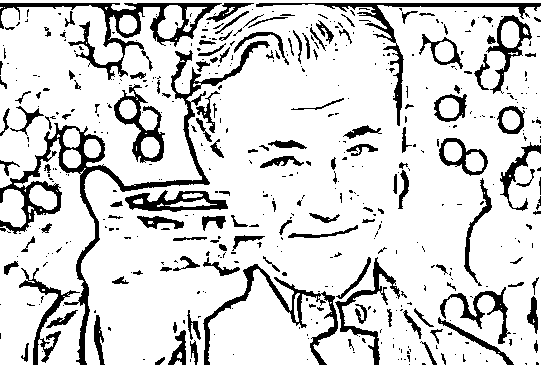

### 调整画面尺寸

1. **横屏转竖屏**：把横屏素材做成9:16模板，底部放竖版底料，用叠加画面（PIP）的方式组合。
2. **拉大横屏**：横屏不一定要放中间，放到任意位置，通过改变人物位置来去重。

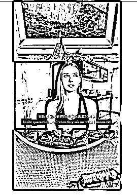
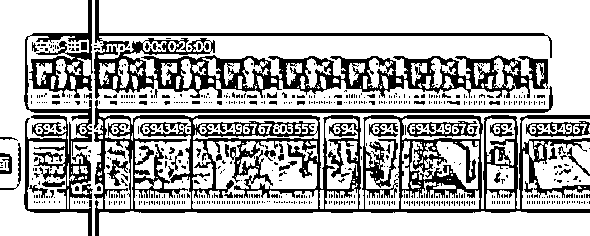
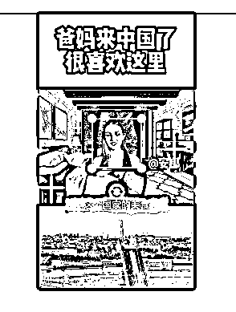
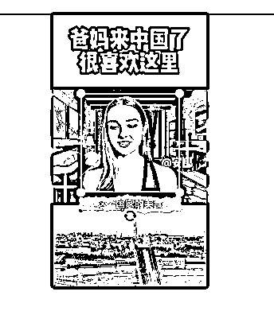
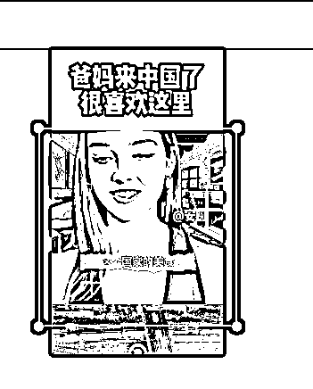

### 人物抠像换背景

把人物完整抠出，替换成底层素材的背景，或者另加背景。

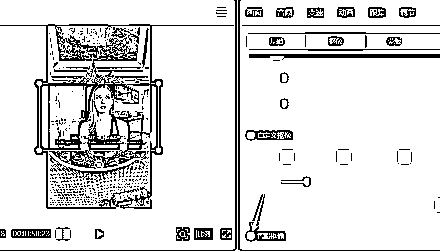
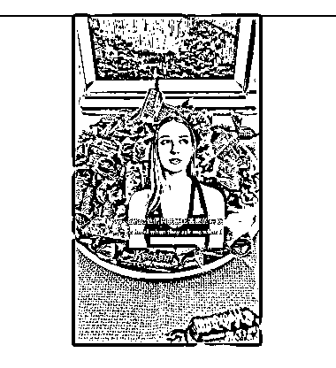

### 加转场

在话题切换、画面转折处加转场特效，提高可看性。

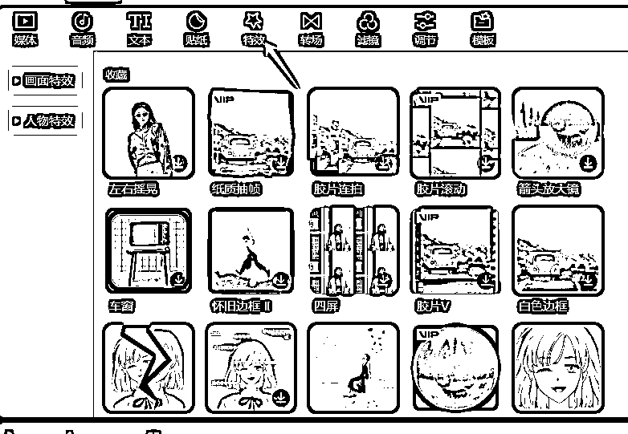

### 背景音乐

搬来的视频大多带原声BGM，先把原声轨关掉。BGM能在配音不够好时救场。使用时要留意音量、情绪高潮和分段间隔。

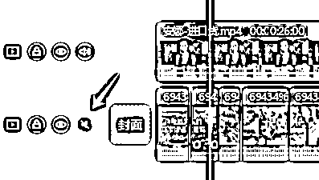
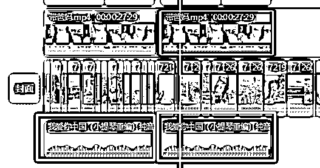

等技术熟练后，可以自己选音乐。尽量别用太热门的“神曲”，容易审美疲劳，全平台都在放。要学会给不同风格和场景配乐，一条视频里甚至可以混搭多首。最懒的办法：参考爆款视频用什么，我们就用什么。

### 字幕

好多人没字幕根本看不出重点，加上字幕能提升完播率。注意：删主轨道内容时，上方字幕轨也会跟着删，所以操作前先点左侧的锁定键。

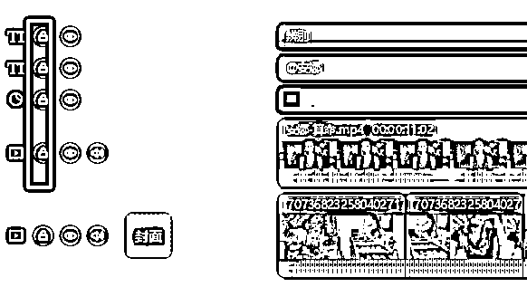

### 修改字体颜色

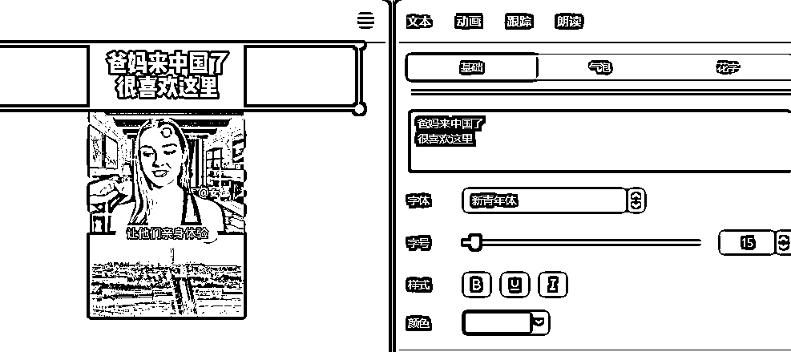
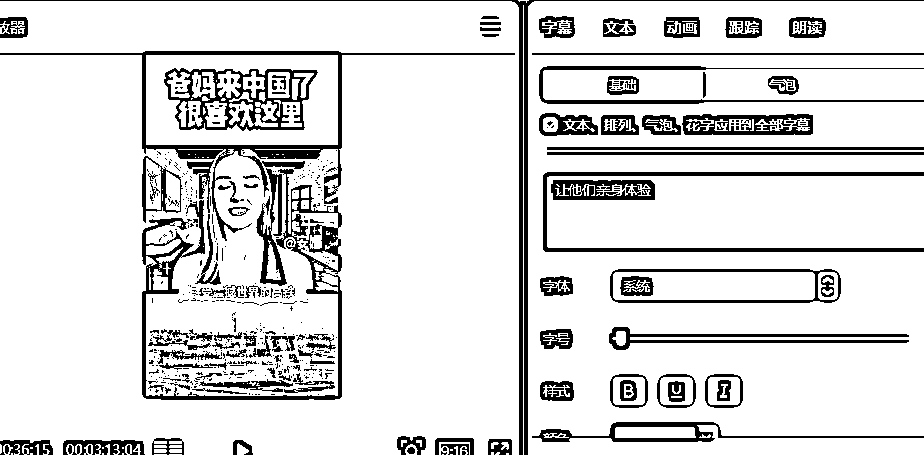

### 批量处理后导出

用键盘上的I和O键选取区域，可以分段导出。选中的区域会被导出，灰色是未选中的。

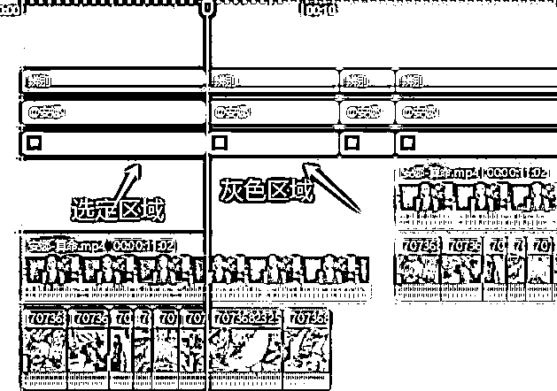
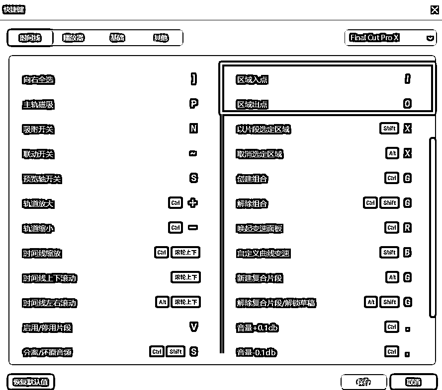
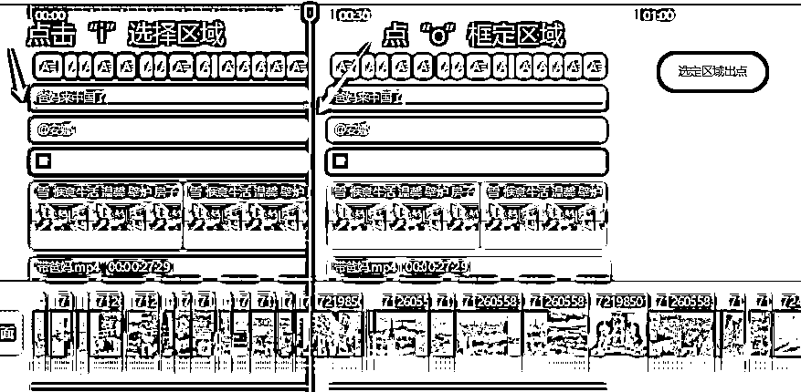

## 快速传输

做矩阵的人往往手机、电脑一堆，Mac和Windows之间传文件可以用LocalSend。一个30秒的视频，大概3秒就能传完，而且无损。

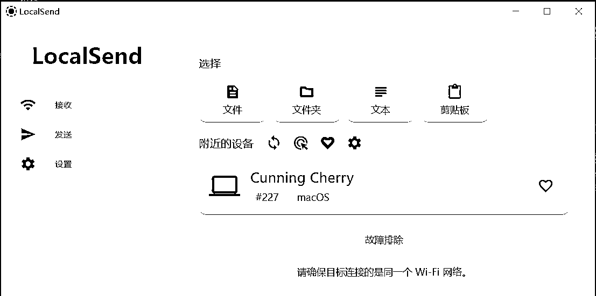
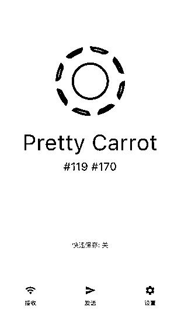

## 一键分发多平台

视频剪完后要分发。试过蚁小二和推兔，前者对免费用户更友好，每天能配5个账号、免费5次；推兔免费版只有1次机会。具体操作可以看官方指引。

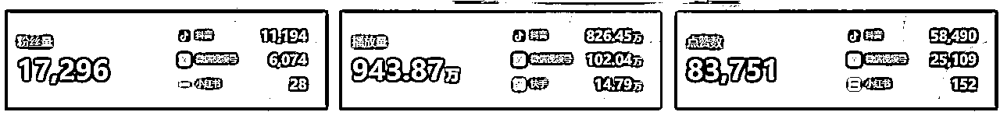
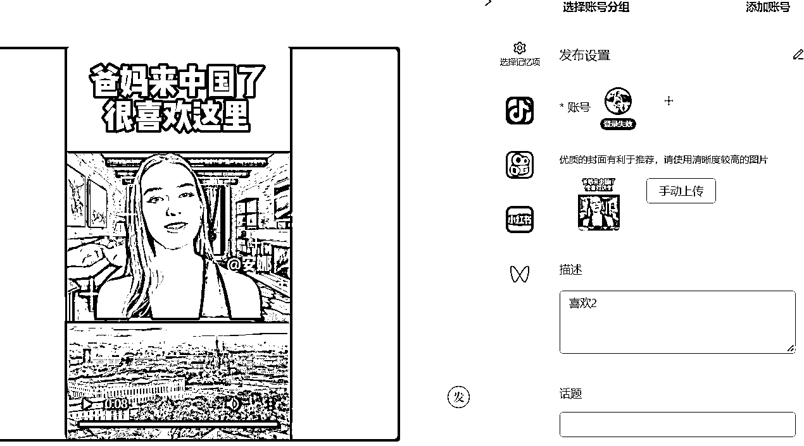
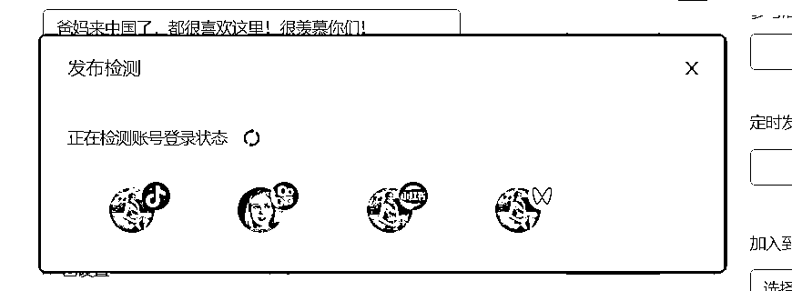

## 结语

这次批量再创作的核心：如果口播文案固定，第一步就是换底层素材，然后再加特效、贴纸、叠加画面等，都是有效的去重手段。

我在视频里写过：“盲目的努力，可能是自我标榜的辛苦，不值得鼓励。”这次从怀疑AI到接受AI，再到成为受益者，我愈发相信这个新时代正在加速到来。拒绝改变没有意义，科技会推着所有人往前走，哪怕你从不信任它。