# 大龄职场二孩宝妈，探索副业5年，瞒着老公付费3万，成功实现薪资翻倍，也找到了适合自己的副业方向

今天想跟大家聊聊我的故事。我是一位在职设计师，同时也是两个孩子的妈妈，到了大家口中所谓的“大龄”阶段。副业折腾了五年，悄悄花掉三万块学费，最终不仅让主业收入翻番，也终于锁定了适合自己的副业赛道。老实说，我的成绩没法跟那些月入几十万的大神比，但我知道，赚钱圈里还有很多像曾经的我一样，站在十字路口不知往哪走的新人。所以我还是鼓起勇气，把自己的经历写出来，希望能给同路人一点参考。

先给刚进圈子的朋友几句掏心窝的话：

第一，千万不要光想不做。哪怕一个项目最终没跑通，哪怕只走出0到0.1的进度，你至少能看清自己卡在哪里；如果连试都不试，你连问题在哪都不知道。

第二，试过之后，要从里面挑一个你做起来不烦、最适合自己的方向深耕。

第三，要主动复盘自己的弱项和优势，下次做项目时把这个缺口补上——可以找别人合作，也可以自己多花时间多投入。

第四，什么时候该收手？当你确认这个项目和你的性格不搭、你也实在提不起兴趣的时候。每一次尝试，其实都是一次自我认知的升级。

以前我很抗拒做爆文，因为爆文需要不断写大众爱看的故事，不管你自己喜不喜欢，能赚钱就行。它考验的是追热点、拆数据的能力，而我偏偏是个偏感性的人，硬撑下去只会难受，所以我主动放弃了。

还有很重要的一点是：积极破圈，舍得付费破圈。真正有价值的信息，往往只在小圈子里流动，不会满大街传播。另外，执行力一定要跟上，用乐观的心态做事。既然花了钱买别人的经验，就别浪费，要配合、要行动、要真正去做。

身边的人一开始都不支持我向外探索，但我恰恰在这个动作里尝到了甜头。一路破圈下来，我找到了高端游这个细分方向，也确定了自己的内容阵地。那种踏踏实实的成就感，让我整个人自信了很多。不过这一切，只是刚刚开始。

如果你也在迷茫，不妨看看我的经历。龙哥说过，一个人的破圈，是从花了一笔自己不敢花的钱开始的。不靠外力推一把，人就一直待在一个舒适圈里，圈里的一切都跟自己的认知相匹配——穷得稳定，富得稳定。直到有一天，她战战兢兢地付出一笔让自己都肉疼的钱，碰巧运气不错，于是看到了一个新世界。我很幸运，因为龙哥盟，我确实看到了那个不一样的世界。

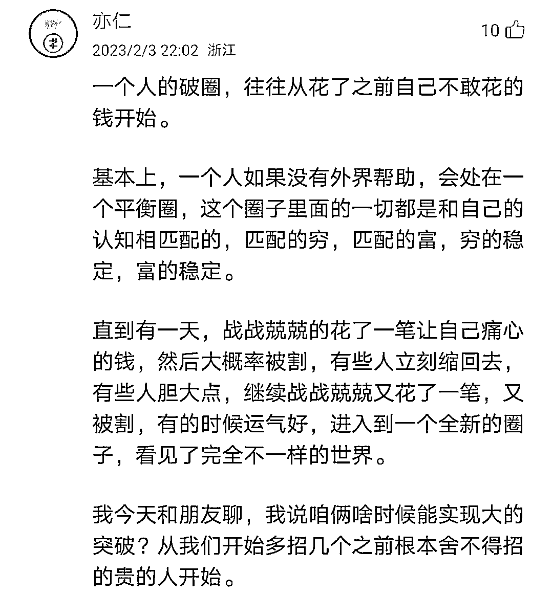

我是去年五月底加入赚钱的，到现在还不满一年。这段时间里，我一边持续学习，一边链接了不少优秀的人，这才找到了真正适合自己的实战项目和内容平台，也发现了自己最顺手的一种输出方式——发朋友圈。别小看这件事，当它和实战项目绑定在一起后，价值就完全不一样了。比如能沉淀出高价值用户，通过朋友圈反复触达，持续促成成交。用这种方式，既能扩大影响力，又能源源不断带来收入，一举两得。

如果你是刚进赚钱的新人，还没跑通过任何项目，也不知道自己天赋在哪，看到满屏的精华帖就发怵；或者你试过很多项目，却总在坚持这一步半途而废；又或者你做过不少项目，但始终找不到那个愿意长期做下去的方向——那么我的帖子或许对你有用。当然，如果你是已经在山顶的大佬，就请自动绕路哈。

接着说说自己。

我出生在小镇农家，家里条件一般，也没有什么人脉。上大学之前，我的世界就只有老师和同学，外面的行业长什么样、别人靠什么赚钱，我一概不清楚。那时候只会埋头死读书，连补习班都没上过。好在还算用功，最后勉强挤进了一所本科。

上了大学才发现，人和人的认知差距，真的会左右命运。

有一个高中同镇的女生，眼界很开阔，高考没考好，转头就去复读，第二年上了985；后来跟着男朋友去了美国，男朋友那时已经是哈佛博士了。我当时就想：如果她当时认命去了专科，还会有这样的机会吗？可见见识广是多么重要！

反观我自己，因为认知不够，错过太多翻盘机会。高中时去我妈的服装厂剪线头，一天几块钱，还被车间主任用异样眼光看。大学时通过熟人找了个“日结”的兼职，发传单当人肉广告，一天7块钱。而我的同学早就去工作室实习了。我不敢去，总觉得自己没经验、学得慢、会被嫌弃。现在我才明白，凡事要先去试，试过才会有底气。

后来进了大学才知道，自己填的工业设计专业，其实完全是凭感觉选的。因为家里没人懂，也没有网络可查，就觉得“设计”两个字听起来很高大上，还有一点点喜欢，就报了名。结果一进去就傻眼了：同学要么是高分学霸，不小心被调剂进来的；要么是从小学美术，有基础的；要么家里开厂，来镀个金回去接班。而我不过是靠着北京户口的运气，分数刚过线才上的。

大学四年，我除了和室友关系好，其他方面几乎是一片空白。英语四级一直没过，我把所有时间都拿来背单词、买全套资料，可每次就差一两分。别人玩我在学，别人实习我也在学，但就是过不了。结果校园招聘我看都不敢看，因为稍微好点的公司都要求四六级证书，我只剩下一个毕业证。

我也不会像有些同学那样，天天围着老师转，要资源、要项目，毕业时拿着各种奖项去大公司。我就只知道闷头学，不知道要进入老师的圈子，更不懂借助资源和人脉。快毕业时虽然有就业辅导，但也就是走形式。所以毕业很久，我都找不到工作。

那之后我随大流做过室内设计师。当时房地产正热，装修小门店遍地都是，只要你不挑资历就能进。可那都是小作坊，干不到一年就倒闭，我反复换了好几家，工资一个月一两千，连合同都不签。能力没攒下多少，更不知道怎么提升自己。我想破圈，但找不到人，只能盯着眼前那点工资干着急。我那时还安慰自己，年轻人刚毕业都这样。后来看到很多大佬的早期经历，人家在学校就知道下一步该干什么，换工作也是有目标地换，不像我被小公司抛来抛去。如果能早几年链接到这些人，我也不至于绕那么多弯路。

后来室内设计不好做了，我又找了个高端家居销售的活。那家公司是潘石屹的一个员工开的，其实是皮包公司，拿几百块的家具包装一下，卖给煤老板和创业公司老总，一个小凳子都敢卖两万。老板天天给我们打鸡血，说服务有钱人是一辈子的财富。底薪只有800，不出单还要扣钱。有个上海小姑娘靠嘴皮子卖了上百万，提成20万直接买车，但更多人只是炮灰。后来客户发现产品质量差，跑来骂人，我们就纷纷跑路了。现在回想起来，那家公司其实是我离钱最近的一次：有低成本的货源，有高净值客户，我却没有留住客户信息的意识，也不懂维护关系、延伸销售。如果当时有一个像赚钱这样的圈子，随便学一招，可能就开单了。可惜没有如果。

再后来，大概2011年，我进了一家做餐具出口的贸易公司，终于签了正式合同。我非常珍惜，天天在摄影棚拍小勺子小叉子，再回电脑上画图，挺稳定的。但行政大姐总爱“指点”我，要求我有眼力见儿，端茶倒水擦桌子。我也照做了，就这么干了近三年。后来外贸行情变差，国外客户大量跑单，老板又守着老观念不愿开拓市场，最后发不出工资，倒闭了。我只是个小透明，有心无力。那老板但凡愿意破圈，学学别人怎么做生意，也不至于走到那一步。

2014年，我生完老大，正好赶上UI设计需求爆发，靠老公的关系进了一家软件公司，部门领导破格把我这个零经验的人招进去，给了8000块一个月——比上家翻了一倍，我特别满足。领导说：“你要好好学，能不能留下就看自己。”结果我在这家公司一待就是六年，工资一分没涨过。我那时候总觉得是自己能力不够，所有委屈都该受着，哪怕被大老总点名说我占用资源、让我调部门，我也觉得这是我应得的。每天都活在恐惧里，甚至一想到上班就发抖。可我就是不敢走，也不敢提加薪，觉得我拿人家工资就该赎罪。那几年，我眼看着身边的人升职加薪，老公也在部门经理带领下越混越好，只有我原地踏步。自卑到极点，压力巨大。

我老公当时“开导”我说：“你挣这些我很满意，不需要你挣钱，我挣钱就好。”这句话对我来说，简直是宣布我没救了。更难受的是，后来我爸生病住院、我妈眼睛做手术，都需要花钱。我老公虽然掏了钱，但总是念叨让我爸妈去查报销，还说我妈转我零花钱他都要查微信。婆婆也质问我：“你妹妹怎么不掏钱？”可妹妹一个月才2000块，根本负担不了。因为出钱的是我老公，全家人对他感恩戴德，甚至有点小心翼翼。那一刻我真真切切地体会到：没钱，在家里连尊严都没有。虽然那时我还不知道该怎么搞钱，但“要赚钱”的种子已经深深扎下了根。

2016年，知识付费开始火起来。为了收入翻倍，我不断报课，手绘、插画、UI设计……一门比一门贵，分别是2000、5000、7000。每一笔钱付出去都让我肉疼，但我还是咬牙坚持。功夫不负有心人，我的审美、作图能力、工作效率都提高了，客户开始夸我，而以前只有批评。虽然因为传统企业用不上新学的东西，工资暂时没涨，但我也终于看到了破圈的苗头。我甚至尝试做作品集想跳槽，但苦于没有完整的实战项目，编都编不出来，最后没跳成。

唯一的好消息是，多年的学习和积累给了我底气。加上长时间混在各种圈子里，我慢慢意识到：一定要走出去，接触更优秀的人，用付费换认知。后来我加入赚钱，跟着里面的节奏，不断尝试、试错、找人请教。终于，我找到一个既感兴趣又能赚钱的方向——高端游项目。我还确定了自己的输出阵地：朋友圈。在这套组合拳下，我的主业薪资也成功实现了翻倍，副业方向也越走越清晰。

回头看，这一路跌跌撞撞，最大的收获不是赚了多少钱，而是我终于打破了过去那个“稳定的穷”的圈子。所谓的成长，不过是从你鼓起勇气花掉那笔让你心疼的钱开始的。希望我的经历，能让你也敢迈出这一步。未来还很长，一切才刚刚开始。

你有没有过这样一种经历：一个点头之交，最后竟成了改变你人生轨迹的钥匙？

我先讲段自己的故事。

以前在食堂吃饭，迎面走来一个陌生人，特别热情地跟我招手。我当时一脸懵，完全不记得这人是谁，但人家笑脸相迎，我也就礼貌回应了一下。他跟我说，好像在哪儿见过我。说实话，那一刻我心里挺感慨的——换作是我，绝对不敢跟一个不认识的人这么搭话。

后来巧了，这人跟我进了同一个项目组。这才加上微信，慢慢熟络起来。再后来，他跳去了别的公司，又通过他的人脉把我引荐进去。就这么一操作，我完成了甲方内部转场，薪资直接翻倍。

最让我意外的是，跟项目经理见面那天，对方态度非常好，连作品都没看，直接就问：“你想要多少？”结果薪资翻了一倍多。

从那一刻起，我彻底想明白一件事——专业技能再硬，也只是敲门砖。酒香也怕巷子深啊！你既要踏实干活，更要积极破圈、主动连接别人。真正能让你走得更远的，是人脉和信息差。

后来那个帮我的哥们儿，因为内部推荐拿走了5000块推荐金。你看，他做了什么？他把自己变成了信息流转的节点，好运自然就缠上他了。

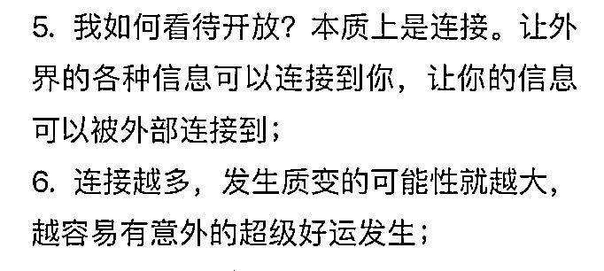

（以上截图来自傅超人的分享）

---

# 二、我的求变之路：进赚钱，开眼界

## 1、顶着压力，咬牙入场

转岗成功后，我并没有安心的感觉。因为我看得到，主业的天花板就摆在那里——这岗位不需要高技能，也不需要高职位，上升通道基本封死。往外跳，也没门路。为了不被淘汰出局，也为了给自己留一条后路，我把目光转向了副业。

所以调岗后的第一件事，就是加入龙哥盟。然而这个决定，遭到了身边所有人的反对。

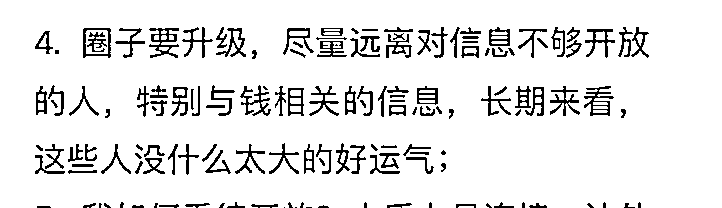

（以上截图来自傅超人的分享）

我身边的圈子几乎全是传统行业的人，尤其是做程序员的老公，典型的“高薪铁饭碗”思维。他觉得把主业做精做深才是正道。以前我花钱报设计课，他完全支持；可我一说要花钱进赚钱圈子，他就说我被传销洗脑了，天天警告我别投钱。他的原话是：“所有信息网上都能免费搜到，何必花钱买？”

起初，我确实在闲鱼上买过一些廉价课程，比如“闲鱼无货源电商”，几块钱的那种。但进群后发现，所谓课程，就是前两节课抛点干货，后面全在推销高价课。你不买，人家根本不理你。花了几块钱，学了个寂寞。

那时我才恍然大悟——真正有价值的信息，从来只在少数人的圈子里流转，而不是满大街免费散播的。

（以上截图来自傅超人的分享）

源于骨子里的危机感，加上之前一次次失败的教训，我逼着自己做了决定。拿着卡里仅剩的2000元，加上微信零钱里的几百块，狠狠心，报了龙哥盟。直到今天，我依然感激自己当时的果断。

龙哥老大有句话说得好：一个人的破圈，往往是从花掉一笔从前不敢花的钱开始的。我举双手赞同。进了赚钱圈子之后，我才发现自己原来不孤单——这里有一群同类。

当然，我当时敢报名，还有一个重要的底气：转岗之后工资翻倍，不用再为生活费发愁了。而且工资卡里正好有一笔我老公查不到的钱……

可就算我再小心翼翼，矛盾还是爆发了。

某天，老公翻我手机（对，他的要求是手机密码也必须共享）——翻到了我加入社群的记录。那天吃饭，当着公婆的面，他就开始质问我到底在搞什么名堂，警告我不要投钱、不要进传销、不要被洗脑。公婆也在旁边帮腔，拿村里谁谁谁投了几十万血本无归来打比方。几双眼睛齐刷刷盯着我，那阵势，好像我只要说错一个字，就会被当场撕碎。

我也想解释啊，可我发现根本解释不清。没法用他们的传统思维解释“创业”这件事。而且，提起这件事，让我想起了一次至今都后怕的经历。

之前我关注了一个育儿👸号，号主推荐了一款儿童蓝牙耳机，三百多块钱，我寻思给闺女学英文用，就买了。结果老公知道后，非说耳机伤孩子耳朵。我解释是儿童专用、进口的、很安全。他根本不听，只丢下一句：我让你退了，听到没有？我没理他，坚持自己没错。

然后，他掐了我脖子。一边掐一边说我不听话。说到底，大概就是他觉得我在花他的钱——哪怕那钱明明是我自己挣的。

从那以后，我只要一想到“不听话花了钱”，就觉得像忤逆了他。本该平等的关系，就因为经济不独立，变成了赤裸裸的支配和被支配。钱是什么呢？钱能带来尊严，钱能带来话语权，钱能带来自由——这事我算是彻底明白了。

所以，想尽办法搞钱，为了不再被拿捏。在我心里，赚钱能治好我的“穷病”。我每天疯狂刷帖子，一刻不停。

## 2、面对项目，无从下手

### 2.1 刚入赚钱，什么都想做，什么都没做成

刚开始刷的都是认知类的帖子，告诉你不要怕短期赚不到钱，要看长远。这类内容对新人确实很友好，我前一两周基本都泡在这样的帖子里。但我还是很焦虑——我太想赚到钱了。

后来不知道在哪儿看到一句话：新人应该多刷精华帖，提升赚钱认知。于是我开始疯刷精华。说实话，我看得很慢，好多术语都看不懂。但我从来没想过放弃——因为我意识到自己正处在信息风暴里，疯狂输入总有一天会变成产出。

龙哥说过：大规模交换的前提是大规模的连接，之后才可能产生交易。所以，得让外部信息和自己的系统连接起来。

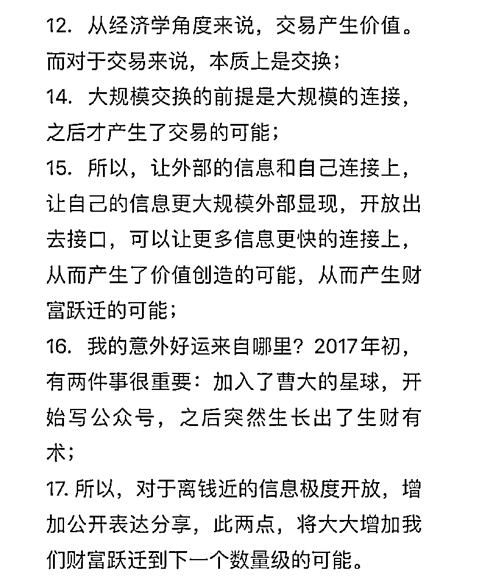

我刷的精华帖，大多带“有手就行”“保姆级”这样的标签。为什么？我总觉得自己能力不行，只配看这类“傻瓜教程”。而且我的逻辑是——这类项目一定能赚钱，如果赚不到，那一定是我不行，不怪项目（瞧，又是认知在作怪）。

但问题来了：刷完我依然没有动手。执行力约等于零。

记得有一次看到风向标，讲“📕帮人处理禁言”这种小需求都能变现，还说小白也能上手。但我就是看不懂细节，也没去实践。后来看到别人真靠这个赚到了钱，而且特别简单。可我没做，所以一分没赚到。

事后我复盘了一下：第一眼确实觉得能做，但有细节看不懂，又不敢去加人问。再加上评论区一堆有经验的人已经在问了，我想哪轮得到自己啊，就放弃了。

怕这怕那，是不是所有新人的通病？还没开始呢，先把困难脑补了个遍。

就这么一直在看，一直不做，越看越焦虑。实在没办法，只好去找心理按摩帖。那段时间看了很多郭晓文老师的文章，甚至追到他👸号里，确实管用——焦虑一下子没了。我开始主动连接大佬，哪怕是获得认知上的提升，也能帮自己看清差距在哪。

通过晓文老师，我了解了一个新手在不同阶段会遇到什么问题，一个项目从零到一大概是怎样的过程：蛮荒期，开采期，精细化运营期（我用的词儿跟晓文老师不一样，具体建议看他的原文）。心态好转之后，我对自己又有了信心。不再自卑，也不再自我否定。

可问题是——我依然没做过任何一个完整项目。因为不会、不敢、怕出错，又一次次错过下场的机会。

刷精华帖时也试着做过，好多项目都被我从0做到了0.1：比如📕运营——我注册了个账号；闲鱼二手书——我也注册了个账号。然后……就没有然后了。

那阶段我最需要什么？认知？确实提升了一些，但我更需要的是——执行！

所有经验都是做出来的。而且每个人情况不同——别人觉得简单的事，在你这里可能就是一座大山。所以必须下场，必须动起来！

### 2.2 盼来了航海，仍然一事无成

精华帖刷了一大堆，除了觉得大佬牛逼，自己依然啥也不会。后来听人说航海能让小白获得实战历练，我心想太好了，终于有人带了！

等啊等，到了9月份，终于盼来航海。

比对了一下上次航海的情况，看到很多人讨论快团团，加上我早前就在📕上认识快团团教练小野，知道她做得很好，于是果断报了快团团。

但一入场我就懵了。

坦白讲，当时我在赚钱认识的人不多，也没什么小道消息，对快团团需要的技能了解得很片面。不敢问，也不知道该问谁。

超人有句话说得很对——圈子会像滚雪球一样不断升级，确实如此！我在赚钱发过风向标，所以进了风向标群。群里每天都在讨论行业动向；航海前还会有人做分析和拆解；还有鱼丸不定时发内测项目机会——大家快去发风向标！！！

内测项目我还没轮上，因为还不具备拆解能力。继续加油吧！

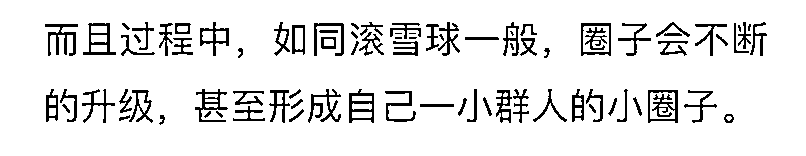

说回正题。

在快团团航海期间，我发现自己没有流量、不会发朋友圈，再努力也赚不到钱。虽然同时报了📕运营，但根本不知道在📕上该卖什么。教练说可以把快团团的产品发到📕，我发了，可产品太少了，撑不起笔记的量。做混剪视频？不会。做开箱测评？又舍不得花那个钱。第一次航海，两个项目全部失败。

航海一年也就两三次，每次21天，剩下那些时间呢？我该靠什么持续发力？迷茫再次淹没了我。

我知道，自己需要一个更小的圈子、更精细的指导，可完全不知道该从哪里入手——因为那时我还没进风向标群。

---

# 三、链接对的人：副业大门终于开了

## 1、自己动手，选中一个合适的项目

终于动手了！

有问题就有答案。我仔仔细细翻了航海的航海总结，发现一个特别适合新手的赛道：👸号爆文。

于是我自己动手，对照航海手册，把这事做到0.1：一口气开了3个👸号，绑定自己为运营者，在淘宝开通了流量主。爆文项目就算正式启动——但问题是：我不知道爆文该怎么写。

那会儿就这些基础操作，花了我整整一个星期。真是啥也不会，航海手册看得很慢，到处都是新知识。

虽然起步艰难，但迈出了第一步，就成功了一大半。

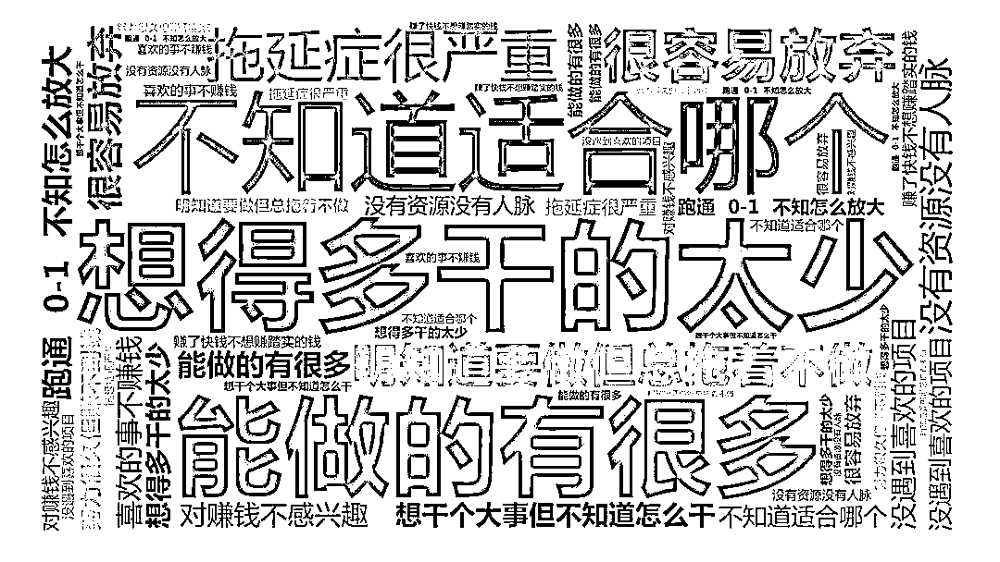

龙哥也说过：想赚钱，先下场把手弄脏（原话截图没存到）。

## 2、链接到对的人，副业开始真正启动

赚钱这个圈子真是藏龙卧虎。我很庆幸自己跳进来了，还像滚雪球一样，一步步升级了自己的圈子。

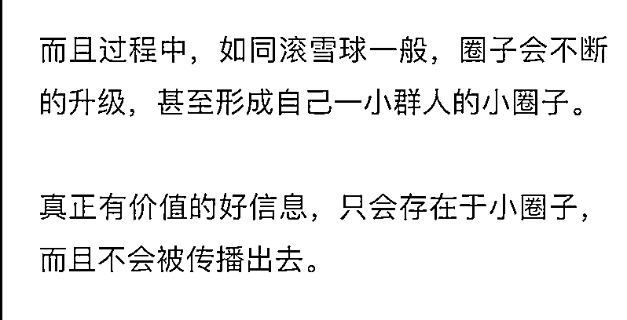

关键是：保持自己与外界的连接，让高价值的信息链接到自己这里！

我经常听赚钱的视频号直播。可那个点我在家哄孩子呢，怎么办？戴上蓝牙耳机，手机放远一点，假装陪孩子玩——耳机小，头发一遮看不见。只是家人可能会奇怪，怎么有时候回话那么迟钝？哈哈。

有时候直播太晚，娃都哄睡了，耳机还塞在耳朵里，早晨醒来才取下来。

有一天偶然听直播，注意到赚钱请来了枫宇翔。我很好奇他是怎么稳定靠爆文月入6000的——说真的，就算他说月入600我都愿意听。

他说了一句话挺打动我：“大佬不好对标，但他比我们多走了几步，正好可以对标。”我觉得太有道理了，一下播就马上链接了他。

谁知道，就这么一次普通的链接，竟让我遇见了副业路上的第一个贵人。

主动去接收有效信息，是你迈出副业的第一步。如果说赚钱让我看见了副业的汪洋大海，那宇翔就是带我进门的人。

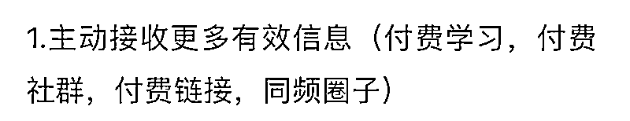

宇翔的小报童，我第一时间就买了。进了他的群，在里边解决了大半困惑，我的爆文项目也终于转起来了。

他特别爱在群里分享观点和认知，除了有些暂时保密的内容，其他能帮的都帮了。真的很感谢他，让我走出了真正意义上的第一步。

这再次印证了那句话：真正有价值的信息，只存在于小圈子里，不会到处传播。

后来我又在宇翔的群里认识了前端队长。他一直在群里分享干货，讲自己做爆文的技巧。我主动加了他。通过队长，又认识了老徐，进了他的副业星球——里面全是各种低成本的小项目，对新手极度友好。

你不知道自己擅长什么的时候，就去主动连接。让外界的信息连接到你这儿，也让你自己的信息被外界看见。

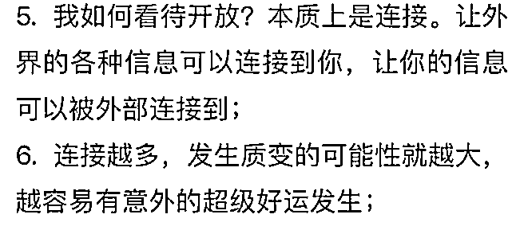

在老徐的星球里，我通过低成本的付费，尝试了各种小项目：

第一个是红包封面。这个主题在赚钱见过晓文老师的帖子，但当初不会做，也没资源。老徐这边把后端资源、玩法全都备好，还配了教练和群。很快我就上手了：开店、分销——不到一个礼拜，出了第一单。

第二个是爆文，虽然和宇翔那边重复了，但我想看看不同人的玩法，反正成本低。不过这个后来没做大——原因后边说。

接着还有📕引流、口播、闲鱼、朋友圈运营……

📕引流——大家都目标明确，只有我连定位都没想清楚，失败理所当然。

口播——简单了解了一下玩法，没想好说什么，定位没有、底气没有，又没开始。

闲鱼——上了几个商品，但没持续学习、没持续运营，加上爆文那摊子事抽不开身，就搁置了。主要是有曝光、没浏览，也不知道怎么回事。上架的是小项目海报和红包封面。

朋友圈运营——认真学习了一遍玩法，但不知道发什么内容，不想瞎发生活日常，没想明白，又没动手。

一个月之内，我尝试了6个项目：有了解玩法的，有失败的，也有跑通闭环的。当然，哪一个做深了都能赚钱，但对我来说，这段过程才是最有价值的。

我终于认清了自己的能力和兴趣，也看清了自己的短板。

而最最重要的是——我终于从0到0.1，做成了1！

这种跑通全流程的自信，足够支撑我去应对往后的任何一个项目。我现在知道做一个完整项目需要什么了：第一，玩法；第二，资源；第三，对标；第四，模仿。

到现在还记得：红包封面出第一个订单时、爆文流量主收到第一笔收入时，心里的那股激动劲儿。

这是我除了主业和兼职外，赚到的第一块钱。虽然就几块钱——搁我以前，一个设计单子就几千，这简直不值一提。但它可持续啊。把一份时间出卖给一个人，跟把一份时间出卖给无数人，完全不是一个概念。

通过这些试水，我更了解自己了。

我的优势在于：喜欢做📕。红包封面我就发在📕上——虽然这平台卷得厉害，群里很多人说不好出单，但我挑了几个封面发上去，立刻有点赞有评论，还引流了2个人到微信，成交了3单。哈哈。

我的短板在于：没有自己的核心项目。引流、口播、朋友圈、闲鱼，全都是渠道玩法——我没自己的产品，总觉得没根基、没安全感。虽然好多人靠分销赚得盆满钵满，但我不喜欢空手套白狼，我想有自己的事业。也许，这是多年做设计留下来的习惯吧。

还有学习能力上的不足：不善于搜索，不善于举一反三，不善于提问——这些事大佬的基本功，我一个都没有。

比如做👸号爆文那阵子，加了宇翔、前端队长、张老板几个大佬的微信，两个sop文档给我学，两个学习群伺候着——但依然没做出成绩。

爆文做了两个月，一直不爆，我私下跑去问张老板，还截图给他诊断。最后才发现：我把“热点文”的意思理解偏了。就这个认知偏差，让我在错误的方向上跑了两个月，每天投入3小时，颗粒无收。

眼看着后进的伙伴一个礼拜就出爆文、几百块轻松到手，我彻底服了——我需要有人教，太需要了。不仅仅是项目经验、思路、思维、想法，每一步都需要有人帮我纠偏。

而且，我已经不再年轻了。刚毕业那几年想付费都没找到门路，如今好不容易摸到了正确的圈子，我必须抓住机会！对我而言，时间比金子都金贵！

---

# 四、付费破圈：意外发现自己的强项

靠着前面这些小项目，我摸清了自己的弱点，也知道了自己需要补什么。我开始持续留意，看看有什么机会能链接到愿意拉我一把的人。

连接越多，质变的可能性就越大，也就越容易撞上意外的好运。

这一天，很快就来了。

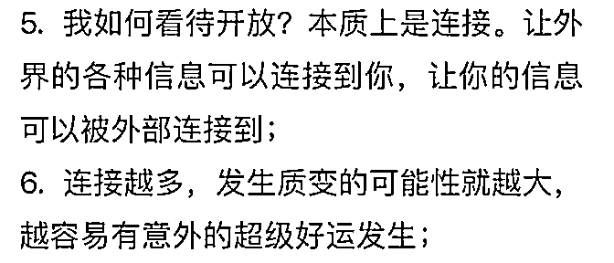

## 1、第二个贵人出现了

枫宇翔绝对是我今年遇上的第一个贵人（我定义的“贵人”是：他的建议能给我带来切切实实的帮助，而不是“免费”帮我）。

有一回，宇翔在爆文群里分享了一个叫做炮爷的小报童，名字有点唬人——叫《百万千万级项目操盘指南》。

说实在的，如果我光看这名字，是绝不会买的，我还没到那级别，这点自知之明还是有的。但宇翔用人格担保：大家一定要买这个小报童，一定要想办法加到炮爷微信。还放话：你们要是买了加不上，他出面去帮我们申请。

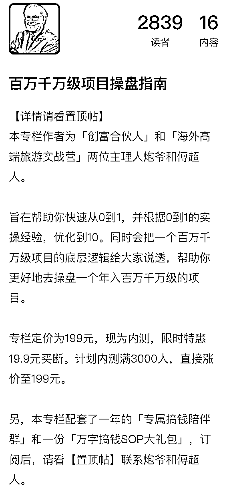

记得当时正在公司食堂打饭，心想：啥玩意儿啊？能让一个人这么卖力地推？炮爷？谁啊？没听过。这名字也起得太豪横了吧……（虽然我也翻了赚钱精华帖，但确实没怎么见过炮爷的名字。后来才知道炮爷是航海家——在那之前我只认识黄小刀，哈哈。可见小刀姐的出镜频率有多高。）

小报童买到手的第二天，恰好赶上了炮爷的直播，讲高端旅游赛道。巧的是，那时候赚钱的旅游航海也快开始了，我琢磨着正好听听这个领域有没有机会。

然后，第二位贵人出现了——赚钱小苗哥。

苗哥当时在帮炮爷做直播，详细讲了高端旅游这个赛道：是他们自己跑出来的项目，从头到尾都有手把手的详细教程——这正好解决了我“没有自己项目”的问题。

但他接下来说的，才是最戳我的。他说，他知道很多新人不是不想开始，也不是想放弃，是卡在问题没人解答——很多人往往连第一步都没完成就停在“注册账号”这一步了。他还说，很多宝妈根本没有太多时间，没人督促，不知道怎么搜索，也没人帮规划副业路径，做一个项目就是一个项目，做完就结束，而他们愿意陪小白从0到1……

还有很多很多，这只是其中几点。关键是——我感觉自己终于找到合适的组织了：一个更小的圈子、更高级的圈子、能一直陪我成长的圈子。

而且，傅超人这个人，他的一些赚钱精华帖在旅游赛道被很多圈友熟知，而他就是炮爷的创业合伙人。一个有实战经验、又有路径规划的合伙人，对“小白”来说简直是完美搭档。于是，我加入了他们。

事实证明，贴身式的指点，让我很快发现了自己的闪光点，行动力直接拉满。

再次引用龙哥的话：一个人的破圈，从花了自己之前不敢花的钱开始。

## 2、付费破圈之后，优势自动浮现

加入的当天，他们就让我写下目标和卡点，然后针对我的情况定制成长方案。当时苗哥说：“发圈。”超人说：“跑通高端游项目。”

我什么都没有多说，就是干！因为他们了解我，我通过前边的项目经历也了解了自己。

加入他们第二天，我就开始按他们的要求做内容输出——除了旅游项目，主要经营朋友圈。

为什么一定要输出？因为输出，才能让你和外部产生连接。那些实现了财富跃迁的人，无一不重视价值输出。只要持续输出，才能撞上超级好运。

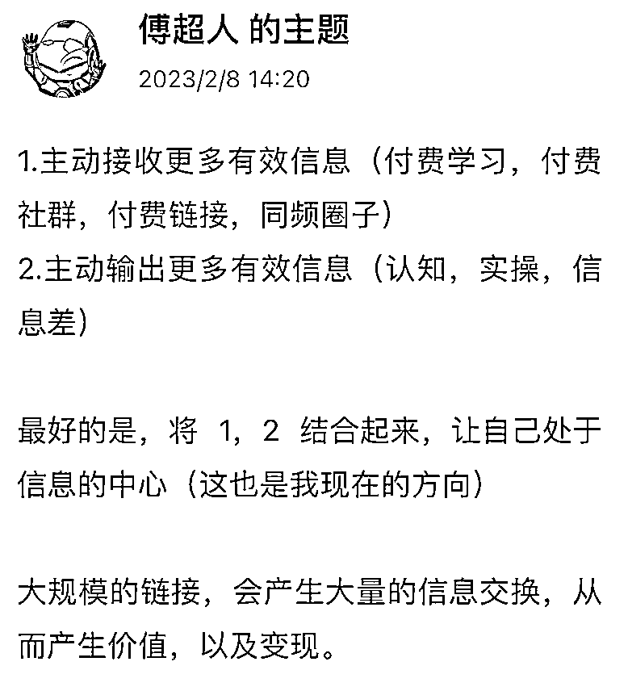

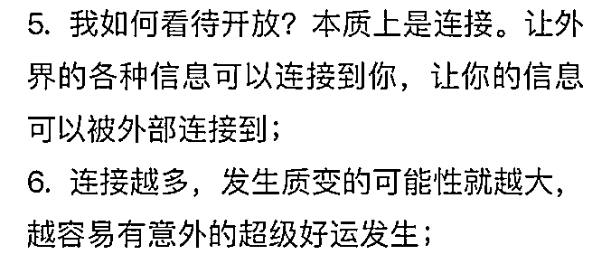

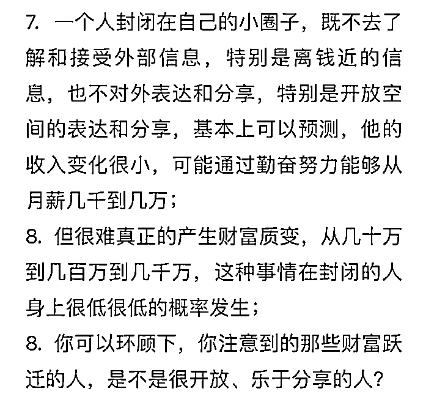

在他们的指点下，我迈出了第一步，当天就收获了陌生人的点赞。

给你们看看我第一次发的朋友圈。

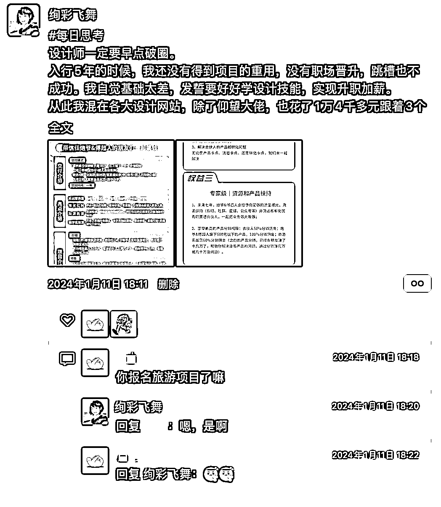

之所以有写作思路，除了炮爷和超人的指导，还要归功于之前那次“朋友圈小项目”的试水。

起初我只是旁观在学习，并没有真的动手发圈，但那段观察期让我把发圈的逻辑和套路都拆解清楚了，为后面真正开写攒足了底稿。

带我做爆文项目的张老板，就是我后来认识的领队，他的早间日记对我冲击很大。他习惯在群里、在公开渠道把自己的干货无偿分享出来，特别愿意拉新人一把。

顺带一提，我还用小报童去支持了小可爱老师。

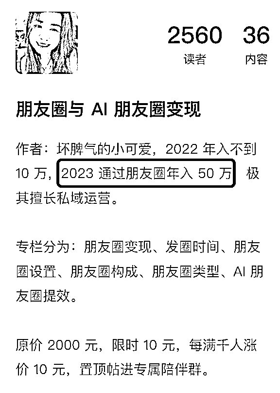

当然能遇到这些贵人，也离不开我自己主动走出去、主动去链接。人要靠自己先破圈。

花钱主动破圈，沉淀项目实操，弄明白自己的短板，快速跟大佬对齐。干就完了，好好听话执行！

这里又忍不住想说一句了，当链接规模做大时，信息在人群里高速流动，价值自然就出来了，最后就能变现。别把自己锁在舒适的小圈子里，害怕跟外界打交道。

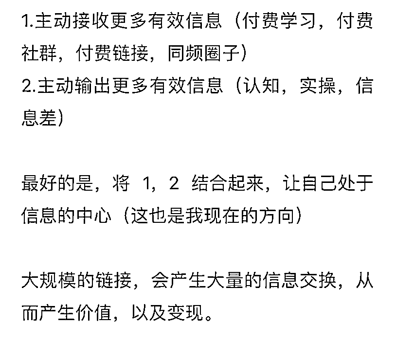

之前在赚钱认识一位朋友，具体名字记不清了。他说自己加入很久都不敢去跟大佬搭话，不敢主动链接，怕被晾着、怕丢面子。可我想说，大佬之所以是大佬，不就是一路不断破圈、不断输出、不断链接上来的吗？

那他们是怎么被大家记住的呢？

### 2.1 发圈这件事的上限到底在哪？

前面讲过，我通过不断复盘发现自己其实有点天赋在发圈上，也明白了发圈的本质就是在做价值交换。可说到底这事看起来很小，真值得投入吗？

小可爱老师靠发朋友圈一年到手50万。没错，就是朋友圈。她是怎么赚到的？她既主动去搜集信息，也主动去释放信息，让自己始终处于信息枢纽的位置。借着持续的价值交换，她的朋友圈价格越来越高。

那换成我们普通人呢？做个人IP呢？能不能把朋友圈做成一个高粘性的内容场？

把公域的流量沉淀到私域，让粉丝打开朋友圈就能获取衣食住行、课程分销等全套价值，就像快团团一样，有没有可能复制？

如果能做到，那你的粉丝值多少钱，你的朋友圈就值多少钱。

所以在我看来，这件事根本没有天花板。

它还能放大你的影响力。

更关键的是，它对新人极其友好，门槛真的低。

### 2.2 朋友圈被点亮，大佬开始注意到你

我发的圈到底触达了多少人，有没有产生效果？

先看结果吧，炮爷、超人他们都点了赞，还收到晓文哥的亲自点评，真的太意外了。原来大佬也会刷小白的朋友圈，大家还不赶紧冲？哈哈。

因为炮爷在群里点名表扬我，陆续有很多人加我关注我的朋友圈，还给我很多鼓励，我心里特别踏实开心。

还有不少很久没联系的老朋友也出来打招呼，说想跟我学发圈，这里就不一一放图了。

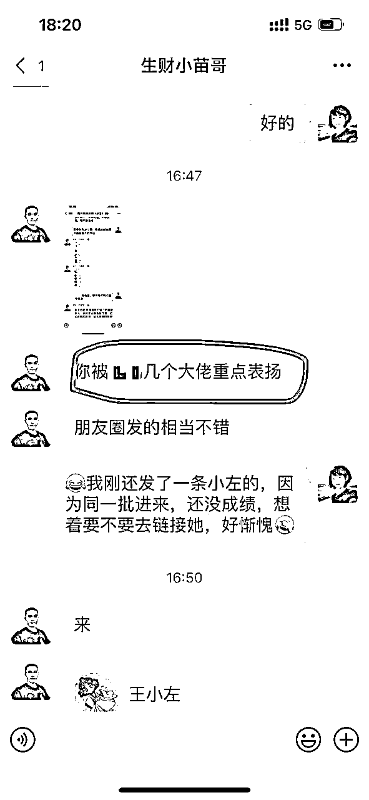

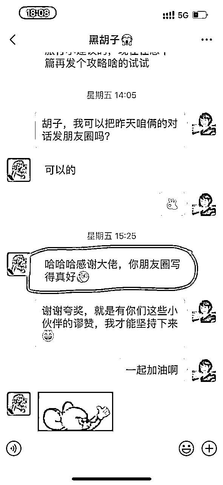

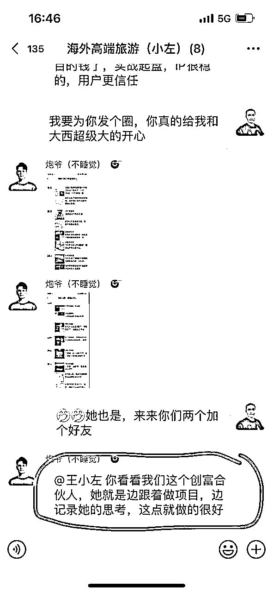

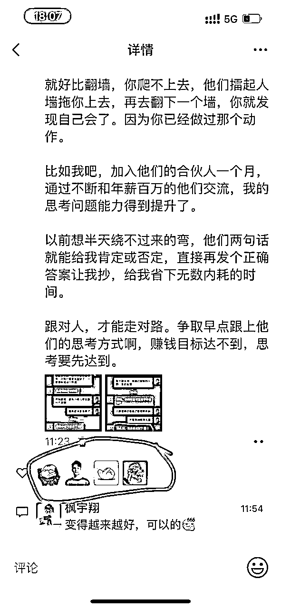

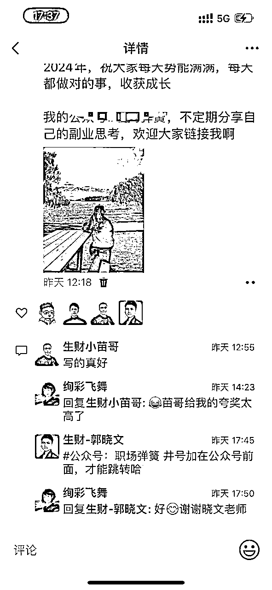

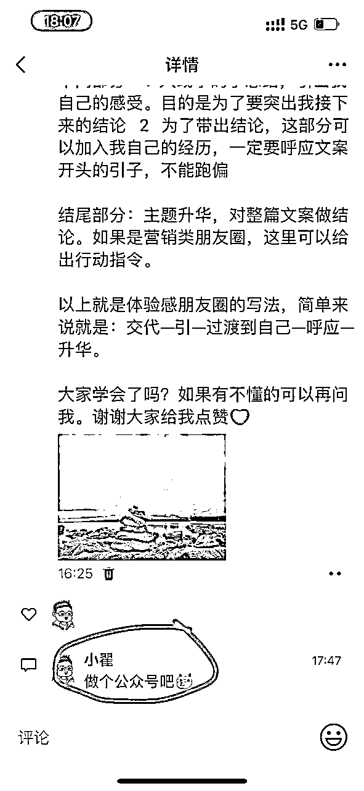

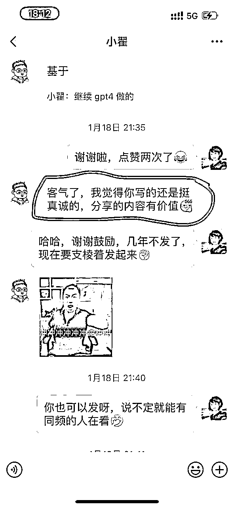

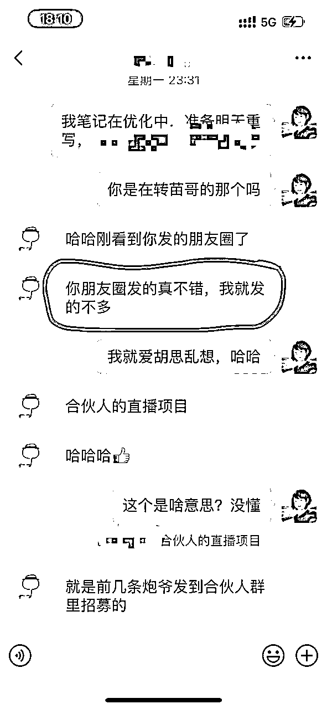

### 2.3 怎么判断哪个项目适合自己

大家都会写点东西，那我为什么认定自己适合深耕发圈呢？

我从这几个角度去确认的：

第一，和当下的目标是否一致。
我现在没有成绩、没有名气，就想先用朋友圈触达私域，把个人IP搭起来。

第二，我在这个事上投入的时间成本更低。
我写朋友圈的文案基本一次成型，很少反复打磨。别人可能要折腾一小时，我20分钟就能定稿。

第三，花费更少，产出更好。
我找选题很快，而且能保证读者看完有收获，感觉很接地气。

朋友圈运营其实是IP运营的核心环节之一，发圈发好了，从公域进来的粉丝粘性会一直保持，直到转化。靠谱老师芷蓝也反复强调过，并且她自己也在做。

希望大家赶紧重视起来，立刻行动。

最后十分感谢傅超人、苗哥、炮爷的耐心指导，感谢老徐团队各位领队的启发，也感谢枫宇翔、前端队长、小翟、张老板、巴尔扎壳、黑胡子等人的加油打气，特别感谢晓文哥对这个新人的鼓励，谢谢各位。

祝大家新年顺利，一切如愿。

# 五：给赚钱新人的忠告

谢谢你看到这里。我的起点很普通，家里人还一直反对，但我没有停下来，一直学习、一直破圈、一直提升自己，最终才锁定了高端游这个方向，加入了心仪的团队，也找到了最匹配我的内容方式——发圈。如果你还没开始，就把我当成一个可以对标的样本吧，加油！

给新人的几句实话：

1、一定要先动手试，哪怕项目最后只做到0到0.1，至少你能看清自己卡在哪儿。不做的话连问题都发现不了。

2、试过之后，挑一个自己能坚持下去、不容易厌倦的项目深耕。

3、及时复盘自己的弱项和长项，把短板在下一个项目里补上。可以通过链接大佬，也可以通过自己多投入时间精力。

4、什么时候该撤？
当你意识到这个项目真的不适合你，你也提不起兴趣去做的时候。每个项目都是认识自己的过程。

我当初为什么退出爆文，是因为爆文要持续写大众爱看的故事，不一定是你喜欢的，核心是赚钱。所以需要很强的选题挖掘和数据分析能力，这类事不适合感性侧重的我，所以果断放弃。

还有一点特别重要：

积极破圈，付费破圈。因为真正有价值的核心信息都藏在小圈子里，而且很少会外泄。另外，提升执行力，用正向的心态去做事。你既然花钱买了别人的经验，就别浪费，好好配合、去做、去试。

如果这篇分享对你有点用，给我点个赞吧，作为纯新手，在大佬扎堆的群里发这种文章真的需要很大的勇气。

我也想认识更多志同道合的朋友，欢迎来链接交流，爱你们❤️